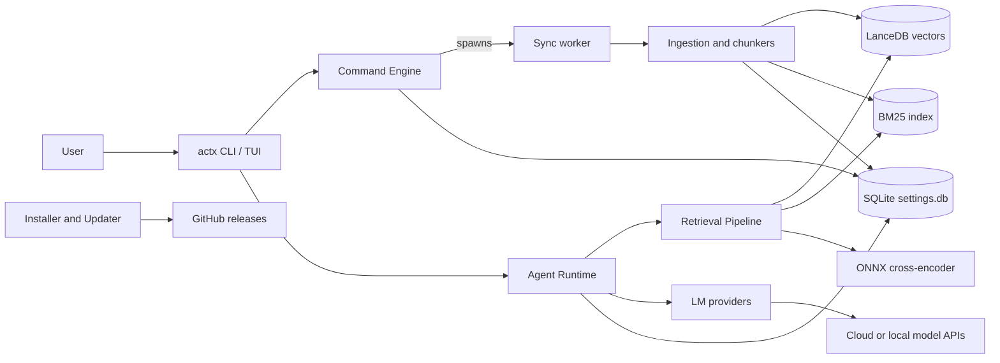

# AnyContext — Technical Documentation

Entry point to the architecture of AnyContext (`actx`). This index is maintained with the
`architecture-docs` skill: the sections between `architecture-docs` markers are
generated by `build_index.py`; the rest is written by hand. User documentation is in
[README.md](README.md); release history is in the GitHub releases of
`Levix-Digital/any-context-releases`.

## System Overview

AnyContext is a local-first contextual AI agent written in Rust. A user registers folders and web
sources in a **workspace**; AnyContext indexes them into a local vector database and a lexical
index, and answers questions grounded in those documents through a terminal interface or one-shot
CLI calls. Everything except the language model call runs on the user's machine.

The code is a Cargo workspace of six crates:

| Crate | Role |
|---|---|
| `crates/any-context-core-rs` | Core domain: ingestion and sync, chunkers, retrieval, storage, command engine, model catalog, hardware profiling, theme tokens. |
| `crates/actx-agent` | Agent runtime: routing, one-hop RAG, ReAct loop, Deep Search, tools, session memory. |
| `crates/actx-lm` | Language model providers (OpenAI-compatible, Anthropic, Gemini, mock). |
| `crates/actx-onnx` | Optional local inference on ONNX Runtime (cross-encoder re-ranker). |
| `crates/actx-cli` | The `actx` binary: CLI, terminal UI and agent assembly. |
| `crates/actx-installer` | Installer, updater and model provisioning. |

A question flows from the CLI or TUI to the agent. The agent routes it: fast questions get one
hybrid search (dense vectors, BM25, Reciprocal Rank Fusion and cross-encoder re-ranking) and a
single model call; complex questions go through Deep Search, which decomposes, searches in batches
and reflects before answering. Slash commands go to the UI-agnostic command engine, which changes
workspace settings in SQLite and starts background sync workers. State lives in two local stores:
LanceDB (chunks and embeddings, with the BM25 file next to it) and SQLite `settings.db`
(workspaces, sources, settings, sync telemetry and conversation memory).

## Subsystems

<!-- architecture-docs:subsystems:start -->
| Subsystem | Summary |
|---|---|
| [Agent Runtime](docs/architecture/agent.md) | Query routing, one-hop RAG, the ReAct loop, Deep Search, tools, system prompt and conversation memory. |
| [CI and Release](docs/architecture/ci-release.md) | GitHub Actions workflows that test the workspace and build and publish release packages. |
| [Command Engine](docs/architecture/commands.md) | UI-agnostic slash command engine shared by the CLI and the TUI. |
| [Command-Line Interface](docs/architecture/cli.md) | The actx binary with argument parsing, one-shot questions, the background sync worker and agent assembly. |
| [Document Chunkers](docs/architecture/chunkers.md) | Turns each supported file type into chunks with line provenance and a content type. |
| [Ingestion and Sync](docs/architecture/ingestion.md) | Scans workspace folders and web sources, chunks changed content, filters noise and writes chunks to LanceDB and BM25. |
| [Installer and Updater](docs/architecture/installer.md) | Installs, updates and uninstalls actx from the releases repository, with atomic binary swap and model provisioning. |
| [Language Model Providers](docs/architecture/lm-providers.md) | Provider-neutral chat, streaming and embedding API over OpenAI-compatible, Anthropic, Gemini, Gemma and mock backends. |
| [Model Catalog and Hardware Profiling](docs/architecture/model-catalog.md) | Catalog and downloader of local ONNX models, hardware probing and installation profiles. |
| [ONNX Inference](docs/architecture/onnx.md) | Optional local neural inference with the cross-encoder re-ranker on ONNX Runtime, plus heuristic perception components. |
| [Retrieval Pipeline](docs/architecture/retrieval.md) | Finds the chunks that answer a question with dense and BM25 search, RRF fusion, cross-encoder re-ranking and context formatting. |
| [Storage and Encryption](docs/architecture/storage.md) | LanceDB vector store, SQLite settings and session database, path healing and encryption at rest. |
| [Terminal UI](docs/architecture/tui.md) | Full-screen Ratatui interface with chat, header and footer telemetry, menus, onboarding and the Aurora theme. |
<!-- architecture-docs:subsystems:end -->

## Architecture Decision Records

Decisions made before ADR-0075 were not recorded as ADRs in the original technical document, and
ADR-0111 was never written.

<!-- architecture-docs:adrs:start -->
| ADR | Title | Status | Version | Date |
|---|---|---|---|---|
| [ADR-0136](docs/adr/0136-neutralizing-reserved-prompt-tags-in-retrieved-text.md) | Neutralizing reserved prompt tags in retrieved text | accepted | v0.45.1 | 2026-10-17 |
| [ADR-0134](docs/adr/0134-release-candidates-and-tagging-on-merge-into-main.md) | Release candidates and tagging on merge into main | accepted |  | 2026-10-16 |
| [ADR-0133](docs/adr/0133-offline-and-privacy-presets-require-a-working-local-model.md) | Offline and privacy presets require a working local model | accepted |  | 2026-10-16 |
| [ADR-0132](docs/adr/0132-query-vectors-use-the-ingestion-embedding-provider-and-model.md) | Query vectors use the ingestion embedding provider and model | accepted |  | 2026-10-16 |
| [ADR-0131](docs/adr/0131-field-level-encryption-on-every-lancedb-write.md) | Field-level encryption on every LanceDB write | accepted |  | 2026-10-16 |
| [ADR-0130](docs/adr/0130-real-onnx-runtime-multilingual-cross-encoder.md) | Real ONNX Runtime (ort load-dynamic), Multilingual mmarco Cross-Encoder and Rectification of ADRs 118/123/125/127/129 | accepted | v0.45.0 | 2026-10-15 |
| [ADR-0129](docs/adr/0129-two-stage-retrieval-cross-encoder-reranking.md) | Two-Stage Neural Retrieval with Local ONNX Cross-Encoder Re-Ranking, Hardware Acceleration and Graceful ADR-110 Fallback | accepted | v0.44.0 | 2026-10-15 |
| [ADR-0128](docs/adr/0128-backend-first-deterministic-dual-rag.md) | Dual RAG Architecture with Backend-First Deterministic Retrieval, U-Shaped Reordering and XML Structural Isolation | accepted | v0.43.0 | 2026-10-15 |
| [ADR-0127](docs/adr/0127-cross-platform-hardware-acceleration-matrix.md) | Tri-Platform Hardware Acceleration Matrix in actx-onnx with DirectML, Metal, CUDA, Vulkan and Graceful CPU SIMD Fallback | accepted | v0.42.0 | 2026-10-15 |
| [ADR-0126](docs/adr/0126-assisted-gemma-weights-downloader.md) | Assisted Gemma 4 ONNX Weights Downloader in the CLI and TUI with Pre-Flight Checks and Real-Time Telemetry | accepted | v0.41.0 | 2026-10-15 |
| [ADR-0125](docs/adr/0125-local-gemma-activation-hardware-guardrails.md) | Operational Activation of Local Gemma 4 ONNX in the CLI Engine, LM Studio-Style Hardware Guardrails and Safe Workspace Presets | accepted | v0.40.0 | 2026-10-14 |
| [ADR-0124](docs/adr/0124-jina-reader-web-ingestion-seven-domains.md) | Web Ingestion with Jina Reader, Pure Grounded RAG and Seven Semantic Domain Matrix | accepted | v0.39.0 | 2026-10-14 |
| [ADR-0123](docs/adr/0123-onnx-production-activation-gemma-4-tiers.md) | Activation of ONNX Models in Production Flows and Gemma 4 Family Support with Five Hardware Tiers | accepted | v0.38.0 | 2026-10-14 |
| [ADR-0122](docs/adr/0122-ci-fast-path-timing-resilience.md) | CI Fast-Path Timing Resilience and SQLite Warmup under Virtualized Runners | accepted |  | 2026-10-14 |
| [ADR-0121](docs/adr/0121-modular-onnx-crate-hardware-profiles.md) | Modular ONNX Crate (actx-onnx), Hardware Pre-Flight Check and Semaphore-Tiered Installation Profiles | accepted | v0.37.0 | 2026-10-13 |
| [ADR-0120](docs/adr/0120-source-display-names-shared-sources-removal.md) | Intelligent Source Naming, Decoupled SQLite Alias, Shared Sources Deprecation and Canonical System Knowledge Manual | accepted | v0.36.0 | 2026-10-10 |
| [ADR-0119](docs/adr/0119-english-interface-spinner-release-notes.md) | Global English Internationalization, Point-by-Point Braille Spinner, Default Collapsed Reasoning Accordion and Standardized Release Notes | accepted | v0.35.0 | 2026-10-10 |
| [ADR-0118](docs/adr/0118-verified-single-file-onnx-model-catalog.md) | Canonical Catalog of Verified Standalone ONNX Models and HTTP Resilience | accepted | v0.34.10 | 2026-10-10 |
| [ADR-0117](docs/adr/0117-aurora-palette-borderless-canvas-onboarding.md) | Aurora Borealis Color Harmonization, Borderless Canvas, ReAct Auto-Scroll, Friendly Update Messages, Graceful Download Cancellation and Neutral Onboarding Wizard | accepted | v0.34.9 | 2026-10-10 |
| [ADR-0116](docs/adr/0116-path-healing-temporal-metadata-change-detection.md) | Smart Path Healing, Restored Temporal Metadata Rules (Freshness Cascade and HTTP 304) and Active Source Change Detection | accepted | v0.34.8 | 2026-10-10 |
| [ADR-0115](docs/adr/0115-onnx-weights-repository-fallbacks.md) | Native ONNX Weights Repository, Resilient Fallbacks, Search Mode Header Indicator and Human Conversational Tone | accepted | v0.34.7 | 2026-10-10 |
| [ADR-0114](docs/adr/0114-aurora-design-tokens-startup-fast-path.md) | Modular Aurora Borealis Design Tokens and Hybrid Startup Fast-Path (Option C) | accepted | v0.34.6 | 2026-10-10 |
| [ADR-0113](docs/adr/0113-tabular-chunker-markdown-table-preservation.md) | Removal of Heuristic Inversion in the Tabular Chunker and Unconditional Preservation of 2D Markdown Formats | accepted | v0.34.5 | 2026-10-10 |
| [ADR-0112](docs/adr/0112-ux-stabilization-deep-search-multiline-prompt.md) | UX Stabilization, Deep Search Language Parity, Multi-Line Prompt and Transparent Self-Knowledge | accepted | v0.34.4 | 2026-10-10 |
| [ADR-0110](docs/adr/0110-ingestion-model-router-quality-gate.md) | Ingestion ModelRouter, Deterministic Quality Gate and Spatial Form Reconstruction (RFC-043) | accepted | v0.34.2 | 2026-10-10 |
| [ADR-0109](docs/adr/0109-ci-sccache-release-profile.md) | CI/CD Acceleration with Sccache and Release Profile Optimizations | accepted | v0.34.1 | 2026-10-09 |
| [ADR-0108](docs/adr/0108-reflective-deep-search-engine.md) | Reflective Agentic Deep Search Engine and Adaptive Routing (RFC-042) | accepted | v0.34.0 | 2026-10-09 |
| [ADR-0107](docs/adr/0107-orphan-cleanup-legacy-updater-compatibility.md) | Removal of Orphaned Files and Unified Release Assets for Legacy Updaters | accepted | v0.33.1 | 2026-10-09 |
| [ADR-0106](docs/adr/0106-full-rust-parity-python-purge.md) | Full Ingestion and Retrieval Parity in Rust and Purge of Legacy Python Code | accepted | v0.33.0 | 2026-10-09 |
| [ADR-0105](docs/adr/0105-native-rust-ingestion-sync-pipeline.md) | Full Native Rust Ingestion and Sync Pipeline (Deprecation of Python Worker Runtimes) | accepted | v0.32.19 | 2026-10-08 |
| [ADR-0104](docs/adr/0104-unified-release-compilation-fast-packaging.md) | CI/CD Release Pipeline Optimization via Unified Workspace Compilation and Fast Multi-Threaded Packaging | accepted |  | 2026-10-08 |
| [ADR-0103](docs/adr/0103-windows-multi-binary-self-update.md) | Robust Multi-Binary Windows Self-Updating, Target Version Delimiters and Sync Indicator Parity | accepted | v0.32.18 | 2026-10-08 |
| [ADR-0102](docs/adr/0102-scoped-folder-ingestion-utf8-boundaries.md) | Scoped Directory Ingestion and Multi-Byte UTF-8 Boundary Clamping | accepted | v0.32.17 | 2026-10-08 |
| [ADR-0101](docs/adr/0101-shadowed-binary-sync-user-path.md) | Shadowed Binary Synchronization, User PATH Prioritization and Clean Telemetry | accepted |  | 2026-10-08 |
| [ADR-0100](docs/adr/0100-native-encryption-sync-cancel-tui-isolation.md) | Native Encryption-at-Rest Interoperability, Background Worker Cancellation and TUI Screen Isolation | accepted | v0.32.16 | 2026-10-08 |
| [ADR-0099](docs/adr/0099-core-command-parity-worker-auto-spawn.md) | Full Core Command Parity, Worker Auto-Spawning and Hexagonal Command Engine Alignment | accepted | v0.32.15 | 2026-10-06 |
| [ADR-0098](docs/adr/0098-lancestore-count-records-parameter-fix.md) | Parameter Order Inversion Resolution in Native LanceStore (count_records) and Live Telemetry Unfreezing | accepted | v0.32.15 | 2026-10-06 |
| [ADR-0097](docs/adr/0097-sqlite-sync-telemetry-agent-background-awareness.md) | Canonical SQLite Sync Telemetry, Live TUI Footer Progress Bar and Native Agent Background Awareness | accepted | v0.32.14 | 2026-10-06 |
| [ADR-0096](docs/adr/0096-bounded-bm25-deserialization-self-healing-index.md) | Bounded BM25 Deserialization, Atomic Temp-Rename and Self-Healing Index Recovery | accepted | v0.32.14 | 2026-10-06 |
| [ADR-0095](docs/adr/0095-clean-screen-buffer-long-term-memory-decoupling.md) | Clean Screen Buffer Initialization, Long-Term Memory Decoupling and Virtual Tab Lifecycle | accepted | v0.32.13 | 2026-10-06 |
| [ADR-0094](docs/adr/0094-test-sandbox-option-hinting-global-self-knowledge.md) | Test Isolation Sandbox, Universal Contextual Option Hinting and Skill-Based Self-Knowledge via Global LanceDB Workspace | accepted | v0.32.12 | 2026-10-06 |
| [ADR-0093](docs/adr/0093-sync-worker-stdio-isolation-chain-of-responsibility.md) | Sync Worker Background Stdio Isolation and Chain of Responsibility Ingestion Engine | accepted | v0.32.11 | 2026-10-04 |
| [ADR-0092](docs/adr/0092-virtual-tab-chat-buffer-isolation.md) | Virtual Tab Workspace Chat Buffer Isolation and Viewport Lifecycle | accepted | v0.32.10 | 2026-10-04 |
| [ADR-0091](docs/adr/0091-hermetic-workspace-isolation-atomic-exe-swap.md) | Hermetic Workspace Isolation, Windows Atomic Executable Swap and Production Installer Canonicalization | accepted | v0.32.9 | 2026-10-02 |
| [ADR-0090](docs/adr/0090-grounding-parity-streaming-single-lancedb-path.md) | Grounding Parity, Real-Time Token Streaming and Single Canonical LanceDB Path | accepted | v0.32.7 | 2026-10-02 |
| [ADR-0089](docs/adr/0089-tui-error-surfacing-search-depth-concealment.md) | TUI Error Surfacing Guarantee and Temporary Search Depth UI Concealment | accepted | v0.32.6 | 2026-10-02 |
| [ADR-0088](docs/adr/0088-conversational-session-boundary.md) | High-Level Conversational Session Boundary and Orphaned Tool Scrubbing | accepted | v0.32.6 | 2026-10-02 |
| [ADR-0087](docs/adr/0087-openai-tool-call-protocol-alignment.md) | OpenAI Function Tool Call Protocol Alignment | accepted | v0.32.5 | 2026-10-02 |
| [ADR-0086](docs/adr/0086-non-blocking-lancedb-safe-runtime-drop.md) | Scoped Non-Blocking LanceDB Invocation and Safe Runtime Destruction | accepted | v0.32.5 | 2026-10-02 |
| [ADR-0085](docs/adr/0085-grounding-vs-search-depth-decoupling.md) | Grounding Strategy vs Search Depth Mode Decoupling and Quint-Status Header | accepted | v0.32.4 | 2026-10-02 |
| [ADR-0084](docs/adr/0084-ui-agnostic-command-engine.md) | Universal UI-Agnostic Command Engine (Hexagonal Architecture) | accepted | v0.32.4 | 2026-10-02 |
| [ADR-0083](docs/adr/0083-dedicated-releases-repository-semver-updater.md) | Dedicated Releases Repository and Semver Updater | accepted | v0.32.3 | 2026-10-02 |
| [ADR-0082](docs/adr/0082-sqlite-session-memory-identity-injection.md) | SQLite Session Memory and Canonical Identity Injection | accepted | v0.32.3 | 2026-10-02 |
| [ADR-0081](docs/adr/0081-tui-header-status-telemetry.md) | TUI Top Header Quad-Status Telemetry | accepted | v0.32.3 | 2026-10-02 |
| [ADR-0080](docs/adr/0080-workspace-isolated-prompt-history.md) | Workspace-Isolated Prompt History Navigation | accepted | v0.32.3 | 2026-10-02 |
| [ADR-0079](docs/adr/0079-utf8-safe-input-auto-scroll.md) | Multi-Byte UTF-8 Character Boundary Safety, Visual Cursor Alignment and Universal Release Protocol | accepted | v0.32.2 | 2026-09-26 |
| [ADR-0078](docs/adr/0078-relational-workspace-folders.md) | Normalized Relational Folder Storage and Legacy Schema Elimination | accepted | v0.32.0 | 2026-09-26 |
| [ADR-0077](docs/adr/0077-native-ratatui-cli-tui.md) | Native Rust CLI and Full-Screen Interactive TUI (actx-cli with Ratatui) | accepted | v0.31.0 | 2026-09-25 |
| [ADR-0076](docs/adr/0076-native-hybrid-rag-pipeline.md) | Native Rust Hybrid RAG Pipeline and RFC-042 Batch Retrieval Engine | accepted | v0.30.39 | 2026-09-25 |
| [ADR-0075](docs/adr/0075-native-rust-agent-fsm.md) | Native Rust ReAct Agent with an Explicit FSM (actx-agent) | accepted | v0.30.38 | 2026-09-25 |
<!-- architecture-docs:adrs:end -->

## How to Update This Documentation

- **A subsystem changed** (behavior, structure, data): edit its page in `docs/architecture/` in place, replacing outdated text.
- **A decision with alternatives and trade-offs**: create an ADR with `new_adr.py` and link it from the subsystem page.
- **A decision that reverses or corrects another**: create a new ADR with `--supersedes` or `--amends`; never rewrite an accepted ADR.
- **A feature was removed**: remove it from the subsystem page; its ADRs stay as history.
- **A release**: nothing here; release notes live in the GitHub releases.
- Run `check_docs.py` before committing.
