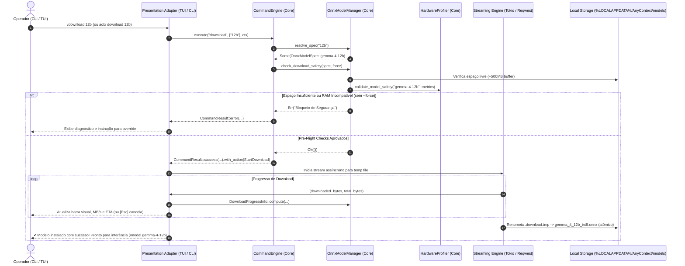

# ADR-0126: Downloader Assistido de Pesos Gemma 4 ONNX no CLI e TUI com Pre-Flight Checks e Telemetria em Tempo Real

- **Status**: Implemented & Verified
- **Date**: 2026-10-15
- **Context**:
  1. Com a ativação operacional do Gemma 4 ONNX no CLI (`v0.40.0`), os usuários necessitavam de um mecanismo assistido, visual e resiliente para baixar e instalar localmente os pesos dos 4 tiers (`gemma-4-compact`, `gemma-4-12b`, `gemma-4-27b`, `gemma-4-32b`).
  2. Arquivos de modelos de linguagem pesam de ~1.85 GB a mais de 20 GB. Iniciar downloads sem pre-flight checks pode resultar em falhas catastróficas por falta de espaço em disco ou congelamento de terminal por estouro de memória física (*swap thrashing* e OOM).
  3. A arquitetura hexagonal (Ports & Adapters) impõe separação estrita de responsabilidades: zero regras de negócio nas UIs de apresentação. Toda a catalogação, resolução de aliases, profilagem de segurança em camadas e métricas de velocidade/ETA devem ser calculadas no Core (`any-context-core-rs`).
- **Decisão**:
  1. **Expansão do Catálogo Canônico e Model Manager no Core (`crates/any-context-core-rs/src/ingestion/model_manager.rs`)**:
     - Adição de `OnnxModelCategory::LanguageModel`.
     - Inclusão dos 4 tiers Gemma 4 no `ONNX_CATALOG` com URLs oficiais de release da Hugging Face, nomes de arquivos quantizados e tamanhos nominais.
     - Implementação de `resolve_spec(query)` suportando aliases canônicos (`compact`, `12b`, `27b`, `32b`).
     - Implementação de `check_download_safety(spec, force)`: pre-flight checks em camadas verificando espaço livre em disco no drive de destino com buffer de segurança de 500MB, e profilagem de RAM física com guardrails estilo LM Studio.
     - Implementação de `DownloadProgressInfo::compute(downloaded, total, elapsed)` com cálculo de velocidade em MB/s e estimativa de tempo restante (ETA).
  2. **Comando Headless no CLI (`crates/actx-cli/src/cli/oneshot.rs`)**:
     - Subcomando `actx download [tier] [--force] [--check]` com barra de progresso gráfica visual no stdout, MB/s, ETA e cancelamento gracioso via Ctrl+C.
  3. **Integração Hexagonal no CommandEngine e TUI (`crates/any-context-core-rs/src/commands/engine.rs` e `crates/actx-cli/src/tui/app.rs`)**:
     - Adição da ação de domínio `CommandAction::StartDownload(String)` no Core.
     - Roteamento de `/download`, `/dl` e `/get-model` no `CommandEngine`, emitindo vereditos e solicitando à UI o início do download apenas após aprovação nos pre-flight checks.
     - `app.rs` recebe a ação e dispara tarefa assíncrona Tokio com telemetria contínua via canais `watch` e `mpsc`.
     - Rodapé da TUI renderiza telemetria completa com MB/s e ETA.
     - Menu de modelos `[F1]` dispara o download com pre-flight checks automáticos ao teclar `[Enter]` em modelo não instalado.
- **Diagrama de Sequência (Download com Pre-Flight Checks e Telemetria)**:

- **Consequências**:
  - Resolução completa e assistida de modelos locais sem necessidade de scripts externos ou downloads manuais arriscados.
  - Conformidade estrita com arquitetura hexagonal e isolamento de responsabilidades.
  - Paridade total entre superfícies CLI headless, Chat TUI e Menu TUI.
