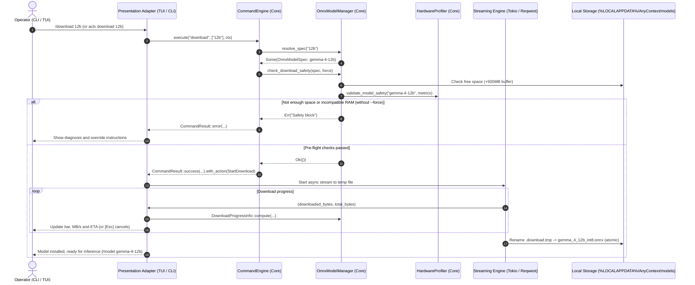

# ADR-0126: Assisted Gemma 4 ONNX Weights Downloader in the CLI and TUI with Pre-Flight Checks and Real-Time Telemetry

## Context

1. With Gemma 4 ONNX activated in the CLI (`v0.40.0`), users needed an assisted, visual and resilient way to download and install the weights of the four tiers (`gemma-4-compact`, `gemma-4-12b`, `gemma-4-27b`, `gemma-4-32b`).
2. Language model files range from about 1.85 GB to more than 20 GB. Starting downloads without pre-flight checks can fail catastrophically for lack of disk space, or freeze the terminal through physical memory exhaustion (swap thrashing and out-of-memory).
3. The hexagonal architecture (ports and adapters) requires a strict separation of responsibilities: no business rules in presentation UIs. Cataloging, alias resolution, layered safety profiling and speed/ETA metrics must be computed in the core (`any-context-core-rs`).

## Decision

1. **Canonical catalog and model manager extended in the core (`crates/any-context-core-rs/src/ingestion/model_manager.rs`)**:
   - Add `OnnxModelCategory::LanguageModel`.
   - Add the four Gemma 4 tiers to `ONNX_CATALOG` with official Hugging Face release URLs, quantized file names and nominal sizes.
   - Implement `resolve_spec(query)` with canonical aliases (`compact`, `12b`, `27b`, `32b`).
   - Implement `check_download_safety(spec, force)`: layered pre-flight checks of free disk space on the target drive with a 500 MB safety buffer, plus physical RAM profiling with LM Studio-style guardrails.
   - Implement `DownloadProgressInfo::compute(downloaded, total, elapsed)` with speed in MB/s and estimated time remaining (ETA).
2. **Headless CLI command (`crates/actx-cli/src/cli/oneshot.rs`)**: `actx download [tier] [--force] [--check]`, with a graphical progress bar on stdout, MB/s, ETA and graceful cancellation with Ctrl+C.
3. **Hexagonal integration in the CommandEngine and TUI (`crates/any-context-core-rs/src/commands/engine.rs` and `crates/actx-cli/src/tui/app.rs`)**:
   - Add the domain action `CommandAction::StartDownload(String)` in the core.
   - Route `/download`, `/dl` and `/get-model` in the `CommandEngine`, which reports the verdict and asks the UI to start the download only after the pre-flight checks pass.
   - `app.rs` receives the action and starts an async Tokio task with continuous telemetry over `watch` and `mpsc` channels.
   - The TUI footer shows full telemetry with MB/s and ETA.
   - In the `[F1]` model menu, pressing `[Enter]` on a model that is not installed starts the download with automatic pre-flight checks.

Sequence of a download with pre-flight checks and telemetry:

## Alternatives Considered

Not recorded.

## Consequences

- Local models are installed with assistance, without external scripts or risky manual downloads.
- Strict compliance with the hexagonal architecture and separation of responsibilities.
- Full parity between the headless CLI, the TUI chat and the TUI menu.
