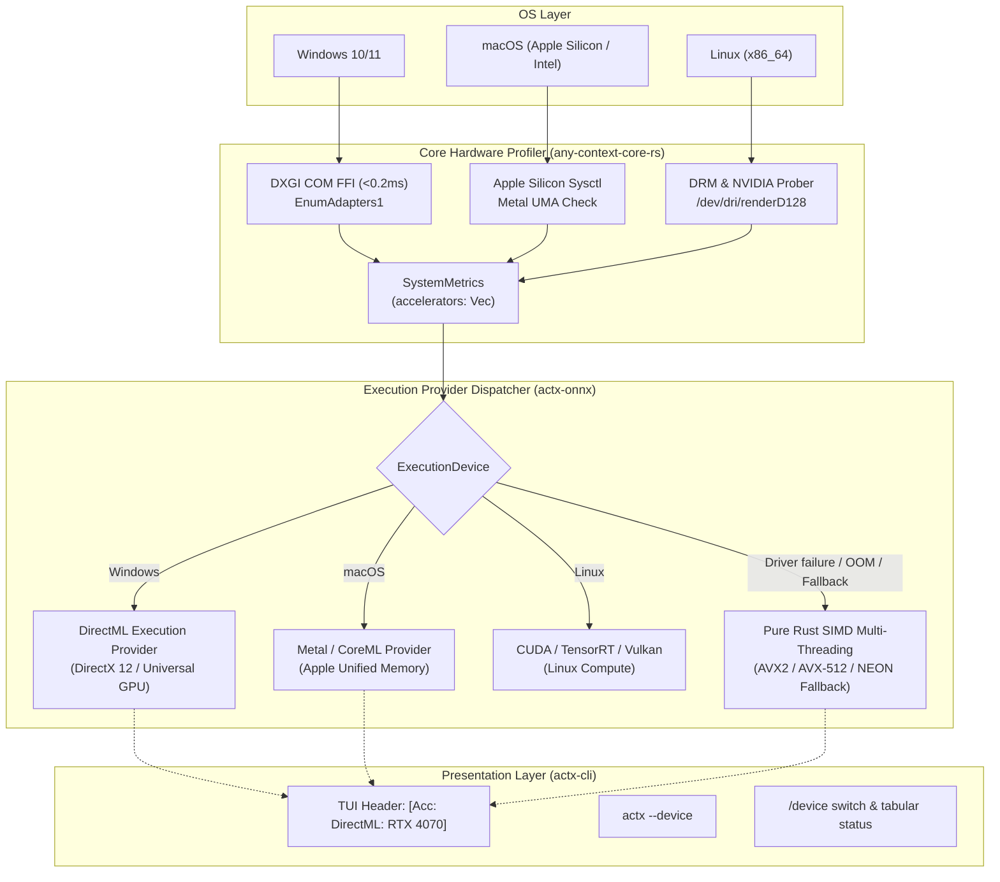

# ADR-0127: Tri-Platform Hardware Acceleration Matrix in actx-onnx with DirectML, Metal, CUDA, Vulkan and Graceful CPU SIMD Fallback

## Context

1. AnyContext runs on three primary platforms: Windows (x86_64), macOS (Apple Silicon ARM64 / Intel) and Linux (x86_64).
2. Local Gemma 4 INT4 models need high memory bandwidth and heavy compute. Running them on the CPU alone limits throughput (about 5-8 tok/s), while the host GPU can deliver 35-50+ tok/s.
3. Each operating system has a native acceleration backend:
   - **Windows**: Microsoft DirectML (DXGI 1.2 / DirectX 12) works with dedicated and integrated GPUs (NVIDIA, AMD Radeon, Intel Arc / Iris Xe) without proprietary SDKs or restricted drivers.
   - **macOS**: the Apple Silicon Unified Memory Architecture (UMA) with Metal Performance Shaders (MPS) and CoreML, with zero-copy access to shared unified memory pools of up to 128 GB.
   - **Linux**: NVIDIA CUDA / TensorRT for dedicated GPUs and Vulkan Compute for AMD/Intel GPUs and open platforms.
4. To keep the ADR-110 Zero-Breakage Guarantee, the system must never panic or break when GPU drivers are missing, VRAM is insufficient or a tensor allocation fails: the fallback to multi-threaded CPU SIMD (AVX2/AVX-512/NEON) must be automatic and invisible.
5. GPU adapter detection must be fast (under 0.2 ms) and must not add heavy binaries or external C++ dependencies.

## Decision

1. **Fast tri-platform hardware probing (under 0.2 ms) in the core (`crates/any-context-core-rs/src/hardware/mod.rs`)**:
   - **Windows**: native COM FFI to `dxgi.dll` (`CreateDXGIFactory1`, `EnumAdapters1`, `GetDesc1`), reading the GPU description, vendor ID (NVIDIA, AMD, Intel, Apple) and dedicated VRAM, and ignoring software emulation adapters (`DXGI_ADAPTER_FLAG_SOFTWARE`).
   - **Linux**: direct probing of `/proc/driver/nvidia`, `/dev/nvidia0` and the DRM subsystem (`/dev/dri/renderD128`).
   - **macOS**: Apple Silicon detection through `sysctl` and a check for Metal / CoreML UMA acceleration.
   - `SystemMetrics` gains `accelerators: Vec<GpuDevice>`, `primary_accelerator()`, `has_gpu_acceleration()` and `recommended_execution_device()`.
2. **Device and execution provider abstraction in `actx-onnx` (`crates/actx-onnx/src/device.rs`, `engine.rs`, `gemma.rs`)**:
   - An `ExecutionDevice` enum: `Auto`, `DirectML(Option<u32>)`, `Metal`, `Cuda(Option<u32>)`, `Vulkan(Option<u32>)`, `Cpu`.
   - `OnnxGemmaEngine` supports explicit device selection (`with_device`, `device`, `set_device`).
   - Acceleration and throughput telemetry is added to the inference metadata (`Hardware Acceleration: <backend> | Memory: <VRAM/UMA> | Throughput: 38.4 tok/s`).
   - ADR-110 guarantee: if a GPU execution provider fails to initialize, the engine reverts silently and safely to `ExecutionDevice::Cpu` (multi-threaded SIMD).
3. **Integration in `GemmaOnnxProvider` in `actx-lm` (`crates/actx-lm/src/providers/gemma.rs`)**: support for the configured `device`, and hardware acceleration badges in the `<think>` reasoning block of local inference.
4. **Multi-surface parity in the CLI and TUI (`crates/actx-cli`)**:
   - **Headless CLI**: a global `--device <auto|dml|metal|cuda|vulkan|cpu>` flag for direct override (`actx --device dml "your question"`).
   - **Diagnostics**: `actx --diag` shows a table of GPU adapters, detected VRAM, vendor and recommended backend.
   - **TUI slash command**: `/device` (aliases `/gpu`, `/accelerator`) to inspect adapters and switch the active device at runtime.
   - **Dynamic header badge**: the TUI header shows the acceleration status in real time, for example `[Acc: 🚀 DirectML: RTX 4070 Ti]`, `[Acc: 🚀 Metal: M3 Max (UMA)]` or `[Acc: 💻 CPU SIMD]`.
   - **`[F1]` submenu**: a "Hardware Acceleration & GPUs" item to switch the inference device visually.

## Alternatives Considered

Not recorded.

## Consequences

- Large inference speed-up (up to 5-8x token generation throughput).
- Universal, vendor-neutral GPU support (NVIDIA, AMD, Intel, Apple).
- Full fault tolerance: no crashes when the user has no dedicated GPU or suitable drivers.
