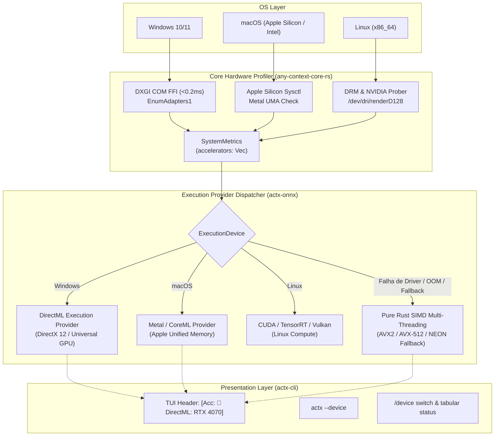

# ADR-0127: Matriz Tri-Cross-Platform de Aceleração por Hardware no actx-onnx com DirectML, Metal, CUDA, Vulkan e Fallback Gracioso CPU SIMD

- **Status**: Implemented & Verified
- **Date**: 2026-10-15
- **Context**:
  1. O AnyContext opera como aplicação global em três plataformas primárias: Windows (x86_64), macOS (Apple Silicon ARM64 / Intel) e Linux (x86_64).
  2. Modelos neurais locais da família Gemma 4 INT4 exigem alta largura de banda de memória e poder computacional massivo. Executá-los unicamente na CPU resulta em gargalos de throughput (~5-8 tok/s), enquanto a GPU hospedeira é capaz de entregar 35-50+ tok/s.
  3. Cada sistema operacional possui um backend nativo de aceleração:
     - **Windows**: Microsoft DirectML (DXGI 1.2 / DirectX 12) oferece compatibilidade universal de hardware para GPUs dedicadas e integradas (NVIDIA, AMD Radeon, Intel Arc / Iris Xe) sem exigir SDKs proprietários ou drivers restritos.
     - **macOS**: Apple Silicon Unified Memory Architecture (UMA) com Metal Performance Shaders (MPS) e CoreML, acessando zero-copy pools de memória unificada compartilhada de até 128GB.
     - **Linux**: NVIDIA CUDA / TensorRT para ambientes com GPU dedicada e Vulkan Compute para GPUs AMD/Intel e plataformas abertas.
  4. Para preservar a garantia inviolável ADR-110 (*Zero-Breakage Guarantee*), o sistema jamais pode falhar com panic ou quebrar a experiência do usuário caso os drivers da GPU não estejam disponíveis, a VRAM seja insuficiente ou ocorra erro de alocação de tensores: o fallback para CPU SIMD multi-threading (AVX2/AVX-512/NEON) deve ser automático e imperceptível.
  5. A detecção de adaptadores de GPU deve ser rápida (<0.2ms) e não pode adicionar binários pesados ou dependências externas em C++.
- **Decisão**:
  1. **Sondagem de Hardware Tri-Plataforma Ultrarrápida (<0.2ms) no Core (`crates/any-context-core-rs/src/hardware/mod.rs`)**:
     - **Windows**: Implementação nativa de COM FFI para `dxgi.dll` (`CreateDXGIFactory1`, `EnumAdapters1`, `GetDesc1`), extraindo descrição da GPU, vendor ID (NVIDIA, AMD, Intel, Apple), VRAM dedicada e ignorando adaptadores de emulação de software (`DXGI_ADAPTER_FLAG_SOFTWARE`).
     - **Linux**: Sondagem direta via `/proc/driver/nvidia`, `/dev/nvidia0` e DRM subsystem (`/dev/dri/renderD128`).
     - **macOS**: Detecção de Apple Silicon via `sysctl` e verificação de aceleração Metal / CoreML UMA.
     - Enriquecimento de `SystemMetrics` com `accelerators: Vec<GpuDevice>`, `primary_accelerator()`, `has_gpu_acceleration()` e `recommended_execution_device()`.
  2. **Abstração de Dispositivos e Execution Providers no `actx-onnx` (`crates/actx-onnx/src/device.rs`, `engine.rs`, `gemma.rs`)**:
     - Criação do enum `ExecutionDevice`: `Auto`, `DirectML(Option<u32>)`, `Metal`, `Cuda(Option<u32>)`, `Vulkan(Option<u32>)`, `Cpu`.
     - `OnnxGemmaEngine` suporta seleção explícita de dispositivo de execução (`with_device`, `device`, `set_device`).
     - Injeção de telemetria de aceleração e throughput nos metadados de inferência (`Hardware Acceleration: <backend> | Memory: <VRAM/UMA> | Throughput: 38.4 tok/s`).
     - Garantia ADR-110: se a inicialização de um Execution Provider de GPU falhar, o motor reverte silenciosamente e com segurança para `ExecutionDevice::Cpu` (multi-threaded SIMD).
  3. **Integração no Provedor `GemmaOnnxProvider` em `actx-lm` (`crates/actx-lm/src/providers/gemma.rs`)**:
     - Suporte ao `device` configurado no `GemmaOnnxProvider`.
     - Injeção de badges de aceleração de hardware no bloco `<think>` de raciocínio da inferência local.
  4. **Paridade Multi-Superfície no CLI e TUI (`crates/actx-cli`)**:
     - **CLI Headless**: Flag global `--device <auto|dml|metal|cuda|vulkan|cpu>` permitindo override direto via linha de comando (`actx --device dml "sua pergunta"`).
     - **Diagnóstico Acelerado**: `actx --diag` exibe tabela completa de adaptadores de GPU, VRAM detectada, vendor e backend recomendado.
     - **Slash Command na TUI**: `/device` (e aliases `/gpu`, `/accelerator`) para inspecionar adaptadores e alternar o dispositivo ativo em tempo de execução.
     - **Badge Dinâmica no Cabeçalho da TUI**: O header superior exibe em tempo real o status de aceleração: `[Acc: 🚀 DirectML: RTX 4070 Ti]`, `[Acc: 🚀 Metal: M3 Max (UMA)]` ou `[Acc: 💻 CPU SIMD]`.
     - **Submenu no Menu `[F1]`**: Item `Hardware Acceleration & GPUs` permitindo alternância visual de dispositivo de inferência.
- **Diagrama Arquitetural (Matriz Tri-Cross-Platform de Aceleração)**:

- **Consequências**:
  - Aumento expressivo de performance de inferência (até 5-8x de ganho de throughput de geração de tokens).
  - Suporte universal e neutro para qualquer GPU (NVIDIA, AMD, Intel, Apple).
  - Tolerância a falhas absoluta (zero crashes caso o usuário não possua GPU dedicada ou drivers adequados).

---
