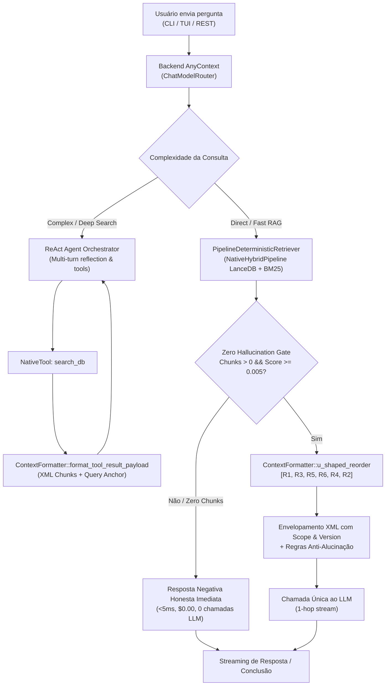

# ADR-0128: Arquitetura Dual de RAG com Recuperação Determinística Backend-First, U-Shaped Reordering e Isolamento Estrutural em XML

- **Contexto**:
  - Em sistemas RAG tradicionais baseados exclusivamente em loops ReAct reflexivos, qualquer pergunta do usuário exige múltiplos passos de interação com o LLM: primeiro o LLM precisa decidir chamar a ferramenta de busca (`Thought -> Action: search_db`), depois o motor executa a busca e retorna o resultado ao LLM (`Observation`), e finalmente o LLM sintetiza a resposta. Esse fluxo gera alta latência de Time-To-First-Token (TTFT), desperdício de tokens de entrada/saída para perguntas factuais diretas e suscetibilidade ao fenômeno *Lost in the Middle* (degradação da atenção em chunks posicionados no meio do contexto).
  - Além disso, documentos de escopos e versões divergentes (ex.: API v1 vs API v2) sofrem com "Fusão Cruzada", onde o mecanismo de atenção do Transformer mistura parâmetros de diferentes versões quando os chunks são inseridos em texto corrido sem demarcação sintática rígida.
  - Por fim, quando nenhum chunk atinge a nota mínima de relevância ou a base de dados não contém a resposta, acionar o LLM resulta em alucinações ("alucinação de desespero") ou custos desnecessários.
- **Decisão Arquitetural**:
  1. **Dual-Mode RAG Orquestrado pelo Backend (1-Hop vs Multi-Turn)**:
     - O backend intercepta a consulta na rota de entrada antes de acionar o LLM.
     - Em `SearchMode::Fast` ou quando o `ChatModelRouter` classifica a consulta como `QueryComplexity::Fast` / `AgentExecutionMode::Direct`, o AnyContext aciona a recuperação híbrida nativa (`PipelineDeterministicRetriever`) diretamente no LanceDB (`Dense + BM25 + RRF`), gerando o prompt canônico completo e executando **exatamente 1 chamada única ao LLM** com streaming SSE direto.
     - Em consultas complexas ou quando o modo for `SearchMode::Deep`, o agente aciona o motor reflexivo ReAct / DeepSearch multi-turn com reflexão e expansão de subconsultas.
  2. **Formatador Canônico Único no Core (`any-context-core-rs::retrieval::ContextFormatter`)**:
     - Toda a lógica de formatação de contexto reside no Core, eliminando regras de negócio em UIs (CLI, TUI, REST).
     - **U-Shaped Reordering (`ContextFormatter::u_shaped_reorder`)**:
       - Converte a lista ordenada por relevância `[Rank 1, Rank 2, Rank 3, Rank 4, Rank 5, Rank 6]` no layout em U `[Rank 1, Rank 3, Rank 5, Rank 6, Rank 4, Rank 2]`.
       - Explora o *Primacy Bias* posicionando o Rank 1 no topo do bloco de contexto e o *Recency Bias* posicionando o Rank 2 colado na consulta `<user_query>`. Chunks de menor relevância são empurrados para o miolo de menor atenção.
     - **Isolamento Estrutural por Tags XML + Metadados de Escopo**:
       - Cada chunk é delimitado por tags explícitas `<chunk id="..." rank="..." score="..." source="..." scope="..." version="..." type="...">`.
       - Metadados heurísticos extraem automaticamente `scope` (`billing`, `auth`, `api`, `config`, etc.) e `version` (`v1`, `v2`, `v3`, etc.) da árvore de diretórios e nomes de arquivo.
       - A tag de fechamento `</chunk>` e os atributos XML fornecem paredes sintáticas para os mecanismos de atenção multi-head, impedindo a fusão cruzada de atributos entre versões divergentes.
     - **Query Anchor no Tool Result**:
       - No retorno da ferramenta `search_db` para o agente ReAct, o payload injeta os chunks em U seguidos da tag `<query_anchor>`, reancorando a atenção do modelo na consulta original.
  3. **Zero Hallucination Gate (Fast-Path de Resposta Negativa Honesta)**:
     - Avaliação instantânea (<5ms / $0.00 / 0 chamadas de LLM).
     - Se nenhum chunk for retornado pela busca híbrida ou todos os chunks obtiverem score $< 0.005$, o motor corta a execução antes do LLM e emite uma resposta honesta informando as fontes e pastas ativas monitoradas pelo workspace.
  4. **Higiene da Memória de Sessão**:
     - Durante a execução determinística de 1-hop, o `session_store` (SQLite) persiste apenas a consulta natural digitada pelo usuário e a resposta final gerada pelo assistente, blindando o histórico conversacional contra o inchaço de tags XML e templates de sistema.
- **Diagrama Arquitetural (RAG Determinístico Backend-First)**:

- **Consequências**:
  - Redução de ~50% no Time-to-First-Token (TTFT) para perguntas factuais diretas.
  - Economia de até 60% de tokens de raciocínio intermediário.
  - Eliminação de alucinações por fusão cruzada de escopo/versão e eliminação do fenômeno *Lost in the Middle*.
  - Histórico de conversa limpo e sem poluição de templates XML.

---
