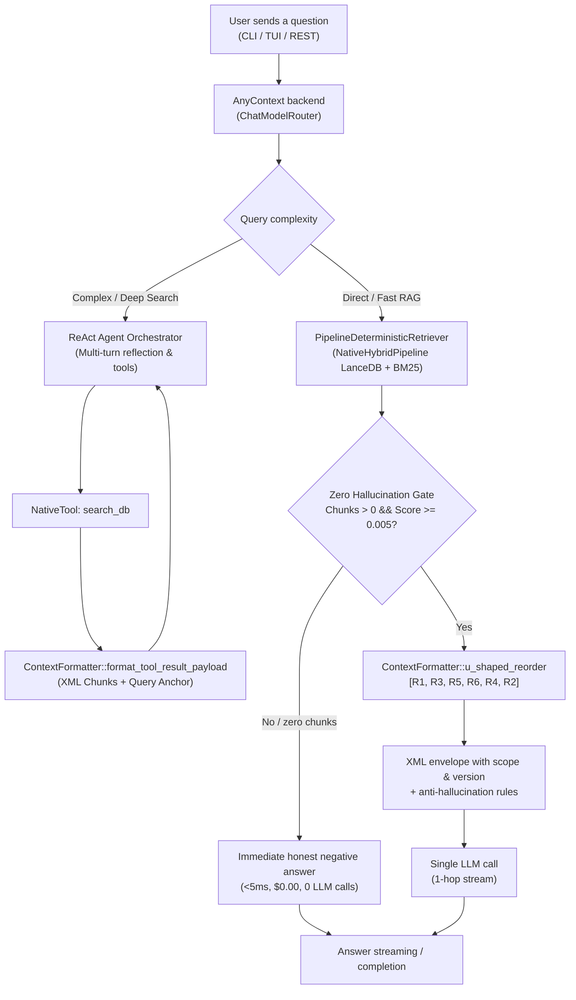

# ADR-0128: Dual RAG Architecture with Backend-First Deterministic Retrieval, U-Shaped Reordering and XML Structural Isolation

## Context

- In RAG systems built only on reflective ReAct loops, every question takes several LLM steps: the LLM first decides to call the search tool (`Thought -> Action: search_db`), the engine runs the search and returns the result (`Observation`), and finally the LLM writes the answer. This produces a high time to first token (TTFT), wastes input and output tokens on direct factual questions, and is exposed to the *Lost in the Middle* effect (attention degrades for chunks placed in the middle of the context).
- Documents with different scopes and versions (for example API v1 and API v2) suffer from "cross fusion": the Transformer attention mixes parameters of different versions when chunks are inserted as running text without a strict syntactic boundary.
- When no chunk reaches the minimum relevance score, or the database does not contain the answer, calling the LLM produces hallucinations ("desperation hallucinations") or unnecessary cost.

## Decision

1. **Backend-orchestrated dual-mode RAG (one hop or multi-turn)**:
   - The backend intercepts the query on the way in, before calling the LLM.
   - In `SearchMode::Fast`, or when the `ChatModelRouter` classifies the query as `QueryComplexity::Fast` / `AgentExecutionMode::Direct`, AnyContext runs native hybrid retrieval (`PipelineDeterministicRetriever`) directly against LanceDB (dense + BM25 + RRF), builds the full canonical prompt and makes **exactly one LLM call**, streamed over SSE.
   - For complex queries, or in `SearchMode::Deep`, the agent uses the reflective multi-turn ReAct / Deep Search engine with reflection and sub-query expansion.
2. **Single canonical formatter in the core (`any-context-core-rs::retrieval::ContextFormatter`)**: all context formatting lives in the core, with no business rules in the UIs (CLI, TUI, REST).
   - **U-shaped reordering (`ContextFormatter::u_shaped_reorder`)**: turns the relevance-ordered list `[Rank 1, Rank 2, Rank 3, Rank 4, Rank 5, Rank 6]` into the U layout `[Rank 1, Rank 3, Rank 5, Rank 6, Rank 4, Rank 2]`. It exploits primacy bias by placing Rank 1 at the top of the context block and recency bias by placing Rank 2 right next to the `<user_query>`; less relevant chunks go to the low-attention middle.
   - **Structural isolation with XML tags and scope metadata**: every chunk is wrapped in an explicit `<chunk id="..." rank="..." score="..." source="..." scope="..." version="..." type="...">` tag. Heuristics extract `scope` (`billing`, `auth`, `api`, `config`, and so on) and `version` (`v1`, `v2`, `v3`, and so on) from the directory tree and file names. The closing `</chunk>` tag and the XML attributes act as syntactic walls for multi-head attention, preventing attributes of different versions from fusing.
   - **Query anchor in the tool result**: in the `search_db` result returned to the ReAct agent, the payload places the U-ordered chunks followed by a `<query_anchor>` tag, re-anchoring the model's attention on the original query.
3. **Zero Hallucination Gate (honest negative answer fast-path)**: an instant check (under 5 ms, $0.00, no LLM call). When hybrid search returns no chunk, or every chunk scores below `0.005`, the engine stops before the LLM and returns an honest answer listing the active sources and folders monitored by the workspace.
4. **Session memory hygiene**: during one-hop deterministic execution, the SQLite `session_store` persists only the natural-language query typed by the user and the final assistant answer, keeping the conversation history free of XML tags and system templates.

## Alternatives Considered

Not recorded.

## Consequences

- About 50% lower time to first token for direct factual questions.
- Up to 60% fewer intermediate reasoning tokens.
- No hallucinations from scope/version cross fusion, and no *Lost in the Middle* effect.
- Clean conversation history without XML template pollution.
