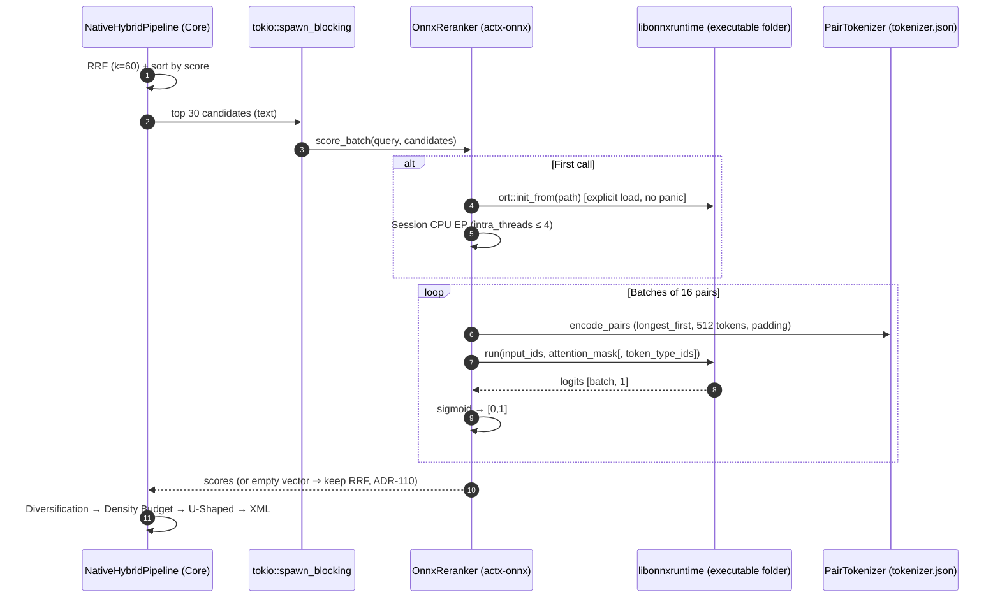
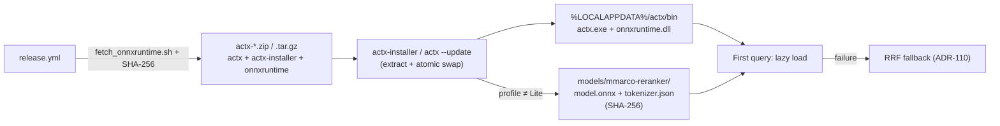

# ADR-0130: Real ONNX Runtime (ort load-dynamic), Multilingual mmarco Cross-Encoder and Rectification of ADRs 118/123/125/127/129

Roadmap phase: Front C0 of the next-generation RAG roadmap (A v0.43.0 → B v0.44.0 → **C0 v0.45.0** → C v0.46.0 → D v0.47.0). It completes the "Cross-Encoder in Rust" item of Master Plan Priority 3 and is a technical prerequisite of the Models Kit (Phase 3).

## Context

Findings verified during discovery:

1. **There was no ONNX runtime in the workspace.** No crate depended on `ort`, `tract`, `candle` or `tokenizers`. `ModelSession::open` only checked that the file existed and its size (> 1 KB).
2. **The v0.44.0 re-ranker was heuristic**: whitespace split, term and bigram counting and a sigmoid. The downloaded weights were never executed.
3. **`OnnxGemmaEngine::generate` returned fixed text** (`"[Local … Inference (… - 38.4 tok/s)]"`) and the provider injected `Throughput: 38.4 tok/s` into the reasoning block.
4. **The query classifier, Scan Sentinel, Layout Extractor and Vision Encoder** were heuristics that declared themselves neural when the file existed; the layout extractor injected `<!-- onnx-layout: preserved -->` and the vision encoder injected `"[… encoded via CLIP ViT]"` into chunks.
5. **GPU acceleration (ADR-0127)** was hardware detection and labels only; no execution provider was ever instantiated. The release publishes only Linux x86_64 and Windows x86_64 (there is no macOS binary).
6. **Non-existent links in the catalog**: `BAAI/bge-reranker-small`, `onnx-community/gemma-4-*-ONNX` (core) and `anycontext/models/*`, `google/gemma-4-*-it-onnx` (installer), violating the rule of ADR-0118. The installer also never downloaded models (`target_models()` was only displayed) and used a different file name for MobileNetV4.
7. **ADR-0121 already planned** the runtime behind a feature flag that was never implemented.

## Decision

| # | Decision |
|---|---|
| D1 | `ort = "=2.0.0-rc.14"` with **`load-dynamic`** (no static linking) + `tokenizers = "0.23"` (feature `onig`), behind the `runtime` feature of `actx-onnx`, propagated as `onnx` (default) in the core. The library is loaded **lazily** through `ort::init_from()` from `ORT_DYLIB_PATH` or from the executable's folder; no other `ort` API is touched before the explicit load succeeds (an implicit load would panic). |
| D3 | Default re-ranker **`cross-encoder/mmarco-mMiniLMv2-L12-H384-v1`** (`model_quint8_avx2.onnx` + `tokenizer.json`, XLM-RoBERTa, multilingual, Apache-2.0), revision `1427fd652930e4ba29e8149678df786c240d8825`. |
| D4 | Premium option **`onnx-community/bge-reranker-v2-m3-ONNX`** (`model_int8.onnx`, about 561 MB, Apache-2.0), same code path; selected with `/rerank model <id>` (persisted) or `--rerank-model <id>` (current run only). |
| D5 | **CPU only** (CPU execution provider, `intra_threads = min(cores, 4)`). `--device`/`/device` other than `cpu` print a warning; badges and `/rerank` show the **effective** device. |
| D6/D7 | Session created on the first `score_batch`; inference in `tokio::task::spawn_blocking`; batches of 16 pairs; `longest_first` truncation at 512 tokens; at most **30 candidates** re-ranked (`MAX_RERANK_CANDIDATES`), with the tail kept in RRF order below them; chunks guaranteed by file name keep their score. |
| D8 | `is_neural_active()` = library present + weights present + no recorded load failure. An invalid file is never reported as neural. |
| D9 | **Multi-file** catalog (`ModelFile { file_name, url, size_bytes, sha256 }`) with `availability: Available | Planned`, URLs **pinned to a revision**, one subfolder per re-ranker model, downloads verified with **SHA-256 + size** before the atomic rename, and files that are already intact are kept. |
| D10 | Rectification in the code: Gemma 4 is `Planned` (`is_neural_active() == false`, `generate*` return a clear error, the provider always uses the fallback); all fictitious telemetry removed; classifier, sentinel, layout and vision run **a single heuristic path** and report `heuristic`; GPU menus marked `[Planned]`. |
| D12 | A `catalog_urls` test (`#[ignore]`) runs in the release: HEAD on every file, status 200 and exact `content-length`. |
| D13 | **No broken links**: the five Document AI URLs of the installer are replaced by the core's (same sizes, SHA-256 and file name), the re-ranker becomes `mmarco-reranker`, and the eight fictitious Gemma URLs are removed. A core ↔ installer parity test is added. |
| D15 | **Transparency**: the release downloads the **official Microsoft ONNX Runtime v1.31.0 (CPU)** with a verified SHA-256 (`scripts/fetch_onnxruntime.sh`) and ships it in `actx-windows-x86_64.zip` (`onnxruntime.dll`) and `actx-linux-x86_64.tar.gz` (`libonnxruntime.so`). The installer and `actx --update` already extract and swap every file of the package atomically. The installer **automatically provisions** `mmarco-reranker` for every non-Lite profile (on install) and on update (silent mode, logged); failures never abort the installation. `ACTX_SKIP_MODEL_DOWNLOAD=1` disables provisioning. |

Real Stage 2 sequence:

Transparent provisioning:

### Corrections from the review of PR #326

| # | Correction |
|---|---|
| R1 | **Multi-query search**: each sub-query re-ranks against its own text and protects its file-name matches; the batch only accumulates the scores. The second re-rank (which overwrote the guaranteed matches and repeated the inference) and the `min_score` applied to cross-encoder scores were removed. |
| R2 | **Head and tail of Stage 2**: protected items do not take cross-encoder slots; the unscored tail is rescaled to stay strictly below the lowest re-scored score, preserving the relative RRF order. |
| R3 | **Updates respect the chosen profile**: `actx --update` uses the `active_profile` (`/profile`), then the profile recorded at install time (`install_profile.txt`), and only then the hardware recommendation. Lite never downloads models. |
| R4 | **Honest status**: `/rerank` and the TUI badge show RRF when loading the model failed in the process (corrupted weights or incompatible runtime), through `actx_onnx::reranker::recorded_load_error`. |
| R5 | **Interrupted downloads** remove the `.download.tmp` on any error (stream, write or cancellation). |
| R6 | **Profile disk requirements** become the sum of the weights actually installed (Gemma 4 is planned and does not count); the headlines mark Gemma 4 as *planned*. |
| R7 | **TUI badge** caches the re-ranker state for 3 s, without disk access on every frame. |

## Alternatives Considered

- **Static linking of ONNX Runtime** (rejected, D1 rationale): the only prebuilt static `ort` build for Windows includes DirectML, which made the binary import `DirectML.dll`, `d3d12.dll`, `dxgi.dll`, `MSVCP140.dll`, `MSVCP140_1.dll` and `VCRUNTIME140_1.dll` at load time; missing any of them would prevent `actx` from starting. With `load-dynamic` the binary keeps exactly the imports of v0.44.0 (verified automatically in the release).

## Consequences

- The first real neural inference in AnyContext, with no network cost and no new configuration for the user.
- The executable keeps the same dependencies as v0.44.0; the runtime ships and updates together with it.
- Documentation and interface reflect faithfully what is neural, heuristic or planned.
- Front C (local ONNX embeddings) can reuse `OnnxSession` and `PairTokenizer`.

### Component matrix after this decision

| Component | State | Execution |
|---|---|---|
| Cross-encoder re-ranker (`mmarco-reranker` / `bge-reranker-v2-m3`) | **Neural** | ONNX Runtime 1.31 CPU, lazy session |
| Query classifier | Heuristic | Keywords, < 1 µs |
| Scan Sentinel | Heuristic | 2D text density |
| Layout Extractor | Heuristic (passthrough) | Core 2D spatial chunkers |
| Vision Encoder | Heuristic | No synthetic description |
| Local Gemma 4 | **Planned** | Configured fallback provider |
| GPU execution providers | **Planned** | CPU on every platform |

### Verified facts about the Gemma 4 family (input for the future generative front)

- Family published by Google: **E2B, E4B, 12B, 26B-A4B (MoE) and 31B**. The tiers of the previous catalog (`compact`, `27b`, `32b`) do not exist.
- Official ONNX (`onnx-community`, Apache-2.0, `transformers.js`) **only for E2B and E4B**; 12B only in unverified third-party ONNX repositories; 26B-A4B and 31B have no ONNX (GGUF/QAT).
- **Multi-graph, multi-file** format: `decoder_model_merged`, `embed_tokens`, audio/vision encoders, sharded external weights (`.onnx_data`, `.onnx_data_1…_9`); E2B q4 totals more than 3.6 GB.
- Consequence: it needs a multi-shard downloader, a generative loop (tokenization, KV cache, sampling) and a recalibration of the hardware tiers, which is the scope of a separate front.

### Measurements (Windows 11, release build, CPU, 4 intra-op threads)

- Loading the mmarco model (first query): **about 620 ms**.
- Re-ranking **30 candidates** (about 80-120 words each): **p50 = 298 ms, p95 = 305 ms**.
- Multilingual test (query in Portuguese): the correct v2 passage scored 0.99998 and the irrelevant visual theme 0.0005. **Observed limitation**: the legacy v1 passage also scored almost the maximum (0.9995): the cross-encoder measures topical relevance, not version isolation, which remains the job of the XML envelope with `scope`/`version` (ADR-0128).
- The official `onnxruntime.dll` 1.31.0 is about 17 MB and itself requires the VC++ Redistributable (`MSVCP140.dll`). If it is missing, loading fails in a contained way and the re-ranker falls back to RRF, with the reason shown in `/rerank`.

### Tests

- `actx-onnx`: missing or corrupted session without panic, pair tokenization (fixture), scores in [0,1], determinism and batch invariance (ONNX fixture generated by `tests/fixtures/gen_tiny_reranker.py`), Gemma unavailable even with a file present, heuristic components never neural, build without the `runtime` feature.
- `any-context-core-rs`: catalog integrity (SHA-256, pinned revision, Planned without files), aliases, `/download` of a planned model, real re-ranking with a fixture and preservation of guaranteed chunks, core ↔ installer parity, `catalog_urls` (ignored, release) and `real_reranker_multilingual` (ignored, opt-in).
- CI: the test workflow downloads the official ONNX Runtime and sets `ORT_DYLIB_PATH` + `ACTX_REQUIRE_ORT=1` (neural tests become mandatory); the release checks the executable's imports.
