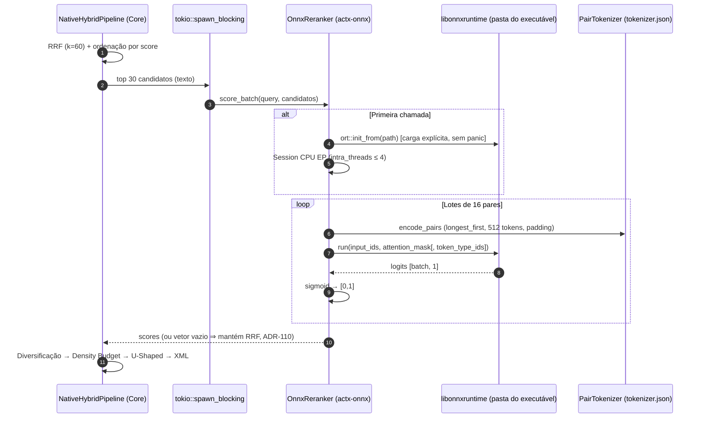
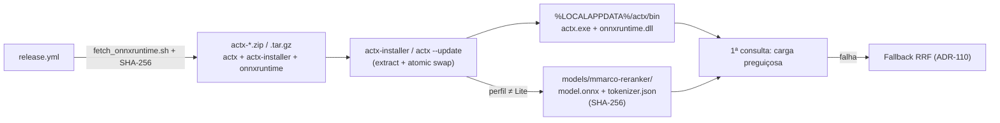

# ADR-0130: Runtime ONNX Real (`ort` load-dynamic), Cross-Encoder Multilíngue mmarco e Retificação das ADRs 118/123/125/127/129

- **Status**: Implemented & Verified
- **Date**: 2026-10-15
- **Fase**: Frente C0 do Roadmap de RAG de Nova Geração (A v0.43.0 → B v0.44.0 → **C0 v0.45.0** → C v0.46.0 → D v0.47.0). Conclui o item "Cross-Encoder em Rust" da Prioridade 3 do Master Plan e é pré-requisito técnico do Kit de Models (Fase 3).

#### 130.1 Contexto (achados verificados no Discovery)

1. **Não existia runtime ONNX no workspace.** Nenhuma crate dependia de `ort`, `tract`, `candle` ou `tokenizers`. `ModelSession::open` apenas verificava existência e tamanho do arquivo (> 1 KB).
2. **O reranker da v0.44.0 era heurístico**: split por espaços, contagem de termos e bigramas e sigmoid. Os pesos baixados nunca eram executados.
3. **`OnnxGemmaEngine::generate` devolvia texto fixo** (`"[Local … Inference (… - 38.4 tok/s)]"`) e o provider injetava `Throughput: 38.4 tok/s` no bloco de raciocínio.
4. **Classificador de consultas, Scan Sentinel, Layout Extractor e Vision Encoder** eram heurísticas que se declaravam neurais quando o arquivo existia; o layout injetava `<!-- onnx-layout: preserved -->` e a visão injetava `"[… encoded via CLIP ViT]"` nos chunks.
5. **Aceleração GPU (ADR-127)** era detecção de hardware e rótulos; nenhum Execution Provider era instanciado. O release publica apenas Linux x86_64 e Windows x86_64 (não há binário macOS).
6. **Links inexistentes no catálogo**: `BAAI/bge-reranker-small`, `onnx-community/gemma-4-*-ONNX` (Core) e `anycontext/models/*`, `google/gemma-4-*-it-onnx` (Instalador), violando a regra da ADR-118. O instalador também nunca baixava modelos (`target_models()` só era exibido) e usava um nome de arquivo divergente para o MobileNetV4.
7. **A ADR-121 já previa** o runtime atrás de uma feature flag que nunca foi implementada.

#### 130.2 Decisões

| # | Decisão |
|---|---|
| D1 | `ort = "=2.0.0-rc.14"` com **`load-dynamic`** (sem linkagem estática) + `tokenizers = "0.23"` (feature `onig`), atrás da feature `runtime` do `actx-onnx`, propagada como `onnx` (default) no Core. A biblioteca é carregada **preguiçosamente** via `ort::init_from()` a partir de `ORT_DYLIB_PATH` ou da pasta do executável; nenhuma outra API do `ort` é tocada antes de a carga explícita ter sucesso (uma carga implícita causaria panic). |
| D1-rationale | A linkagem estática (único build pré-compilado do `ort` para Windows inclui DirectML) fazia o binário importar `DirectML.dll`, `d3d12.dll`, `dxgi.dll`, `MSVCP140.dll`, `MSVCP140_1.dll` e `VCRUNTIME140_1.dll` na carga — a falta de qualquer uma impediria o `actx` de abrir. Com `load-dynamic` o binário mantém exatamente os imports da v0.44.0 (verificado automaticamente no release). |
| D3 | Reranker padrão **`cross-encoder/mmarco-mMiniLMv2-L12-H384-v1`** (`model_quint8_avx2.onnx` + `tokenizer.json`, XLM-RoBERTa, multilíngue, Apache-2.0), revisão `1427fd652930e4ba29e8149678df786c240d8825`. |
| D4 | Opção premium **`onnx-community/bge-reranker-v2-m3-ONNX`** (`model_int8.onnx`, ~561 MB, Apache-2.0), mesmo caminho de código; seleção por `/rerank model <id>` (persistida) ou `--rerank-model <id>` (só na execução). |
| D5 | **Somente CPU** (CPU Execution Provider, `intra_threads = min(núcleos, 4)`). `--device`/`/device` ≠ `cpu` emitem aviso; badges e `/rerank` mostram o dispositivo **efetivo**. |
| D6/D7 | Sessão criada no primeiro `score_batch`; inferência em `tokio::task::spawn_blocking`; lotes de 16 pares; truncamento `longest_first` em 512 tokens; no máximo **30 candidatos** reranqueados (`MAX_RERANK_CANDIDATES`), cauda mantém a ordem RRF abaixo deles; chunks garantidos por nome de arquivo preservam a nota. |
| D8 | `is_neural_active()` = biblioteca presente + pesos presentes + nenhuma falha de carga registrada. Arquivo inválido nunca é reportado como neural. |
| D9 | Catálogo **multi-arquivo** (`ModelFile { file_name, url, size_bytes, sha256 }`) com `availability: Available | Planned`, URLs **fixadas por revisão**, subpasta por modelo para rerankers, download com **SHA-256 + tamanho** antes do rename atômico, arquivos já íntegros são preservados. |
| D10 | Retificação no código: Gemma 4 `Planned` (`is_neural_active() == false`, `generate*` retornam erro claro, provider sempre usa o fallback); remoção de toda telemetria fictícia; classificador/sentinel/layout/visão executam **um único caminho heurístico** e reportam `heuristic`; menus de GPU marcados `[Planned]`. |
| D12 | Teste `catalog_urls` (`#[ignore]`) executado no release: HEAD de cada arquivo, status 200 e `content-length` exato. |
| D13 | **Zero links quebrados**: 5 URLs de Document AI do instalador corrigidas para as do Core (mesmos tamanhos/SHA-256 e mesmo nome de arquivo), reranker → `mmarco-reranker`, 8 URLs fictícias do Gemma removidas. Teste de paridade Core ↔ Instalador. |
| D15 | **Transparência**: o release baixa o ONNX Runtime **oficial da Microsoft v1.31.0 (CPU)** com SHA-256 verificado (`scripts/fetch_onnxruntime.sh`) e o inclui em `actx-windows-x86_64.zip` (`onnxruntime.dll`) e `actx-linux-x86_64.tar.gz` (`libonnxruntime.so`). Instalador e `actx --update` já extraem e trocam todos os arquivos do pacote atomicamente. O instalador **provisiona automaticamente** o `mmarco-reranker` em todo perfil não-Lite (instalação) e na atualização (modo silencioso, registrado em log); falhas nunca abortam a instalação. `ACTX_SKIP_MODEL_DOWNLOAD=1` desativa o provisionamento. |

#### 130.3 Matriz de componentes após a v0.45.0

| Componente | Estado | Execução |
|---|---|---|
| Cross-Encoder Re-Ranker (`mmarco-reranker` / `bge-reranker-v2-m3`) | **Neural** | ONNX Runtime 1.31 CPU, sessão preguiçosa |
| Query Classifier | Heurístico | Palavras-chave, < 1 µs |
| Scan Sentinel | Heurístico | Densidade de texto 2D |
| Layout Extractor | Heurístico (passthrough) | Chunkers espaciais 2D do Core |
| Vision Encoder | Heurístico | Sem descrição sintética |
| Gemma 4 local | **Planejado** | Provider de fallback configurado |
| Execution Providers GPU | **Planejado** | CPU em todas as plataformas |

#### 130.4 Fatos verificados da família Gemma 4 (insumo para a futura frente generativa)

- Família publicada pelo Google: **E2B, E4B, 12B, 26B-A4B (MoE) e 31B**. Os tiers do catálogo anterior (`compact`, `27b`, `32b`) não existem.
- ONNX oficial (`onnx-community`, Apache-2.0, `transformers.js`) **apenas para E2B e E4B**; 12B somente em repositórios ONNX de terceiros não verificados; 26B-A4B e 31B sem ONNX (GGUF/QAT).
- Formato **multi-grafo e multi-arquivo**: `decoder_model_merged`, `embed_tokens`, encoders de áudio/visão, pesos externos fragmentados (`.onnx_data`, `.onnx_data_1…_9`); E2B q4 > 3,6 GB somados.
- Consequência: exige downloader multi-shard, loop generativo (tokenização, KV-cache, amostragem) e recalibração dos tiers de hardware — escopo de uma frente própria.

#### 130.5 Diagrama de sequência — Estágio 2 real

#### 130.6 Diagrama — provisionamento transparente

#### 130.7 Medições reais (Windows 11, release, CPU, 4 threads de intra-op)

- Carga do modelo mmarco (primeira consulta): **~620 ms**.
- Reranqueamento de **30 candidatos** (≈ 80–120 palavras cada): **p50 = 298 ms, p95 = 305 ms**.
- Teste multilíngue (consulta em português): o trecho correto da v2 recebeu 0,99998, o tema visual irrelevante 0,0005. **Limitação observada**: o trecho da v1 legada também recebeu nota quase máxima (0,9995) — o cross-encoder mede relevância temática, não isolamento de versão; o isolamento continua a cargo do envelopamento XML com `scope`/`version` (ADR-128).
- Biblioteca oficial `onnxruntime.dll` 1.31.0: ~17 MB; ela própria requer o VC++ Redistributable (`MSVCP140.dll`). Se ausente, a carga falha de forma contida e o reranker cai em RRF com o motivo exibido em `/rerank`.

#### 130.8 Testes

- `actx-onnx`: sessão ausente/corrompida sem panic, tokenização de pares (fixture), escores em [0,1], determinismo e invariância de lote (fixture ONNX gerado por `tests/fixtures/gen_tiny_reranker.py`), Gemma indisponível mesmo com arquivo, componentes heurísticos nunca neurais, build sem a feature `runtime`.
- `any-context-core-rs`: integridade do catálogo (SHA-256, revisão fixada, Planned sem arquivos), aliases, `/download` de modelo planejado, reranqueamento real com fixture + preservação de chunks garantidos, paridade Core ↔ Instalador, `catalog_urls` (ignored, release) e `real_reranker_multilingual` (ignored, opt-in).
- CI: o workflow de testes baixa o ONNX Runtime oficial e define `ORT_DYLIB_PATH` + `ACTX_REQUIRE_ORT=1` (testes neurais tornam-se obrigatórios); o release verifica os imports do executável.

#### 130.9 Consequências

- Primeira inferência neural real do AnyContext, sem custo de rede e sem nova configuração para o usuário.
- Executável com as mesmas dependências da v0.44.0; o runtime viaja e é atualizado junto com ele.
- Documentação e interface passam a refletir fielmente o que é neural, heurístico ou planejado.
- Base pronta para a Frente C (embeddings locais ONNX) reutilizar `OnnxSession` e `PairTokenizer`.

#### 130.10 Correções da revisão do PR #326

| # | Correção |
|---|---|
| R1 | **Busca multi-consulta**: cada sub-consulta faz o rerank contra o próprio texto e protege os matches por nome de arquivo; o lote apenas acumula os scores. O segundo rerank (que sobrescrevia os matches garantidos e repetia a inferência) e o `min_score` aplicado sobre scores do cross-encoder foram removidos. |
| R2 | **Cabeça e cauda do Estágio 2**: itens protegidos não ocupam vagas do cross-encoder; a cauda não avaliada é reescalada para ficar estritamente abaixo do menor score reavaliado, preservando a ordem RRF relativa. |
| R3 | **Atualização respeita o perfil escolhido**: `actx --update` usa o `active_profile` (`/profile`), depois o perfil gravado na instalação (`install_profile.txt`) e só então a recomendação de hardware. Lite nunca baixa modelos. |
| R4 | **Status honesto**: `/rerank` e o badge da TUI mostram RRF quando a carga do modelo falhou no processo (pesos corrompidos ou runtime incompatível), via `actx_onnx::reranker::recorded_load_error`. |
| R5 | **Downloads interrompidos** removem o `.download.tmp` em qualquer erro (stream, escrita ou cancelamento). |
| R6 | **Requisitos de disco dos perfis** passam a ser a soma dos pesos realmente instalados (Gemma 4 é planejado e não conta); os headlines marcam Gemma 4 como *planned*. |
| R7 | **Badge da TUI** guarda o estado do reranker por 3 s, sem acesso ao disco a cada quadro. |
