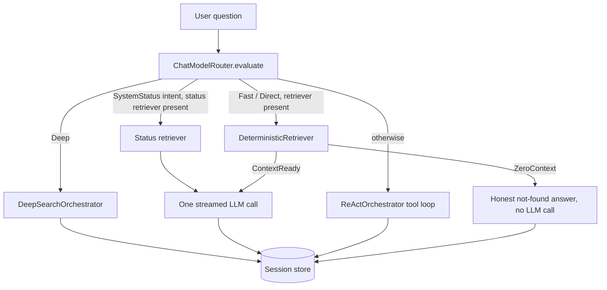

# Agent Runtime

Query routing, one-hop RAG, the ReAct loop, Deep Search, tools, system prompt and conversation memory.

## Responsibilities

- Decide, for every question, between a deterministic one-hop RAG answer, the ReAct tool loop and the multi-phase Deep Search.
- Run each path against a language model provider, streaming typed events to the interface.
- Register and call tools (`search_db`, `system_status`, `web_search`).
- Persist the conversation per workspace and reload it on the next turn.
- Build the system prompt for each answer path from `config/AGENT.md`, the workspace settings, the grounding mode and the tools the path offers.

Retrieval itself is in the [retrieval pipeline](retrieval.md); the concrete tools and retrievers are wired by the [CLI](cli.md) in `crates/actx-cli/src/engine.rs`.

## Structure

| Module | Role |
|---|---|
| `lib.rs` | `Agent`, `AgentBuilder`, `DeterministicRetriever`, `DeterministicRetrievalOutput`, `ToolBasedRetriever`; the shared one-hop execution (`run_one_hop`, `stream_one_hop`). |
| `router.rs` | `ChatModelRouter`, `ComplexityClassifier`, `DeterministicClassifier`, `RoutingDecision`, `QueryComplexity`, `QueryIntent`, `is_status_query`. |
| `fsm.rs` | `ReActOrchestrator`: the ReAct state machine. |
| `deep_search.rs` | `DeepSearchOrchestrator`, `DeepSearchRetriever`, `DeepSearchConfig`, `RetrievedChunk`, `SynthesisPromptFormatter`, `DefaultSynthesisFormatter`, prompts and response parsers. |
| `tool.rs` | `Tool`, `NativeTool`, `ToolRegistry` (behind `std::sync::RwLock`). |
| `session.rs` | `SessionStore`, `SqliteSessionStore`, `InMemorySessionStore`. |
| `events.rs` | `AgentEvent` and the event channel. |
| `config.rs` | `AgentConfig`, `AgentExecutionMode` (`ReAct`, `DeepSearch`, `Direct`), `SearchMode` (`Auto`, `Fast`, `Deep`). |
| `crates/actx-cli/src/prompt.rs` | `build_system_prompt`, `load_agent_md`, embedded `AGENT.md`, `README.md` and `SYSTEM_KNOWLEDGE.md`. |

## Behavior

### Routing

`ChatModelRouter::evaluate(query, search_mode)` classifies the query (complexity, intent, confidence, reason) and applies the workspace's search mode:

- `/search fast` forces the fast path and `/search deep` forces Deep Search.
- `/search auto` follows the classifier: `Deep` complexity goes to Deep Search, `Fast` to the fast path.
- Intents: `Code`, `Architecture`, `DevOpsInfra`, `DataSchema`, `SecurityAudit`, `Document`, `General`, and `SystemStatus`.
- After the classifier, `is_status_query` checks for terms about the live state of the workspace (indexed, indexing, syncing, sync status, status, progress, chunk counts, and their Portuguese forms). A match sets the intent to `SystemStatus` and prefixes the reason with "live status question"; mode and complexity are unchanged. It runs after any classifier, so the application's ONNX adapter routes status questions the same way (ADR-0145).
- When the intent is `SystemStatus` and a status retriever is configured (`AgentBuilder::status_retriever`), `run` and `stream` answer through it in every search mode, before Deep Search and the fast path.

The classifier is a deterministic keyword and structure heuristic (query length, multi-clause markers, comparison triggers, domain patterns). In the application it is the `actx-onnx` query classifier wrapped by `OnnxComplexityClassifierAdapter`, which is also heuristic (see [ONNX Inference](onnx.md)). `Agent::stream` emits `AgentEvent::RoutingDecision` before anything else so the interface can show the route; the TUI and one-shot mode show `📊 [ModelRouter: Live Status]` for the `system_status` intent.

### One-hop deterministic RAG

When a `DeterministicRetriever` is configured and the route is fast (or the mode is `Direct`), the agent:

1. Calls `retrieve_and_format(query)`. The CLI's `PipelineDeterministicRetriever` runs one hybrid search and applies the Zero Hallucination Gate.
2. On `ZeroContext { message }`, returns the message without calling the model.
3. On `ContextReady { formatted_prompt }`, sends the prior session messages plus the formatted prompt (system rules, XML context and the query) in a single streamed model call.
4. Persists only the user's original question and the final answer.

Because the CLI always configures this retriever when LanceDB opens, fast questions take this path; the ReAct loop runs when no deterministic retriever is available.

Status questions take the same one-hop execution with the status retriever. The CLI's `PipelineStatusRetriever` runs the same hybrid search, adds the live status report (`workspace_status_report`, the report of the `system_status` tool) in a `<live_status>` block and always returns `ContextReady`: the Zero Hallucination Gate is skipped because the report is context, and a failed search leaves the report to answer from.

### ReAct loop

`ReActOrchestrator::run` builds the messages (system prompt, prior session messages, the new user message) and loops up to `max_turns` (10 in the application): it calls the model with the tool definitions, executes requested tool calls and feeds the results back. On the last turn tools are withheld and the model is told to synthesize its final answer. Tool messages stay in working memory; only the user prompt and the final answer are persisted.

### Deep Search

`DeepSearchOrchestrator::run` (defaults: `max_iterations` 3, `max_sub_queries` 4, `max_gap_queries` 3):

1. **Decomposition** (`SUB_QUERY_PROMPT`): splits the question into up to four sub-queries and emits `AgentEvent::Decomposition`.
2. **Batch retrieval**: each iteration (`AgentEvent::IterationStart`) calls `DeepSearchRetriever::retrieve_batch` with the current queries; the CLI's `PipelineBatchRetriever` runs them concurrently through `retrieve_hybrid_batch_async` and passes each chunk's section path and file line range (ADR-0142) on to the synthesis. New chunks are deduplicated by id; when `enable_reranker` is on (off by default), a new chunk scoring below `rerank_score_threshold` is checked for relevance with `RERANK_PROMPT` (a yes/no model call).
3. **Gap analysis** (`REFLECT_PROMPT`): asks whether more searches are needed and produces gap queries (`AgentEvent::GapAnalysis`); the loop stops early when there are none or at the last iteration.
4. **Synthesis**: the prior session messages plus one prompt built by the `SynthesisPromptFormatter` from all collected chunks and the original question. The CLI injects `CanonicalSynthesisFormatter` from the [retrieval](retrieval.md) context formatter: the system prompt, the shared isolation rules and the Deep Search synthesis rules, the chunks of every iteration sorted by relevance in U-shaped XML, and the question last. Without injection, `DefaultSynthesisFormatter` (`SUMMARY_PROMPT`, plain chunk blocks, question last) is used. `sanitize_direct_conclusion` strips leftover meta-narrative and section headers.

### Tools

The application registers the tools below. Only the ReAct loop offers them to the model; one-hop RAG and the Deep Search synthesis call no tools. The status report of `system_status` also reaches the routed paths through the status route; web search results do not, because web content is indexed before it reaches the model (indexing web search results is FEAT-019, and the raw snippets this tool returns are BUG-018).

- `search_db(query)`: hybrid search in the active workspace plus `Global` (top 5), returned as the XML tool payload with a query anchor, or the Zero Hallucination message.
- `system_status(workspace?)`: sync status from SQLite, chunk count from LanceDB, monitored folders and web sources.
- `web_search(query)`: only when web search is enabled for the workspace; Tavily, Serper or DuckDuckGo, preferring the domains of the workspace's web sources.

### System prompt

`build_system_prompt(workspace, grounding_mode, search_mode, web_search_enabled, path)` builds one prompt per answer path (ADR-0144). `PromptPath::Tools(names)` is the ReAct prompt, with `names` taken from the registered tools; `PromptPath::RetrievedContext` is given to `PipelineDeterministicRetriever` (and through it `PipelineStatusRetriever`) and `CanonicalSynthesisFormatter`. Both concatenate:

1. `AGENT.md`: from `ACTX_AGENT_MD`, then `config/AGENT.md` in the working directory, then the user configuration directory, then the copy embedded at compile time. It names no tool: it asks to answer from the workspace context, to answer questions about past conversations from the earlier turns, and to explain `/folder`, `/web` and `/sources` instead of changing sources.
2. The operational environment: workspace, grounding strategy, search depth and web search status.
3. Persistent memory directives (the agent has long-term memory per workspace).
4. The grounding mode directives: **strict** (no parametric knowledge, answers only from the workspace context, natural "not found" answers, mandatory source citations), **hybrid** (workspace facts first, then clearly labeled model knowledge) or **proactive** (documents, web and domain knowledge combined, each insight tagged by source).
5. The disabled web search block when web search is off.
6. The path section:
   - `Tools(names)`: the allowed tools, and one rule per known tool present (`search_db` before answering, at most once, with bilingual keywords; `system_status` for indexing questions; `web_search` permission-gated in strict mode). No other tool is named.
   - `RetrievedContext`: the excerpts are already in `<retrieved_context>`; no tools are available, so the model never writes tool calls or claims to have searched or changed anything; a live status report, when present, is in `<live_status>`, and otherwise the status bar and `/status` are pointed to; when web search is enabled, no live web search runs for this answer.
7. The recency and language rules.

Answers follow the language of the user's question.

### Self-knowledge

`ensure_global_knowledge_bootstrap` (in the CLI engine) indexes the embedded `SYSTEM_KNOWLEDGE.md` and `README.md` into the `Global` workspace, one chunk per heading, in LanceDB and BM25. It runs again whenever `global_knowledge_version` differs from the binary version, replacing the previous chunks. These chunks have zero vectors, so they are found through BM25.

### Session memory

`SqliteSessionStore::open(settings.db, 50)` keeps `actx_sessions` and `actx_session_messages` in the settings database. Each workspace uses the session id `ws_<workspace>`. Reads skip tool messages and empty assistant messages and return the latest 50 messages; on open, orphaned tool rows are deleted. `/history` and `/reset-memory` inspect or clear the session.

### Events

`AgentEvent`: `RoutingDecision`, `Decomposition`, `IterationStart`, `GapAnalysis`, `Thinking` (reasoning tokens), `ToolStart`, `ToolEnd`, `Delta` (answer tokens), `Done` and `Error`.

## Interfaces

- **Built by**: `build_agent_sync` in the [CLI](cli.md), used by one-shot questions and the [TUI](tui.md).
- **Calls**: [language model providers](lm-providers.md) (`chat_complete`, `chat_stream`), the retrievers and tools supplied by the CLI, and the session store.
- **Exports**: `Agent::run` (to completion) and `Agent::stream` (event receiver plus join handle).

## Decisions

- [ADR-0075](../adr/0075-native-rust-agent-fsm.md): native Rust agent with an explicit state machine instead of LangGraph.
- [ADR-0082](../adr/0082-sqlite-session-memory-identity-injection.md): SQLite session per workspace, memory directives and the `search_db` tool.
- [ADR-0085](../adr/0085-grounding-vs-search-depth-decoupling.md): grounding mode and search depth are independent.
- [ADR-0088](../adr/0088-conversational-session-boundary.md): only user prompts and final answers are persisted.
- [ADR-0090](../adr/0090-grounding-parity-streaming-single-lancedb-path.md): embedded `AGENT.md`, mandatory retrieval in strict mode, token streaming.
- [ADR-0094](../adr/0094-test-sandbox-option-hinting-global-self-knowledge.md): self-knowledge through the `Global` workspace and a lean skill directive.
- [ADR-0095](../adr/0095-clean-screen-buffer-long-term-memory-decoupling.md): long-term memory decoupled from the visible chat.
- [ADR-0097](../adr/0097-sqlite-sync-telemetry-agent-background-awareness.md): `system_status` tool.
- [ADR-0108](../adr/0108-reflective-deep-search-engine.md): Deep Search orchestrator and its events.
- [ADR-0112](../adr/0112-ux-stabilization-deep-search-multiline-prompt.md): conclusion sanitization and version-aware self-knowledge.
- [ADR-0115](../adr/0115-onnx-weights-repository-fallbacks.md): natural tone instead of warning disclaimers.
- [ADR-0119](../adr/0119-english-interface-spinner-release-notes.md): answers match the user's language.
- [ADR-0120](../adr/0120-source-display-names-shared-sources-removal.md): `SYSTEM_KNOWLEDGE.md` manual.
- [ADR-0124](../adr/0124-jina-reader-web-ingestion-seven-domains.md): seven intent domains; the model reads only from the index.
- [ADR-0125](../adr/0125-local-gemma-activation-hardware-guardrails.md): the chosen model is kept on every turn; routing only picks the search depth.
- [ADR-0128](../adr/0128-backend-first-deterministic-dual-rag.md): backend-first one-hop RAG and session hygiene.
- [ADR-0141](../adr/0141-deep-search-synthesis-uses-the-canonical-context-formatter-t.md): the Deep Search synthesis prompt comes from the canonical context formatter through `SynthesisPromptFormatter`.
- [ADR-0144](../adr/0144-system-prompt-per-answer-path-with-the-tool-section-generate.md): system prompt per answer path; only the ReAct prompt names tools, taken from the registered tools.
- [ADR-0145](../adr/0145-live-status-reaches-the-routed-paths-as-retrieved-context.md): status questions are routed to a one-hop path with the live status report; web results are not given to the model without indexing.
