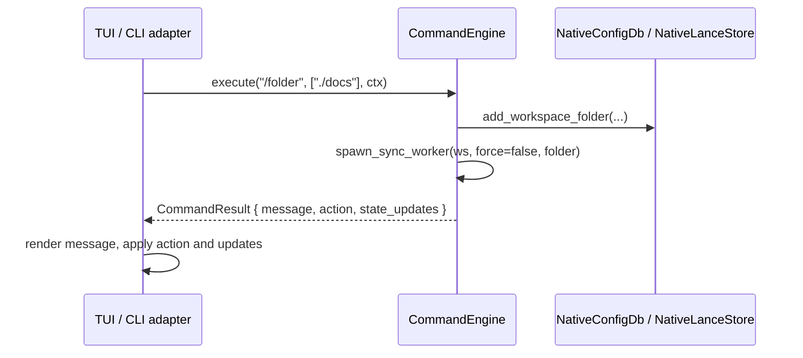

# Command Engine

UI-agnostic slash command engine shared by the CLI and the TUI.

## Responsibilities

- Parse and execute every slash command (`/switch`, `/sync`, `/folder`, `/model`, ...) with all the domain logic in the core.
- Read and write workspace configuration through [storage](storage.md), start background sync workers, and validate model downloads and hardware safety.
- Tell the presentation layer what to do next through a typed result (message, action, state updates) instead of touching any UI.

Rendering results, menus and progress is the job of the [TUI](tui.md) and the [CLI](cli.md).

## Structure

| Item | File | Role |
|---|---|---|
| `CommandEngine::execute(raw_cmd, args, ctx)` | `engine.rs` | Single dispatcher for every command and alias. |
| `CommandEngine::spawn_sync_worker` | `engine.rs` | Starts a detached `--sync-worker` process. |
| `ExecutionContext` | `models.rs` | Input: active workspace, model, grounding mode, search mode, web search flag, execution device, re-rank mode. |
| `CommandResult` | `models.rs` | Output: `success`, `message` (Markdown), `action`, `state_updates`, `error`. |
| `CommandAction` | `models.rs` | `None`, `Exit`, `ClearChat`, `OpenMenu(id)`, `SwitchWorkspace(name)`, `RebuildAgent`, `StartDownload(id)`, `SetDevice(name)`. |
| `CommandStateUpdates` | `models.rs` | Optional new values for workspace, model, grounding mode, search mode, web search, execution device and re-rank mode. |
| `GroundingMode`, `SearchDepthMode` | `models.rs` | `strict`/`hybrid`/`proactive` and `auto`/`fast`/`deep`, with short aliases. |

## Behavior

### Dispatch

The command name is trimmed, stripped of the leading `/` and lower-cased. A `@<version>` suffix is split off (used by `/update@<version>`). Unknown commands return an error that points to `/help`.

### Command groups

| Group | Commands (aliases) | Behavior |
|---|---|---|
| Session | `/exit` (`/quit`, `/q`), `/clear` (`/cls`), `/menu`, `/help` (`/commands`, `/slash`) | Exit, clear the visible chat, open the main menu, list commands. |
| Workspaces | `/switch` (`/workspace`, `/ws`), `/rename`, `/cd`, `/pwd` | List, create, switch or delete workspaces (`/switch --delete`), rename, change or show the working directory. |
| Answer settings | `/mode` (`/grounding`), `/search` (`/depth`), `/fast`, `/deep`, `/web-search`, `/router` | Set and persist grounding mode, search depth and web search per workspace; show the routing decision. |
| Sources | `/folder` (`/add`, `/dir`), `/web` (`/url`), `/sources` (`/src`), `/transfer`, `/link`, `/unlink` | Add or remove folders and web sources (adding one starts a sync worker), list and rename sources (`/sources rename <n> <name>`), move or copy a source between workspaces. |
| Index | `/sync` (`/reindex`, `/index`), `/cancel` (`/stop`), `/purge`, `/inspect` (`/chunks`), `/status`, `/logs`, `/density`, `/spans` | Start or cancel a sync, delete a workspace's vectors, inspect chunks and counts (`/inspect <filter>` matches decrypted text in memory over a sample of up to 2,000 chunks), read log files, inspect chunk density and PDF spans. |
| Models and hardware | `/model` (`/models`, `/m`), `/download` (`/dl`, `/get-model`), `/profile`, `/preset` (`/kit`), `/device` (`/gpu`), `/rerank`, `/vision`, `/ocr` | Select the language model with hardware guardrails, validate and request model downloads, switch hardware profiles and workspace presets, choose the execution device, set the re-rank mode and model. |
| Memory | `/history`, `/reset-memory` (`/forget`) | Inspect or wipe the workspace session (`ws_<workspace>`) and clear the chat. |
| Configuration | `/keys` (`/api-key`), `/config` (`/settings`), `/onboarding` (`/setup`), `/diagnostics` (`/diag`, `/health`), `/billing` | Save API keys in SQLite and export them to the process environment, followed by `RebuildAgent` (a failed save is reported as session-only); show the configuration dashboard, open the onboarding wizard, show diagnostics, show the tier (Community). |
| Updates | `/update` (`/upgrade`), `/check-update`, `/version`, `/info` | `/update` only explains how to run `actx --update[@version]` from the OS terminal and logs the request; the update itself never runs inside the interactive session. |
| Deprecated | `/shared` | Returns an error: shared sources were removed and workspaces are strictly isolated. |

### Sync workers

`spawn_sync_worker(workspace, force, target_folder)` starts the current executable (or the installed `actx` in the canonical bin directory) with `--sync-worker --workspace <ws> [--force] [--folder <path>]`, redirects its stdout and stderr to `sync_<workspace>.log` in the logs directory, and on Windows creates it without a console window. It returns the child PID and the log path. `/sync cancel` marks the sync status as cancelled and terminates the worker; the [ingestion](ingestion.md) loop also stops cooperatively when it sees the cancelled status.

### Models, downloads and presets

- `/model <id>` accepts cloud models immediately; local models are checked by `HardwareProfiler` and rejected when unsafe for the machine unless `--force` is given (see [Model Catalog and Hardware Profiling](model-catalog.md)).
- `/download <id|alias>` resolves the catalog entry, runs the disk and RAM pre-flight checks and, when they pass, returns `CommandAction::StartDownload(id)`; the UI performs the download. Planned models (local Gemma 4) are refused.
- `/rerank [auto|on|off|status]` persists `rerank_mode`; `/rerank model <id>` persists `reranker_model`.
- `/preset offline|balanced|frontier|privacy` reconfigures the workspace: `balanced` sets `gpt-4o-mini`, hybrid grounding, auto search and web search on; `frontier` sets `claude-3-7-sonnet`, proactive grounding, deep search and web search on; `offline` and `privacy` keep the active model and set strict grounding, fast search and web search off, but only when the active model runs locally (`ollama/<model>` or `local/<model>`). With any other model they fail, explain that local Gemma 4 generation is planned, suggest `/model ollama/<model>` and change nothing.

## Interfaces

- **Called by**: the TUI (`crates/actx-cli/src/tui/app.rs`) and the CLI command registry (`crates/actx-cli/src/commands/`), which build an `ExecutionContext` from the current state, call `execute` and apply the returned action and state updates.
- **Calls**: [storage](storage.md), [ingestion](ingestion.md) (`NativeSyncOrchestrator` for inline syncs and the worker process), [Model Catalog and Hardware Profiling](model-catalog.md), and `actx_installer` (paths, update logging).
- **Contract**: results are plain data (`serde`-serializable), so any future surface can consume them.

## Decisions

- [ADR-0081](../adr/0081-tui-header-status-telemetry.md): slash commands mutate state and rebuild the agent immediately.
- [ADR-0084](../adr/0084-ui-agnostic-command-engine.md): command evaluation extracted into the UI-agnostic `CommandEngine`.
- [ADR-0085](../adr/0085-grounding-vs-search-depth-decoupling.md): `/mode` (grounding) and `/search` (depth) are separate settings.
- [ADR-0092](../adr/0092-virtual-tab-chat-buffer-isolation.md): `/reset-memory` returns `ClearChat`.
- [ADR-0099](../adr/0099-core-command-parity-worker-auto-spawn.md): centralized worker spawning, credentials, dashboard, inspection and logs.
- [ADR-0100](../adr/0100-native-encryption-sync-cancel-tui-isolation.md): `/sync cancel`, `/cd`, `/pwd`.
- [ADR-0112](../adr/0112-ux-stabilization-deep-search-multiline-prompt.md): `/update` gives terminal instructions instead of updating in process.
- [ADR-0120](../adr/0120-source-display-names-shared-sources-removal.md): `/sources rename` and the deprecation of `/shared`.
- [ADR-0121](../adr/0121-modular-onnx-crate-hardware-profiles.md): `/profile`.
- [ADR-0125](../adr/0125-local-gemma-activation-hardware-guardrails.md): model guardrails with `--force` and workspace presets.
- [ADR-0126](../adr/0126-assisted-gemma-weights-downloader.md): `/download` and `CommandAction::StartDownload`.
- [ADR-0129](../adr/0129-two-stage-retrieval-cross-encoder-reranking.md) and [ADR-0130](../adr/0130-real-onnx-runtime-multilingual-cross-encoder.md): `/rerank` modes and model selection.
- [ADR-0133](../adr/0133-offline-and-privacy-presets-require-a-working-local-model.md): offline and privacy presets require a working local model.
