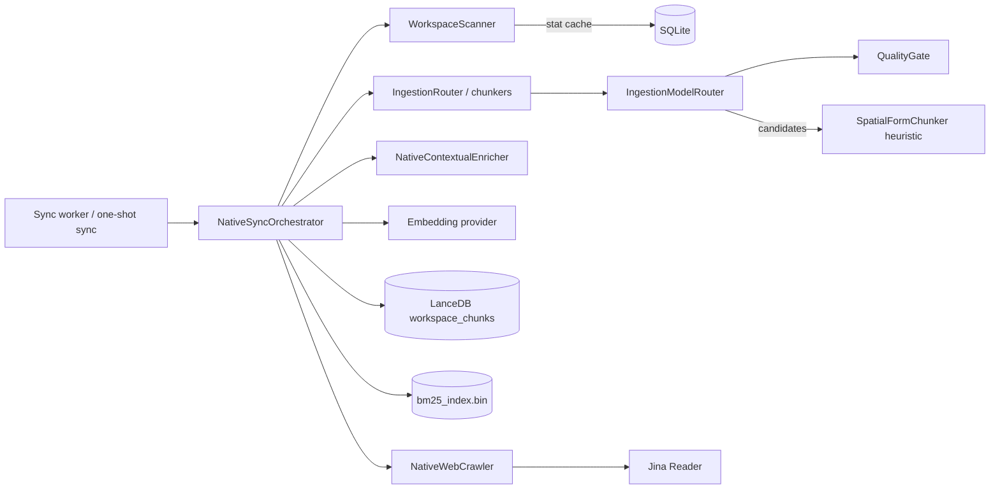

# Ingestion and Sync

Scans workspace folders and web sources, chunks changed content, filters noise and writes chunks to LanceDB and BM25.

## Responsibilities

- Discover the supported files under every folder registered for a workspace and compute what changed since the last sync.
- Chunk new and modified files (through the [chunkers](chunkers.md)), drop noise with the quality gate, and attach a document-level summary envelope.
- Embed the chunks and write them to the LanceDB vector table and the BM25 index; remove the chunks of deleted, moved and modified files.
- Crawl the web sources registered for a workspace and index their pages the same way.
- Report progress, cancellation and results through the SQLite sync telemetry.

It does not decide when to sync (the [command engine](commands.md) and the [CLI](cli.md) do), and it does not own the stores ([storage](storage.md)) or the BM25 format ([retrieval](retrieval.md)).

## Structure

| Module | Role |
|---|---|
| `orchestrator.rs` | `NativeSyncOrchestrator`, `SyncOptions`, `SyncResult`: the sync pipeline. |
| `scanner.rs` | `WorkspaceScanner`, `DiffResult`: filesystem walk and differential calculation. |
| `router.rs` | `IngestionRouter`: picks the chunker for a file (see [chunkers](chunkers.md)). |
| `quality_gate.rs` | `QualityGate`: deterministic noise filter and Document AI triage. |
| `model_router.rs` | `IngestionModelRouter`: runs the quality gate and resolves Document AI candidates. |
| `enricher.rs` | `NativeContextualEnricher`: extractive document summary and keywords (contextual retrieval envelope). |
| `crawler.rs` | `NativeWebCrawler`: BFS crawler with sitemaps, `robots.txt` and web metadata extraction. |
| `jina.rs` | `NativeJinaExtractor`: Markdown extraction through Jina Reader. |
| `traits.rs` | `Chunker`, `ScanSentinel`, `DocumentVisionExtractor`, `DocumentLayoutExtractor` contracts. |
| `model_manager.rs`, `onnx_adapter.rs` | Local model catalog and ONNX adapters, documented in [Model Catalog and Hardware Profiling](model-catalog.md). |

## Behavior

### Sync pass

`NativeSyncOrchestrator::run` performs one pass for one workspace (`SyncOptions { workspace, force, target_folder, verbose, model }`). `run_sync` is the synchronous entry point; when it is called inside a Tokio runtime it runs the pass on a separate thread with its own runtime.

1. Mark the workspace as syncing in the `workspace_sync_status` table (stage `scanning`, worker PID).
2. Encrypt the chunks an older version stored in plaintext (`NativeLanceStore::encrypt_plaintext_rows`, see [storage](storage.md)); the count goes to `SyncResult::chunks_encrypted_legacy` and is printed by verbose syncs, and a failure goes to `SyncResult::errors` and is retried on the next pass.
3. Resolve the folders: only `target_folder` when it is set (a `/folder <path>` sync); otherwise the folders registered for the workspace, or the current directory when none is registered.
4. Load `bm25_index.bin` from the LanceDB directory, or start an empty index.
5. Resolve the embedding provider (see below).
6. With `force`, delete the workspace's vectors and BM25 entries (or only the target folder's) and clear the stat cache.
7. Scan and diff against the SQLite stat cache (`WorkspaceScanner::scan_and_diff_native`).
8. Apply renames, deletions and modifications: the chunks of deleted, renamed and modified files are removed from LanceDB and BM25 before re-indexing.
9. If nothing changed and the workspace has no web sources, record the ledger and return early as up to date.
10. For each file to index: check for cooperative cancellation, update progress (stage `files`), chunk it, triage the chunks, build the document envelope, embed and upsert. Files that yield no chunks are still recorded in the stat cache so they are not re-read on every pass.
11. Crawl the workspace's web sources (only for full workspace syncs, not folder-scoped ones).
12. Save the BM25 index, record the sync ledger (`record_sync_ledger`) and set the status back to `idle`.

`SyncResult` reports totals, `chunks_dropped_quality`, `documents_enriched_ai`, `quality_pass_rate`, `chunks_encrypted_legacy`, errors, duration and whether the pass was cancelled. Errors on one file are collected and do not stop the pass.

### Scanning and change detection

- The walk skips version control, dependency, build and IDE directories (`.git`, `node_modules`, `target`, `.venv`, `dist`, `build`, `.next`, `vendor`, and others) and minified bundles.
- Supported files are documents (`pdf`, `docx`, `pptx`, `txt`, `md`, `rst`, `epub`, `eml`, and others), spreadsheets and data (`csv`, `tsv`, `json`, `jsonl`, `xlsx`, `xls`, `ods`, `ofx`), source and configuration files in many languages, well-known file names (`Dockerfile`, `Makefile`, `.env`, and others) and images (`png`, `jpg`, `jpeg`, `webp`).
- A file is new when it is not in the stat cache, modified when its modification time differs by more than 1 ms or its size differs, and deleted when it is cached but no longer on disk.
- A deleted and a new file of the same non-zero size are treated as a rename when they have the same base name (moved across folders) or the same extension in the same folder (renamed in place).
- Paths are normalized (Windows `\\?\` prefix removed) before comparison.
- A folder that does not exist is passed to path healing (`storage::path_healer::try_heal_path`); when it cannot be healed it is reported in `DiffResult::missing_folders` and skipped.

### Chunk triage

`IngestionModelRouter::triage_chunks` runs each chunk through the `QualityGate`, which decides `Pass`, `Reject(reason)` or `DocumentAi(target)`:

- Rejection reasons: `EmptyOrTooShort`, `LowEntropyRepeatedPattern`, `HighEntropyBinaryNoise`, `MinifiedOrCompressedLine`, `DegenerateSyntaxFragment`, `BoilerplateSpam`.
- Defaults (`QualityGateConfig`): `min_chars` 20, Shannon entropy between 1.5 and 5.95 bits per character, `min_lexical_density` 0.12, `max_single_line_chars` 2000, `max_table_pipe_ratio` 0.55.
- Well-formed Markdown tables (with a `| --- |` separator) are never treated as dense complex forms.

Document AI candidates are resolved by `process_document_ai_candidates`, in order: a registered layout extractor, a vision provider when `VisionExecutionMode` is `LocalSlm` or `CorporateVpc`, and finally the pure Rust `SpatialFormChunker` heuristic. The orchestrator uses `IngestionModelRouter::default()`, so today vision is `Disabled`, no layout extractor or scan sentinel is attached, and candidates always go through the spatial heuristic.

### Document envelope

`NativeContextualEnricher::extract_envelope` builds a `SemanticEnvelope` per document: a title (first heading or short leading line), up to three lead sentences (summary capped at 450 characters) and seven keywords. Envelopes are cached in SQLite by content hash. The envelope text is prepended to each chunk for embedding and BM25 (`apply_envelope_to_chunk`), while LanceDB stores the original chunk text with the summary and keywords as separate columns.

### Embedding and writing

- Chunk ids are `<first 12 hex chars of the file SHA-256>_<index>`.
- `resolve_embedding_provider(db, model_override, workspace)` picks the embedding model from, in order: the explicit override, `ACTX_EMBEDDING_MODEL`, `ACTX_MODEL`, the workspace model, the default model, then `text-embedding-3-small`. The [retrieval pipeline](retrieval.md) uses the same function for query vectors, so queries and chunks share one vector space.
- The provider is chosen from the model name: `mock*` uses the mock provider; `gemini*` uses Gemini `text-embedding-004` when a Gemini key is stored; `ollama*`/`local*` use `nomic-embed-text` on `http://localhost:11434/v1`; otherwise OpenAI `text-embedding-3-small` when an OpenAI key is stored, else the mock provider.
- If embedding fails, or there is no provider, the chunks get deterministic pseudo-vectors derived from the SHA-256 of the text, so a sync never fails for lack of an API key (but semantic search quality then depends on BM25).
- Records are upserted into the LanceDB table `workspace_chunks` with `last_modified` (RFC 3339 from the file modification time), content type, summary, keywords and content hash; text, summary and keywords are encrypted by the store (see [storage](storage.md)).

### Web sources

`NativeWebCrawler` (defaults: 50 pages, depth 3, redirect limit 5, user agent `AnyContext-WebCrawler/...`, `robots.txt` respected) crawls breadth-first from each registered URL, seeding the queue with URLs found in the site's sitemaps. Only `text/html` and `text/plain` responses are processed.

- Page text comes from Jina Reader (`https://r.jina.ai/<url>` with `Accept: text/markdown`, 15 s timeout, 50,000 character limit, optional `JINA_API_KEY`), falling back to stripping HTML tags when Jina fails or returns nothing.
- The modification date follows a cascade: page metadata (`extract_web_metadata`: meta tags, JSON-LD, `<time>`, footer patterns, date in the URL), sitemap `<lastmod>`, the HTTP `Last-Modified` header, and finally the crawl time.
- Each page goes through `index_web_page`: it is chunked with `IngestionRouter::chunk_text_native` (Markdown chunker when the text has headings) and its text is hashed (SHA-256). A page whose URL is already indexed with the same content hash is skipped; otherwise the previous chunks of that page are deleted (exact URL only, never its sub-pages) from LanceDB and BM25, and the new chunks are written, keyed by URL.
- Web sources are re-crawled on every full sync, but only new or changed pages are re-embedded. Pages that disappeared from the site keep their last indexed chunks. `check_url_modified` (HTTP `HEAD` with `If-None-Match`/`If-Modified-Since`) exists in the crawler but the sync pass does not use it.

### Cancellation and telemetry

Every file iteration reads the sync status; when it is no longer syncing or its stage is `cancelled` (set by `/sync cancel`), the pass stops and reports `cancelled: true`. Progress stages written to SQLite are `scanning`, `files`, `web`, `idle` and `cancelled`; the TUI footer and the agent's `system_status` tool read them.

## Interfaces

- **Called by**: the `--sync-worker` process and `actx --sync` in the [CLI](cli.md) (`NativeSyncOrchestrator::new_default`), and the [command engine](commands.md) (`/sync`, `/folder`, `/web`), which spawns the worker with `CommandEngine::spawn_sync_worker` and logs its output to `sync_<workspace>.log`.
- **Calls**: [storage](storage.md) (`NativeLanceStore`, `NativeConfigDb`, path healing), [retrieval](retrieval.md) (`BM25Index`), [language model providers](lm-providers.md) (`LmProvider::embed`) and the [chunkers](chunkers.md).
- **Configuration**: `ACTX_EMBEDDING_MODEL`, `ACTX_MODEL`, `JINA_API_KEY`; API keys stored with `/keys`.

## Decisions

- [ADR-0091](../adr/0091-hermetic-workspace-isolation-atomic-exe-swap.md): `/sync` runs in a dedicated background `--sync-worker` process.
- [ADR-0093](../adr/0093-sync-worker-stdio-isolation-chain-of-responsibility.md): worker output goes to log files; each source handler skips gracefully when its source is absent.
- [ADR-0098](../adr/0098-lancestore-count-records-parameter-fix.md): live scanning counts in the progress callbacks.
- [ADR-0102](../adr/0102-scoped-folder-ingestion-utf8-boundaries.md): `/folder <path>` syncs only that folder.
- [ADR-0105](../adr/0105-native-rust-ingestion-sync-pipeline.md): native Rust sync orchestrator replaces the Python workers.
- [ADR-0106](../adr/0106-full-rust-parity-python-purge.md): remaining ingestion features ported to Rust, Python removed.
- [ADR-0110](../adr/0110-ingestion-model-router-quality-gate.md): quality gate, ingestion model router and spatial form reconstruction.
- [ADR-0113](../adr/0113-tabular-chunker-markdown-table-preservation.md): Markdown tables exempt from dense form classification.
- [ADR-0116](../adr/0116-path-healing-temporal-metadata-change-detection.md): path healing, web temporal metadata cascade and change detection.
- [ADR-0124](../adr/0124-jina-reader-web-ingestion-seven-domains.md): Jina Reader for web pages, used only at ingestion time.
- [ADR-0123](../adr/0123-onnx-production-activation-gemma-4-tiers.md) and [ADR-0130](../adr/0130-real-onnx-runtime-multilingual-cross-encoder.md): ONNX perception adapters, which today run as heuristics.
- [ADR-0131](../adr/0131-field-level-encryption-on-every-lancedb-write.md): chunk fields encrypted on every write.
- [ADR-0135](../adr/0135-automatic-encryption-of-lancedb-rows-stored-in-plaintext.md): chunks stored in plaintext encrypted at the start of every sync.
- [ADR-0132](../adr/0132-query-vectors-use-the-ingestion-embedding-provider-and-model.md): one embedding resolver for chunks and queries.
