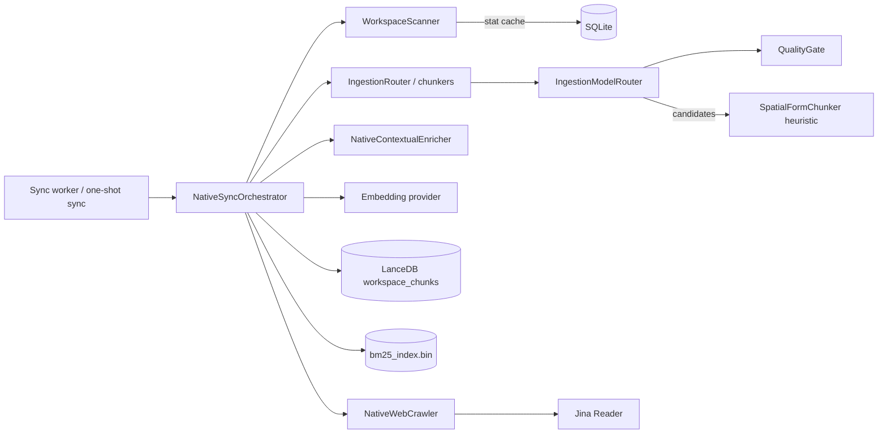

# Ingestion and Sync

Scans workspace folders and web sources, chunks changed content, filters noise and writes chunks to LanceDB and BM25.

## Responsibilities

- Discover the supported files under every folder registered for a workspace and compute what changed since the last sync.
- Chunk new and modified files (through the [chunkers](chunkers.md)), drop noise with the quality gate, and attach a document-level summary envelope.
- Embed the chunks and write them to the LanceDB vector table and the BM25 index; remove the chunks of deleted, moved and modified files.
- Crawl the web sources registered for a workspace and index their pages the same way.
- Report progress, cancellation and results through the SQLite sync telemetry.

It does not decide when to sync (the [command engine](commands.md) and the [CLI](cli.md) do), and it does not own the stores ([storage](storage.md)) or the BM25 format ([retrieval](retrieval.md)).

## Structure

| Module | Role |
|---|---|
| `orchestrator.rs` | `NativeSyncOrchestrator`, `SyncOptions`, `SyncResult`: the sync pipeline. |
| `scanner.rs` | `WorkspaceScanner`, `DiffResult`: filesystem walk and differential calculation. |
| `router.rs` | `IngestionRouter`: picks the chunker for a file (see [chunkers](chunkers.md)). |
| `quality_gate.rs` | `QualityGate`: deterministic noise filter and Document AI triage. |
| `model_router.rs` | `IngestionModelRouter`: runs the quality gate and resolves Document AI candidates. |
| `enricher.rs` | `NativeContextualEnricher`: extractive document summary and keywords (contextual retrieval envelope). |
| `crawler.rs` | `NativeWebCrawler`: BFS crawler with sitemaps, `robots.txt` and web metadata extraction. |
| `jina.rs` | `NativeJinaExtractor`: Markdown extraction through Jina Reader. |
| `traits.rs` | `Chunker`, `ScanSentinel`, `DocumentVisionExtractor`, `DocumentLayoutExtractor` contracts. |
| `model_manager.rs`, `onnx_adapter.rs` | Local model catalog and ONNX adapters, documented in [Model Catalog and Hardware Profiling](model-catalog.md). |

## Behavior

### Sync pass

`NativeSyncOrchestrator::run` performs one pass for one workspace (`SyncOptions { workspace, force, target_folder, verbose, model }`). `run_sync` is the synchronous entry point; when it is called inside a Tokio runtime it runs the pass on a separate thread with its own runtime.

1. Mark the workspace as syncing in the `workspace_sync_status` table (stage `scanning`, worker PID).
2. Add the chunk provenance columns to a LanceDB table created by an older version (`NativeLanceStore::ensure_provenance_columns`, see [storage](storage.md)); a failure goes to `SyncResult::errors`. Then encrypt the chunks an older version stored in plaintext (`NativeLanceStore::encrypt_plaintext_rows`, see [storage](storage.md)); the count goes to `SyncResult::chunks_encrypted_legacy` and is printed by verbose syncs, and a failure goes to `SyncResult::errors` and is retried on the next pass. Finally, a workspace indexed before secret redaction is repaired once (see "Secret redaction" below).
3. Resolve the embedding target and decide whether the stored vectors can be kept (see "Embedding target and reindex" below). A reindex turns the pass into a forced pass over the whole workspace, even when it was scoped to one folder, and writes its message to the sync status.
4. Resolve the folders: only `target_folder` when it is set (a `/folder <path>` sync) and no reindex is due; otherwise the folders registered for the workspace. A workspace with no registered folder indexes no folder, never the current directory, and reports `SyncResult::no_sources` when it has no web source either.
5. Load `bm25_index.bin` from the LanceDB directory, or start an empty index.
6. With `force` (or a reindex), delete the workspace's vectors and BM25 entries (or only the target folder's) and clear the stat cache.
7. Scan and diff against the SQLite stat cache (`WorkspaceScanner::scan_and_diff_native`). A scoped pass compares only the cache entries inside its folder; a full pass also deletes the cached files that are no longer inside any registered folder (the folder was removed with `/folder --remove`). See "Offline sources" below.
8. Apply renames, deletions and modifications: the chunks of deleted, renamed and modified files are removed from LanceDB and BM25 before re-indexing.
9. If nothing changed and the workspace has no web sources, record the ledger and return early as up to date.
10. For each file to index: check for cooperative cancellation, update progress (stage `files`), chunk it with its secret values redacted, triage the chunks, build the document envelope, embed and upsert. Files that yield no chunks are still recorded in the stat cache so they are not re-read on every pass.
11. Crawl the workspace's web sources (only for full workspace syncs, not folder-scoped ones).
12. Save the BM25 index, record the sync ledger (`record_sync_ledger`), set the status back to `idle` and record the embedding target. A cancelled pass returns before this step, so it keeps the previous target and an interrupted reindex runs again on the next pass.

`SyncResult` reports totals, `chunks_dropped_quality`, `documents_enriched_ai`, `quality_pass_rate`, `chunks_encrypted_legacy`, `embedding_reindex` (the reindex message, when one ran), `secrets_redacted` and `secrets_repaired_files`, `offline_folders` and `no_sources`, errors, duration and whether the pass was cancelled. Errors on one file are collected and do not stop the pass.

### Scanning and change detection

- The walk skips version control, dependency, build and IDE directories (`.git`, `node_modules`, `target`, `.venv`, `dist`, `build`, `.next`, `vendor`, and others) and minified bundles.
- Supported files are documents (`pdf`, `docx`, `pptx`, `txt`, `md`, `rst`, `epub`, `eml`, and others), spreadsheets and data (`csv`, `tsv`, `json`, `jsonl`, `xlsx`, `xls`, `ods`, `ofx`), source and configuration files in many languages, well-known file names (`Dockerfile`, `Makefile`, `.env`, and others) and images (`png`, `jpg`, `jpeg`, `webp`).
- A file is new when it is not in the stat cache, modified when its modification time differs by more than 1 ms or its size differs, and deleted when it is cached, no longer on disk, inside a folder the scanner read and not inside an offline path.
- A deleted and a new file of the same non-zero size are treated as a rename when they have the same base name (moved across folders) or the same extension in the same folder (renamed in place).
- Paths are normalized (Windows `\\?\` prefix removed) before comparison.
- A folder that cannot be listed is reported in `DiffResult::missing_folders` and `DiffResult::offline_paths` and skipped; a subfolder or file the walk cannot read is added to `offline_paths`. Its path is never guessed or redirected.

### Offline sources

Files under an offline path keep their index until the source is back ([ADR-0150](../adr/0150-offline-sources-keep-their-index-and-folders-are-never-redir.md)). The orchestrator copies `DiffResult::offline_paths` to `SyncResult::offline_folders` and writes `N source(s) offline, their index is kept: <paths>. If a folder moved, remove it with /folder --remove <path> and add the new path.` (`ingestion::offline_summary`) to the sync status; the CLI prints it with `⚠` after every sync, and prints `ℹ Workspace '<ws>' has no sources: …` when `no_sources` is set. `scanner::is_within_folder` compares whole path components, so `/a/docs` does not contain `/a/docs-old`.

### Secret redaction

Secret values never reach the index ([ADR-0149](../adr/0149-secret-values-are-redacted-before-chunking-with-no-exception.md)). `ingestion::secrets::redact_secrets` replaces them with `[SECRET REDACTED]`, keeping key names, quotes and line breaks, so the rest of the file stays searchable and line numbers do not move. There is no setting or allow list.

- **Rules**: private key blocks (public keys and certificates are kept); provider tokens with a fixed prefix (AWS, GitHub, GitLab, Slack, Stripe, Google, Anthropic, OpenAI, Hugging Face, npm, SendGrid, Twilio, JWT); passwords in URLs and connection strings; values of assignments whose key name says secret (`password`, `secret`, `token`, `api_key`, `client_secret`, `private_key`, `credential`, `auth`, `dsn`, …) unless they are references, flags or code; and random-looking values (20+ base64 or hex characters, high Shannon entropy) of any assignment. Entropy is never scored on free text or checksums.
- **Where**: `IngestionRouter::chunk_file_redacted` (and the text and bytes variants, which the `*_native` methods call) redacts text formats as a whole before chunking and extracted formats (PDF, Office, workbooks, images) chunk by chunk after extraction; web pages go through the same path. The raw file read for the document envelope is redacted too.
- **Reporting**: `SyncResult::secrets_redacted` counts the values replaced in the pass's files, the CLI prints it after the sync, and verbose syncs name each file, never the value.
- **Repair**: a workspace without `secret_redaction_version:<workspace> = 1` in `app_settings` is scanned once at the start of a sync (`NativeLanceStore::for_each_row`). Every file with a stored secret loses its rows, removed from the disk (`NativeLanceStore::purge_paths_from_disk`), and its stat cache entry, so the same pass reindexes it redacted; `SyncResult::secrets_repaired_files` counts them and the CLI asks the user to rotate those credentials when a cloud model was used.

### Chunk triage

`IngestionModelRouter::triage_chunks` runs each chunk through the `QualityGate`, which decides `Pass`, `Reject(reason)` or `DocumentAi(target)`:

- Rejection reasons: `EmptyOrTooShort`, `LowEntropyRepeatedPattern`, `HighEntropyBinaryNoise`, `MinifiedOrCompressedLine`, `DegenerateSyntaxFragment`, `BoilerplateSpam`.
- Defaults (`QualityGateConfig`): `min_chars` 20, Shannon entropy between 1.5 and 5.95 bits per character, `min_lexical_density` 0.12, `max_single_line_chars` 2000, `max_table_pipe_ratio` 0.55.
- Well-formed Markdown tables (with a `| --- |` separator) are never treated as dense complex forms.

Document AI candidates are resolved by `process_document_ai_candidates`, in order: a registered layout extractor, a vision provider when `VisionExecutionMode` is `LocalSlm` or `CorporateVpc`, and finally the pure Rust `SpatialFormChunker` heuristic. The orchestrator uses `IngestionModelRouter::default()`, so today vision is `Disabled`, no layout extractor or scan sentinel is attached, and candidates always go through the spatial heuristic.

### Document envelope

`NativeContextualEnricher::extract_envelope` builds a `SemanticEnvelope` per document from the file's text with its secrets redacted: a title (first heading or short leading line), up to three lead sentences (summary capped at 450 characters) and seven keywords. Envelopes are cached in SQLite by content hash. The envelope text is prepended to each chunk for embedding and BM25 (`apply_envelope_to_chunk`), while LanceDB stores the original chunk text with the summary and keywords as separate columns. Retrieval takes the text of every hit from LanceDB; `strip_envelope` removes the envelope when only the BM25 text is available, so its format has one owner here.

### Chunk provenance

`embed_and_upsert_chunks` stores each chunk's `header_path` (section, symbol, page, sheet or row locator) in its own LanceDB column; `document_summary` holds only the envelope summary. `start_line`/`end_line` are stored only when `IngestionRouter::has_file_lines(file_path)` is true and `1 <= start_line <= end_line`: for local Markdown, code, structured data and plain text files, whose chunkers report file line numbers. Web pages, PDF, Office, images and tabular files (CSV, TSV, Excel, OFX) report page-relative lines, extracted-text lines or row indexes, so they get no line range and keep their locator in `header_path`. Files indexed before v0.45.1 get provenance when they change or with `/sync --force`.

### Embedding and writing

- Chunk ids are `<first 12 hex chars of the file SHA-256>_<index>`.
- `resolve_embedding_provider(db, model_override, workspace)` (`ingestion/embedding.rs`) picks the model name from, in order: the explicit override, `ACTX_EMBEDDING_MODEL`, `ACTX_MODEL`, the workspace (chat) model, the default model, then `text-embedding-3-small`. It returns the provider and an `EmbeddingTarget` (`provider/model`).
- The target is chosen from the model name: `mock*` gives `mock/mock-embed`; `gemini*` gives `gemini/gemini-embedding-2` when a Gemini key is stored; `ollama*`/`local*` give `ollama/nomic-embed-text` on `http://localhost:11434/v1`; otherwise `openai/text-embedding-3-small`. When the chosen provider has no key, it falls back to OpenAI when an OpenAI key is stored, else to `mock/mock-embed`.
- Without a provider the chunks get deterministic pseudo-vectors derived from the SHA-256 of the text. The sync never reaches this today, since the resolver falls back to the mock provider; a failed embedding call fails the file instead (see "Embedding failures").
- Records are upserted into the LanceDB table `workspace_chunks` with `last_modified` (RFC 3339 from the file modification time), content type, summary, keywords and content hash; text, summary and keywords are encrypted by the store (see [storage](storage.md)).

### Embedding failures

A failed embedding call fails the file ([ADR-0146](../adr/0146-a-failed-embedding-fails-the-file-and-embedding-outcomes-are.md)):

- `embed_and_upsert_chunks` returns `EmbedFailure`: `Provider(LmError)`, `ShortAnswer` (a vector count different from the chunk count), `Store` (LanceDB upsert) or `Skipped`. Nothing is written to LanceDB for that file, and the file is not recorded in the stat cache, so the next sync retries it.
- Its chunks stay in BM25, which receives them before the embedding call, so keyword search still finds it. Before indexing a file the loop removes the file's BM25 chunks (`remove_by_exact_file`), so a retry after an edit leaves no chunks of the failed version behind.
- A `RateLimit` error is retried once after `retry_after_secs` (2 s when absent, at most 30 s).
- `EmbedBreaker` (one per pass, shared with web pages) opens on an `Auth` error or after 3 consecutive failed files; a short answer counts as a failure and a success resets the count. While it is open, files and pages are still chunked into BM25 and fail as `Skipped` without calling the provider.
- `SyncResult.embedding_failures` counts the files and pages that failed, and `SyncResult.embedding_provider_unavailable` says whether the breaker opened. The final status writes `embedding_failure_summary` ("N files not embedded; they are retried on the next sync; first error: ...") into `workspace_sync_status.error`; a pass without failures clears it. `sync_error_headline` gives the part before the first `; ` for one-line surfaces.

### Embedding target and reindex

The column `workspaces.embedding_target` records the target that built the workspace's vectors. `decide_reindex` compares it with the current target at the start of every pass:

| Recorded target | Decision |
|---|---|
| equal to the current one | keep |
| different | reindex the whole workspace |
| none, no chunk stored | adopt the current target |
| none, chunks stored (indexed before the record existed) | compare with `legacy_target`, the answer of the earlier resolver: the same target except Gemini, which was `text-embedding-004`. Equal: adopt; different: reindex |

The reindex needs no confirmation; its message ("Embedding model changed (A → B): the whole workspace is reindexed.") goes to the sync status, the verbose output and `SyncResult::embedding_reindex`. `pending_reindex_notice` lets `/model` and `/sync` warn in advance. A workspace without a row in `workspaces` can't record a target and is left as it is. Queries prefer the recorded target until the reindex runs (see [retrieval](retrieval.md)).

On the mock target (`EmbeddingTarget::is_mock`) the chunks are still written with the mock vectors, which are all the same: the rows are needed by BM25-only hits and file name matches, and queries on that target skip dense search ([ADR-0147](../adr/0147-constant-vectors-never-reach-dense-search-the-mock-target-is.md)). Adding a key changes the target, which reindexes the workspace.

### System documentation (`Global`)

The `Global` workspace holds the sections of the embedded `SYSTEM_KNOWLEDGE.md` and `README.md` (`global_knowledge_records` in `crates/actx-cli/src/engine.rs`, ids `global_sys_doc_<n>`), shared by every workspace ([ADR-0147](../adr/0147-constant-vectors-never-reach-dense-search-the-mock-target-is.md)):

- At startup, and from the `search_db` tool, `ensure_global_knowledge_bootstrap` writes the rows with placeholder (zero) vectors and their BM25 entries when they are missing or come from another version (`global_knowledge_version`), then clears the setting `global_knowledge_embedding_target`. It makes no network call.
- After each pass of `actx --sync` and of the sync worker, `refresh_global_knowledge_vectors` embeds the rows with the default target (`resolve_embedding_provider(db, None, "Global")`) when the setting differs from it, replaces the `Global` rows (all vectors first, then delete and insert, since `upsert_records` appends) and records the target in the setting. It does nothing on the mock target, before this version's bootstrap, or when the pass was cancelled or its breaker opened.
- A provider error, a short answer or a vector size other than the table's records nothing: the placeholders stay and the next sync retries. The sync output says `AnyContext documentation embedded with <target>` or why it was not.
- Queries use `Global` in dense search only when the setting equals their target (`global_dense_enabled`, see [retrieval](retrieval.md)).

### Web sources

`NativeWebCrawler` (defaults: 50 pages, depth 3, redirect limit 5, user agent `AnyContext-WebCrawler/...`, `robots.txt` respected) crawls breadth-first from each registered URL, seeding the queue with URLs found in the site's sitemaps. Only `text/html` and `text/plain` responses are processed.

- Page text comes from Jina Reader (`https://r.jina.ai/<url>` with `Accept: text/markdown`, 15 s timeout, 50,000 character limit, optional `JINA_API_KEY`), falling back to stripping HTML tags when Jina fails or returns nothing.
- The modification date follows a cascade: page metadata (`extract_web_metadata`: meta tags, JSON-LD, `<time>`, footer patterns, date in the URL), sitemap `<lastmod>`, the HTTP `Last-Modified` header, and finally the crawl time.
- Each page goes through `index_web_page`: it is chunked with `IngestionRouter::chunk_text_native` (Markdown chunker when the text has headings) and its text is hashed (SHA-256). A page whose URL is already indexed with the same content hash is skipped; otherwise the previous chunks of that page are deleted (exact URL only, never its sub-pages) from LanceDB and BM25, and the new chunks are written, keyed by URL.
- A page that fails to index (chunking, delete or embedding) is reported in the sync errors as `Failed to index page '<url>': ...` and counted with the embedding failures; a crawler that cannot start is reported too. Its retry works through the content hash: no LanceDB row has the new hash yet.
- Web sources are re-crawled on every full sync, but only new or changed pages are re-embedded. Pages that disappeared from the site keep their last indexed chunks. `check_url_modified` (HTTP `HEAD` with `If-None-Match`/`If-Modified-Since`) exists in the crawler but the sync pass does not use it.

### Cancellation and telemetry

Every file iteration reads the sync status; when it is no longer syncing or its stage is `cancelled` (set by `/sync cancel`), the pass stops and reports `cancelled: true`. Progress stages written to SQLite are `scanning`, `files`, `web`, `idle` and `cancelled`; the TUI footer and the agent's `system_status` tool read them. The final `idle` write carries the embedding failure summary in the `error` column (or clears it).

## Interfaces

- **Called by**: the `--sync-worker` process and `actx --sync` in the [CLI](cli.md) (`NativeSyncOrchestrator::new_default`), and the [command engine](commands.md) (`/sync`, `/folder`, `/web`), which spawns the worker with `CommandEngine::spawn_sync_worker` and logs its output to `sync_<workspace>.log`.
- **Calls**: [storage](storage.md) (`NativeLanceStore`, `NativeConfigDb`), [retrieval](retrieval.md) (`BM25Index`), [language model providers](lm-providers.md) (`LmProvider::embed`) and the [chunkers](chunkers.md).
- **Configuration**: `ACTX_EMBEDDING_MODEL`, `ACTX_MODEL`, `JINA_API_KEY`; API keys stored with `/keys`.

## Decisions

- [ADR-0091](../adr/0091-hermetic-workspace-isolation-atomic-exe-swap.md): `/sync` runs in a dedicated background `--sync-worker` process.
- [ADR-0093](../adr/0093-sync-worker-stdio-isolation-chain-of-responsibility.md): worker output goes to log files; each source handler skips gracefully when its source is absent.
- [ADR-0098](../adr/0098-lancestore-count-records-parameter-fix.md): live scanning counts in the progress callbacks.
- [ADR-0102](../adr/0102-scoped-folder-ingestion-utf8-boundaries.md): `/folder <path>` syncs only that folder.
- [ADR-0105](../adr/0105-native-rust-ingestion-sync-pipeline.md): native Rust sync orchestrator replaces the Python workers.
- [ADR-0106](../adr/0106-full-rust-parity-python-purge.md): remaining ingestion features ported to Rust, Python removed.
- [ADR-0110](../adr/0110-ingestion-model-router-quality-gate.md): quality gate, ingestion model router and spatial form reconstruction.
- [ADR-0113](../adr/0113-tabular-chunker-markdown-table-preservation.md): Markdown tables exempt from dense form classification.
- [ADR-0116](../adr/0116-path-healing-temporal-metadata-change-detection.md): web temporal metadata cascade and change detection (its path healing is replaced by ADR-0150).
- [ADR-0124](../adr/0124-jina-reader-web-ingestion-seven-domains.md): Jina Reader for web pages, used only at ingestion time.
- [ADR-0123](../adr/0123-onnx-production-activation-gemma-4-tiers.md) and [ADR-0130](../adr/0130-real-onnx-runtime-multilingual-cross-encoder.md): ONNX perception adapters, which today run as heuristics.
- [ADR-0131](../adr/0131-field-level-encryption-on-every-lancedb-write.md): chunk fields encrypted on every write.
- [ADR-0135](../adr/0135-automatic-encryption-of-lancedb-rows-stored-in-plaintext.md): chunks stored in plaintext encrypted at the start of every sync.
- [ADR-0132](../adr/0132-query-vectors-use-the-ingestion-embedding-provider-and-model.md): one embedding resolver for chunks and queries.
- [ADR-0138](../adr/0138-record-the-embedding-target-per-workspace-and-reindex-on-change.md): embedding target recorded per workspace, automatic reindex when it changes, Gemini `gemini-embedding-2`.
- [ADR-0142](../adr/0142-chunk-provenance-columns-in-lancedb-added-in-place.md): chunk provenance (`header_path`, file line range) stored in LanceDB, lines only for file-line chunkers.
- [ADR-0143](../adr/0143-bm25-only-hits-take-their-text-from-lancedb-batch-deduplicat.md): the enveloped text stays in BM25 only; retrieval reads chunk text from LanceDB and `strip_envelope` is the fallback.
- [ADR-0146](../adr/0146-a-failed-embedding-fails-the-file-and-embedding-outcomes-are.md): a failed embedding fails the file (retried on the next sync, kept in BM25), one rate-limit retry, a provider breaker per pass and the failure summary in the sync status.
- [ADR-0147](../adr/0147-constant-vectors-never-reach-dense-search-the-mock-target-is.md): mock vectors are never searched; the sync embeds `Global` with the default target.
- [ADR-0149](../adr/0149-secret-values-are-redacted-before-chunking-with-no-exception.md): secret values are redacted before chunking with no exception, and indexes built before are repaired once.
- [ADR-0150](../adr/0150-offline-sources-keep-their-index-and-folders-are-never-redir.md): offline sources keep their index, scoped syncs touch only their folder, folders are never redirected, no implicit source.
