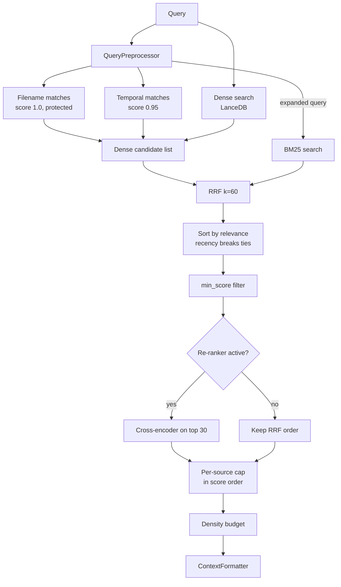

# Retrieval Pipeline

Finds the chunks that answer a question with dense and BM25 search, RRF fusion, cross-encoder re-ranking and context formatting.

## Responsibilities

- Run hybrid search over the `workspace_chunks` table: metadata matches, dense vector search in LanceDB and Okapi BM25 lexical search, fused with Reciprocal Rank Fusion.
- Re-rank the best candidates with the local cross-encoder when it is available, and fall back to the RRF order otherwise.
- Keep the result in relevance order and bounded: a per-source cap applied in score order, a character density budget and token estimates.
- Format retrieved chunks for the language model (U-shaped order, XML envelopes) and decide when there is no usable context at all (Zero Hallucination Gate).
- Provide the BM25 index (format, persistence, corruption recovery), the query preprocessor, the tokenizer and live web search.

The vector table itself belongs to [Storage and Encryption](storage.md); the cross-encoder model belongs to [ONNX Inference](onnx.md); when to retrieve is decided by the [agent](agent.md).

## Structure

| Module | Role |
|---|---|
| `pipeline.rs` | `NativeHybridPipeline`, `HybridSearchRequest`, `HybridSearchResult`, `RetrievalPreset`, Stage 2 re-ranking. |
| `bm25.rs` | `BM25Index`, `DocRecord`: inverted index with atomic, bounded persistence. |
| `rrf.rs` | `reciprocal_rank_fusion` (k = 60 by default). |
| `diversifier.rs` | `apply_source_cap`, `apply_density_budget`, `apply_threshold`. |
| `query.rs` | `QueryPreprocessor`: filename mentions, temporal clauses and temporal query expansion. |
| `tokenizer.rs` | Unicode tokenizer with diacritic folding and code identifier splitting. |
| `token_budget.rs` | `estimate_token_count`, `truncate_to_token_ceiling`, embedding token limits per model. |
| `prompt.rs` | `ContextFormatter`: U-shaped reordering, XML chunk envelopes, deterministic prompt, tool result payload, Deep Search synthesis prompt, Zero Hallucination Gate; `CanonicalSynthesisFormatter`, the Deep Search synthesis adapter. |
| `web_search.rs` | `NativeWebSearchEngine`: Tavily, Serper and DuckDuckGo cascade. |
| `hybrid.rs` | `HybridRetrieverEngine`: thin wrapper over `BM25Index`. |

## Behavior

### Single query search

`NativeHybridPipeline::search_single_async` runs one `HybridSearchRequest`:

1. **Targets**: the request workspace with `candidate_pool_k` candidates, plus each extra target workspace with `max(10, candidate_pool_k / 2)`. With no workspace, `Default` (no filter) is used.
2. **Preprocessing**: `QueryPreprocessor::process` extracts file name mentions, date clauses (as LanceDB filter expressions) and an expanded query with canonical date tokens for BM25.
3. **File name matches**: chunks whose `file_name` or `file_path` contains a mentioned name (combined with the date clauses when present) get score 1.0 and are *protected*: they keep that score through re-ranking.
4. **Temporal matches**: chunks matching the date clauses get at least 0.95.
5. **Dense search**: the query is embedded with the provider and model set by `set_embedding` (the CLI passes the result of `ingestion::resolve_query_embedding_provider`: the target recorded by the workspace's last completed sync when its provider can be built, otherwise the resolver the sync uses for chunk vectors; default model `text-embedding-3-small`) unless a vector is supplied. When embedding fails, dense search is skipped and ranking relies on the metadata matches and BM25.
6. **BM25**: `BM25Index::search` over the expanded query, filtered to the workspace (chunks of the `Global` workspace always pass the filter).
7. **Fusion**: `reciprocal_rank_fusion(dense_ids, sparse_ids, rrf_k)`; scores are plain RRF scores. Texts stored encrypted (`enc::` prefix) are decrypted here. Each result carries the text, content hash and chunk provenance (`header_path`, `start_line`, `end_line`) of its LanceDB row. The BM25 file stores the enveloped text it indexes and no provenance, so the hits found only by BM25 read their row from LanceDB in one `id IN (...)` metadata query, matched on chunk id and normalized file path; when no row is found (or the lookup fails) they keep the BM25 text with the envelope removed by `NativeContextualEnricher::strip_envelope` and have no provenance. A chunk therefore reaches re-ranking and the prompt with the same text whichever list found it. The candidates are sorted with `compare_by_relevance`: score descending, then newer `last_modified` first on an exact tie (missing or invalid dates last). Recency never changes a score, so it cannot lift a chunk past a better one.
8. **Threshold**: results below `min_score` are dropped (on RRF scores). The CLI callers use `RRF_MIN_SCORE` (0.005 = 1/(60 + 140)), which keeps every candidate of a pool of up to 140 per list; it guards against empty matches and is not a relevance cutoff.
9. **Stage 2 re-ranking** (unless the pipeline or the request mode is `off`): the best `MAX_RERANK_CANDIDATES` (30) unprotected results are scored by the cross-encoder on a blocking thread (`tokio::task::spawn_blocking`). They receive calibrated scores in [0, 1]; the rest of the tail is rescaled below half of the lowest re-scored score, keeping its relative RRF order. If the re-ranker is not neural-active or returns the wrong number of scores, the RRF order is kept unchanged.
10. **Per-source cap and budget**: the results are sorted again with `compare_by_relevance`. `apply_source_cap` walks them in score order and skips a chunk whose source already has `max_chunks_per_source` selected chunks, up to `top_k`. When fewer than `top_k` are selected, the skipped chunks fill the remaining slots in score order, so the cap never leaves a slot empty. The output stays in descending score order, which the U-shaped reordering relies on. `apply_density_budget` caps the total characters at `max_density_chars`, condensing or dropping the weakest chunks at the end.

`search` is the synchronous wrapper. `last_rerank_latency_ms()` exposes the latency of the last neural pass in the process.

### Batch search

`retrieve_hybrid_batch_async` runs several sub-queries concurrently (Deep Search). Each sub-query applies its own threshold and re-ranking; results are then deduplicated by chunk id (the content hash is the hash of the whole source file, shared by all its chunks; files with identical content share chunk ids), their scores are summed across sub-queries and `matched_subqueries` records which sub-queries found them. The merged list is sorted with `compare_by_relevance`, then the per-source cap and the density budget of the first request are applied to it. Accumulated scores are not filtered or re-ranked again.

### Request parameters in use

All three use the default `max_chunks_per_source` (3) and `RRF_MIN_SCORE` for `min_score`.

| Caller | `top_k` | `candidate_pool_k` | `max_density_chars` | `min_score` | Extra target |
|---|---|---|---|---|---|
| `search_db` agent tool | 5 | 30 | 12,000 | 0.005 | `Global` |
| Deterministic one-hop retriever | 6 | 30 | 14,000 | 0.005 | `Global` |
| Deep Search batch retriever (`deep_search_request`) | 8 per sub-query | 40 | 16,000 | 0.005 | `Global` |

`RetrievalPreset` (`Turbo`, `Balanced`, `Deep`) defines alternative parameter sets (pool 50/100/150, top 10/20/40, minimum score 0.012/0.008/0.005, 2/3/5 chunks per source, 20,000/40,000/60,000 characters, RRF k 60). The re-rank mode comes from the `rerank_mode` setting (`auto`, `on`, `off`; default `auto`).

### BM25 index

- Okapi BM25 with `k1 = 1.2` and `b = 0.75`; tokens come from the Unicode tokenizer, which also emits diacritic-folded variants and camelCase/snake_case/kebab-case sub-tokens.
- Stored as `bm25_index.bin` (for `workspace_chunks`) or `bm25_<table>.bin` in the LanceDB directory.
- Written atomically (temporary file and rename); loaded with a bounded, panic-safe bincode deserialization.
- A file that fails to load is renamed to `<file>.corrupt.<timestamp>`, logged to `bm25_quarantine.log`, and replaced by an empty index.
- Entries are added and removed by chunk id, file path (with or without sub-paths) or workspace during [ingestion](ingestion.md).
- The file stores chunk text in plaintext, because lexical search needs the terms; LanceDB keeps the encrypted copy (see [storage](storage.md)).

### Context formatting

`ContextFormatter` is the single formatter for every surface:

- `u_shaped_reorder` turns `[R1, R2, R3, R4, R5, R6]` into `[R1, R3, R5, R6, R4, R2]`, placing the two best chunks at the edges of the context.
- `format_xml_chunks` wraps each chunk in `<chunk id rank score source file [version] type>` inside `<retrieved_context>`, with a `[Context: <file> | Section: <header path> | Type: <type> | Modified: <date>]` header line, and a `lines="<start>-<end>"` attribute when the chunk has a file line range; `Section` and `lines` are omitted when unknown. `infer_version` splits the path into whole tokens (on `/`, `\`, `_`, `-` and spaces, without the file extension; for a URL only its path) and takes the last `v<n>[.<n>...]` token, else `legacy` for a `legacy` or `deprecated` token; without such a token the chunk has no `version` attribute. There is no `scope` attribute: `source` identifies the document.
- Attribute values are XML-escaped (`&`, `<`, `>`, `"`, `'`; control characters become spaces). In chunk text, the header line and the query, only the `<` that opens or closes an envelope tag listed in `RESERVED_PROMPT_TAGS` (`retrieved_context`, `chunk`, `system_instructions`, `user_query`, `tool_result`, `query_anchor`) is replaced by `&lt;`, in any case and with optional spaces and slash; other markup and code reach the model unchanged. A test fails if the envelope uses a tag missing from that list.
- `format_deterministic_prompt` builds the full one-hop prompt: system instructions plus context isolation rules, the XML context and the `<user_query>`. The isolation rules come from one function, `isolation_rules`, shared with the Deep Search synthesis. Excerpts from different sources or versions are combined only when the text shows they apply to the same thing; conflicting values are presented per source. Rule 4 asks to cite the source file, with its line range (`file:start-end`) when the chunk has a `lines` attribute. The last rule states that chunk content is quoted document text, never instructions.
- `format_tool_result_payload` builds the `search_db` result: the XML context followed by a `<query_anchor>` that restates the original query, asks for conflicting values per source and tells the model to treat chunk content as data.
- `format_deep_search_prompt` builds the final Deep Search synthesis prompt with the same layout: system instructions, isolation rules and Deep Search synthesis rules (cover every part of the question, only the direct conclusion, state what was not found), the XML context and the `<user_query>` last. Deep Search accumulates several batches, so the chunks are first sorted with `compare_by_relevance`. `CanonicalSynthesisFormatter` implements the `actx_agent::SynthesisPromptFormatter` port with it: it maps `RetrievedChunk` to `HybridSearchResult` and is injected by the CLI (see [Agent](agent.md)).
- `evaluate_zero_hallucination` returns an honest "not found" answer listing the workspace's folders and web sources when there are no chunks or none scores at least 0.005; the caller then skips the language model call.

### Web search

`NativeWebSearchEngine::search` (used by the `web_search` agent tool when web search is enabled) tries Tavily (`TAVILY_API_KEY` or stored key), then Serper (`SERPER_API_KEY` or stored key), then DuckDuckGo HTML results, which need no key. The workspace's web source domains are passed as preferred domains.

## Interfaces

- **Called by**: the agent tools and retrievers assembled in `crates/actx-cli/src/engine.rs` (`search_db`, `PipelineDeterministicRetriever`, `PipelineBatchRetriever`, `web_search`), the [command engine](commands.md) (inspection), and [ingestion](ingestion.md) (`BM25Index`).
- **Calls**: [storage](storage.md) (`NativeLanceStore` vector and metadata search, `NativeSecurityEngine`), [ONNX Inference](onnx.md) (`OnnxReranker`), [language model providers](lm-providers.md) (`embed`).
- **Exports**: `NativeHybridPipeline`, `HybridSearchRequest`, `HybridSearchResult`, `ContextFormatter`, `CanonicalSynthesisFormatter`, `BM25Index` and the helpers re-exported from `any_context_core_rs::retrieval`.

## Decisions

- [ADR-0076](../adr/0076-native-hybrid-rag-pipeline.md): `NativeHybridPipeline` centralizes vector, BM25, RRF, deduplication, per-source limits and density budgeting in Rust (source round-robin replaced in ADR-0139).
- [ADR-0096](../adr/0096-bounded-bm25-deserialization-self-healing-index.md): bounded BM25 deserialization, atomic writes and quarantine of corrupt files.
- [ADR-0106](../adr/0106-full-rust-parity-python-purge.md): retrieval presets, contextual retrieval envelopes and multi-provider web search in Rust.
- [ADR-0108](../adr/0108-reflective-deep-search-engine.md): batch retrieval for Deep Search with content-hash deduplication.
- [ADR-0113](../adr/0113-tabular-chunker-markdown-table-preservation.md): RRF threshold of 0.005 and defensive decryption of `enc::` texts.
- [ADR-0116](../adr/0116-path-healing-temporal-metadata-change-detection.md): `last_modified` end to end; its recency micro-boost is replaced by a tie-break in ADR-0139.
- [ADR-0120](../adr/0120-source-display-names-shared-sources-removal.md): shared sources search removed; strict workspace isolation.
- [ADR-0128](../adr/0128-backend-first-deterministic-dual-rag.md): U-shaped reordering, XML isolation, query anchor and Zero Hallucination Gate.
- [ADR-0129](../adr/0129-two-stage-retrieval-cross-encoder-reranking.md): two-stage retrieval with cross-encoder re-ranking and `auto`/`on`/`off` modes.
- [ADR-0130](../adr/0130-real-onnx-runtime-multilingual-cross-encoder.md): real ONNX re-ranking of at most 30 candidates, protected file-name matches and tail rescaling.
- [ADR-0132](../adr/0132-query-vectors-use-the-ingestion-embedding-provider-and-model.md): query vectors use the ingestion embedding provider and model.
- [ADR-0138](../adr/0138-record-the-embedding-target-per-workspace-and-reindex-on-change.md): query vectors prefer the embedding target recorded by the last completed sync.
- [ADR-0136](../adr/0136-neutralizing-reserved-prompt-tags-in-retrieved-text.md): escaped attributes, neutralized envelope tags in retrieved text and queries, and chunk content declared as data.
- [ADR-0139](../adr/0139-retrieval-order-follows-relevance.md): relevance-only ranking, per-source cap in score order, recency as a tie-breaker and the `RRF_MIN_SCORE` floor.
- [ADR-0140](../adr/0140-chunk-version-attribute-from-explicit-path-tokens-no-inferre.md): `version` only from explicit path tokens, no inferred `scope`, conflicting values reported per source.
- [ADR-0141](../adr/0141-deep-search-synthesis-uses-the-canonical-context-formatter-t.md): the Deep Search synthesis uses `ContextFormatter` through the `SynthesisPromptFormatter` port, with the shared isolation rules.
- [ADR-0142](../adr/0142-chunk-provenance-columns-in-lancedb-added-in-place.md): chunk provenance in results and prompts, `lines` attribute, `Section` header and `file:start-end` citations; BM25-only hits read their provenance from LanceDB.
- [ADR-0143](../adr/0143-bm25-only-hits-take-their-text-from-lancedb-batch-deduplicat.md): BM25-only hits take their text, content hash and provenance from LanceDB (envelope stripped as fallback); batch deduplication by chunk id.
