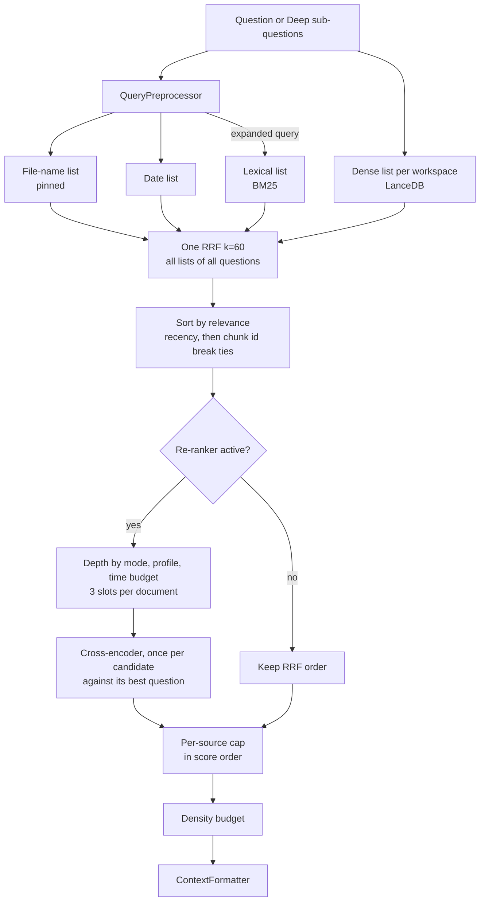

# Retrieval Pipeline

Finds the chunks that answer a question with dense and BM25 search, RRF fusion, cross-encoder re-ranking and context formatting.

## Responsibilities

- Run hybrid search over the `workspace_chunks` table: metadata matches, dense vector search in LanceDB and Okapi BM25 lexical search, fused with Reciprocal Rank Fusion.
- Re-rank the best candidates with the local cross-encoder when it is available, and fall back to the RRF order otherwise.
- Keep the result in relevance order and bounded: a per-source cap applied in score order, a character density budget and token estimates.
- Format retrieved chunks for the language model (U-shaped order, XML envelopes) and decide when there is no usable context at all (Zero Hallucination Gate).
- Provide the BM25 index (format, persistence, corruption recovery), the query preprocessor, the tokenizer and live web search.

The vector table itself belongs to [Storage and Encryption](storage.md); the cross-encoder model belongs to [ONNX Inference](onnx.md); when to retrieve is decided by the [agent](agent.md).

## Structure

| Module | Role |
|---|---|
| `pipeline.rs` | `NativeHybridPipeline`, `HybridSearchRequest`, `HybridSearchResult`, `RetrievalPreset`, Stage 2 re-ranking. |
| `requests.rs` | `fast_request` and `deep_request`: the requests the product sends, shared with the benchmark. |
| `filter.rs` | `RetrievalFilter`: source scopes, date range and content types, rendered as a LanceDB predicate and as the BM25 rule. |
| `bm25.rs` | `BM25Index`, `DocRecord`: inverted index with atomic, bounded persistence. |
| `rrf.rs` | `fuse`: RRF of any number of `RankedList`s (k = 60 by default), with the questions that found each candidate and the best one. |
| `relevance.rs` | `RelevanceBand` (relevant, maybe, irrelevant), `RelevanceThresholds::band`, `BandCounts`. |
| `rerank_depth.rs` | Reranker depth by `SearchMode` and hardware profile, time budgets, measured cost per candidate, `PER_DOCUMENT_RERANK_SLOTS`. |
| `diversifier.rs` | `apply_source_cap`, `apply_density_budget`. |
| `query.rs` | `QueryPreprocessor`: filename mentions, temporal clauses and temporal query expansion. |
| `tokenizer.rs` | Unicode tokenizer with diacritic folding and code identifier splitting. |
| `token_budget.rs` | `estimate_token_count`, `truncate_to_token_ceiling`, embedding token limits per model. |
| `prompt.rs` | `ContextFormatter`: U-shaped reordering, XML chunk envelopes, deterministic prompt, live status prompt, tool result payload, Deep Search synthesis prompt, Zero Hallucination Gate; `CanonicalSynthesisFormatter`, the Deep Search synthesis adapter. |
| `web_search.rs` | `NativeWebSearchEngine`: Tavily API search, `NO_SEARCH_PROVIDER`. |
| `hybrid.rs` | `HybridRetrieverEngine`: thin wrapper over `BM25Index`. |



## Behavior

### Single query search

`NativeHybridPipeline::search_with_outcome` runs one `HybridSearchRequest` and returns a `RetrievalOutput`: the results, the `QueryEmbeddingOutcome` of its dense half and the `RerankOutcome` of its reranking. `search_single_async` returns the results only. It is a batch of one question: steps 1 to 6 collect the question's lists (`collect_lists`), steps 7 to 9 fuse, rerank and select them (`fuse_and_rerank`), exactly as for Deep ([ADR-0156](../adr/0156-one-fusion-of-all-lists-per-search-and-reranker-depth-by-mode-profile-and-time-budget.md)).

The request's `filter` (`RetrievalFilter`: source scopes, a modification date range, content types; empty by default) narrows every list inside its search, before the list's limit, never after it ([ADR-0155](../adr/0155-retrieval-filters-apply-inside-each-retriever-and-the-answer-says-when-dense-search-did-not-run.md)). `lance_predicate()` renders it for LanceDB and `matches()` for BM25. A source scope matches its own path and anything under it (`docs` never matches `docs-old`), with either path separator; the date range is inclusive below and exclusive above, on the stored UTC RFC 3339 `last_modified`, and chunks without a date never pass it; values are escaped literals. The workspace, the embedding target and the `Global` rule below are applied as before.

1. **Targets**: the request workspace with `candidate_pool_k` candidates, plus each extra target workspace with `max(10, candidate_pool_k / 2)`. With no workspace, `Default` is used. Every workspace, `Default` included, is filtered to its own chunks plus `Global` in dense search, metadata matches, BM25 and the lookup of BM25-only rows (BUG-023).
2. **Preprocessing**: `QueryPreprocessor::process` extracts file name mentions, date clauses (as LanceDB filter expressions) and an expanded query with canonical date tokens for BM25. The BM25 search (step 6) starts now, on a blocking thread, and runs while steps 3 to 5 do.
3. **File name list**: chunks whose `file_name` or `file_path` contains a mentioned name (combined with the date clauses when present, and with the request filter) form one list, in the order LanceDB returns them. They are *pinned*: after fusion they get score 1.0, take no reranker slot and keep that score.
4. **Date list**: chunks matching the date clauses (and the request filter) form one list, in the order LanceDB returns them; no score is invented for them.
5. **Dense search**: the question, with the query prefix of the workspace's vector space (IMP-029), is embedded with the provider set by `set_query_embedding` (the CLI passes `ingestion::resolve_query_embedding` through `QueryEmbedding::apply`: the target recorded by the workspace's last completed sync, never another model; when that model cannot run, dense search is skipped for the question and the outcome says why) unless a vector is supplied. The vector search is limited to the request filter and to chunks of that space (`embedding_target` equal to the target's key, or empty for chunks written before ADR-0154), so vectors of two models are never compared. On the mock target the resolver gives no provider, because every mock vector is the same: dense search is skipped. When embedding fails or returns no vector, dense search is skipped too, and ranking relies on the metadata matches and BM25. A query vector shorter than the chunk table (Ollama `nomic-embed-text` gives 768 values for the 1536 table) is zero-padded by `search_vector_async` exactly as the stored vectors are padded on write, so the scores equal those of the short space; a longer vector is rejected, as it is on write (BUG-021). A failed vector search is recorded, not dropped. Each searched workspace gives its own dense list, ranked by similarity (chunk id on ties). The outcome is recorded as a `QueryEmbeddingOutcome` (`Dense`, `NoProvider`, `NoEmbeddingKey` on the mock target, `Unavailable(reason)` when the workspace's model cannot run, `Failed(reason)` for the embedding call, `SearchFailed(reason)` for the vector search), see below. Rows of the `Global` workspace take part only when the pipeline's `set_global_dense` is on, which the CLI sets from `ingestion::global_dense_enabled`: `Global` was embedded with the query's target. Otherwise the `Global` target is skipped and the vector search filters `workspace <> 'Global'` (on every workspace, `Default` included), so the placeholder vectors written at startup never rank; `Global` is still found by BM25 and file name matches ([ADR-0147](../adr/0147-constant-vectors-never-reach-dense-search-the-mock-target-is.md)).
6. **BM25**: `BM25Index::search_filtered` over the expanded query, filtered to the workspace (chunks of the `Global` workspace always pass it) and to the request filter before scoring, so `candidate_pool_k` counts only matching chunks. The pipeline shares each loaded index as an `Arc`, so a search does not copy it.
7. **Fusion**: `rrf::fuse(lists, rrf_k)` over every list of every question of the search (k = 60, equal weights); scores are plain RRF scores, and no candidate is dropped by its score (the `min_score` cut was removed, ADR-0156). Each fused candidate records the questions whose lists found it (`matched_subqueries`) and the question of its highest single contribution. `dense_score` is the best cosine similarity of a dense hit, `sparse_score` its BM25 score. Texts stored encrypted (`enc::` prefix) are decrypted here. Each result carries the text, content hash and chunk provenance (`header_path`, `start_line`, `end_line`) of its LanceDB row. The BM25 file stores the enveloped text it indexes and no provenance, so the hits found only by BM25 read their row from LanceDB in one `id IN (...)` metadata query, matched on chunk id and normalized file path; when no row is found (or the lookup fails) they keep the BM25 text with the envelope removed by `NativeContextualEnricher::strip_envelope` and have no provenance. A chunk therefore reaches re-ranking and the prompt with the same text whichever list found it. The candidates are sorted with `compare_by_relevance`: score descending, then newer `last_modified` first on an exact tie (missing or invalid dates last). Recency never changes a score, so it cannot lift a chunk past a better one.
8. **Stage 2 re-ranking** (always on, no user option, [ADR-0157](../adr/0157-the-cross-encoder-is-always-on-discards-what-it-does-not-sco.md)): the unpinned candidates, in fusion order, go through `apply_source_cap` with `PER_DOCUMENT_RERANK_SLOTS` (3) per document, the reserve filling the slots left, up to the depth (`rerank_picks`). The depth is the request's `rerank_depth`, lowered by `rerank_depth::effective_depth` when the request has a `rerank_budget_ms` and the cost per candidate measured in this process would exceed it (never below `MIN_RERANK_DEPTH`, 10). The picks are scored by the cross-encoder in one pass on a blocking thread (`tokio::task::spawn_blocking`), each candidate once, against the question that ranked it best (one `score_batch` per question). They receive calibrated scores in [0, 1], and every other unpinned candidate is discarded (`keep_scored`): only the pinned matches and the scored candidates go on to the selection. The pass records its latency, its candidate count and its cost per candidate (averaged with the previous one). The outcome is `Scored`, `NotNeeded` when there is nothing unpinned to score, or `Unavailable(cause)` when the cross-encoder cannot run: no reranker on the pipeline, ONNX Runtime missing, weights missing, a failed load, a scoring error or the wrong number of scores. `Unavailable` keeps the fusion order and discards nothing.
   **Relevance bands** ([ADR-0158](../adr/0158-reranker-scores-are-read-as-relevance-bands-and-irrelevant-chunks-are-discarded.md)): after a `Scored` pass, every scored candidate gets the band of its score under the thresholds of the active reranker in the [model catalog](model-catalog.md) (`OnnxModelManager::relevance_thresholds(model_id)`): irrelevant below the first threshold, relevant from the second, maybe between them (a score at a threshold takes the higher band). The irrelevant candidates are discarded (`apply_relevance_bands`), even when they are the best ones left, so they never reach the selection or the LLM. Pinned matches have no band. With any other outcome, or a reranker that is not in the catalog, nothing is banded or discarded. `RetrievalOutput::bands` has the `BandCounts` of the pass (relevant, maybe, irrelevant discarded), `None` when nothing was banded. `NativeHybridPipeline::set_relevance_cut(false)` bands without discarding; only the benchmark's ranking pass uses it.
9. **Per-source cap and budget**: the results are sorted again with `compare_by_relevance`. `apply_source_cap` walks them in score order and skips a chunk whose source already has `max_chunks_per_source` selected chunks, up to `top_k`. When fewer than `top_k` are selected, the skipped chunks fill the remaining slots in score order, so the cap never leaves a slot empty. The output stays in descending score order, which the U-shaped reordering relies on. `apply_density_budget` caps the total characters at `max_density_chars`, condensing or dropping the weakest chunks at the end; a condensed chunk is returned with its condensed text. Both use the first request's values.

`search` is the synchronous wrapper. `last_rerank_pass()` (`last_rerank_latency_ms()`, `last_rerank_candidates()`) gives the latency and the candidate count of the last neural pass in the process, , `last_rerank_outcome()` the last reranking outcome and `last_band_counts()` the band counts of the last search (none when it was not banded); the `Reranker` line of `/status` shows them with the model and the profile's depths. The query embedding outcome of step 5 is kept on the pipeline (`last_query_embedding()`) and process-wide (`last_query_embedding_outcome()`); `dense_search_status()` turns the latter into the `Dense Search` line of `/status` and of the `system_status` report, or `n/a (no query yet in this session)` ([ADR-0146](../adr/0146-a-failed-embedding-fails-the-file-and-embedding-outcomes-are.md)). `QueryEmbeddingOutcome::answer_notice()` turns an outcome other than `Dense` into the warning line the retrievers in `engine.rs` pass to the [agent](agent.md), which shows it at the end of the answer ("Answered by keyword search only: <cause>. <fix>"). `RerankOutcome::answer_notice()` does the same for a reranker that could not run ("Answered without relevance ranking: <cause>. <fix>", the fix being `actx download reranker` for missing weights, a reinstall for a missing runtime, `/status` otherwise); `RetrievalOutput::notices()` joins both, dense first, and is what the retrievers pass.

### Batch search

`retrieve_hybrid_batch_with_outcome` (and `retrieve_hybrid_batch_async`, results only) collects the lists of several sub-queries concurrently (Deep Search), then runs steps 7 to 9 once over all of them; its dense outcome is the first sub-query whose dense half did not run, or `Dense`, and it has one reranking outcome. Candidates are keyed by chunk id (the content hash is the hash of the whole source file, shared by all its chunks; files with identical content share chunk ids). A chunk found by several sub-queries is one candidate: it collects the RRF contributions of each list, `matched_subqueries` names every sub-query that found it, and it is reranked once, against the sub-query that ranked it best. Scores are never summed across sub-queries (ADR-0156).

### Request parameters in use

All three use the default `max_chunks_per_source` (3). They are built by `retrieval::tool_request`, `retrieval::fast_request` and `retrieval::deep_request` with `CANDIDATES_PER_LIST` (30) candidates per list and the hardware profile in effect (`hardware_tier` in `actx-cli/src/engine.rs`: the `active_profile` setting, else the recommended profile, probed once per process); none sets a filter yet (FEAT-088 and IMP-047 will).

| Caller | `top_k` | `candidate_pool_k` | `max_density_chars` | Reranker depth | Time budget | Extra target |
|---|---|---|---|---|---|---|
| `search_db` agent tool (`tool_request`) | 5 | 30 | 12,000 | Fast | 1 s | `Global` |
| Deterministic one-hop retriever (`fast_request`) | 6 | 30 | 14,000 | Fast | 1 s | `Global` |
| Deep Search batch retriever (`deep_request`) | 8 per batch | 30 per sub-query | 16,000 | Deep | 3 s | `Global` |

Reranker depth per profile (`rerank_depth::profile_depth`), Fast / Deep: Lite 20 / 30, Smart Balanced 30 / 50, Air-Gapped Power 30 / 50, Workstation Pro 40 / 75, Sovereign Ultra 50 / 100. Requests built without the builders default to a depth of 30 and no time budget.

`RetrievalPreset` (`Turbo`, `Balanced`, `Deep`) defines alternative parameter sets (pool 50/100/150, top 10/20/40, 2/3/5 chunks per source, 20,000/40,000/60,000 characters, RRF k 60). There is no re-rank mode: a `rerank_mode` setting stored by an older version is ignored.

Equal scores are ordered by recency, then by chunk id and file path (`compare_by_relevance`); BM25 orders equal scores by chunk id before its cut at the pool size. The same question therefore always ranks the same.

### BM25 index

- Okapi BM25 with `k1 = 1.2` and `b = 0.75`; tokens come from the Unicode tokenizer, which also emits diacritic-folded variants and camelCase/snake_case/kebab-case sub-tokens.
- Stored as `bm25_index.bin` (for `workspace_chunks`) or `bm25_<table>.bin` in the LanceDB directory.
- Written atomically (temporary file and rename); loaded with a bounded, panic-safe bincode deserialization.
- A file that fails to load is renamed to `<file>.corrupt.<timestamp>`, logged to `bm25_quarantine.log`, and replaced by an empty index.
- Entries are added and removed by chunk id, file path (with or without sub-paths) or workspace during [ingestion](ingestion.md).
- The file stores chunk text in plaintext, because lexical search needs the terms; LanceDB keeps the encrypted copy (see [storage](storage.md)).

### Context formatting

`ContextFormatter` is the single formatter for every surface:

- `u_shaped_reorder` turns `[R1, R2, R3, R4, R5, R6]` into `[R1, R3, R5, R6, R4, R2]`, placing the two best chunks at the edges of the context.
- `format_xml_chunks` wraps each chunk in `<chunk id rank score source file [version] type>` inside `<retrieved_context>`, with a `[Context: <file> | Section: <header path> | Type: <type> | Modified: <date>]` header line, and a `lines="<start>-<end>"` attribute when the chunk has a file line range; `Section` and `lines` are omitted when unknown. `infer_version` splits the path into whole tokens (on `/`, `\`, `_`, `-` and spaces, without the file extension; for a URL only its path) and takes the last `v<n>[.<n>...]` token, else `legacy` for a `legacy` or `deprecated` token; without such a token the chunk has no `version` attribute. There is no `scope` attribute: `source` identifies the document.
- Attribute values are XML-escaped (`&`, `<`, `>`, `"`, `'`; control characters become spaces). In chunk text, the header line and the query, only the `<` that opens or closes an envelope tag listed in `RESERVED_PROMPT_TAGS` (`retrieved_context`, `chunk`, `system_instructions`, `user_query`, `tool_result`, `query_anchor`, `live_status`) is replaced by `&lt;`, in any case and with optional spaces and slash; other markup and code reach the model unchanged. A test fails if the envelope uses a tag missing from that list. The list and these helpers live in `actx_agent::prompt_safety` and are shared with the Deep Search intermediate prompts, which add `sub_queries` to the list (see [Agent](agent.md)).
- `format_deterministic_prompt` builds the full one-hop prompt: system instructions plus context isolation rules, the XML context and the `<user_query>`. The isolation rules come from one function, `isolation_rules`, shared with the Deep Search synthesis. Excerpts from different sources or versions are combined only when the text shows they apply to the same thing; conflicting values are presented per source. Rule 4 asks to cite the source file, with its line range (`file:start-end`) when the chunk has a `lines` attribute. The last rule states that chunk content is quoted document text, never instructions.
- `format_tool_result_payload` builds the `search_db` result: the XML context followed by a `<query_anchor>` that restates the original query, asks for conflicting values per source and tells the model to treat chunk content as data.
- `format_status_prompt` builds the one-hop prompt for a live status question: the deterministic prompt plus the live status rules (the report is evidence; status questions are answered from it; no estimated progress) and the status report in `<live_status>` after the XML context, neutralized like chunk text (ADR-0145).
- `format_deep_search_prompt` builds the final Deep Search synthesis prompt with the same layout: system instructions, isolation rules and Deep Search synthesis rules (cover every part of the question, only the direct conclusion, state what was not found), the XML context and the `<user_query>` last. Deep Search accumulates several batches, so the chunks are first sorted with `compare_by_relevance`. `CanonicalSynthesisFormatter` implements the `actx_agent::SynthesisPromptFormatter` port with it: it maps `RetrievedChunk` to `HybridSearchResult` and is injected by the CLI (see [Agent](agent.md)).
- `evaluate_zero_hallucination` returns an honest "not found" answer listing the workspace's folders and web sources when there are no chunks or none scores at least 0.005; the caller then skips the language model call.

### Web search

`NativeWebSearchEngine::search` (used by the `web_search` agent tool when web search is enabled) uses only the Tavily API (`TAVILY_API_KEY` or the key saved with `/keys tavily`), first scoped to the workspace's web source domains and then on the open web. Without a key it returns `NO_SEARCH_PROVIDER` before any request, and `/web-search on` shows the same notice. There is no scraping fallback ([ADR-0152](../adr/0152-web-search-uses-only-allowed-search-apis-and-never-scrapes.md)). The client identifies itself as `AnyContext/<version>`.

### Benchmark

The development benchmark ([ADR-0153](../adr/0153-a-development-retrieval-benchmark-gates-retrieval-changes.md)) measures retrieval quality on a fixed corpus. It is development tooling: the `actx-bench` crate is not part of the product build.

- **Data** (`benchmarks/retrieval/`): `corpus/` holds fictitious documents in Portuguese and English (Markdown, text, PDF) and the fictitious CMR form, with distractors that differ in version, negation, module or date; `questions.json` holds the labeled questions (id, language, category, text, relevant documents with a grade from 1 to 3 and an optional passage; negative questions have none); `baseline.<config_id>.json` is the committed reference; `results/` is git-ignored; `tools/make_pdfs.py` regenerates the PDFs.
- **Run**: the corpus is indexed from scratch in a sandbox whose default paths (`ACTX_SETTINGS_DB`, `ACTX_CONTEXT_DB`, `ACTX_MODELS_DIR`, `ACTX_TEST_MODE`) point to a temp folder. Each question runs a ranking pass (`fast_request` with `top_k` 10, no density cut, no `Global`) and a delivered pass (`fast_request` as sent, no `Global`); the run stops if the cross-encoder is not active. The ranking pass bands without discarding (`set_relevance_cut(false)`), so the ranking metrics measure order and keep every score; the delivered pass applies the relevance cut as the product does. `--reranker <id>` runs another catalog reranker (default `mmarco-reranker`).
- **Metrics**: on positive questions, HitRate@1/3/5/10, MRR@10 and NDCG@10 (a document counts once, at its best rank), passage HitRate@5, the delivered hit rate and the false nothing-found rate; on negative questions, the nothing-found rate (the delivered pass returned nothing); latency of the delivered pass (mean and p95), overall, by language and by category. Each positive question records the best reranker score of a relevant document in the ranking pass (`best_relevant_score`), and the summary has a band calibration table: for irrelevant thresholds 0.005, 0.01, 0.02, 0.03 and 0.05, the negatives whose best score is below it (nothing would be delivered) and the positives that would lose their relevant document.
- **Gate**: a run is compared with the baseline of the same configuration (`config_id`, corpus and question file hashes, retrievers, embedding target, reranker); it fails when MRR@10, HitRate@5 or the delivered hit rate is more than 0.02 below. Latency never fails a run. Runs with another configuration are reported as not comparable.
- **Configurations**: `lexical-rerank` (the mock embedding target, so dense search is skipped, plus the verified cross-encoder) and `dense-local-<model>-rerank` (`--embedding local/<model>`: the local embedding model through the product's resolution, downloaded into the models folder, plus the cross-encoder). A run with another reranker appends `-<reranker>` to the id. A cloud model (`--embedding openai/text-embedding-3-small`) takes its key from the environment. The run stops if the index was embedded with another target.
- **CI**: `.github/workflows/retrieval-benchmark.yml` runs on pull requests and pushes that change retrieval, ingestion, storage, `actx-onnx`, `actx-bench` or the benchmark data, with `--check-determinism`, and writes the comparison to the job summary. It runs both configurations, the dense one with the reference model (the default of the AirGappedPower profile), each against its own baseline; a manual run (`workflow_dispatch`, input `embedding`) benchmarks another catalog model and only reports it when it has no baseline.

```bash
cargo run -p actx-bench --release -- retrieval validate
cargo run -p actx-bench --release -- retrieval run                  # compare with the baseline
cargo run -p actx-bench --release -- retrieval run --save-baseline  # accept a change
```

Exit codes: 0 no regression, 1 regression, 2 invalid labels, 3 environment error (ONNX Runtime, reranker, provider), 4 baseline missing or not comparable when `--compare` is given, 5 non-deterministic ranking.

## Interfaces

- **Called by**: the agent tools and retrievers assembled in `crates/actx-cli/src/engine.rs` (`search_db`, `PipelineDeterministicRetriever`, `PipelineBatchRetriever`, `web_search`), the [command engine](commands.md) (inspection), and [ingestion](ingestion.md) (`BM25Index`).
- **Calls**: [storage](storage.md) (`NativeLanceStore` vector and metadata search, `NativeSecurityEngine`), [ONNX Inference](onnx.md) (`OnnxReranker`), [language model providers](lm-providers.md) (`embed`).
- **Exports**: `NativeHybridPipeline`, `HybridSearchRequest`, `HybridSearchResult`, `ContextFormatter`, `CanonicalSynthesisFormatter`, `BM25Index` and the helpers re-exported from `any_context_core_rs::retrieval`.

## Decisions

- [ADR-0076](../adr/0076-native-hybrid-rag-pipeline.md): `NativeHybridPipeline` centralizes vector, BM25, RRF, deduplication, per-source limits and density budgeting in Rust (source round-robin replaced in ADR-0139).
- [ADR-0096](../adr/0096-bounded-bm25-deserialization-self-healing-index.md): bounded BM25 deserialization, atomic writes and quarantine of corrupt files.
- [ADR-0106](../adr/0106-full-rust-parity-python-purge.md): retrieval presets, contextual retrieval envelopes and multi-provider web search in Rust.
- [ADR-0108](../adr/0108-reflective-deep-search-engine.md): batch retrieval for Deep Search with content-hash deduplication.
- [ADR-0113](../adr/0113-tabular-chunker-markdown-table-preservation.md): RRF threshold of 0.005 and defensive decryption of `enc::` texts.
- [ADR-0116](../adr/0116-path-healing-temporal-metadata-change-detection.md): `last_modified` end to end; its recency micro-boost is replaced by a tie-break in ADR-0139.
- [ADR-0120](../adr/0120-source-display-names-shared-sources-removal.md): shared sources search removed; strict workspace isolation.
- [ADR-0128](../adr/0128-backend-first-deterministic-dual-rag.md): U-shaped reordering, XML isolation, query anchor and Zero Hallucination Gate.
- [ADR-0129](../adr/0129-two-stage-retrieval-cross-encoder-reranking.md): two-stage retrieval with cross-encoder re-ranking and `auto`/`on`/`off` modes.
- [ADR-0130](../adr/0130-real-onnx-runtime-multilingual-cross-encoder.md): real ONNX re-ranking of at most 30 candidates, protected file-name matches and tail rescaling.
- [ADR-0132](../adr/0132-query-vectors-use-the-ingestion-embedding-provider-and-model.md): query vectors use the ingestion embedding provider and model.
- [ADR-0138](../adr/0138-record-the-embedding-target-per-workspace-and-reindex-on-change.md): query vectors prefer the embedding target recorded by the last completed sync.
- [ADR-0136](../adr/0136-neutralizing-reserved-prompt-tags-in-retrieved-text.md): escaped attributes, neutralized envelope tags in retrieved text and queries, and chunk content declared as data.
- [ADR-0148](../adr/0148-shared-prompt-safety-primitives-and-the-deep-search-intermed.md): the neutralization helpers move to `actx_agent::prompt_safety`, shared with the Deep Search intermediate prompts.
- [ADR-0139](../adr/0139-retrieval-order-follows-relevance.md): relevance-only ranking, per-source cap in score order, recency as a tie-breaker and the `RRF_MIN_SCORE` floor (removed by ADR-0156).
- [ADR-0140](../adr/0140-chunk-version-attribute-from-explicit-path-tokens-no-inferre.md): `version` only from explicit path tokens, no inferred `scope`, conflicting values reported per source.
- [ADR-0141](../adr/0141-deep-search-synthesis-uses-the-canonical-context-formatter-t.md): the Deep Search synthesis uses `ContextFormatter` through the `SynthesisPromptFormatter` port, with the shared isolation rules.
- [ADR-0153](../adr/0153-a-development-retrieval-benchmark-gates-retrieval-changes.md): the development retrieval benchmark, its gate, the shared request builders and the fixed tie-break.
- [ADR-0142](../adr/0142-chunk-provenance-columns-in-lancedb-added-in-place.md): chunk provenance in results and prompts, `lines` attribute, `Section` header and `file:start-end` citations; BM25-only hits read their provenance from LanceDB.
- [ADR-0143](../adr/0143-bm25-only-hits-take-their-text-from-lancedb-batch-deduplicat.md): BM25-only hits take their text, content hash and provenance from LanceDB (envelope stripped as fallback); batch deduplication by chunk id.
- [ADR-0145](../adr/0145-live-status-reaches-the-routed-paths-as-retrieved-context.md): the `<live_status>` block for status questions.
- [ADR-0146](../adr/0146-a-failed-embedding-fails-the-file-and-embedding-outcomes-are.md): the query embedding outcome is recorded and shown in `/status` and the `system_status` report.
- [ADR-0147](../adr/0147-constant-vectors-never-reach-dense-search-the-mock-target-is.md): no dense search on the mock target; `Global` joins dense search only when embedded with the query's target.
- [ADR-0152](../adr/0152-web-search-uses-only-allowed-search-apis-and-never-scrapes.md): web search only through allowed APIs (Tavily); DuckDuckGo scraping and Serper removed.
- [ADR-0155](../adr/0155-retrieval-filters-apply-inside-each-retriever-and-the-answer-says-when-dense-search-did-not-run.md): the request filter inside both retrievers, BM25 in parallel with dense search, 30 candidates per list, and the dense outcome returned with the results for the answer's warning line.
- [ADR-0156](../adr/0156-one-fusion-of-all-lists-per-search-and-reranker-depth-by-mode-profile-and-time-budget.md): clean lists, one RRF per search (Deep included) without a score cut, one reranking pass with 3 slots per document, and the reranker depth by mode, hardware profile and time budget.
- [ADR-0157](../adr/0157-the-cross-encoder-is-always-on-discards-what-it-does-not-sco.md): the cross-encoder is always on, candidates it does not score are discarded, and a reranker that cannot run keeps the fusion order with a warning at the end of the answer.
- [ADR-0158](../adr/0158-reranker-scores-are-read-as-relevance-bands-and-irrelevant-chunks-are-discarded.md): reranker scores are read as relevance bands with per-model thresholds in the catalog, irrelevant chunks are discarded, and the benchmark calibrates the thresholds and gates the delivered hit rate.
