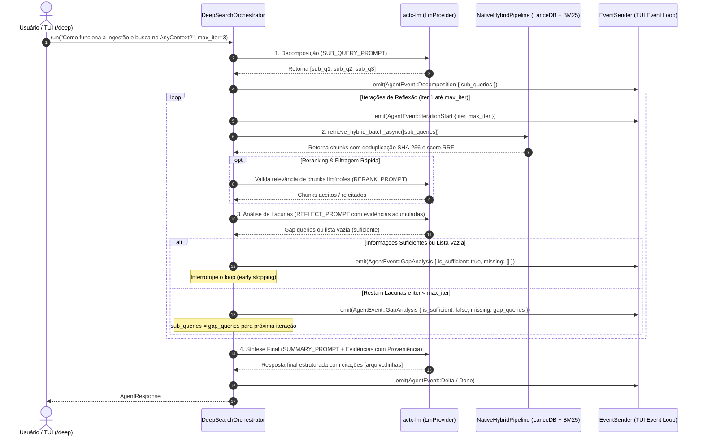

# Blueprint Fase 2: Motor Deep Search Agêntico Reflexivo Nativo em Rust (RFC-042 & DeepSearcher Reference)

## 📌 Metadados
- **Projeto**: `any-context` (`actx`)
- **Versão Alvo**: `v0.34.0`
- **Fase do Master Plan**: Fase 2 (RFC-042 Deep Search & ModelRouter)
- **Referência Técnica**: `https://github.com/zilliztech/deep-searcher`
- **Status**: Em Planejamento / Aguardando Aprovação (Gate 3)

---

## 1. 🔍 Contexto & Aprendizados do Repositório de Referência (`zilliztech/deep-searcher`)

O repositório de referência estabelece os princípios fundamentais de um motor de busca profunda baseada em agentes:
1. **Decomposição Ortogonal (`SUB_QUERY_PROMPT`)**: Quebra de perguntas complexas em até 4 sub-perguntas independentes (ou 1 se simples).
2. **Filtragem / Reranking de Chunks (`RERANK_PROMPT`)**: Validação semântica booleana ("YES" / "NO") de chunks candidatos antes de aceitá-los no corpus de evidências, reduzindo ruído e alucinação.
3. **Avaliação Iterativa de Lacunas (`REFLECT_PROMPT`)**: Inspeção cruzada entre pergunta original, sub-perguntas já exploradas e evidências acumuladas, gerando até 3 novas "gap queries" se restarem pontos cegos, ou encerrando imediatamente se as informações forem suficientes.
4. **Síntese de Conteúdo (`SUMMARY_PROMPT`)**: Geração da resposta final consolidando todos os chunks aceitos.

### 🚀 Vantagens Nativas & Diferenciais do AnyContext:
- **100% Pure Native Rust**: Zero latência de Python, execução do loop em milissegundos com paralelismo real via `tokio::join_all` e `retrieve_hybrid_batch_async`.
- **Hybrid RAG Robusto**: Combinação nativa de vetores no LanceDB + léxico BM25 Okapi em memória + fusão RRF ($k=60$).
- **Proveniência de Código em Nível de Linha**: Cada chunk do AnyContext possui `file_path`, `file_name`, `start_line`, `end_line` e `header_path` (Tree-sitter), permitindo síntese com citações exatas de código (`[crates/core/src/router.rs:45-60]`).
- **Telemetria Reativa para TUI**: Emissão de eventos tipados em tempo real (`AgentEvent::Decomposition`, `AgentEvent::IterationStart`, `AgentEvent::GapAnalysis`) para renderização visual da árvore de reflexão.

---

## 2. 🏛️ Arquitetura do `DeepSearchOrchestrator` (`crates/actx-agent/src/deep_search.rs`)

---

## 3. 📋 Marcos de Execução (Milestones)

- **M1: Módulo `DeepSearchOrchestrator` e Prompts Reflexivos em `actx-agent`**:
  - Criação de `crates/actx-agent/src/deep_search.rs`.
  - Implementação dos prompts em inglês padronizados: `SUB_QUERY_PROMPT`, `RERANK_PROMPT`, `REFLECT_PROMPT` e `SUMMARY_PROMPT`.
  - Parser resiliente de respostas (extração de listas JSON/Python mesmo com textos explicativos ou blocos `<think>`).

- **M2: Integração de Batch Retrieval com `NativeHybridPipeline` e Reranker**:
  - Conexão do `DeepSearchOrchestrator` com `retrieve_hybrid_batch_async`.
  - Deduplicação de chunks entre iterações e acumulação de score.
  - Reranker opcional/configurável (comportamento híbrido: aceitação direta para scores altos e filtro semântico para limítrofes).

- **M3: Loop Iterativo de Reflexão, Análise de Lacunas e Eventos Reativos**:
  - Loop determinístico com teto `max_iter` (padrão: 3).
  - Emissão síncrona dos eventos `AgentEvent::Decomposition`, `AgentEvent::IterationStart`, `AgentEvent::GapAnalysis`.
  - Early stopping se `gap_queries` for vazio ou sobreposição for superior a 90%.

- **M4: Síntese com Proveniência Estruturada de Arquivos e Linhas**:
  - Formatação dos chunks com cabeçalhos semânticos e identificação clara de arquivos e intervalos de linhas.
  - Inclusão de referências verificáveis na resposta final gerada pelo modelo.

- **M5: Superfície CLI/TUI: Comandos `/deep`, `/fast`, `/search` e Árvore de Reflexão**:
  - Suporte ao comando `/deep <pergunta>` no dispatcher da CLI/TUI para forçar o Deep Search.
  - Suporte ao comando `/fast <pergunta>` para resposta direta em turno único.
  - Suporte ao comando `/search <auto|fast|deep>` para gravar a política do workspace ativo no banco SQLite.
  - Renderização na TUI do status reativo das sub-perguntas e iterações.

- **M6: Suíte Completa de Testes Unitários e E2E**:
  - Testes unitários em `actx-agent` cobrindo decomposição, parsing de gap queries, filtragem e síntese com `MockLmProvider`.
  - Testes de integração em `tests/` validando o fluxo completo com `NativeHybridPipeline` real em SQLite/LanceDB temporário.
  - 100% de testes verdes em `cargo test --workspace`.

- **M7: Dual-Doc (README + TECDOC com ADR-108) e Cenário 23 em `MANUAL_TESTS.md`**:
  - Atualização do `README.md` documentando o comando `/deep` e o modo Deep Search.
  - Atualização do `TECDOC.md` com a Seção 101 e o **ADR-108 (Motor Deep Search Reflexivo e Roteamento Adaptativo)**.
  - Inclusão do **Cenário 23** em `tests/MANUAL_TESTS.md` de forma não-truncada.

- **M8: Versionamento v0.34.0, Gate 8, Release CI Watch e Publicação**:
  - Bump de versão para `0.34.0`.
  - Verificação de Gate 8 (`verify_gate.py --gate 8`).
  - Commit, tag `v0.34.0`, push e acompanhamento contínuo dos builds no GitHub Actions até a confirmação de publicação em `Levix-Digital/any-context-releases`.
