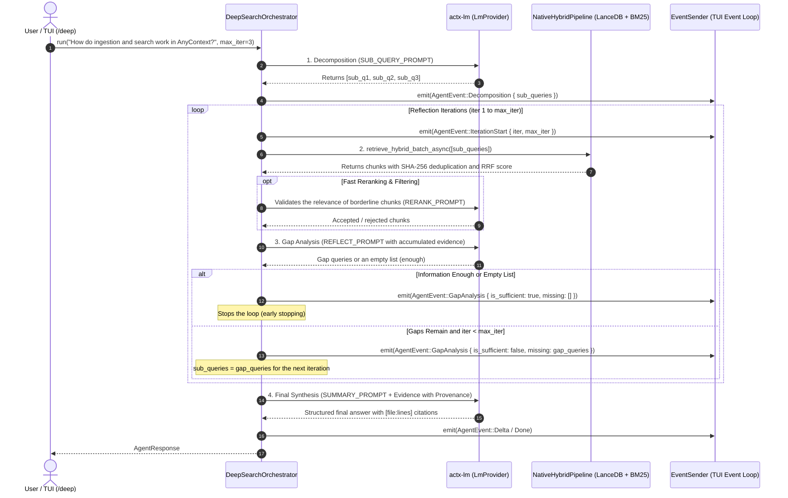

# Phase 2 Blueprint: Native Rust Reflective Agentic Deep Search Engine (RFC-042 & DeepSearcher Reference)

## 📌 Metadata
- **Project**: `any-context` (`actx`)
- **Target Version**: `v0.34.0`
- **Master Plan Phase**: Phase 2 (RFC-042 Deep Search & ModelRouter)
- **Technical Reference**: `https://github.com/zilliztech/deep-searcher`
- **Status**: In Planning / Awaiting Approval (Gate 3)

---

## 1. 🔍 Context & Lessons from the Reference Repository (`zilliztech/deep-searcher`)

The reference repository sets out the fundamental principles of an agent-based deep search engine:
1. **Orthogonal Decomposition (`SUB_QUERY_PROMPT`)**: breaking complex questions into up to 4 independent sub-questions (or 1 if simple).
2. **Chunk Filtering / Reranking (`RERANK_PROMPT`)**: a boolean semantic validation ("YES" / "NO") of candidate chunks before accepting them into the evidence corpus, reducing noise and hallucination.
3. **Iterative Gap Evaluation (`REFLECT_PROMPT`)**: cross-inspection between the original question, the sub-questions already explored and the accumulated evidence, producing up to 3 new "gap queries" if blind spots remain, or stopping at once if the information is enough.
4. **Content Synthesis (`SUMMARY_PROMPT`)**: generation of the final answer consolidating all accepted chunks.

### 🚀 AnyContext's Native Advantages & Differentiators:
- **100% Pure Native Rust**: zero Python latency, the loop runs in milliseconds with real parallelism through `tokio::join_all` and `retrieve_hybrid_batch_async`.
- **Robust Hybrid RAG**: native combination of LanceDB vectors + in-memory Okapi BM25 lexical search + RRF fusion ($k=60$).
- **Line-Level Code Provenance**: each AnyContext chunk has `file_path`, `file_name`, `start_line`, `end_line` and `header_path` (Tree-sitter), allowing synthesis with exact code citations (`[crates/core/src/router.rs:45-60]`).
- **Reactive Telemetry for the TUI**: real-time emission of typed events (`AgentEvent::Decomposition`, `AgentEvent::IterationStart`, `AgentEvent::GapAnalysis`) to render the reflection tree visually.

---

## 2. 🏛️ `DeepSearchOrchestrator` Architecture (`crates/actx-agent/src/deep_search.rs`)

---

## 3. 📋 Execution Milestones

- **M1: `DeepSearchOrchestrator` Module and Reflective Prompts in `actx-agent`**:
  - Creation of `crates/actx-agent/src/deep_search.rs`.
  - Standardized English prompts: `SUB_QUERY_PROMPT`, `RERANK_PROMPT`, `REFLECT_PROMPT` and `SUMMARY_PROMPT`.
  - Resilient answer parser (extracting JSON/Python lists even with explanatory text or `<think>` blocks).

- **M2: Batch Retrieval Integration with `NativeHybridPipeline` and Reranker**:
  - Connection of `DeepSearchOrchestrator` to `retrieve_hybrid_batch_async`.
  - Chunk deduplication across iterations and score accumulation.
  - Optional/configurable reranker (hybrid behavior: direct acceptance for high scores and a semantic filter for borderline ones).

- **M3: Iterative Reflection Loop, Gap Analysis and Reactive Events**:
  - Deterministic loop with a `max_iter` ceiling (default: 3).
  - Synchronous emission of the `AgentEvent::Decomposition`, `AgentEvent::IterationStart`, `AgentEvent::GapAnalysis` events.
  - Early stopping if `gap_queries` is empty or the overlap is above 90%.

- **M4: Synthesis with Structured File and Line Provenance**:
  - Chunk formatting with semantic headers and clear identification of files and line ranges.
  - Verifiable references included in the final answer generated by the model.

- **M5: CLI/TUI Surface: `/deep`, `/fast`, `/search` Commands and the Reflection Tree**:
  - Support for the `/deep <question>` command in the CLI/TUI dispatcher to force Deep Search.
  - Support for the `/fast <question>` command for a direct single-turn answer.
  - Support for the `/search <auto|fast|deep>` command to store the active workspace's policy in the SQLite database.
  - Rendering in the TUI of the reactive status of sub-questions and iterations.

- **M6: Complete Unit and E2E Test Suite**:
  - Unit tests in `actx-agent` covering decomposition, gap query parsing, filtering and synthesis with `MockLmProvider`.
  - Integration tests in `tests/` validating the full flow with a real `NativeHybridPipeline` on a temporary SQLite/LanceDB.
  - 100% green tests in `cargo test --workspace`.

- **M7: Dual-Doc (README + TECDOC with ADR-108) and Scenario 23 in `MANUAL_TESTS.md`**:
  - `README.md` update documenting the `/deep` command and the Deep Search mode.
  - `TECDOC.md` update with Section 101 and **ADR-108 (Reflective Deep Search Engine and Adaptive Routing)**.
  - **Scenario 23** added to `tests/MANUAL_TESTS.md`, non-truncated.

- **M8: v0.34.0 Versioning, Gate 8, Release CI Watch and Publication**:
  - Version bump to `0.34.0`.
  - Gate 8 verification (`verify_gate.py --gate 8`).
  - Commit, tag `v0.34.0`, push and continuous follow-up of the GitHub Actions builds until publication is confirmed in `Levix-Digital/any-context-releases`.
