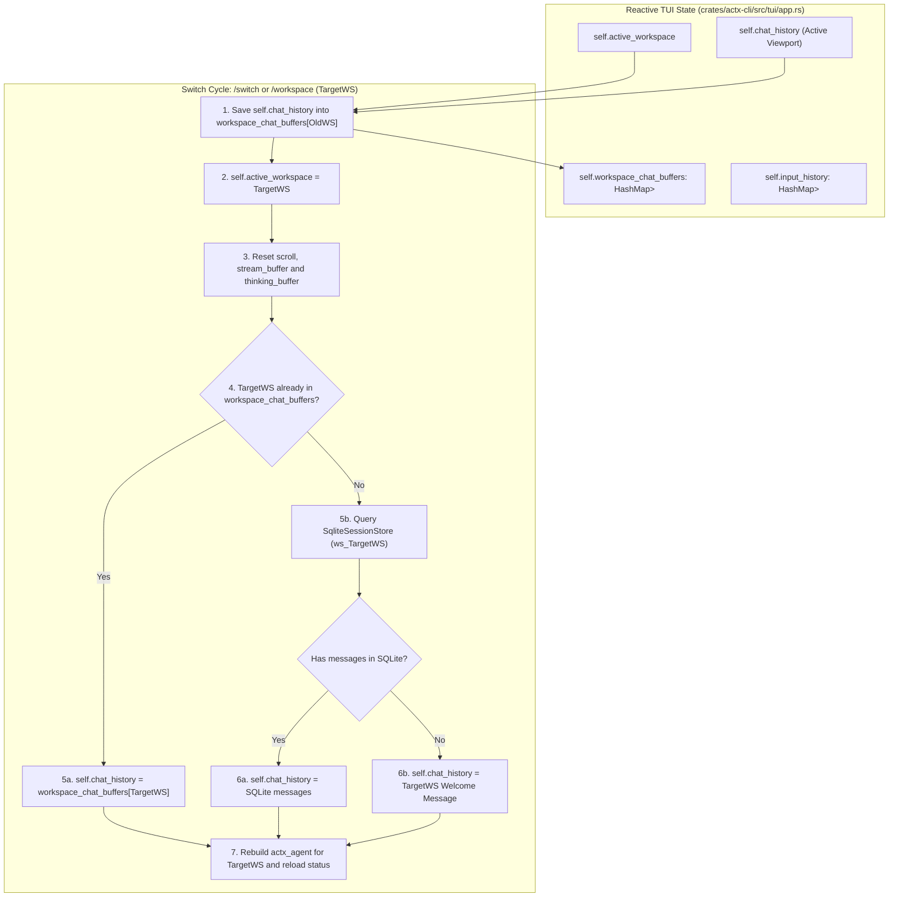

# 📐 Blueprint v0.32.10: Hermetic Isolation of Chat Buffers and History per Workspace in the Native TUI (crates/actx-cli)

## 📌 Plan Metadata
- **Project**: AnyContext (`actx`)
- **Target Version**: `v0.32.10`
- **Status**: Active (`active`)
- **Date**: 2026-10-04
- **Conversation ID**: `09953e71-964e-4480-b790-66a5d4797cd7`
- **Architecture Principle**: Virtual Tab Workspace Isolation pattern (ADR-052 & Hexagonal Ports & Adapters)

---

## 🔍 1. Problem Diagnosis & Root Cause
In the native Rust TUI (`crates/actx-cli/src/tui/app.rs`), the application state kept:
- `pub input_history: HashMap<String, Vec<String>>` (correctly isolated per workspace for Up/Down prompt history navigation).
- **`pub chat_history: Vec<ChatMessageItem>`** (monolithic and shared by every workspace).

When switching workspaces through `/workspace <target>`, `/switch <target>` or the modal menu (`[F1] -> Workspaces`):
1. The previous workspace's `chat_history` was not kept in any map.
2. `self.active_workspace` changed to the new workspace.
3. `load_session_history_for_workspace()` ran and called `self.chat_history.push(...)` without clearing the previous history.
4. If the new workspace had no previous messages (e.g. newly created), no message was added, and the screen kept showing all of the previous workspace's messages, with only a footer notice about the switch.
5. When switching back, the messages were pulled again and duplicated at the end of the single vector.

---

## 🏛️ 2. Solution Architecture (Virtual Tab Workspace Isolation)

---

## 🎯 3. Execution Milestones

- **M1: Per-Workspace Buffer Structure in `App`**:
  - Add `pub workspace_chat_buffers: std::collections::HashMap<String, Vec<ChatMessageItem>>` to `App`.
  - Create a helper function `create_welcome_message` to standardize per-workspace welcome headers.
- **M2: Atomic `switch_to_workspace` Method in `App`**:
  - Save the source workspace's `chat_history` into `workspace_chat_buffers`.
  - Restore the target workspace's history from the session cache or load it from `SqliteSessionStore` (`ws_<target>`).
  - If the workspace is new, render the workspace's canonical welcome message with its model, grounding and search status.
  - Reset the ephemeral viewport variables (`current_stream_buffer`, `current_thinking_buffer`, `scroll_offset`, `auto_scroll`).
- **M3: Integration with `/clear` and `/reset-memory`**:
  - On `/clear`: clear the on-screen buffer and remove the active workspace's cache entry from `workspace_chat_buffers`.
  - On `/reset-memory`: attach the `CommandAction::ClearChat` action in `engine.rs` so that resetting memory in SQLite also clears the active workspace's screen.
- **M4: Automated Test Suite in Rust**:
  - Create unit tests in `crates/actx-cli/tests/cli_tests.rs` validating that when switching between `WorkspaceA` and `WorkspaceB`:
    - `WorkspaceA` keeps its messages.
    - `WorkspaceB` starts clean or with its own history.
    - Returning to `WorkspaceA` restores exactly its messages, with no leakage or duplication.
- **M5: Dual-Doc Update & Manual Test Scenario**:
  - Sync `TECDOC.md` (ADR-092) and `README.md`.
  - Add Scenario 11 (or extend Scenario 10) in `tests/MANUAL_TESTS.md`, detailing the step-by-step validation of chat screen isolation.
- **M6: Gate Validation & Release `v0.32.10` Preparation**:
  - Version bump in every manifest, binary builds and release follow-up.
