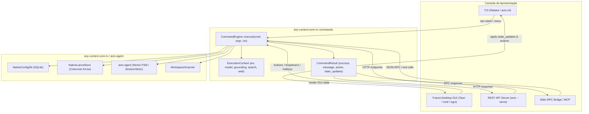

# 📐 Blueprint Arquitetural v0.32.4: Desacoplamento Universal do Motor de Comandos e Separação de Grounding Mode vs Search Mode

## 1. Visão Geral e Contexto
Atendendo às orientações de arquitetura do usuário e aos pilares fundamentais do `dev-cycle-protocol` (Pilar 1: Modularização & Isolamento de Domínio; Pilar 2: Arquitetura Hexagonal & Paridade Multi-Superfície):
1. **Separação Conceitual Rígida**:
   - `Grounding Mode` (`STRICT`, `HYBRID`, `PROACTIVE`): governa o rigor epistemológico e a ancoragem da IA aos documentos indexados no workspace.
   - `Search Mode` / Profundidade de Busca (`AUTO`, `FAST`, `DEEP`): governa a profundidade de recuperação RAG (RFC-042), alternando entre busca rápida direta e raciocínio reflexivo multi-etapa.
2. **Desacoplamento Total de Comandos e Interfaces**:
   - Elimina o acoplamento direto onde as funções de comando recebiam `&mut App` (struct da TUI Ratatui).
   - Introduz o `CommandEngine` puro no Core, recebendo um `ExecutionContext` agnóstico e retornando um `CommandResult` estruturado.
   - Qualquer UI (TUI atual, futura Desktop GUI, REST API, Stdio RPC, extensões) passa a atuar exclusivamente como um *Presentation Adapter*.

---

## 2. Arquitetura Hexagonal (Ports & Adapters)



---

## 3. Especificação dos Modos Operacionais

### A. Grounding Mode (`/mode`, `/grounding`, `/grounding-mode`)
- **Valores válidos**: `strict` (ou `s`), `hybrid` (ou `h`), `proactive` (ou `p`).
- **Comportamento**:
  - `strict`: O agente responde estritamente apoiado em chunks recuperados do workspace ativo.
  - `hybrid`: Prioriza contexto local complementado por conhecimento geral do modelo.
  - `proactive`: Ancoragem com inferência proativa para preenchimento de lacunas.
- **Persistência**: `grounding_mode` em `settings.db`.

### B. Search Mode / Profundidade de Busca (`/search`, `/search-mode`, `/depth`, `/fast`, `/deep`)
- **Valores válidos**: `auto` (ou `a`), `fast` (ou `f`), `deep` (ou `d`).
- **Comportamento**:
  - `auto`: O agente decide autonomamente pela complexidade da query.
  - `fast`: Execução direta de busca híbrida de 1 turno (< 50ms).
  - `deep`: Busca profunda reflexiva com decomposição em sub-queries (RFC-042).
- **Persistência**: `search_mode` em `settings.db`.
- **Configuração do Agente**: Mapeado para `actx_agent::config::SearchMode`.

---

## 4. Estrutura do CommandEngine e CommandResult

```rust
#[derive(Debug, Clone, Serialize, Deserialize)]
pub struct CommandResult {
    pub success: bool,
    pub message: String,
    pub action: CommandAction,
    pub state_updates: CommandStateUpdates,
    pub error: Option<String>,
}

#[derive(Debug, Clone, PartialEq, Eq, Serialize, Deserialize, Default)]
pub enum CommandAction {
    #[default]
    None,
    Exit,
    ClearChat,
    OpenMenu(String),
    SwitchWorkspace(String),
    RebuildAgent,
}

#[derive(Debug, Clone, Default, Serialize, Deserialize)]
pub struct CommandStateUpdates {
    pub active_workspace: Option<String>,
    pub active_model: Option<String>,
    pub grounding_mode: Option<String>,
    pub search_mode: Option<String>,
    pub web_search_enabled: Option<bool>,
}
```

---

## 5. Top Header Telemetry na TUI

O cabeçalho superior (`render_header` em `crates/actx-cli/src/tui/ui.rs`) exibirá com destaque todos os 5 parâmetros operacionais:
```text
AnyContext v0.32.4 ─ [WS: Default] ─ [Model: gpt-4o-mini] ─ [Grounding: HYBRID] ─ [Search: AUTO] ─ [Web: OFF] ─ ● IDLE
```

---

## 6. Marcos de Execução (Milestones)
- **M1**: Implementar `CommandResult`, `CommandAction`, `CommandStateUpdates`, `ExecutionContext` e `CommandEngine` em `crates/any-context-core-rs/src/commands/`.
- **M2**: Separar `/mode` (Grounding: strict/hybrid/proactive) e `/search` (Search Mode: auto/fast/deep) no `CommandEngine` e persistir ambas as chaves em `settings.db`.
- **M3**: Refatorar `crates/actx-cli/src/commands/dispatcher.rs` para delegar 100% da execução ao `CommandEngine`, atuando apenas como consumidor de `CommandResult`.
- **M4**: Atualizar o `App` e o TUI Top Header para renderizar `[Grounding: ...]` e `[Search: ...]` de forma reativa.
- **M5**: Suíte de testes unitários e de integração validando o isolamento do CommandEngine e os novos comandos.
- **M6**: Atualização do Dual-Doc (`TECDOC.md`, `README.md`) e acúmulo de testes manuais em `tests/MANUAL_TESTS.md` (Cenário 6).
- **M7**: Verificação Gate 8, bump `v0.32.4`, release e acompanhamento contínuo no CI.
