# 📐 Engineering Blueprint v0.34.8: Smart Path Healing, Temporal Metadata & Active Change Detection

## 📌 Context & Diagnosis of the Reported Problems

### 1. Google Drive Path Diagnosis
- **Error shown in the TUI**:
  `❌ Directory does not exist: G:/My Drive/Documentos/Levix Digital/AnyContext`
- **Investigation on Disk (`G:\`)**:
  - PowerShell test `Test-Path "G:\My Drive\Levix Digital\AnyContext"` ➔ **`True`** (the directory **exists**!).
  - PowerShell test `Test-Path "G:\My Drive\Documentos\Levix Digital\AnyContext"` ➔ **`False`**.
  - The `Levix Digital` directory is at the root of the Drive (`G:\My Drive\Levix Digital`), and **NOT** inside `Documentos`.
  - In the SQLite database `%LOCALAPPDATA%\AnyContext\config\settings.db` (`workspace_folders` table), the old record contained the redundant `/Documentos/` folder.
  - Since the check did `Path::new(folder).exists()`, Rust strictly reported that the stored path did not exist.

### 2. Diagnosis of the "Most Recent Information Rule"
- **Prompt Status**: the instruction already exists in the System Prompt (`crates/actx-cli/src/prompt.rs:180-182`):
  > *Whenever multiple sources within the same priority tier contain overlapping or differing information, THE MOST RECENT SOURCE ALWAYS PREVAILS AND SUPERSEDES OLDER DATA.*
- **Critical Bottleneck Identified in the RAG Pipeline**:
  - The `VectorRecord` in LanceDB **stores** `last_modified: Option<String>` (RFC 3339 timestamp).
  - **HOWEVER**:
    1. The `HybridSearchResult` struct in `crates/any-context-core-rs/src/retrieval/pipeline.rs` **had no `last_modified` field** (it was dropped while assembling the results).
    2. The BM25 `DocRecord` did not store `last_modified` either.
    3. In the `search_db` tool (`crates/actx-cli/src/engine.rs`), chunks were formatted for the LLM like this:
       `• [{}] (Score: {:.2}, Source: {}, Type: {}):\n{}` (no date or time!).
    4. For web pages (`sync_web_portals`), `mtime` was stored as `0.0` (UNIX epoch 1970).
  - **Conclusion**: the LLM was told to prioritize the most recent information, but the chunks it read **had no date or time indication in the header**.

### 3. Diagnosis of Change Detection and the "Up to date" Status
- **Why was the file change not detected?**:
  1. Since the path in the database contained `Documentos/`, the scanner ran `if !root_p.exists() { continue; }`, skipping the folder. So it found 0 files on disk and 0 in the cache, concluding that the workspace was "Up to date".
  2. AnyContext **has no active background filesystem watcher** (such as `notify` or `ReadDirectoryChangesW`) running continuously while the app is idle. Checks only happened when `/sync` or startup ran.
  3. The TUI showed a fixed `✔ Up to date` whenever `is_syncing == false`, without testing whether the configured folders were reachable or whether there were modified files.

---

## 🏛️ Solution Architecture for Release `v0.34.8`

```mermaid
flowchart TD
    subgraph PathHealing["1. Smart Path Healing Engine"]
        A["Configured Folder"] --> B{"Path::exists()?"}
        B -- Yes --> C["Valid Path"]
        B -- No --> D["try_heal_path()"]
        D --> E["Remove/Add 'Documentos/'"]
        E --> F["Normalize Slashes & Drive Mount"]
        F --> G{"Healed Path Exists?"}
        G -- Yes --> H["Auto-Update SQLite & Notify User"]
        G -- No --> I["Report ⚠️ Folder Unreachable"]
    end

    subgraph TemporalProvenance["2. Temporal Provenance Pipeline"]
        J["LanceDB & BM25"] --> K["last_modified (RFC 3339)"]
        K --> L["HybridSearchResult.last_modified"]
        L --> M["search_db Tool Output Header"]
        M --> N["• [file] (Score: X, Modified: 2026-10-10T12:00:00Z)"]
        N --> O["LLM applies the Universal Temporal Recency Rule with 100% precision"]
    end

    subgraph ChangeDetection["3. Active Change Detection & Workspace Health"]
        P["Heartbeat / Idle Tick / /sync"] --> Q["Check whether folders exist"]
        Q -- Missing --> R["Header/Footer: ⚠️ Folder Unreachable"]
        Q -- Ok --> S["Stat Diff (mtime, size)"]
        S -- Changes --> T["Header/Footer: ⚡ Changes detected (run /sync)"]
        S -- Identical --> U["Header/Footer: ✔ Up to date"]
        V["/sync Execution"] --> W["Purge moved/deleted files from LanceDB and BM25"]
    end
```



---

## 📋 Implementation Milestones (v0.34.8)

### Milestone 1: Smart Path Healing (`crates/any-context-core-rs/src/storage/path_healer.rs`)
1. Implement a pure function `try_heal_path(p: &Path) -> Option<PathBuf>`:
   - Tests common variations: removing `Documentos/` or `Documents/`, adding `Documentos/` or `Documents/`, removing `OneDrive/`, normalizing `/` and `\` slashes.
   - Tests whether the leaf directory exists on the corresponding drive.
2. Integrate it into folder reading in `NativeConfigDb::get_workspace_folders`:
   - If a configured path does not exist but `try_heal_path` finds the real folder, it auto-updates the record in the `workspace_folders` table and returns the correct path.
3. Integrate it into the `/folder` and `/sync` commands:
   - If the user types a path with a small slip, AnyContext heals it transparently and reports:
     `🔄 Auto-resolved folder path to 'G:/My Drive/Levix Digital/AnyContext'`.

### Milestone 2: End-to-End Propagation of Temporal Metadata (`last_modified`)
1. **BM25 (`crates/any-context-core-rs/src/retrieval/bm25.rs`)**:
   - Add `pub last_modified: Option<String>` to the `DocRecord` struct.
   - Update `add_chunk` to receive `last_modified: Option<String>`.
2. **RAG Pipeline (`crates/any-context-core-rs/src/retrieval/pipeline.rs`)**:
   - Add `pub last_modified: Option<String>` to the `HybridSearchResult` struct.
   - Propagate `last_modified` when extracting results from both LanceDB (`d.last_modified.clone()`) and BM25 (`doc.last_modified.clone()`).
   - Implement a soft recency boost in ranking (tiebreak favoring more recent documents).
3. **Header Injection in the `search_db` Tool (`crates/actx-cli/src/engine.rs`)**:
   - Format each chunk header with an explicit date/time:
     ```rust
     let mod_str = match &r.last_modified {
         Some(lm) if !lm.is_empty() => format!(" | Modified: {}", lm),
         _ => String::new(),
     };
     out.push(format!(
         "• [{}] (Score: {:.2}, Source: {}, Type: {}{}):\n{}",
         r.file_name, r.score, r.file_path, type_str, mod_str, r.text
     ));
     ```
4. **Web Crawler (`crates/any-context-core-rs/src/ingestion/orchestrator.rs`)**:
   - When indexing web pages, use `chrono::Utc::now().timestamp() as f64` instead of `0.0`.

### Milestone 3: Change Detection, Folder Health and Purge of Moved Files
1. **Folder Health Diagnosis**:
   - Create `check_workspace_folder_health(workspace: &str) -> FolderHealth`:
     - Identifies whether any folder is offline or unreachable, or whether changes pending sync were detected.
2. **Visual Reflection in the TUI (`crates/actx-cli/src/tui/ui.rs` and `app.rs`)**:
   - If a configured folder does not exist: show `⚠️ [Sync: Folder offline]` in the Header and `⚠️ Folder unreachable` in the Footer.
   - If the folder exists but files were modified/moved/deleted: show `⚡ [Sync: Changes detected]`, inviting the user to run `/sync`.
3. **Purge Guarantee in `/sync`**:
   - Validate that when the user runs `/sync`, moved or deleted files are immediately removed from LanceDB (`delete_by_file`) and BM25 (`remove_by_file`), and the log reports:
     `✔ Purged X moved/deleted file(s). Indexed Y new file(s). Workspace 100% synchronized.`

### Milestone 4: Local Verification, Tests & Dual-Doc
1. Unit and integration test for `try_heal_path`.
2. Test of `last_modified` propagation in `search_single_async`.
3. Test of moved-file purge in the orchestrator.
4. Dual-Doc record (TecDoc ADR-112 and Scenario 27 in `MANUAL_TESTS.md`).
