# 📐 Blueprint de Engenharia v0.34.8: Smart Path Healing, Metadados Temporais & Detecção Ativa de Alterações

## 📌 Contexto & Diagnóstico dos Problemas Reportados

### 1. Diagnóstico do Caminho do Google Drive
- **Erro apresentado na TUI**:
  `❌ Directory does not exist: G:/My Drive/Documentos/Levix Digital/AnyContext`
- **Investigação no Disco (`G:\`)**:
  - Teste via PowerShell `Test-Path "G:\My Drive\Levix Digital\AnyContext"` ➔ **`True`** (O diretório **existe**!).
  - Teste via PowerShell `Test-Path "G:\My Drive\Documentos\Levix Digital\AnyContext"` ➔ **`False`**.
  - O diretório `Levix Digital` está na raiz do Drive (`G:\My Drive\Levix Digital`), e **NÃO** dentro de `Documentos`.
  - No banco SQLite `%LOCALAPPDATA%\AnyContext\config\settings.db` (tabela `workspace_folders`), o registro antigo continha a pasta redundante `/Documentos/`.
  - Como a verificação fazia `Path::new(folder).exists()`, o Rust reportava estritamente que o caminho gravado não existia.

### 2. Diagnóstico da "Regra de Informação Mais Recente"
- **Status do Prompt**: A instrução já existe no System Prompt (`crates/actx-cli/src/prompt.rs:180-182`):
  > *Whenever multiple sources within the same priority tier contain overlapping or differing information, THE MOST RECENT SOURCE ALWAYS PREVAILS AND SUPERSEDES OLDER DATA.*
- **Gargalo Crítico Identificado no Pipeline RAG**:
  - O `VectorRecord` no LanceDB **guarda** `last_modified: Option<String>` (timestamp RFC 3339).
  - **PORÉM**:
    1. A struct `HybridSearchResult` em `crates/any-context-core-rs/src/retrieval/pipeline.rs` **não possuía o campo `last_modified`** (era descartado durante a montagem dos resultados).
    2. O `DocRecord` do BM25 também não gravava `last_modified`.
    3. Na ferramenta `search_db` (`crates/actx-cli/src/engine.rs`), os chunks eram formatados para o LLM assim:
       `• [{}] (Score: {:.2}, Source: {}, Type: {}):\n{}` (sem data nem hora!).
    4. Nas páginas web (`sync_web_portals`), `mtime` era gravado como `0.0` (época UNIX 1970).
  - **Conclusão**: O LLM recebia a ordem de priorizar informações mais recentes, mas os chunks que ele lia **não tinham nenhuma indicação de data ou hora no cabeçalho**.

### 3. Diagnóstico da Detecção de Mudanças e do Status "Up to date"
- **Por que a alteração de arquivos não foi detectada?**:
  1. Como o caminho no banco continha `Documentos/`, o scanner executava `if !root_p.exists() { continue; }`, ignorando a pasta. Logo, achava 0 arquivos no disco e 0 no cache, concluindo que o workspace estava "Up to date".
  2. O AnyContext **não possui um filesystem watcher ativo em background** (como `notify` ou `ReadDirectoryChangesW`) rodando continuamente enquanto o app está parado. As verificações só aconteciam quando `/sync` ou a inicialização rodavam.
  3. A TUI exibia fixamente `✔ Up to date` sempre que `is_syncing == false`, sem testar se as pastas configuradas estavam acessíveis ou se havia arquivos modificados.

---

## 🏛️ Arquitetura da Solução para a Release `v0.34.8`

```mermaid
flowchart TD
    subgraph PathHealing["1. Smart Path Healing Engine"]
        A["Folder Configurado"] --> B{"Path::exists()?"}
        B -- Sim --> C["Caminho Válido"]
        B -- Não --> D["try_heal_path()"]
        D --> E["Remove/Adiciona 'Documentos/'"]
        E --> F["Normaliza Slashes & Drive Mount"]
        F --> G{"Caminho Curado Existe?"}
        G -- Sim --> H["Auto-Update SQLite & Notifica Usuário"]
        G -- Não --> I["Reporta ⚠️ Folder Unreachable"]
    end

    subgraph TemporalProvenance["2. Temporal Provenance Pipeline"]
        J["LanceDB & BM25"] --> K["last_modified (RFC 3339)"]
        K --> L["HybridSearchResult.last_modified"]
        L --> M["search_db Tool Output Header"]
        M --> N["• [file] (Score: X, Modified: 2026-10-10T12:00:00Z)"]
        N --> O["LLM aplica Universal Temporal Recency Rule com 100% de precisão"]
    end

    subgraph ChangeDetection["3. Active Change Detection & Workspace Health"]
        P["Heartbeat / Idle Tick / /sync"] --> Q["Verifica se pastas existem"]
        Q -- Faltando --> R["Header/Footer: ⚠️ Folder Unreachable"]
        Q -- Ok --> S["Stat Diff (mtime, size)"]
        S -- Mudanças --> T["Header/Footer: ⚡ Changes detected (run /sync)"]
        S -- Idêntico --> U["Header/Footer: ✔ Up to date"]
        V["Execução de /sync"] --> W["Purga arquivos movidos/deletados do LanceDB e BM25"]
    end
```



---

## 📋 Marcos de Implementação (v0.34.8)

### Marco 1: Smart Path Healing (`crates/any-context-core-rs/src/storage/path_healer.rs`)
1. Implementar função pura `try_heal_path(p: &Path) -> Option<PathBuf>`:
   - Testa variações comuns: remoção de `Documentos/` ou `Documents/`, adição de `Documentos/` ou `Documents/`, remoção de `OneDrive/`, normalização de barras `/` e `\`.
   - Testa se o diretório folha existe no drive correspondente.
2. Integrar na leitura de pastas em `NativeConfigDb::get_workspace_folders`:
   - Se um caminho configurado não existir, mas `try_heal_path` encontrar a pasta real, auto-atualiza o registro na tabela `workspace_folders` e retorna o caminho correto.
3. Integrar no comando `/folder` e `/sync`:
   - Se o usuário digitar um caminho com pequeno deslize, o AnyContext cura transparentemente e informa:
     `🔄 Auto-resolved folder path to 'G:/My Drive/Levix Digital/AnyContext'`.

### Marco 2: Propagação de Metadados Temporais (`last_modified`) Ponta-a-Ponta
1. **BM25 (`crates/any-context-core-rs/src/retrieval/bm25.rs`)**:
   - Adicionar `pub last_modified: Option<String>` na struct `DocRecord`.
   - Atualizar `add_chunk` para receber `last_modified: Option<String>`.
2. **Pipeline RAG (`crates/any-context-core-rs/src/retrieval/pipeline.rs`)**:
   - Adicionar `pub last_modified: Option<String>` na struct `HybridSearchResult`.
   - Propagar `last_modified` na extração de resultados tanto do LanceDB (`d.last_modified.clone()`) quanto do BM25 (`doc.last_modified.clone()`).
   - Implementar recency boost suave no rankeamento (desempate favorecendo documentos mais recentes).
3. **Injeção de Cabeçalho na Tool `search_db` (`crates/actx-cli/src/engine.rs`)**:
   - Formatar o cabeçalho de cada chunk com data/hora explícita:
     ```rust
     let mod_str = match &r.last_modified {
         Some(lm) if !lm.is_empty() => format!(" | Modified: {}", lm),
         _ => String::new(),
     };
     out.push(format!(
         "• [{}] (Score: {:.2}, Source: {}, Type: {}{}):\n{}",
         r.file_name, r.score, r.file_path, type_str, mod_str, r.text
     ));
     ```
4. **Web Crawler (`crates/any-context-core-rs/src/ingestion/orchestrator.rs`)**:
   - Ao indexar páginas web, usar `chrono::Utc::now().timestamp() as f64` em vez de `0.0`.

### Marco 3: Detecção de Mudanças, Saúde de Pastas e Purga de Arquivos Movidos
1. **Diagnóstico de Saúde de Pastas**:
   - Criar `check_workspace_folder_health(workspace: &str) -> FolderHealth`:
     - Identifica se alguma pasta está offline, inacessível ou se foram detectadas mudanças pendentes de sync.
2. **Reflexo Visual na TUI (`crates/actx-cli/src/tui/ui.rs` e `app.rs`)**:
   - Se alguma pasta configurada não existir: exibir `⚠️ [Sync: Folder offline]` no Header e `⚠️ Folder unreachable` no Footer.
   - Se a pasta existir mas arquivos foram modificados/movidos/deletados: exibir `⚡ [Sync: Changes detected]` convidando o usuário a rodar `/sync`.
3. **Garantia de Purga em `/sync`**:
   - Validar que quando o usuário executa `/sync`, arquivos movidos ou deletados são imediatamente removidos do LanceDB (`delete_by_file`) e do BM25 (`remove_by_file`), e o log informa:
     `✔ Purged X moved/deleted file(s). Indexed Y new file(s). Workspace 100% synchronized.`

### Marco 4: Verificação Local, Testes & Dual-Doc
1. Teste unitário e de integração para `try_heal_path`.
2. Teste de propagação de `last_modified` em `search_single_async`.
3. Teste de purga de arquivos movidos no orquestrador.
4. Registro de Dual-Doc (TecDoc ADR-112 e Cenário 27 no `MANUAL_TESTS.md`).
