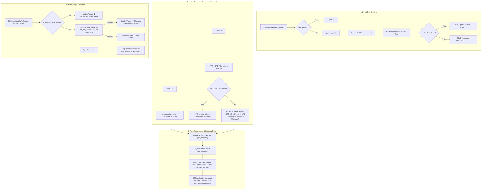

# 📐 Engineering Blueprint v0.34.8: Smart Path Healing, Recovery of the Historical Temporal Rules & Lightweight Change Detection

## 📌 Context & Recovery of the Development History (Python Legacy ➔ Rust)

After a deep investigation of the git history (`git log -S "Last-Modified"`, commits `2c85f68` and `9d77227`), we recovered exactly how the date, time and change verification rules worked in AnyContext:

### 1. How Date and Time Were Collected in Local Folders:
- Collected directly from the file system metadata (`fs::Metadata`):
  - `mtime` (`last_modified_date`): exact date and time of the last modification (`fs::metadata(path)?.modified()`).
  - `ctime` (`creation_date`): file creation date (`fs::metadata(path)?.created()`).
- In the current Rust: `mtime` was converted to RFC 3339, but it was **dropped** in the middle of the search pipeline (`HybridSearchResult`).

### 2. How Date and Time Were Collected on Web Sites (Without Downloading to Check):
- **Lightweight Header Check - RFC 7232**:
  - A conditional HTTP `HEAD` or `GET` request sending the headers:
    - `If-Modified-Since`: date of the last crawl (`cached_last_modified`)
    - `If-None-Match`: cached `ETag`
  - If the server answers **`304 Not Modified`**: AnyContext confirms in **< 50ms**, without downloading the HTML body, that the page is still 100% identical!
  - If the server answers `200 OK`, or on a `HEAD` request: the HTTP `Last-Modified` (or `Date`) header carries the server's official timestamp.
- **Metadata Freshness Cascade** when the page was processed:
  1. **Tier 1 (High Confidence - HTML Meta Tags & Schema.org)**:
     - `<meta property="article:modified_time" content="...">`
     - `<meta name="dcterms.modified" content="...">`
     - `<meta name="dc.date.modified" content="...">`
     - `<meta property="article:published_time" content="...">`
     - `<meta name="dcterms.issued" content="...">`
     - Schema.org JSON-LD: `"dateModified": "..."` and `"datePublished": "..."`
     - `<time datetime="...">`
  2. **Tier 2 (Footer Text Patterns)**:
     - `Date modified: YYYY-MM-DD`, `Last modified: YYYY-MM-DD`, `Last updated: YYYY-MM-DD`, `Page details YYYY-MM-DD`.
  3. **Tier 3 (Date Pattern in the URL)**:
     - `/YYYY/MM/DD/` or `/YYYY/MM/`.
  4. **Tier 4 (XML Sitemap `lastmod`)**:
     - The `<lastmod>` field of `sitemap.xml`.
  5. **Tier 5 (HTTP Header)**:
     - `Last-Modified` from the HTTP header (RFC 2822 / 7231).
  6. **Tier 6 (Fallback)**:
     - Current crawl timestamp (`Utc::now()`). *(In Rust it was fixed at `0.0` / 1970!)*

### 3. How Chunks Were Formatted for the LLM to Apply the Recency Rule:
- In the original `search_tools.py`:
  ```text
  --- [Document Chunk 1 | Source: file.docx | Workspace: Default | Last Modified: 2026-10-10 12:00:00 | Type: Local Document] ---
  Path: ...
  Content: ...
  ```
- In the current Rust (`search_db`), the string was generated as:
  `• [{}] (Score: {:.2}, Source: {}, Type: {}):\n{}` — **with no date or time at all**!
  That is why the LLM could not apply the most-recent-information rule.

---

## 🏛️ Complete Solution Architecture for Release `v0.34.8`



---

## 📋 Implementation Milestones (v0.34.8)

### Milestone 1: Smart Path Healing (`crates/any-context-core-rs/src/storage/path_healer.rs`)
1. Implement `try_heal_path(p: &Path) -> Option<PathBuf>`:
   - Tests variations: removing/adding `Documentos/`, `Documents/`, `OneDrive/`, normalizing `/` and `\` slashes.
   - Tests whether the corresponding subfolder exists on the volume.
2. Integrate into `NativeConfigDb::get_workspace_folders`:
   - Self-heals and updates the record in the `workspace_folders` table if the stored path is corrupted but the folder exists.
3. Integrate into the `/folder` and `/sync` commands:
   - Tells the user: `🔄 Auto-resolved folder path to 'G:/My Drive/Levix Digital/AnyContext'`.

### Milestone 2: Recovery of the Temporal Cascade and HTTP 304 for the Web (`crates/any-context-core-rs/src/ingestion/crawler.rs`)
1. **Support for HTTP Conditional GET / HEAD (RFC 7232)**:
   - When checking web sources, pass `If-Modified-Since` and `If-None-Match`.
   - If the server answers `304 Not Modified`, mark the page as unchanged instantly without downloading the HTML.
2. **Implementation of the Metadata Freshness Cascade (Native Rust)**:
   - Extracts the `<meta property="article:modified_time">`, `<meta name="dcterms.modified">`, `<meta name="dc.date.modified">` tags.
   - Extracts schema.org JSON-LD (`"dateModified": "..."`, `"datePublished": "..."`).
   - Extracts footer regexes (`Date modified:`, `Last modified:`, `Updated:`).
   - Extracts the URL regex (`/YYYY/MM/DD/`).
   - Extracts the HTTP `Last-Modified` header.
   - Falls back to `Utc::now()` (never `0.0`!).
3. **In the Orchestrator (`orchestrator.rs`)**:
   - Pass the real timestamp returned by the crawler to `embed_and_upsert_chunks`.

### Milestone 3: `last_modified` Propagation in the RAG Pipeline and Injection into the LLM Prompt
1. **BM25 (`crates/any-context-core-rs/src/retrieval/bm25.rs`)**:
   - Add `pub last_modified: Option<String>` to `DocRecord`.
2. **RAG Pipeline (`crates/any-context-core-rs/src/retrieval/pipeline.rs`)**:
   - Add `pub last_modified: Option<String>` to `HybridSearchResult`.
   - Propagate it from `d.last_modified` (LanceDB) and `doc.last_modified` (BM25).
   - Apply a soft recency boost in reranking to break ties in favor of newer versions.
3. **Header Injection in the `search_db` Tool (`crates/actx-cli/src/engine.rs`)**:
   - Format the header handed to the LLM with an explicit timestamp:
     ```rust
     let mod_str = match &r.last_modified {
         Some(lm) if !lm.is_empty() => format!(" | Modified: {}", lm),
         _ => String::new(),
     };
     out.push(format!(
         "• [{}] (Score: {:.2}, Source: {}, Type: {}{}):\n{}",
         r.file_name, r.score, r.file_path, type_str, mod_str, r.text
     ));
     ```

### Milestone 4: Active Change Detection, Source Health and Purge
1. **Source Health Diagnosis (`WorkspaceHealth`)**:
   - Checks whether every configured local folder and web portal is reachable.
   - If any source fails: Header/Footer shows `⚠️ [Sync: 1 source unreachable]`.
2. **Fast Local and Web Diff**:
   - Folders: compare `(mtime, size)` with `file_stat_cache`.
   - Web: lightweight `ETag` / `Last-Modified` check through HTTP HEAD / 304.
   - If changes are detected: shows `⚡ [Sync: Changes detected - run /sync]`.
3. **Purge Guarantee in `/sync`**:
   - Purges moved/deleted files from LanceDB (`delete_by_file`) and BM25 (`remove_by_file`).
   - Detailed log: `✔ Purged X moved/deleted file(s). Indexed Y new file(s). Workspace 100% synchronized.`

### Milestone 5: Unit Tests, E2E and Dual-Doc
1. Test of `try_heal_path` with real Google Drive paths and slash separators.
2. Test of the web metadata cascade and the HTTP 304 response.
3. Test of `last_modified` propagation in `search_db`.
4. Update of `TECDOC.md` (ADR-112) and `MANUAL_TESTS.md` (Scenario 27).
