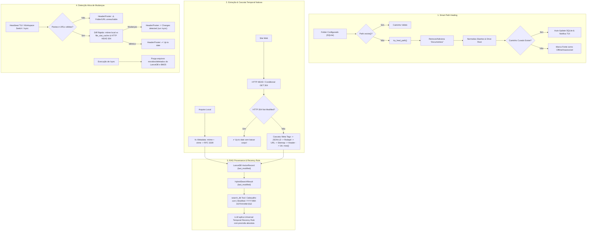

# 📐 Blueprint de Engenharia v0.34.8: Smart Path Healing, Recuperação das Regras Temporais Históricas & Detecção Leve de Alterações

## 📌 Contexto & Recuperação do Histórico de Desenvolvimento (Legado Python ➔ Rust)

Após investigação aprofundada no histórico do git (`git log -S "Last-Modified"`, commits `2c85f68` e `9d77227`), recuperamos com exatidão como as regras de data, hora e verificação de alterações funcionavam no AnyContext:

### 1. Como a Data e Hora Eram Coletadas em Pastas Locais:
- Coletadas diretamente dos metadados do sistema de arquivos (`fs::Metadata`):
  - `mtime` (`last_modified_date`): data e hora exata da última modificação (`fs::metadata(path)?.modified()`).
  - `ctime` (`creation_date`): data de criação do arquivo (`fs::metadata(path)?.created()`).
- No Rust atual: o `mtime` era convertido para RFC 3339, mas era **descartado** no meio do pipeline de busca (`HybridSearchResult`).

### 2. Como a Data e Hora Eram Coletadas em Sites Web (Sem Precisar Baixar para Ver):
- **Verificação Leve de Mudanças (Lightweight Header Check - RFC 7232)**:
  - Requisição HTTP `HEAD` ou `GET` condicional enviando os cabeçalhos:
    - `If-Modified-Since`: data do último crawl (`cached_last_modified`)
    - `If-None-Match`: `ETag` em cache
  - Se o servidor responder **`304 Not Modified`**: o AnyContext confirma em **< 50ms**, sem baixar o corpo HTML, que a página continua 100% idêntica!
  - Se o servidor responder `200 OK`, ou em requisição `HEAD`: o cabeçalho HTTP `Last-Modified` (ou `Date`) traz o carimbo oficial do servidor.
- **Cascata de Metadados de Frescor (Metadata Freshness Cascade)** quando a página era processada:
  1. **Tier 1 (Alta Confiança - Meta Tags HTML & Schema.org)**:
     - `<meta property="article:modified_time" content="...">`
     - `<meta name="dcterms.modified" content="...">`
     - `<meta name="dc.date.modified" content="...">`
     - `<meta property="article:published_time" content="...">`
     - `<meta name="dcterms.issued" content="...">`
     - JSON-LD Schema.org: `"dateModified": "..."` e `"datePublished": "..."`
     - `<time datetime="...">`
  2. **Tier 2 (Padrões de Texto no Rodapé)**:
     - `Date modified: YYYY-MM-DD`, `Last modified: YYYY-MM-DD`, `Last updated: YYYY-MM-DD`, `Page details YYYY-MM-DD`.
  3. **Tier 3 (Padrão de Data na URL)**:
     - `/YYYY/MM/DD/` ou `/YYYY/MM/`.
  4. **Tier 4 (XML Sitemap `lastmod`)**:
     - Campo `<lastmod>` do `sitemap.xml`.
  5. **Tier 5 (Cabeçalho HTTP)**:
     - `Last-Modified` do cabeçalho HTTP (RFC 2822 / 7231).
  6. **Tier 6 (Fallback)**:
     - Crawl timestamp atual (`Utc::now()`). *(No Rust estava fixo em `0.0` / 1970!)*

### 3. Como os Chunks Eram Formatados para o LLM Aplicar a Regra de Recência:
- No `search_tools.py` original:
  ```text
  --- [Document Chunk 1 | Source: file.docx | Workspace: Default | Last Modified: 2026-10-10 12:00:00 | Type: Local Document] ---
  Path: ...
  Content: ...
  ```
- No Rust atual (`search_db`), a string era gerada como:
  `• [{}] (Score: {:.2}, Source: {}, Type: {}):\n{}` — **sem nenhuma data ou hora**!
  Por isso o LLM não conseguia aplicar a regra de informação mais recente.

---

## 🏛️ Arquitetura Completa da Solução para a Release `v0.34.8`



---

## 📋 Marcos de Implementação (v0.34.8)

### Marco 1: Smart Path Healing (`crates/any-context-core-rs/src/storage/path_healer.rs`)
1. Implementar `try_heal_path(p: &Path) -> Option<PathBuf>`:
   - Testa variações: remoção/adição de `Documentos/`, `Documents/`, `OneDrive/`, normalização de barras `/` e `\`.
   - Testa existência da subpasta correspondente no volume.
2. Integrar em `NativeConfigDb::get_workspace_folders`:
   - Auto-cura e atualiza o registro na tabela `workspace_folders` se o caminho gravado estiver corrompido mas a pasta existir.
3. Integrar nos comandos `/folder` e `/sync`:
   - Avisa ao usuário: `🔄 Auto-resolved folder path to 'G:/My Drive/Levix Digital/AnyContext'`.

### Marco 2: Recuperação da Cascata Temporal e HTTP 304 para Web (`crates/any-context-core-rs/src/ingestion/crawler.rs`)
1. **Suporte a HTTP Conditional GET / HEAD (RFC 7232)**:
   - Na checagem de fontes web, passar `If-Modified-Since` e `If-None-Match`.
   - Se o servidor responder `304 Not Modified`, marca a página como inalterada instantaneamente sem baixar o HTML.
2. **Implementação da Cascata de Metadados de Frescor (Rust Nativo)**:
   - Extrai tags `<meta property="article:modified_time">`, `<meta name="dcterms.modified">`, `<meta name="dc.date.modified">`.
   - Extrai schema.org JSON-LD (`"dateModified": "..."`, `"datePublished": "..."`).
   - Extrai regex de rodapé (`Date modified:`, `Last modified:`, `Updated:`).
   - Extrai regex de URL (`/YYYY/MM/DD/`).
   - Extrai header HTTP `Last-Modified`.
   - Fallback para `Utc::now()` (nunca `0.0`!).
3. **No Orquestrador (`orchestrator.rs`)**:
   - Passar o timestamp real retornado pelo crawler para `embed_and_upsert_chunks`.

### Marco 3: Propagação de `last_modified` no Pipeline RAG e Injeção no Prompt do LLM
1. **BM25 (`crates/any-context-core-rs/src/retrieval/bm25.rs`)**:
   - Adicionar `pub last_modified: Option<String>` no `DocRecord`.
2. **Pipeline RAG (`crates/any-context-core-rs/src/retrieval/pipeline.rs`)**:
   - Adicionar `pub last_modified: Option<String>` em `HybridSearchResult`.
   - Propagar de `d.last_modified` (LanceDB) e `doc.last_modified` (BM25).
   - Aplicar recency boost suave no reranking para desempate a favor de versões mais novas.
3. **Injeção do Cabeçalho na Tool `search_db` (`crates/actx-cli/src/engine.rs`)**:
   - Formatar o cabeçalho entregue ao LLM com carimbo de tempo explícito:
     ```rust
     let mod_str = match &r.last_modified {
         Some(lm) if !lm.is_empty() => format!(" | Modified: {}", lm),
         _ => String::new(),
     };
     out.push(format!(
         "• [{}] (Score: {:.2}, Source: {}, Type: {}{}):\n{}",
         r.file_name, r.score, r.file_path, type_str, mod_str, r.text
     ));
     ```

### Marco 4: Detecção Ativa de Mudanças, Saúde de Fontes e Purga
1. **Diagnóstico de Saúde das Fontes (`WorkspaceHealth`)**:
   - Verifica se todas as pastas locais e portais web configurados estão acessíveis.
   - Se alguma fonte falhar: Header/Footer exibe `⚠️ [Sync: 1 source unreachable]`.
2. **Diff Rápido Local e Web**:
   - Pastas: compara `(mtime, size)` com `file_stat_cache`.
   - Web: checagem leve de `ETag` / `Last-Modified` via HTTP HEAD / 304.
   - Se houver alterações detectadas: exibe `⚡ [Sync: Changes detected - run /sync]`.
3. **Garantia de Purga em `/sync`**:
   - Purga arquivos movidos/deletados do LanceDB (`delete_by_file`) e BM25 (`remove_by_file`).
   - Log detalhado: `✔ Purged X moved/deleted file(s). Indexed Y new file(s). Workspace 100% synchronized.`

### Marco 5: Testes Unitários, E2E e Dual-Doc
1. Teste de `try_heal_path` com caminhos reais do Google Drive e separadores de barra.
2. Teste da cascata de metadados web e resposta HTTP 304.
3. Teste de propagação de `last_modified` no `search_db`.
4. Atualização do `TECDOC.md` (ADR-112) e `MANUAL_TESTS.md` (Cenário 27).
