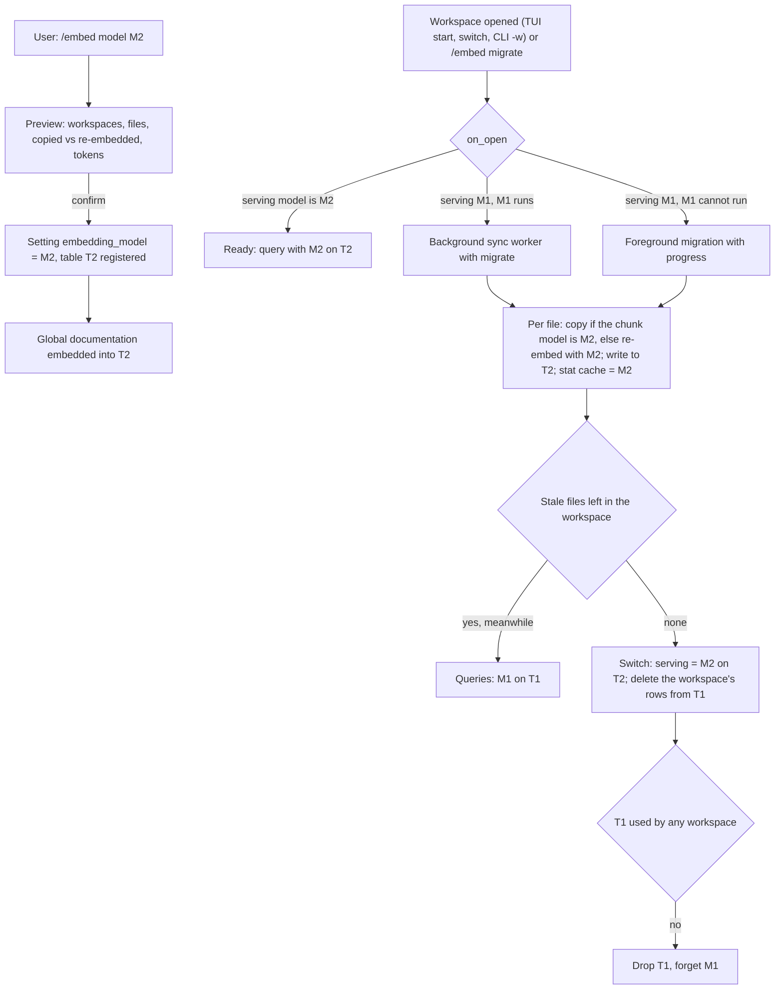

# One application-wide embedding model, per-chunk model metadata and one vector table per model

Plan for IMP-004 (`dev-cycle-protocol` Phases 1 and 2). Business rules decided with the user on 2026-10-19 and revised on the same day after M1 (tables per model instead of per dimension, file-by-file migration with a per-workspace switch); the discovery is kept below the plan.

## Backlog items

### IMP-004: Per-table vector dimension in LanceDB with assisted reindex
- **Priority**: high
- **Found**: 2026-10-17, 2026-10-17 triage of the post-v0.45.0 roadmap
- **Description**: storage/lancedb.rs fixes DEFAULT_VECTOR_DIM = 1536 and ingestion writes every table with it, while Gemini (768), Ollama nomic-embed-text (768) and local ONNX embedders (384/768) produce other sizes. Store model and dimension per workspace/table, detect divergence and offer assisted reindex. First LanceDB schema change since C0: needs migration and rollback; combine with the Frente D parent_id change (roadmap 2.2 goal 4).

### Related items, kept separate (user's decision, 2026-10-19)
FEAT-005 and BUG-021 stay as their own backlog items and are not promoted into this plan.
- **FEAT-005** (high): embedding model independent of the chat model, with stale-workspace status. This plan's rules 1 and 5 overlap with it.
- **BUG-021** (high, closed by PR #371 before this plan was approved): dense search never ran when the embedding model's dimension was not 1536 (seen with Ollama `nomic-embed-text`, 768). PR #371 zero-pads query vectors to the 1536 table and records failed vector searches as `SearchFailed`. With one table per model at the model's own size, nothing new is padded; the padding of query vectors stays only for the legacy `workspace_chunks` table until it is dropped. PR #371's regression test is adapted instead of adding a new one.
- **BUG-022** (medium, found in M1): a folder-scoped sync purged the other folders' chunks. Fixed in this branch.
- **BUG-023** (high, found in the plan review): the `Default` workspace retrieved chunks of every workspace. Fixed first, on its own, by PR #372 (user's decision).

### Behavior changes confirmed by the user (2026-10-19)
- A failed query embedding (network, rate limit, server error) is retried once and then answered with an error; there is no BM25-only fallback.
- Without a usable key or endpoint for the active model, sync and questions show the error and the fix; the mock provider is never used outside tests.
- Each workspace has its own chat: a query searches one workspace (plus the `Global` AnyContext documentation), never several.

## 1. Goal and decisions

**Goal.** Dense search always runs, on every workspace, with vectors from one embedding model chosen for the whole application and stored at the model's own size. A model change migrates the index file by file into the new model's table; each workspace keeps answering with the old model until all its files are migrated, then switches at once, so every query uses exactly one embedding model and the user never gets a BM25-only answer.

**Business rules (decided by the user).**
1. **One embedding model for the application.** A global setting, independent of the chat model. `/model` no longer affects embeddings. There is no per-workspace embedding model (FEAT-005's per-workspace override stays out). Two models coexist only while a migration runs.
2. **Every chunk records its file and the model that produced its vector.** Where a chunk came from (API, ONNX, any endpoint) does not matter; the model key is what future migrations read. A different model is a different vector space even at the same size, so every file indexed with the old model is stale after a change.
3. **One table per model.** T1 holds the vectors of model M1. Changing M1 to M2 creates T2, at M2's size. There is no padding and no notion of tables per size.
4. **Migration is file by file, the switch is per workspace.** Files of a workspace are re-embedded (or copied, rule 8) into T2 one by one. Until the last file of the workspace is in T2, the workspace keeps answering with M1 on T1. Then it switches to M2 on T2 at once and its chunks are deleted from T1. A query therefore always embeds the question with exactly one model.
5. **Migration runs when a workspace is opened**, in the background, and the user is warned clearly when changing the model (what is reindexed, when, how much). `/embed` can also migrate every workspace now.
6. **If the old model can no longer run** (key removed, model shut down) while a workspace still answers with it, opening the workspace runs its migration in the foreground with progress, and it answers only when the migration finishes.
7. **Disk**: when T1 holds no chunk of any workspace, T1 is dropped and M1 is forgotten. A second (or third, after another change during a migration) table exists only while workspaces still answer with it.
8. **A chunk already embedded with the active model is copied, not re-embedded.** On the upgrade to v0.46.0 the existing `workspace_chunks` table becomes the old table of every workspace; the chunks whose model is the chosen global model move to its table with their vectors (vectors stored with trailing zero padding get the padding removed, which leaves them exactly as the model produced them). Only chunks of other models are re-embedded.
9. **Two runtimes, one behavior.** An embedding model runs either through an **API** (any endpoint: OpenAI, Ollama, LM Studio, vLLM, Azure and other OpenAI-compatible servers, plus Google's native Gemini format) or through **ONNX** locally (Frente C; this plan only reserves the variant). The active model is never swapped silently (no OpenAI fallback, no mock fallback). If it cannot run, the user gets a clear error naming the model, the cause and the fix.
10. **The dimension is measured, not catalogued.** When a model is configured, one probe embedding measures its vector size, stored with the configuration.
11. **Gemini keeps its native adapter** (`batchEmbedContents` with `outputDimensionality`), selected by the request format `gemini` of the API runtime.

**Decisions with alternatives (ADRs).**
- **ADR-0149 Application-wide embedding model with per-chunk model metadata** (supersedes ADR-0138, amends ADR-0132 and ADR-110). Covers the two runtimes, the configuration (endpoint, format, model, measured dimension) and the model key. Alternatives: per-workspace record and full workspace reindex (ADR-0138, current), per-workspace model (FEAT-005 original), a fixed provider list (current resolver, rejected: blocks every other OpenAI-compatible endpoint), Gemini through Google's OpenAI-compatible endpoint (rejected by the user; native adapter kept).
- **ADR-0150 One vector table per embedding model, file-by-file migration with a per-workspace switch.** Alternatives: one table per vector size with rows of several models filtered by model (first version of this plan, rejected: mixes models in a table, needs per-row filters and compaction), zero-padding everything to 1536 (rejected: storage waste, 1536 cap), one table per workspace (rejected: largest migration), deleting each file from T1 as soon as it is in T2 and embedding every query with both models during the migration (rejected by the user: two models in one query), BM25 for unmigrated files (rejected: dense search must always run).

## 2. Design (`software-design`)

Hexagonal style: the core owns the rules, storage is an adapter, CLI and TUI only render and ask.

### 2.1 Where each piece lives
| Piece | Location | Responsibility |
|---|---|---|
| `EmbeddingConfig { runtime, model, dimension }`, presets, `probe_dimension`, `resolve_active_embedding`, `provider_for` (done in M1) | `core/ingestion/embedding.rs` | The configured model and its provider. `key()` = `<model>#<dimension>`, written on every chunk. |
| Table registry: setting `embedding_tables` (model key → table name), `table_for(key)` | `core/ingestion/embedding.rs` (rules), `core/storage/lancedb.rs` (tables) | One table per model, named `chunks_<slug of the key>`; the legacy `workspace_chunks` is registered as the table of the models found in it at the upgrade. |
| Serving state per workspace: `workspaces.serving_model` (key) and `workspaces.serving_table` | `core/storage/sqlite.rs` | The model and table that answer the workspace's queries. Changes once per migration, at the switch. |
| `EmbeddingMigration` | new `core/ingestion/embedding_migration.rs` (upgrade part done in M1) | `on_open(workspace) -> UpToDate / Background { files } / Foreground { files, reason }`, the per-file step (copy or re-embed into the active table), the switch, the deletion from old tables and the drop of empty tables. Pure decisions plus a thin runner over the orchestrator. |
| `embedding_model` column on every chunk (done in M1) | `core/storage/lancedb.rs` | Which model built each vector; decides copy versus re-embed. |
| `embedding_model` per file in the stat cache (done in M1) | `core/storage/sqlite.rs` | Which files are already in the active table; makes an interrupted migration resume where it stopped. |
| Single-model query | `core/retrieval/pipeline.rs` | Embeds the query with the workspace's serving model and searches its serving table. |
| `/embed` command, warnings, migration status | `core/commands/engine.rs`; rendering in `actx-cli` | Status, model change with confirmation, migrate-all, open-time trigger. |

### 2.2 Interfaces added or changed
- Done in M1: `EmbeddingConfig`, `resolve_active_embedding`, `resolve_embedding`, `provider_for`, `probe_dimension`, `active_embedding_config`, `set_active_embedding_config`, `known_embedding_configs`, `stale_files_notice`, `GeminiProvider::with_output_dimensionality`, `NativeConfigDb::{stale_files, count_stale_files, backfill_stat_cache_embedding_model}`, `NativeLanceStore::{ensure_added_columns, count_rows_where, backfill_embedding_model}`.
- `fn table_for(db, &EmbeddingConfig) -> String`: registers the table of a model on first use.
- `NativeLanceStore`:
  - `upsert_records(records, table, dim)` keeps its shape; writers pass the active table and `config.dimension`, and a vector whose length differs from the dimension is **rejected** (no padding on new tables).
  - `copy_file_rows(file_path, workspace, from, to, model_key, dim) -> usize`: copies a file's rows of `model_key` to another table, removing trailing zero padding; rows whose padding is not all zeros are not copied (re-embedded instead).
  - `delete_by_workspace(workspace, table)` (exists), `drop_table(name)`, `count_records(workspace, table)` (exists).
- `NativeConfigDb`: `get/set_workspace_serving(workspace) -> (model_key, table)`, `workspaces_served_by(table) -> Vec<String>`.
- `EmbeddingMigration::on_open(workspace) -> OpenDecision`, `EmbeddingMigration::switch(workspace)` (sets serving to the active model and table, deletes the workspace's rows from every other table, drops tables that no workspace and no `Global` row uses).
- `SyncOptions.migrate: bool`: a normal incremental pass that also moves the stale files and switches the workspace when none is left (set by the open-time trigger and `/embed migrate`).
- Query side: `QueryEmbedding` is resolved from the workspace's serving model (`provider_for(known config of serving_model)`), with `set_query_embedding` and the serving table passed to the pipeline.
- `CommandResult` gains `EmbeddingChangePreview { from, to, per_workspace: Vec<(name, files, chunks, copied, re_embedded)>, estimated_tokens }`.
- Removed: `decide_reindex`, `legacy_target`, `pending_reindex_notice`, `GLOBAL_KNOWLEDGE_TARGET_SETTING`, `generate_fallback_vectors`, `resolve_query_embedding_provider` (done in M1); `GLOBAL_VECTOR_DIM` and `DEFAULT_VECTOR_DIM` as write sizes (M2); the BM25-only fallback of the query (M4).

### 2.3 Data flow

- **Changed or new files during a migration** are written to T2 only (the stat cache follows T2). Until the switch the workspace answers from T1, where those files still have their previous version; this short lag is accepted.
- **Interrupted migration**: the stat cache records each file that reached T2, so the next open continues with the remaining files; T2 rows of an unswitched workspace are never queried.
- **Another model change during a migration** (M1 → M2 → M3): files are compared with M3, chunks already of M3 are copied, the others re-embedded; at the switch the workspace's rows are deleted from every other table, and every table left unused is dropped.
- **`Global`** (a few dozen chunks) is embedded into the new table right after the change; its rows stay in the old table until that table is dropped, so workspaces still answering with M1 keep dense matches on the AnyContext documentation.
- **BM25** is shared by all models (text does not change); a file's BM25 rows are replaced when the file is written to the new table.

### 2.4 Error strategy
| Failure | Where handled | What the user sees |
|---|---|---|
| Active model cannot run (no key, endpoint unreachable, weights missing) | `resolve_active_embedding` (done in M1) | Sync: the pass stops before embedding, status with model, cause and fix. Queries keep their serving model; a workspace that would need the active model gets the same error. Never BM25 only. |
| Query embedding call fails (network, rate limit, 5xx) | `pipeline.rs` | One retry with `embed_with_retry`; then an error answer naming the model and cause. ADR-110's silent BM25 fallback is removed (amended by ADR-0149). |
| Serving model cannot run while the workspace still needs it | `EmbeddingMigration::on_open` | Foreground migration with a progress line; the prompt is blocked with "Reindexing <ws> with <model>: n/N files". |
| Vector length differs from the model's dimension | `upsert_records` | The file fails like any embedding failure (ADR-0146): reported, retried next pass, no rows written. |
| Migration interrupted (cancel, crash) | stat cache per file | Finished files stay in T2; the next open continues; the workspace keeps answering from T1. |
| Copy finds padding that is not all zeros | `copy_file_rows` | The file is re-embedded instead (logged in verbose output). |
| Table drop fails | switch | Logged and shown in `/embed`; retried at the next switch or startup. Search is unaffected. |

### 2.5 Dependencies
No new crates. LanceDB 0.39 supports several tables, nullable column addition and `drop_table`.

### 2.6 Deliberately not abstracted
- No per-workspace override hook (rule 1); the serving columns keep it possible later.
- No model catalog: the dimension is measured once by the probe.
- No per-vendor embedding adapters: the API runtime has two request formats (`openai`, `gemini`).
- No migration scheduler or queue: the existing `spawn_sync_worker` runs the background pass.
- No dual-model query: rule 4 makes every query single-model.

## 3. Affected surfaces and files

**Surfaces** (`cli`, `tui`):
- New `/embed` (status: runtime, endpoint, model, measured dimension, table, per workspace the serving model and stale files, migration progress, tables on disk) and `/embed model <preset>` or `/embed model --url <base_url> --model <name> [--key <key name>] [--format openai|gemini]` (probe, preview and confirmation); `/embed migrate` migrates every workspace now. CLI: `actx embed`, `actx embed model ... [--yes]`, `actx embed migrate`.
- `/model` no longer warns about reindexing; it changes only the chat model (done in M1).
- TUI: badge with the active embedding model; workspace menu marks workspaces still answering with an older model ("migrating: n files left"); progress line during background and foreground migrations.
- First run and upgrade: one notice with the chosen global model and what is copied or re-embedded.

**Files** (main ones):
- `crates/any-context-core-rs/src/ingestion/embedding.rs`, `ingestion/embedding_migration.rs`, `ingestion/orchestrator.rs`, `ingestion/mod.rs`
- `crates/any-context-core-rs/src/storage/lancedb.rs`, `storage/sqlite.rs`
- `crates/any-context-core-rs/src/retrieval/pipeline.rs`
- `crates/any-context-core-rs/src/commands/engine.rs` (commands, workspace switch hook)
- `crates/actx-cli/src/engine.rs` (query embedding, Global), `tui/app.rs`, `tui/` widgets, `cli/` subcommands
- `crates/actx-lm/src/providers/gemini.rs` (done in M1)
- Tests: `crates/any-context-core-rs/tests/orchestrator_tests.rs`, unit tests in the files above

## 4. Tests (`quality-assurance`)

**Automated (all under `cargo test --workspace`, deterministic, temp dirs, scripted embedders with chosen dimensions):**
- Done in M1: configuration and presets, key ignores the endpoint, probe of a custom OpenAI-compatible endpoint, probe failure, missing key without fallback, global model choice and stat cache backfill, chunk backfill once, `/model` leaves the embedding model unchanged, stale files re-embedded, sync stops when the model cannot run, BUG-022 regression.
- Tables per model: a 768 model writes a 768 table; a vector of the wrong length is rejected; the active table is registered once; two models of the same size get two tables.
- BUG-021 (test from PR #371, adapted): a 768 workspace is found by dense search with no padding.
- Upgrade: every workspace serves from `workspace_chunks` with its legacy model; chunks of the global model are copied (padding removed, vectors equal to the originals), the others re-embedded; a copy with non-zero padding falls back to re-embedding.
- Migration: during the migration of a workspace, queries use M1 on T1 and find every file (migrated or not); one embedding per query; at the switch the workspace's rows leave T1 and queries use M2 on T2; an interrupted migration resumes with the remaining files only; a file changed during the migration ends in T2 with its new content.
- `on_open` returns `UpToDate`, `Background` or `Foreground` for the three cases; foreground when the serving model has no key.
- Drop: T1 is dropped when no workspace and no `Global` row use it; kept while one does; M1 → M2 → M3 during a migration ends with one table.
- Queries: a failed query embedding is retried once, then an error, never a BM25-only answer.
- `/embed model` preview counts files, chunks, copies and tokens per workspace; nothing changes without confirmation; `/embed migrate` migrates every workspace.
- Global documentation is embedded into the new table at the change and stays in the old table until it is dropped.
- Replace or remove tests of removed behavior (done in M1 for the resolver and reindex rules).

**Manual tests (`tests/MANUAL_TESTS.md`):**
- Replace **MT-SYNC-006** (changing the model reindexes the workspace once) with a new section `## Embedding Model`:
  - MT-EMB-001: Changing the embedding model shows the preview and changes nothing until confirmed.
  - MT-EMB-002: Opening a workspace after a model change migrates it in the background; it answers with the old model meanwhile and with the new one after the switch.
  - MT-EMB-003: With the old model unavailable, opening the workspace migrates it in the foreground before answering.
  - MT-EMB-004: A model with a dimension other than 1536 (Ollama `nomic-embed-text`, 768) answers with dense results (BUG-021).
  - MT-EMB-005: Without a key for the active model, sync and questions show the error and the fix, never a BM25-only answer.
  - MT-EMB-006: Upgrading from v0.45.x keeps every workspace queryable, reports the chosen global model, and copies the chunks already of that model without API calls.
  - MT-EMB-007: A custom OpenAI-compatible endpoint (for example LM Studio) is configured with URL and model; its dimension is measured and shown by `/embed`.
  - MT-EMB-008: After every workspace is migrated, `/embed` shows a single table; the old one is gone from disk.
- Update **MT-SYNC-007** (Gemini workspace from an older version) to the per-file migration.
- Review **MT-SYNC-008** and the Answers section for the removed BM25 fallback.

**Acceptance criteria:** every test above passes; no code path writes padded, truncated or pseudo vectors; no query answers from BM25 alone; no query embeds the question with two models; a model change costs one embedding per stale file and none for chunks already of the active model; after a completed migration only the active model's table remains.

## 5. Documentation (`architecture-docs`, `user-docs`)
- ADR-0149 and ADR-0150 (above); mark ADR-0138 superseded, ADR-0132 and ADR-110 amended.
- `docs/architecture/storage.md`: tables per model, table registry, `embedding_model` column, stat cache column, serving columns, table drop.
- `docs/architecture/ingestion.md`: global model, file-by-file migration with the per-workspace switch, open-time trigger, copy of chunks already of the active model, no pseudo-vectors.
- `docs/architecture/retrieval.md`: single-model query on the serving table, no BM25-only answers, error path.
- `docs/architecture/commands.md`, `cli.md`, `tui.md`: `/embed`, badges, progress.
- `docs/architecture/lm-providers.md`: Gemini output size note.
- `TECDOC.md` index (`build_index.py`), `check_docs.py` with zero errors.
- README: new "Embedding model" section (choose, change, what a change costs, what happens per workspace), update the commands table; `check_readme.py` with zero errors.

## 6. CI, release and observability (`devops-release`)
- **Version impact:** minor, target **v0.46.0** (new setting, new command, LanceDB schema change, behavior change of the fallback).
- **CI:** no workflow change; the new tests run in `cargo test --workspace`.
- **Observability:**
  - `/embed` and `actx embed` show active model, dimension, tables on disk, per workspace the serving model and stale files, migration state and the last error.
  - Sync status carries migration progress (`migrating n/N files with <model>`), visible in the TUI status bar and `actx status`.
  - `last_query_embedding()` reports the model that embedded the query.
  - Verbose sync output lists copied and re-embedded files, the switch and the table drop.
- Each of these is asserted in the automated tests (status fields, command output structs).

## 7. Security, migration and rollback
- **Secrets:** no change; keys stay in the encrypted settings store. The new columns hold only model keys and table names.
- **Encryption at rest:** unchanged; copied rows keep their encrypted fields as stored.
- **Data migration (additive, at first start of v0.46.0):**
  1. Add the nullable `embedding_model` column to `workspace_chunks` and to the stat cache (done in M1), and the serving columns to `workspaces`.
  2. Choose the global model (done in M1: the preset of the most indexed files; ties or none resolve from the default chat model). Show it once to the user.
  3. Backfill the chunk and stat cache model keys from `workspaces.embedding_target` (done in M1). Old keys map to the new form: `openai/text-embedding-3-small` → `text-embedding-3-small#1536`, `gemini/gemini-embedding-2` → `gemini-embedding-2#1536`, `ollama/nomic-embed-text` → `nomic-embed-text#768`; `gemini/text-embedding-004` (shut down) and `mock/mock-embed` (constant vectors) map to `legacy:` keys that never match an active model.
  4. Every workspace serves from `workspace_chunks` with its mapped key until migrated; `workspace_chunks` is registered as the old table. On open, chunks of the global model are copied to its table (padding removed), the others re-embedded, then the workspace switches.
  5. `workspaces.embedding_target` and `global_knowledge_embedding_target` are left in place (not dropped) for rollback.
- **Rollback:** v0.45.x reads only `workspace_chunks`. A workspace not yet migrated keeps working after a downgrade; a migrated one has left `workspace_chunks` (and the table is dropped once empty), so the release notes say to run `actx sync --force` on those workspaces after a downgrade. Code rollback is a revert pull request on `main` and the next patch release.

## 8. Execution steps and milestones
- **M1 Global model and per-chunk metadata (done):** `EmbeddingConfig` with the API and ONNX runtimes, presets, dimension probe, global setting and resolver without a provider list or fallbacks, `embedding_model` columns, upgrade choice and backfill, `/model` decoupled. Revision to apply with M2: map `ollama/nomic-embed-text` to `nomic-embed-text#768`.
- **M2 Tables per model:** table registry and naming, writers (ingestion and `Global`) on the active model's table at its size with strict length, serving columns with the upgrade backfill (every workspace served by `workspace_chunks`), BUG-021 test adapted.
- **M3 File-by-file migration with per-workspace switch:** `on_open` decision, background worker and foreground path, per-file copy or re-embed, resume, switch, deletion from old tables, drop of unused tables, `Global` into the new table.
- **M4 Single-model query and no BM25-only answers:** queries on the serving model and table, retry once then error, removal of the BM25-only fallback.
- **M5 Surfaces:** `/embed` and `actx embed` with preview, confirmation and migrate-all, TUI badge, migration marks and progress, first-run and upgrade notice.
- **M6 Documentation and manual tests:** ADRs, architecture pages, README, manual test suite; `check_docs.py`, `check_readme.py`, `manual_tests.py validate`, `check_design.py`.

Each milestone is a commit series on the session's work branch (from `dev`), with `cargo test --workspace` green before the next milestone; one pull request into `dev`.

## Implementation notes

### M1 (2026-10-19)
- **Mock runtime.** `EmbeddingRuntime` has a third variant, `Mock`, reachable only through the `mock` preset (`SyncOptions.model`, `ACTX_EMBEDDING_MODEL`); it is never chosen as a fallback. Integration tests need it outside `cfg(test)`.
- **Choice of the global model** counts indexed files per preset in the stat cache (SQLite only), not chunks, so it can run on the query path before LanceDB is opened. Ties and installations without indexed files follow the default chat model.
- **Ollama rows** were first mapped to `legacy:ollama/nomic-embed-text` (stale because zero-padded). Revised with the user: the padding is a storage artifact of the 1536 table, not a property of the model, so they map to `nomic-embed-text#768` and are copied with the padding removed (rule 8). Applied with M2.
- **`Global`** is left out of the LanceDB backfill: its rows are rewritten as placeholders (no model) on every upgrade and embedded again with the active model; `global_dense_enabled` now reads the rows' `embedding_model`.
- **Interim migration** until M3: a sync pass purges and re-embeds the stale files it scans (purge-before-embed, file by file). M3 replaces it with embed-then-swap and the open-time trigger.
- **CLI `-m`** no longer reaches the sync: it is the chat model (rule 1).
- **BUG-022** (found while testing scoped migration): a folder-scoped sync purged the other folders' chunks. Fixed in this branch with a regression test.

## Discovery (2026-10-19)

### What already exists (ADR-0138, v0.45.1)
- `workspaces.embedding_target` records the `provider/model` that built each workspace's vectors; `decide_reindex` triggers an automatic full reindex when the resolved target changes, and `pending_reindex_notice` warns from `/model` and `/sync`.
- `resolve_query_embedding_provider` embeds queries with the recorded target.
- The embedding model is derived from the workspace chat model, with a fallback chain to OpenAI and then the mock provider when a key is missing.

### Current dimension handling
- One shared table, `workspace_chunks`, with a fixed `FixedSizeList(1536)` vector column (`storage/lancedb.rs:21`, `DEFAULT_VECTOR_DIM`). Every row of every workspace (and `Global`) lives in it, separated by the `workspace` column.
- `build_record_batch` silently zero-pads shorter vectors and truncates longer ones to 1536.
- Writers hard-code 1536: `ingestion/orchestrator.rs` (upsert and offline fallback vectors), `actx-cli/src/engine.rs` (`GLOBAL_VECTOR_DIM`), and Gemini requests `outputDimensionality: 1536` (`GEMINI_EMBEDDING_DIM`) to fit the table.
- Providers: OpenAI `text-embedding-3-small` = 1536, Gemini `gemini-embedding-2` = 1536 (requested), Ollama `nomic-embed-text` = 768, mock = 1536. No local ONNX embedder yet (Frente C goal 1).
- Transport: OpenAI and Ollama already share `actx_lm::providers::openai::OpenAiCompatibleProvider` (same `/embeddings` call; only base URL, key and model differ), like Groq, DeepSeek, OpenRouter and `CustomCompatible`. Gemini has its own adapter (native `batchEmbedContents`). The embedding resolver (`ingestion/embedding.rs`, `build_provider`) still hard-codes a provider list with fixed URLs and models, so no other OpenAI-compatible endpoint can be used for embeddings.

### Defect found: dense search never works when the model's dimension is not 1536 (BUG-021, seen with Ollama)
- Chunk vectors (768) are zero-padded to 1536 on write, but the query vector is sent to `search_vector_async` unpadded.
- LanceDB 0.39 rejects a query vector whose size matches no vector column ("No vector column found to match with the query vector dimension", its own test in `lancedb-0.39.0/src/query.rs`).
- The pipeline drops the error (`if let Ok(matches) = ...`), so Ollama workspaces are answered by BM25 only while `last_query_embedding()` reports `Dense`.

### Related behavior
- The `Default` workspace searches every row and multi-workspace queries reuse the primary workspace's query vector for the others, so workspaces with different targets are compared across vector spaces. Fixed by rule 1 and BUG-023 (PR #372); multi-workspace queries only add `Global`.
- Forced syncs purge the whole workspace before re-embedding, leaving it without vectors during the pass; the per-file swap replaces this for migrations.

### Options considered with the user
- A. Pad the query vector only (rejected: storage waste, 1536 cap).
- B. One table per vector dimension (first version of this plan; replaced on 2026-10-19 by one table per model, see ADR-0150).
- C. One table per workspace (rejected: largest migration).
- One permanent table per model (rejected by the user: disk use on the customer's machine for a rare change). Kept in its non-permanent form: the old model's table is dropped once no workspace answers with it.
- BM25 for unmigrated files (rejected by the user: dense search must always run).
