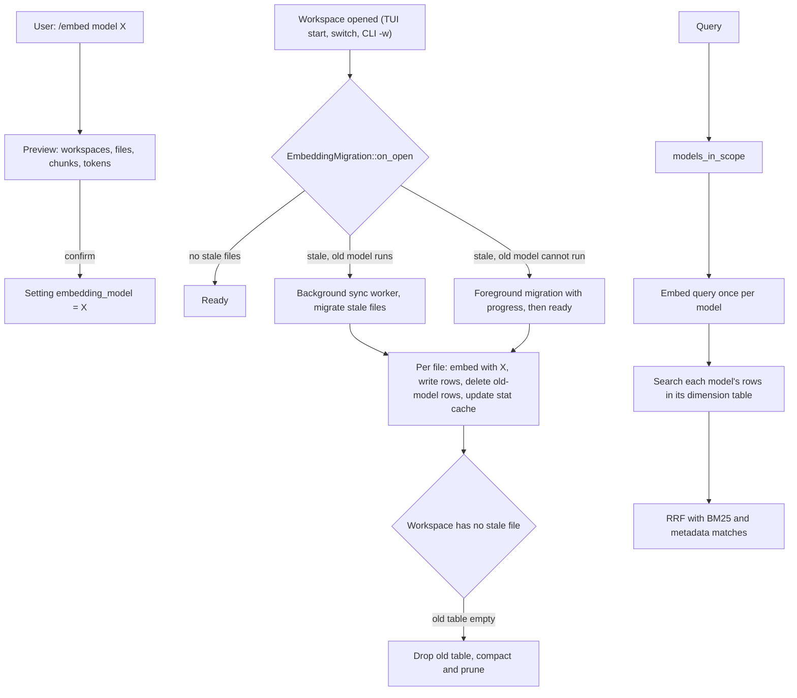

# One application-wide embedding model, per-chunk model metadata and per-dimension tables

Plan for IMP-004 (`dev-cycle-protocol` Phases 1 and 2). Business rules decided with the user on 2026-10-19; the discovery is kept below the plan.

## Backlog items

### IMP-004: Per-table vector dimension in LanceDB with assisted reindex
- **Priority**: high
- **Found**: 2026-10-17, 2026-10-17 triage of the post-v0.45.0 roadmap
- **Description**: storage/lancedb.rs fixes DEFAULT_VECTOR_DIM = 1536 and ingestion writes every table with it, while Gemini (768), Ollama nomic-embed-text (768) and local ONNX embedders (384/768) produce other sizes. Store model and dimension per workspace/table, detect divergence and offer assisted reindex. First LanceDB schema change since C0: needs migration and rollback; combine with the Frente D parent_id change (roadmap 2.2 goal 4).

### Related items, kept separate (user's decision, 2026-10-19)
FEAT-005 and BUG-021 stay as their own backlog items and are not promoted into this plan.
- **FEAT-005** (high): embedding model independent of the chat model, with stale-workspace status. This plan's rules 1 and 5 overlap with it.
- **BUG-021** (high, closed by PR #371 before this plan was approved): dense search never ran when the embedding model's dimension was not 1536 (seen with Ollama `nomic-embed-text`, 768). PR #371 zero-pads query vectors to the 1536 table and records failed vector searches as `SearchFailed`. Milestone M2 replaces the padding with native-size tables and adapts PR #371's regression test instead of adding a new one.

### Behavior changes confirmed by the user (2026-10-19)
- A failed query embedding (network, rate limit, server error) is retried once and then answered with an error; there is no BM25-only fallback.
- Without a usable key or endpoint for the active model, sync and questions show the error and the fix; the mock provider is never used outside tests.

## 1. Goal and decisions

**Goal.** Dense search always runs, on every workspace, with vectors from one embedding model chosen for the whole application, stored at the model's native dimension, and a model change migrates the index file by file without the user ever getting a BM25-only answer.

**Business rules (decided by the user).**
1. **One embedding model for the application.** A global setting, independent of the chat model. `/model` no longer affects embeddings. There is no per-workspace embedding model (FEAT-005's per-workspace override stays out).
2. **Every chunk records the model that produced its vector.** A chunk whose model differs from the active model is stale, and the **file** that produced it is reindexed (not the whole workspace).
3. **Never answer with BM25 only.** While a workspace still has stale chunks, the query is embedded with each model present in the searched rows and every part of the index is searched densely.
4. **Two runtimes, one behavior.** An embedding model runs either through an **API** (any endpoint: OpenAI, Ollama, LM Studio, vLLM, Azure and other OpenAI-compatible servers, plus Google's native Gemini format) or through **ONNX** locally (Frente C; this plan only reserves the variant). There is no per-vendor code path beyond the request format. The active model is the model: it is never swapped silently (no OpenAI fallback, no mock fallback). If it cannot run (missing key, unreachable endpoint, missing weights), the user gets a clear error naming the model, the cause and the fix.
5. **Migration runs when a workspace is opened**, in the background, and the user is warned clearly when changing the model (what is reindexed, when, how much).
6. **If the old model of stale chunks can no longer run** (key removed, model shut down), opening the workspace runs the migration in the foreground with progress, and the workspace answers only when it finishes (option (a)).
7. **Disk**: one active table per vector dimension. A second table exists only while a model change to another dimension is migrating; rows move file by file and the old table is dropped and compacted at the end.

8. **The dimension is measured, not catalogued.** When a model is configured, one probe embedding measures its vector size, which is stored with the configuration. Any model of any size works without a catalog.
9. **Gemini keeps its native adapter** (`batchEmbedContents` with `outputDimensionality`), selected by the request format `gemini` of the API runtime (decided by the user; Google's OpenAI-compatible endpoint was not adopted).

**Decisions with alternatives (ADRs).**
- **ADR-0149 Application-wide embedding model with per-chunk model metadata** (supersedes ADR-0138, amends ADR-0132 and ADR-110). Covers the two runtimes, the configuration (endpoint, format, model, measured dimension) and the model key. Alternatives: per-workspace record and full workspace reindex (ADR-0138, current), per-workspace model (FEAT-005 original), one permanent table per model (rejected for disk use), a fixed provider list (current resolver, rejected: blocks every other OpenAI-compatible endpoint), Gemini through Google's OpenAI-compatible endpoint (rejected by the user; native adapter kept).
- **ADR-0150 Vector tables keyed by dimension, dual-model query during a migration.** Alternatives: zero-padding everything to 1536 (option A, rejected: storage waste, 1536 cap), one table per workspace (option C, rejected: largest migration), BM25 for unmigrated files (rejected by rule 3).

## 2. Design (`software-design`)

Hexagonal style: the core owns the rules, storage is an adapter, CLI and TUI only render and ask.

### 2.1 Where each piece lives
| Piece | Location | Responsibility |
|---|---|---|
| `EmbeddingConfig { runtime, model, dimension }` with `runtime = Api { format: OpenAi \| Gemini, base_url, key_name: Option } \| Onnx { .. }` (replaces `EmbeddingTarget`) | `core/ingestion/embedding.rs` | The configured model. `key()` = `<model>#<dimension>` (for example `text-embedding-3-small#1536`, `nomic-embed-text#768`): the vector-space identity written on every chunk. The endpoint is deliberately left out of the key, so moving the same model to another URL or port does not reindex. |
| Presets | `core/ingestion/embedding.rs` | Shortcuts that only fill an `EmbeddingConfig`: `openai` (`https://api.openai.com/v1`, `text-embedding-3-small`, key `openai`), `gemini` (format `gemini`, `gemini-embedding-2`, key `gemini`, 1536 requested), `ollama` (`http://localhost:11434/v1`, `nomic-embed-text`, no key). Any other endpoint is configured with URL, model and optional key name. |
| `probe_dimension(config)` | `core/ingestion/embedding.rs` | One embedding call on a fixed text when a model is configured; stores the measured length. The `gemini` format sends the configured `outputDimensionality` (1536 by default). |
| `resolve_active_embedding(db)` | `core/ingestion/embedding.rs` | Reads the global setting and builds the provider with `actx_lm::providers::ProviderKind` (`CustomCompatible` for format `openai`, `Gemini` for format `gemini`), or returns `EmbeddingUnavailable { model, reason, fix }`. Replaces `resolve_embedding_provider`, `resolve_query_embedding_provider` and `build_provider`: no chat-model derivation, no fixed provider list, no fallback chain. `ACTX_EMBEDDING_MODEL` keeps overriding the setting (tests, CI) with a preset name. |
| `EmbeddingMigration` | new `core/ingestion/embedding_migration.rs` | Stale detection per workspace, the open-time decision (none, background, foreground), and the per-file swap. Pure decision functions plus a thin runner over the orchestrator. |
| Global setting `embedding_model` (JSON of `EmbeddingConfig`; keys stay in the encrypted credential store, referenced by `key_name`) | `core/storage/sqlite.rs` (`app_settings`) | Single source of the active model. |
| `embedding_model` per file in the stat cache | `core/storage/sqlite.rs` (`workspace_files` stat cache, new nullable column) | Fast counts of stale files without scanning LanceDB; written in the same step as the chunks. |
| `embedding_model` column on every chunk | `core/storage/lancedb.rs` (nullable Utf8, added in place like the provenance columns) | Source of truth for which model built each vector; used as a filter in dense search. |
| `table_for_dimension(dim)` | `core/storage/lancedb.rs` | `workspace_chunks` stays the 1536 table (no rewrite of existing data); other sizes use `workspace_chunks_d<dim>`. |
| Multi-model dense search | `core/retrieval/pipeline.rs` | Embeds the query once per model present in the searched scope, searches each model's rows in its table, fuses with the existing RRF. |
| `/embed` command, warnings, migration status | `core/commands/engine.rs`; rendering in `actx-cli` (`tui/`, `cli/`) | Status, model change with confirmation, open-time trigger. |

### 2.2 Interfaces added or changed
- `fn resolve_active_embedding(db) -> Result<(Arc<dyn LmProvider>, EmbeddingConfig), EmbeddingUnavailable>`; callers: orchestrator `run`, `RetrievalPipeline` construction, `engine.rs` Global embedding, `/embed`.
- `fn provider_for(db, &EmbeddingConfig) -> Result<Arc<dyn LmProvider>, EmbeddingUnavailable>`: used for the old model during a migration. The settings keep the configuration of every model still present in chunks (`embedding_models_known`), so the old model's endpoint is known while stale chunks exist.
- `async fn probe_dimension(provider, &EmbeddingConfig) -> Result<usize, EmbeddingUnavailable>`; caller: `/embed model`.
- `GeminiProvider::with_output_dimensionality(n)`: the request size comes from the configuration instead of the `GEMINI_EMBEDDING_DIM` constant.
- `NativeLanceStore`:
  - `upsert_records(records, model: &EmbeddingConfig)`: chooses the table from `model.dimension`, writes the `embedding_model` column, and **rejects** a vector whose length differs from the dimension (no more padding or truncation).
  - `search_vector_async(query, limit, workspace, filter, model: &EmbeddingConfig)`: table by dimension plus `embedding_model = '<key>'` filter.
  - `delete_file_rows_except(file_path, workspace, keep: &EmbeddingConfig)`: removes the old-model rows of a file after its new rows are written, in every table.
  - `ensure_embedding_model_column()`, `drop_table_if_empty(name)`, `optimize(table)` (compact and prune, used at the end of a migration).
- `NativeConfigDb`: `get/set_embedding_model()`, `count_stale_files(workspace, active) -> usize`, `stale_files(workspace, active) -> Vec<String>`, `models_in_scope(workspaces) -> Vec<String>` (distinct models in the stat cache of the searched workspaces).
- `EmbeddingMigration::on_open(workspace) -> OpenDecision { UpToDate, Background { files }, Foreground { files, reason } }`.
- `SyncOptions.migrate_stale: bool`: a normal incremental pass that also re-embeds the stale files (set by the open-time trigger).
- `CommandResult` gains `EmbeddingChangePreview { from, to, per_workspace: Vec<(name, files, chunks)>, estimated_tokens }` for the confirmation.
- Removed: `decide_reindex`, `legacy_target`, `pending_reindex_notice`, `global_dense_enabled`, `GLOBAL_KNOWLEDGE_TARGET_SETTING`, `generate_fallback_vectors` (no pseudo-vectors are written any more), `GLOBAL_VECTOR_DIM`. `DEFAULT_VECTOR_DIM` is replaced by `EmbeddingConfig::dimension`.

### 2.3 Data flow

- **Per-file swap (embed-then-swap).** A stale file is re-embedded first, its new rows written, then its old-model rows deleted. The file is never without vectors, so dense search keeps covering it. BM25 rows are replaced the same way (text does not change, so BM25 stays valid throughout).
- **Changed files during a migration** follow the normal purge-before-embed path, now embedded with the active model.
- **Global knowledge rows** are re-embedded at startup when their chunk model differs from the active one (a few dozen chunks), replacing `GLOBAL_KNOWLEDGE_TARGET_SETTING`; until then they are searched with their own model like any stale row.
- **`Default` and multi-workspace queries** use `models_in_scope` over every searched workspace, which also removes today's cross-space comparison between workspaces.

### 2.4 Error strategy
| Failure | Where handled | What the user sees |
|---|---|---|
| Active model cannot run (no key, Ollama unreachable, weights missing) | `resolve_active_embedding` | Sync: the pass stops before embedding, status `error` with model, cause and fix (`/embed`, key command). Query: no answer; the same message. Never BM25 only. |
| Query embedding call fails (network, rate limit, 5xx) | `pipeline.rs` | One retry with the existing `embed_with_retry`; then an error answer naming the model and cause. ADR-110's silent BM25 fallback is removed (amended by ADR-0149). |
| Old model cannot run while stale chunks exist | `EmbeddingMigration::on_open` | Foreground migration with a progress line; the prompt is blocked with "Reindexing <ws> with <model>: n/N files". |
| Vector length differs from the model's dimension | `upsert_records` | The file fails like any embedding failure (ADR-0146): reported, retried next pass, no rows written. |
| Migration interrupted (cancel, crash) | Per-file swap | Each finished file is already migrated; the next open continues with the remaining stale files. |
| Table drop or compaction fails | End of migration | Logged and reported in `/embed`; retried at the next migration end or startup. Search is unaffected. |

### 2.5 Dependencies
No new crates. LanceDB 0.39 already supports several tables, nullable column addition (`add_columns`) and `optimize`.

### 2.6 Deliberately not abstracted
- No per-workspace override hook (rule 1); the stat cache column keeps it possible later.
- No model catalog: the dimension is measured once by the probe, and presets are plain constructors of `EmbeddingConfig`.
- No per-vendor embedding adapters: the API runtime has two request formats (`openai`, `gemini`) because those are the two wire formats in use; a new OpenAI-compatible server needs only configuration.
- No migration scheduler or queue: the existing `spawn_sync_worker` runs the background pass.

## 3. Affected surfaces and files

**Surfaces** (`cli`, `tui`):
- New `/embed` (status: runtime, endpoint, model, measured dimension, table, stale files per workspace, migration progress) and `/embed model <preset>` or `/embed model --url <base_url> --model <name> [--key <key name>] [--format openai|gemini]` (probe, preview and confirmation). CLI: `actx embed` and `actx embed model ... [--yes]` with the same arguments.
- `/model` no longer warns about reindexing; it changes only the chat model.
- TUI: badge with the active embedding model; workspace menu marks workspaces with stale files ("reindex pending: n files"); progress line during background and foreground migrations.
- First run and upgrade: one notice with the chosen global model.

**Files** (main ones):
- `crates/any-context-core-rs/src/ingestion/embedding.rs`, new `ingestion/embedding_migration.rs`, `ingestion/orchestrator.rs`, `ingestion/mod.rs`
- `crates/any-context-core-rs/src/storage/lancedb.rs`, `storage/sqlite.rs`
- `crates/any-context-core-rs/src/retrieval/pipeline.rs`
- `crates/any-context-core-rs/src/commands/engine.rs` (commands, workspace switch hook)
- `crates/actx-cli/src/engine.rs` (Global embedding), `tui/app.rs`, `tui/` widgets, `cli/` subcommands
- `crates/actx-lm/src/providers/gemini.rs` (output dimensionality from the configuration, default 1536)
- Tests: `crates/any-context-core-rs/tests/orchestrator_tests.rs`, unit tests in the files above

## 4. Tests (`quality-assurance`)

**Automated (all under `cargo test --workspace`, deterministic, temp dirs, scripted embedders with chosen dimensions):**
- Regression for BUG-021 (test from PR #371, adapted): a 768-dimension workspace is found by dense search (`dense_score` set, outcome `Dense`) from the `workspace_chunks_d768` table, with no padding.
- `EmbeddingConfig`: presets fill the expected endpoint, format, model and key; `key()` ignores the endpoint; a custom OpenAI-compatible endpoint (local test server) is probed and its measured dimension stored; a probe failure leaves the active model unchanged and reports the cause.
- The `openai` format reaches any base URL through the same code path (`CustomCompatible`); the `gemini` format sends the configured `outputDimensionality`.
- `upsert_records` rejects a vector of the wrong length; writes to `workspace_chunks` for 1536 and `workspace_chunks_d768` for 768; writes the `embedding_model` column.
- Legacy table gains `embedding_model` in place; backfill from `workspaces.embedding_target` and the legacy rule; rows of `mock/mock-embed` count as stale.
- Stale detection counts only files whose model differs; `on_open` returns `UpToDate`, `Background` or `Foreground` for the three cases.
- Per-file swap: during a migration every file keeps dense coverage (search after each file finds both migrated and unmigrated chunks); an interrupted migration resumes with the remaining files only.
- Same-dimension change keeps one table; different-dimension change creates the second table, moves rows, drops the old table and compacts at the end.
- Dual-model query: chunks from model A and model B are both returned; the query is embedded once per model; with a single model, one embedding call (no extra cost).
- `Default` and multi-workspace queries cover workspaces on different models.
- Active model unavailable: sync stops with the error and writes nothing; query returns the error, never a BM25-only answer; no fallback to OpenAI or mock.
- `/model` changes no embedding state; `/embed model` preview counts files, chunks and tokens per workspace; nothing changes without confirmation.
- Global knowledge rows re-embedded on model change.
- Replace or remove tests of removed behavior: `decide_reindex_cases`, `legacy_gemini_workspace_is_reindexed`, `query_side_*`, `global_dense_requires_the_same_target`, `pending_notice_*`, `gemini_output_size_matches_the_vector_table`, `test_embedding_target_change_reindexes_whole_workspace`, `test_scoped_sync_with_target_change_reindexes_all_folders`.

**Manual tests (`tests/MANUAL_TESTS.md`):**
- Replace **MT-SYNC-006** (changing the model reindexes the workspace once) with a new section `## Embedding Model`:
  - MT-EMB-001: Changing the embedding model shows the preview and changes nothing until confirmed.
  - MT-EMB-002: Opening a workspace after a model change migrates it in the background and answers with dense results meanwhile.
  - MT-EMB-003: With the old model unavailable, opening the workspace migrates it in the foreground before answering.
  - MT-EMB-004: A model with a dimension other than 1536 (Ollama `nomic-embed-text`, 768) answers with dense results (BUG-021).
  - MT-EMB-007: A custom OpenAI-compatible endpoint (for example LM Studio) is configured with URL and model, its dimension is measured and shown by `/embed`.
  - MT-EMB-005: Without a key for the active model, sync and questions show the error and the fix, never a BM25-only answer.
  - MT-EMB-006: Upgrading from v0.45.x keeps every workspace queryable and reports the chosen global model.
- Update **MT-SYNC-007** (Gemini workspace from an older version) to the per-file migration.
- Review **MT-SYNC-008** and the Answers section for the removed BM25 fallback.

**Acceptance criteria:** every test above passes; no code path writes padded, truncated or pseudo vectors; no query answers from BM25 alone; a model change costs exactly one embedding of each stale file; disk after a completed migration is within 10% of a single table of the same data.

## 5. Documentation (`architecture-docs`, `user-docs`)
- ADR-0149 and ADR-0150 (above); mark ADR-0138 superseded, ADR-0132 and ADR-110 amended.
- `docs/architecture/storage.md`: tables by dimension, `embedding_model` column, stat cache column, compaction at migration end.
- `docs/architecture/ingestion.md`: global model, per-file migration, open-time trigger, no pseudo-vectors.
- `docs/architecture/retrieval.md`: multi-model dense search, no BM25-only answers, error path.
- `docs/architecture/commands.md`, `cli.md`, `tui.md`: `/embed`, badges, progress.
- `docs/architecture/lm-providers.md`: Gemini output size note.
- `TECDOC.md` index (`build_index.py`), `check_docs.py` with zero errors.
- README: new "Embedding model" section (choose, change, what a change costs, what happens per workspace), update the commands table; `check_readme.py` with zero errors.

## 6. CI, release and observability (`devops-release`)
- **Version impact:** minor, target **v0.46.0** (new setting, new command, LanceDB schema change, behavior change of the fallback).
- **CI:** no workflow change; the new tests run in `cargo test --workspace`.
- **Observability:**
  - `/embed` and `actx embed` show active model, dimension, tables, stale files per workspace, migration state and the last error.
  - Sync status carries migration progress (`migrating n/N files with <model>`), visible in the TUI status bar and `actx status`.
  - `last_query_embedding()` reports one outcome per model used, so tests and diagnostics see dual-model queries.
  - Verbose sync output lists migrated files and the table drop or compaction.
- Each of these is asserted in the automated tests (status fields, command output structs).

## 7. Security, migration and rollback
- **Secrets:** no change; keys stay in the encrypted settings store. The new column holds only `provider/model`.
- **Encryption at rest:** unchanged; `embedding_model` stays in clear text like the other filter columns.
- **Data migration (additive, at first start of v0.46.0):**
  1. Add the nullable `embedding_model` column to `workspace_chunks` and to the stat cache.
  2. Choose the global model: the target recorded by the most chunks across workspaces; ties or none resolve from the current default chat model as today. Show it once to the user.
  3. Backfill each workspace's rows and stat cache from `workspaces.embedding_target` (legacy rule for unrecorded ones); `Global` from `global_knowledge_embedding_target`. Old keys map to the new form: `openai/text-embedding-3-small` → `text-embedding-3-small#1536`, `gemini/gemini-embedding-2` → `gemini-embedding-2#1536`, `ollama/nomic-embed-text` → `nomic-embed-text#768`; `gemini/text-embedding-004` and `mock/mock-embed` map to keys that never match an active model, so those files are stale. The matching presets become the known configurations of the old models.
  4. Workspaces on another model become stale and migrate when opened (rules 5 and 6). Ollama rows padded in the 1536 table are stale and move to `workspace_chunks_d768` when migrated, if Ollama is the global model.
  5. `workspaces.embedding_target` and `global_knowledge_embedding_target` are left in place (not dropped) for rollback.
- **Rollback:** reverting to v0.45.x keeps working for every 1536 workspace (the table and its rows are unchanged, the extra column is ignored). Rows already moved to another dimension table are invisible to v0.45.x; the release notes say to run `actx sync --force` on those workspaces after a downgrade. Code rollback is a revert pull request on `main` and the next patch release.

## 8. Execution steps and milestones
- **M1 Global model and per-chunk metadata:** `EmbeddingConfig` with the API and ONNX runtimes, presets, dimension probe, global setting and resolver without a provider list or fallbacks, `embedding_model` columns, data migration and backfill, `/model` decoupled. Tests for configuration, resolver, migration and backfill.
- **M2 Tables by dimension:** `table_for_dimension`, strict vector length, BUG-021 regression test, Global and ingestion writers on the active model.
- **M3 File-level migration:** stale detection, per-file swap, `on_open` decision, background worker and foreground path, table drop and compaction at the end.
- **M4 Multi-model query and no BM25-only answers:** `models_in_scope`, dual-model dense search with RRF, error answers for unavailable models and failed query embeddings.
- **M5 Surfaces:** `/embed` and `actx embed` with preview and confirmation, TUI badge, stale marks and progress, first-run and upgrade notice.
- **M6 Documentation and manual tests:** ADRs, architecture pages, README, manual test suite; `check_docs.py`, `check_readme.py`, `manual_tests.py validate`, `check_design.py`.

Each milestone is a commit series on the session's work branch (from `dev`), with `cargo test --workspace` green before the next milestone; one pull request into `dev`.

## Implementation notes

### M1 (2026-10-19)
- **Mock runtime.** `EmbeddingRuntime` has a third variant, `Mock`, reachable only through the `mock` preset (`SyncOptions.model`, `ACTX_EMBEDDING_MODEL`); it is never chosen as a fallback. Integration tests need it outside `cfg(test)`.
- **Choice of the global model** counts indexed files per preset in the stat cache (SQLite only), not chunks, so it can run on the query path before LanceDB is opened. Ties and installations without indexed files follow the default chat model.
- **Ollama rows** recorded as `ollama/nomic-embed-text` map to `legacy:ollama/nomic-embed-text`, not to `nomic-embed-text#768`: their vectors are zero-padded in the 1536 table, so they are stale and move to `workspace_chunks_d768` when migrated (section 7 step 4). Likewise `gemini/text-embedding-004` and `mock/mock-embed` map to `legacy:` keys.
- **`Global`** is left out of the LanceDB backfill: its rows are rewritten as placeholders (no model) on every upgrade and embedded again with the active model; `global_dense_enabled` now reads the rows' `embedding_model`.
- **Interim migration** until M3: a sync pass purges and re-embeds the stale files it scans (purge-before-embed, file by file). M3 replaces it with embed-then-swap and the open-time trigger.
- **CLI `-m`** no longer reaches the sync: it is the chat model (rule 1).
- **BUG-022** (found while testing scoped migration): a folder-scoped sync purged the other folders' chunks. Fixed in this branch with a regression test.

## Discovery (2026-10-19)

### What already exists (ADR-0138, v0.45.1)
- `workspaces.embedding_target` records the `provider/model` that built each workspace's vectors; `decide_reindex` triggers an automatic full reindex when the resolved target changes, and `pending_reindex_notice` warns from `/model` and `/sync`.
- `resolve_query_embedding_provider` embeds queries with the recorded target.
- The embedding model is derived from the workspace chat model, with a fallback chain to OpenAI and then the mock provider when a key is missing.

### Current dimension handling
- One shared table, `workspace_chunks`, with a fixed `FixedSizeList(1536)` vector column (`storage/lancedb.rs:21`, `DEFAULT_VECTOR_DIM`). Every row of every workspace (and `Global`) lives in it, separated by the `workspace` column.
- `build_record_batch` silently zero-pads shorter vectors and truncates longer ones to 1536.
- Writers hard-code 1536: `ingestion/orchestrator.rs` (upsert and offline fallback vectors), `actx-cli/src/engine.rs` (`GLOBAL_VECTOR_DIM`), and Gemini requests `outputDimensionality: 1536` (`GEMINI_EMBEDDING_DIM`) to fit the table.
- Providers: OpenAI `text-embedding-3-small` = 1536, Gemini `gemini-embedding-2` = 1536 (requested), Ollama `nomic-embed-text` = 768, mock = 1536. No local ONNX embedder yet (Frente C goal 1).
- Transport: OpenAI and Ollama already share `actx_lm::providers::openai::OpenAiCompatibleProvider` (same `/embeddings` call; only base URL, key and model differ), like Groq, DeepSeek, OpenRouter and `CustomCompatible`. Gemini has its own adapter (native `batchEmbedContents`). The embedding resolver (`ingestion/embedding.rs`, `build_provider`) still hard-codes a provider list with fixed URLs and models, so no other OpenAI-compatible endpoint can be used for embeddings.

### Defect found: dense search never works when the model's dimension is not 1536 (BUG-021, seen with Ollama)
- Chunk vectors (768) are zero-padded to 1536 on write, but the query vector is sent to `search_vector_async` unpadded.
- LanceDB 0.39 rejects a query vector whose size matches no vector column ("No vector column found to match with the query vector dimension", its own test in `lancedb-0.39.0/src/query.rs`).
- The pipeline drops the error (`if let Ok(matches) = ...`), so Ollama workspaces are answered by BM25 only while `last_query_embedding()` reports `Dense`.

### Related behavior
- The `Default` workspace searches every row and multi-workspace queries reuse the primary workspace's query vector for the others, so workspaces with different targets are compared across vector spaces. Fixed by rule 1 and the multi-model query.
- Forced syncs purge the whole workspace before re-embedding, leaving it without vectors during the pass; the per-file swap replaces this for migrations.

### Options considered with the user
- A. Pad the query vector only (rejected: storage waste, 1536 cap).
- B. One table per vector dimension (kept, as one active table per dimension, the second one only during a migration).
- C. One table per workspace (rejected: largest migration).
- One permanent table per model (rejected by the user: disk use on the customer's machine for a rare change).
- BM25 for unmigrated files (rejected by the user: dense search must always run).
