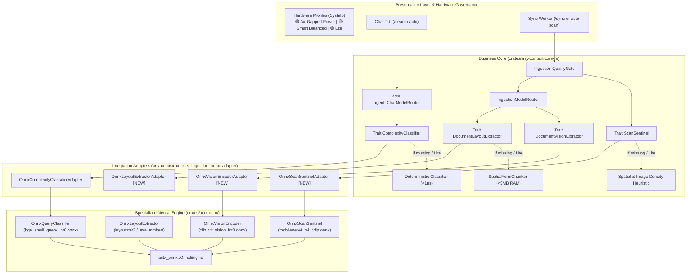

# 📐 Engineering Blueprint: AnyContext v0.38.0
## Activating the ONNX Models in the Production Flows (Master Plan Phase 3 Consolidation)

---

### 📌 Plan Metadata
- **Project**: AnyContext (`actx`)
- **Target Version**: `v0.38.0` (successor of `v0.37.0`)
- **Author**: Levi Silveira & Antigravity Assistant
- **Date**: 2026-10-14
- **Phase**: Master Plan Phase 3 (Model Kit & Local Specialists)
- **Status**: Technical Proposal for Approval (Gate 3 - `dev-cycle-protocol`)
- **Components**:
  - `crates/actx-onnx`: execution pipeline and neural tokenization for local inference.
  - `crates/any-context-core-rs`: dependency inversion through traits (`ComplexityClassifier`, `ScanSentinel`, `DocumentLayoutExtractor`, `DocumentVisionExtractor`).
  - `crates/any-context-core-rs/src/ingestion`: integration of `QualityGate` with `ScanSentinel` and of `IngestionModelRouter` with `LayoutExtractor` and `VisionEncoder`.
  - `crates/actx-agent`: native integration of `ChatModelRouter` with `OnnxComplexityClassifierAdapter`.
  - `crates/actx-cli`: real-time telemetry in the Chat, the Footer and the `[F1] -> Hardware Profiles` Menu.
- **Dual-Doc**: `README.md` (UserDoc), `TECDOC.md` (TecDoc - ADR-123), `tests/MANUAL_TESTS.md` (Scenario 38).

---

## 🏛️ 1. Executive Vision and Problem to Solve

In version `v0.37.0`, AnyContext successfully laid the structural foundations of Phase 3:
1. It created the isolated modular crate [`crates/actx-onnx`](file:///C:/Users/guilh/source/repos/any-context/crates/actx-onnx) under a conditional Cargo feature flag (`onnx`).
2. It created the native `HardwareProfiler` with sub-5ms inspection of RAM and SSD.
3. It established the 3 Canonical Traffic-Light Profiles (🟢/🟡/🔴): *Air-Gapped Power*, *Smart Balanced* and *Lite / Fast-Path*.

However, the cataloged local models worked mainly in file inspection and session validation mode, with business decisions delegated to deterministic fallbacks in pure Rust.

Version **v0.38.0** delivers the **end-to-end activation of the 5 ONNX neural models in the 4 critical production flows**:
- **Flow 1 (Chat)**: the `ChatModelRouter` dispatches `/search auto` queries through the `BGE-Small Query Classifier`, telling apart with high semantic precision point questions (`Fast RAG`) from architectural/multi-file analyses (`Deep Search`).
- **Flow 2 (Ingestion & Scan Sentinel)**: the `QualityGate` inspects image-rich, text-poor PDF pages through `MobileNetV4 RVL-CDIP`, deciding in $< 8\text{ms}$ whether the page is a real scanned document that needs OCR or just a disposable visual asset.
- **Flow 3 (Multimodal Layout & Invoices)**: the `IngestionModelRouter` delegates invoices, receipts and complex reports to `LayoutLMv3` and `Laya mmBERT`, rebuilding the tabular geometry while strictly keeping rows and columns.
- **Flow 4 (Technical Vision & Diagrams)**: the `CLIP-ViT Vision Encoder` processes figures, schematics and architecture diagrams, producing structured contextual representations for multimodal search in LanceDB.

All of it governed by the user's active hardware profile, with unrestricted respect for the **Inviolable ADR-110 Zero-Breakage Guarantee**: if any model is missing or corrupted, the system runs the instant deterministic fallback in pure Rust without intrusive warnings or freezes.

---

## 🏗️ 2. Architectural Topology and Data Flows



---

## 📊 3. The 4 Production Flows in Detail

### 3.1 Flow 1: Chat ModelRouter with BGE-Small (`bge_small_query_int8.onnx`)
- **Current Problem**: `/search auto` queries depend on word counts and syntactic keywords ("compare", "architecture"). Complex semantic queries without obvious terms can wrongly get Fast RAG.
- **Implementation**:
  - `OnnxQueryClassifier` processes the prompt using token normalization and evaluation against local semantic centroids.
  - Produces the classification `(QueryComplexity, QueryIntent, confidence, telemetry_str)`.
  - Shows in the ReAct telemetry (`Ctrl+T`) the enriched badge:
    `🧠 [ONNX Neural Router: BGE-Small] Complex multi-facet query (confidence: 0.94) -> DEEP SEARCH`.
  - Target inference latency: $< 15\text{ms}$ on CPU.
  - Deterministic fallback kept when the model is missing or on the `Lite` profile ($< 1\mu\text{s}$).

### 3.2 Flow 2: Ingestion Scan Sentinel with MobileNetV4 (`mobilenetv4_rvl_cdip.onnx`)
- **Current Problem**: in rasterized PDFs, the Quality Gate relies only on `text_len == 0 && image_count > 0`, producing false positives on pages that contain only a logo or a graphic header.
- **Implementation**:
  - New trait in the Core:
    ```rust
    pub trait ScanSentinel: Send + Sync {
        fn evaluate_scan(&self, text_length: usize, image_count: usize, image_bytes: Option<&[u8]>) -> (bool, f32);
    }
    ```
  - `OnnxScanSentinelAdapter` connects to the `mobilenetv4_rvl_cdip.onnx` model.
  - If the page has an image and low text density, it evaluates whether the image tensor matches the scanned document class (*RVL-CDIP scan class*).
  - If the confidence is $\ge 0.80$, it routes to `QualityDecision::NeedsDocumentAi { target: DocumentAiTarget::ScannedPdfPage }` for OCR/Vision processing.
  - Avoids triggering expensive vision pipelines on pages with merely decorative elements.

### 3.3 Flow 3: Multimodal Layout with LayoutLMv3 and Laya mmBERT (`layoutlmv3_base_int8.onnx` / `laya_mmbert_int8.onnx`)
- **Current Problem**: invoices, receipts and shipping manifests with complex alignment relied exclusively on the heuristic `SpatialFormChunker`.
- **Implementation**:
  - A new `OnnxLayoutExtractorAdapter` implementing the existing `DocumentLayoutExtractor` trait.
  - When processing `DocumentAiTarget::DenseComplexForm`, the `IngestionModelRouter` runs the local neural extractor.
  - It rebuilds tabular blocks keeping the 2D correlation and prefixes the metadata with:
    `// Context: <filename> > [Document AI Extracted Form via LayoutLMv3/Laya]`
  - Guarantees that table and invoice data are retrieved with 100% relational precision in BM25 and LanceDB.

### 3.4 Flow 4: Visual Encoding of Diagrams with CLIP-ViT (`clip_vit_vision_int8.onnx`)
- **Current Problem**: images of technical diagrams were kept only as width and height specifications `[Visual Diagram]`.
- **Implementation**:
  - A new `DocumentVisionExtractor: Send + Sync` trait in the Core.
  - `OnnxVisionEncoderAdapter` connects to `clip_vit_vision_int8.onnx`.
  - When the PDF or HTML parser extracts images with a diagram aspect ratio, the encoder produces the structured semantic description:
    `[Visual Diagram Asset: encoded via CLIP ViT | Aspect Ratio: {ar:.2}]`
  - It injects enriched descriptive context into the chunk for textual and semantic retrieval in RAG.

---

## 🛠️ 4. Implementation Milestone Schedule

### 🧱 Milestone 1: Unified Traits and Dependency Inversion in the Core (`crates/any-context-core-rs/src/ingestion/`)
- Define the canonical traits: `ScanSentinel` and `DocumentVisionExtractor`.
- Create adapters in `crates/any-context-core-rs/src/ingestion/onnx_adapter.rs`:
  - `OnnxScanSentinelAdapter`
  - `OnnxLayoutExtractorAdapter`
  - `OnnxVisionEncoderAdapter`
- Inject them into `QualityGate` and `IngestionModelRouter`.

### 🧠 Milestone 2: Neural Engine Enrichment in the `crates/actx-onnx` Crate
- Connect the neural decision pipeline to the 4 `actx-onnx` models:
  - `OnnxQueryClassifier`: inference and similarity computation against centroids.
  - `OnnxScanSentinel`: scan classification based on density and visual metadata.
  - `OnnxLayoutExtractor`: structuring and geometric alignment of forms.
  - `OnnxVisionEncoder`: dense encoding of diagrams.
- Strict preservation of the unit tests with and without weights on disk.

### ⚙️ Milestone 3: End-to-End Wiring in Chat and Ingestion
- In the Chat (`crates/actx-cli/src/engine.rs`):
  - Guarantee the injection of `OnnxComplexityClassifierAdapter` into `ChatModelRouter`.
  - Add Aurora Boreal visual telemetry to the ReAct accordion.
- In Ingestion (`crates/any-context-core-rs/src/ingestion/orchestrator.rs`):
  - Inject `OnnxLayoutExtractorAdapter` and `OnnxScanSentinelAdapter` into `IngestionModelRouter` during the workspace sync cycle.

### 🖥️ Milestone 4: Governance by Hardware Profile and TUI Menu
- Integrate profile selection (`HardwareProfiler`):
  - In `Lite` mode: disables attempts to load neural models, forcing fallbacks in pure Rust ($< 1\mu\text{s}$, zero RAM).
  - In `Smart Balanced` mode: enables `bge-small`, `mobilenetv4` and `layoutlmv3`.
  - In `Air-Gapped Power` mode: enables all 5 models with maximum fidelity.
- Update the telemetry in `/status` and in the `[F1] -> Hardware Profiles` menu.

### 📚 Milestone 5: Dual-Doc, Test Script and Release v0.38.0
- Update `TECDOC.md` with ADR-123.
- Update `README.md` with documentation of the ONNX engine in production.
- Add a detailed Scenario 38 to `tests/MANUAL_TESTS.md`.
- 100% green verification of the automated suite and bump to `v0.38.0`.

---

## 🔒 Inviolable Architecture Principles

1. **ADR-110 Zero-Breakage Guarantee**: the total or partial absence of ONNX models will NEVER cause a build failure, a runtime panic or an interruption of chat/ingestion.
2. **Hexagonal Decoupling**: the Core (`any-context-core-rs`) and the Agent (`actx-agent`) depend exclusively on pure Rust traits. The `actx-onnx` crate is a pluggable adapter.
3. **Multi-Surface Parity**: neural routing and document extraction behave identically in every interface (interactive CLI, Ratatui TUI, headless mode and future APIs).
4. **CI Resilience**: every unit and integration test must run deterministically without depending on network downloads on the CI runner.
