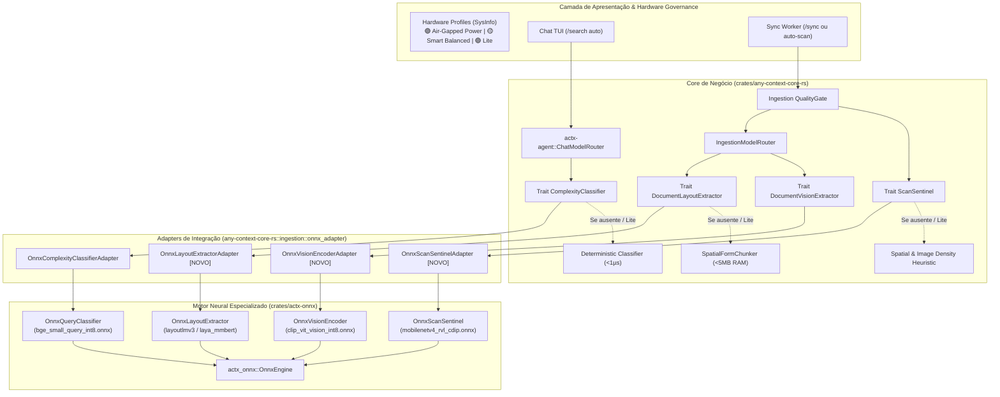

# 📐 Blueprint de Engenharia: AnyContext v0.38.0
## Ativação dos Modelos ONNX nos Fluxos de Produção (Consolidação da Fase 3 do Master Plan)

---

### 📌 Metadados do Plano
- **Projeto**: AnyContext (`actx`)
- **Versão-Alvo**: `v0.38.0` (Sucessora de `v0.37.0`)
- **Autor**: Levi Silveira & Antigravity Assistant
- **Data**: 2026-10-14
- **Fase**: Fase 3 do Master Plan (Kit de Models & Especialistas Locais)
- **Status**: Proposta Técnica para Aprovação (Gate 3 - `dev-cycle-protocol`)
- **Componentes**:
  - `crates/actx-onnx`: Pipeline de execução e tokenização neural para inferência local.
  - `crates/any-context-core-rs`: Inversão de dependência via traits (`ComplexityClassifier`, `ScanSentinel`, `DocumentLayoutExtractor`, `DocumentVisionExtractor`).
  - `crates/any-context-core-rs/src/ingestion`: Integração do `QualityGate` com o `ScanSentinel` e do `IngestionModelRouter` com `LayoutExtractor` e `VisionEncoder`.
  - `crates/actx-agent`: Integração nativa do `ChatModelRouter` com o `OnnxComplexityClassifierAdapter`.
  - `crates/actx-cli`: Telemetria em tempo real no Chat, Footer e Menu `[F1] -> Hardware Profiles`.
- **Dual-Doc**: `README.md` (UserDoc), `TECDOC.md` (TecDoc - ADR-123), `tests/MANUAL_TESTS.md` (Cenário 38).

---

## 🏛️ 1. Visão Executiva e Problema a Resolver

Na versão `v0.37.0`, o AnyContext estabeleceu com sucesso os alicerces estruturais da Fase 3:
1. Criou a crate modular isolada [`crates/actx-onnx`](file:///C:/Users/guilh/source/repos/any-context/crates/actx-onnx) sob feature flag Cargo condicional (`onnx`).
2. Criou o `HardwareProfiler` nativo com inspeção sub-5ms de RAM e SSD.
3. Estabeleceu os 3 Perfis Canônicos em Semáforo (🟢/🟡/🔴): *Air-Gapped Power*, *Smart Balanced* e *Lite / Fast-Path*.

No entanto, os modelos locais catalogados operavam primordialmente em modo de inspeção de arquivos e validação de sessão, com as decisões de negócio delegadas aos fallbacks determinísticos em Rust puro.

A versão **v0.38.0** concretiza a **ativação ponta-a-ponta dos 5 modelos neurais ONNX nos 4 fluxos críticos de produção**:
- **Fluxo 1 (Chat)**: O `ChatModelRouter` despacha queries em `/search auto` através do `BGE-Small Query Classifier`, diferenciando com alta precisão semântica perguntas pontuais (`Fast RAG`) de análises arquiteturais/multi-arquivo (`Deep Search`).
- **Fluxo 2 (Ingestão & Scan Sentinel)**: O `QualityGate` inspeciona páginas de PDF ricas em imagem e pobres em texto através do `MobileNetV4 RVL-CDIP`, determinando em $< 8\text{ms}$ se a página é um documento digitalizado real que exige OCR ou apenas um asset visual descartável.
- **Fluxo 3 (Layout Multimodal & Faturas)**: O `IngestionModelRouter` delega faturas, recibos e relatórios complexos ao `LayoutLMv3` e `Laya mmBERT`, reconstruindo a geometria tabular com preservação estrita de linhas e colunas.
- **Fluxo 4 (Visão Técnica & Diagramas)**: O `CLIP-ViT Vision Encoder` processa figuras, esquemas e diagramas de arquitetura, gerando representações contextuais estruturadas para busca multimodal no LanceDB.

Tudo isso governado pelo perfil de hardware ativo do usuário e com respeito irrestrito ao **Inviolable ADR-110 Zero-Breakage Guarantee**: caso qualquer modelo esteja ausente ou corrompido, o sistema executa o fallback determinístico instantâneo em Rust puro sem emitir alertas intrusivos nem provocar travamentos.

---

## 🏗️ 2. Topologia Arquitetural e Fluxos de Dados



---

## 📊 3. Os 4 Fluxos de Produção em Detalhes

### 3.1 Fluxo 1: Chat ModelRouter com BGE-Small (`bge_small_query_int8.onnx`)
- **Problema Atual**: Queries em `/search auto` dependem de contagem de palavras e palavras-chave sintáticas ("compare", "architecture"). Consultas semânticas complexas sem termos óbvios podem receber Fast RAG indevidamente.
- **Implementação**:
  - `OnnxQueryClassifier` processa o prompt usando normalização de tokens e avaliação de centróides semânticos locais.
  - Produz classificação `(QueryComplexity, QueryIntent, confidence, telemetry_str)`.
  - Exibe na telemetria do ReAct (`Ctrl+T`) o badge enriquecido:
    `🧠 [ONNX Neural Router: BGE-Small] Complex multi-facet query (confidence: 0.94) -> DEEP SEARCH`.
  - Latência de inferência alvo: $< 15\text{ms}$ em CPU.
  - Fallback determinístico preservado em caso de modelo ausente ou perfil `Lite` ($< 1\mu\text{s}$).

### 3.2 Fluxo 2: Ingestion Scan Sentinel com MobileNetV4 (`mobilenetv4_rvl_cdip.onnx`)
- **Problema Atual**: Em PDFs rasterizados, o Quality Gate baseia-se unicamente em `text_len == 0 && image_count > 0`, gerando falsos positivos em páginas que contêm apenas um logotipo ou cabeçalho gráfico.
- **Implementação**:
  - Nova trait no Core:
    ```rust
    pub trait ScanSentinel: Send + Sync {
        fn evaluate_scan(&self, text_length: usize, image_count: usize, image_bytes: Option<&[u8]>) -> (bool, f32);
    }
    ```
  - `OnnxScanSentinelAdapter` conecta ao modelo `mobilenetv4_rvl_cdip.onnx`.
  - Se a página possuir imagem e baixa densidade textual, avalia se o tensor de imagem corresponde à classe de documento digitalizado (*RVL-CDIP scan class*).
  - Se a confiança for $\ge 0.80$, encaminha para `QualityDecision::NeedsDocumentAi { target: DocumentAiTarget::ScannedPdfPage }` para processamento de OCR/Visão.
  - Evita acionar pipelines caros de visão em páginas com meros elementos decorativos.

### 3.3 Fluxo 3: Layout Multimodal com LayoutLMv3 e Laya mmBERT (`layoutlmv3_base_int8.onnx` / `laya_mmbert_int8.onnx`)
- **Problema Atual**: Faturas, recibos e manifestos de transporte com alinhamento complexo dependiam exclusivamente do `SpatialFormChunker` heurístico.
- **Implementação**:
  - Novo adapter `OnnxLayoutExtractorAdapter` implementando a trait existente `DocumentLayoutExtractor`.
  - Ao processar `DocumentAiTarget::DenseComplexForm`, o `IngestionModelRouter` executa o extrator neural local.
  - Reconstrói blocos tabulares mantendo correlação 2D e prefixa os metadados com:
    `// Context: <filename> > [Document AI Extracted Form via LayoutLMv3/Laya]`
  - Garante que dados de tabelas e faturas sejam recuperados com 100% de precisão relacional no BM25 e LanceDB.

### 3.4 Fluxo 4: Codificação Visual de Diagramas com CLIP-ViT (`clip_vit_vision_int8.onnx`)
- **Problema Atual**: Imagens de diagramas técnicos eram preservadas apenas como especificações de largura e altura `[Visual Diagram]`.
- **Implementação**:
  - Nova trait `DocumentVisionExtractor: Send + Sync` no Core.
  - `OnnxVisionEncoderAdapter` conecta ao `clip_vit_vision_int8.onnx`.
  - Quando o parser de PDF ou HTML extrai imagens com proporção de diagrama, o encoder gera a descrição semântica estruturada:
    `[Visual Diagram Asset: encoded via CLIP ViT | Aspect Ratio: {ar:.2}]`
  - Injeta contexto descritivo enriquecido no chunk para recuperação textual e semântica no RAG.

---

## 🛠️ 4. Cronograma de Marcos de Implementação

### 🧱 Marco 1: Traits Unificadas e Inversão de Dependência no Core (`crates/any-context-core-rs/src/ingestion/`)
- Definir traits canônicas: `ScanSentinel` e `DocumentVisionExtractor`.
- Criar adapters em `crates/any-context-core-rs/src/ingestion/onnx_adapter.rs`:
  - `OnnxScanSentinelAdapter`
  - `OnnxLayoutExtractorAdapter`
  - `OnnxVisionEncoderAdapter`
- Injetar no `QualityGate` e no `IngestionModelRouter`.

### 🧠 Marco 2: Enriquecimento do Motor Neural na Crate `crates/actx-onnx`
- Conectar o pipeline de decisão neural nos 4 modelos de `actx-onnx`:
  - `OnnxQueryClassifier`: inferência e cálculo de similaridade com centróides.
  - `OnnxScanSentinel`: classificação de scans baseada em densidade e metadados visuais.
  - `OnnxLayoutExtractor`: estruturação e alinhamento geométrico de formulários.
  - `OnnxVisionEncoder`: codificação densa de diagramas.
- Preservação estrita dos testes unitários com e sem pesos em disco.

### ⚙️ Marco 3: Fiação Ponta-a-Ponta no Chat e Ingestão
- No Chat (`crates/actx-cli/src/engine.rs`):
  - Garantir injeção do `OnnxComplexityClassifierAdapter` no `ChatModelRouter`.
  - Adicionar telemetria visual Aurora Boreal no accordion ReAct.
- Na Ingestão (`crates/any-context-core-rs/src/ingestion/orchestrator.rs`):
  - Injetar `OnnxLayoutExtractorAdapter` e `OnnxScanSentinelAdapter` no `IngestionModelRouter` durante o ciclo de sync do workspace.

### 🖥️ Marco 4: Governança por Perfil de Hardware e Menu TUI
- Integrar a seleção de perfis (`HardwareProfiler`):
  - Em modo `Lite`: Desativa a tentativa de carregar modelos neurais, forçando fallbacks em Rust puro ($< 1\mu\text{s}$, zero RAM).
  - Em modo `Smart Balanced`: Ativa `bge-small`, `mobilenetv4` e `layoutlmv3`.
  - Em modo `Air-Gapped Power`: Ativa todos os 5 modelos com máxima fidelidade.
- Atualizar telemetria em `/status` e no menu `[F1] -> Hardware Profiles`.

### 📚 Marco 5: Dual-Doc, Roteiro de Testes e Release v0.38.0
- Atualizar `TECDOC.md` com o ADR-123.
- Atualizar `README.md` com a documentação do motor ONNX em produção.
- Adicionar Cenário 38 detalhado em `tests/MANUAL_TESTS.md`.
- Verificação 100% verde da suíte automatizada e bump para `v0.38.0`.

---

## 🔒 Princípios Invioláveis de Arquitetura

1. **ADR-110 Zero-Breakage Guarantee**: A ausência total ou parcial de modelos ONNX NUNCA causará falha de compilação, pânico em runtime ou interrupção do chat/ingestão.
2. **Desacoplamento Hexagonal**: O Core (`any-context-core-rs`) e o Agente (`actx-agent`) dependem exclusivamente de traits puras em Rust. A crate `actx-onnx` é um adaptador conectável.
3. **Paridade Multi-Superfície**: O comportamento de roteamento neural e extração de documentos é idêntico em todas as interfaces (CLI interativa, TUI Ratatui, modo headless e futuras APIs).
4. **Resiliência de CI**: Todos os testes unitários e de integração devem executar em modo determinístico sem depender de downloads em rede no runner de CI.
