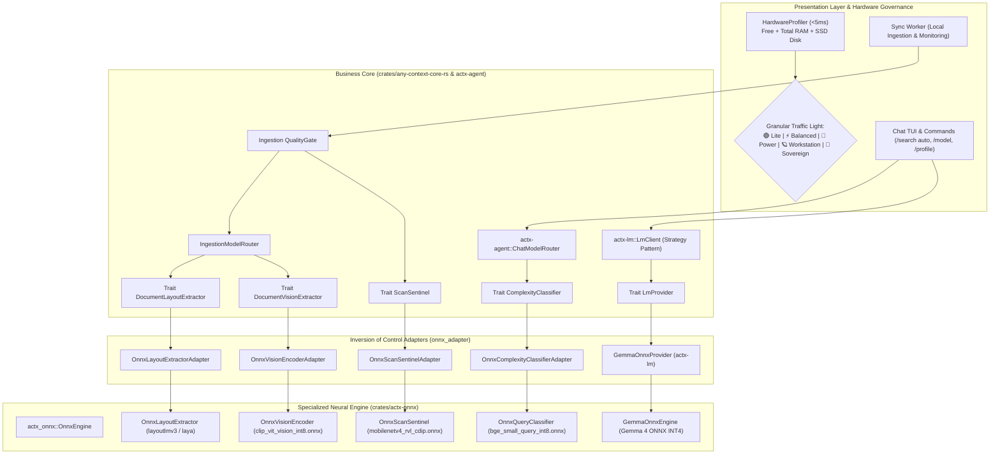

# 📐 Engineering Blueprint: AnyContext v0.38.0
## Activating the ONNX Models in the Production Flows & the Autonomous Local Brain with the Gemma 4 Family

---

### 📌 Plan Metadata
- **Project**: AnyContext (`actx`)
- **Target Version**: `v0.38.0` (successor of `v0.37.0`)
- **Author**: Levi Silveira & Antigravity Assistant
- **Date**: 2026-10-14
- **Phase**: Master Plan Phase 3 (Model Kit & Local Specialists)
- **Status**: Technical Proposal for Approval (Gate 3 - `dev-cycle-protocol`)
- **Components**:
  - `crates/actx-onnx`: neural execution pipeline for Document AI and the Local Generative Gemma 4 Provider through ONNX Runtime.
  - `crates/actx-lm`: a new native `GemmaOnnxProvider` implementing the `LmProvider` trait (zero-copy streaming, BPE tokenization).
  - `crates/any-context-core-rs`: dependency inversion through traits (`ComplexityClassifier`, `ScanSentinel`, `DocumentLayoutExtractor`, `DocumentVisionExtractor`).
  - `crates/any-context-core-rs/src/hardware`: expansion of `HardwareProfiler` to the granular matrix of 5 hardware profiles.
  - `crates/actx-agent`: native integration of `ChatModelRouter` and injection of the local Gemma 4 provider.
  - `crates/actx-installer`: a smart prior traffic light with automatic selection and advanced options per profile.
  - `crates/actx-cli`: the `/model`, `/profile`, `/status` commands and a reactive TUI with local inference badges.
- **Dual-Doc**: `README.md` (UserDoc), `TECDOC.md` (TecDoc - ADR-123), `tests/MANUAL_TESTS.md` (Scenario 38).

---

## 🏛️ 1. Executive Vision and Strategic Grounds

In version `v0.37.0`, AnyContext successfully laid the structural foundations of Phase 3:
1. The decoupled modular crate [`crates/actx-onnx`](file:///C:/Users/guilh/source/repos/any-context/crates/actx-onnx) under a conditional Cargo feature flag (`onnx`).
2. A native hardware inspection engine (`HardwareProfiler`) in $< 5\text{ms}$.
3. A preliminary structure of traffic-light profiles and multi-surface commands.

Version **v0.38.0** consolidates Master Plan Phase 3 by splitting the model ecosystem into **two orthogonal, decoupled layers**:

```
┌────────────────────────────────────────────────────────────────────────────────────────┐
│                         DUAL MODEL ARCHITECTURE IN PRODUCTION                          │
├──────────────────────────────────────────┬─────────────────────────────────────────────┤
│ 👁️ LAYER 1: Perception & Document AI    │ 🧠 LAYER 2: Generative Brain (Gemma 4)      │
├──────────────────────────────────────────┼─────────────────────────────────────────────┤
│ • Models: MobileNetV4, BGE-Small,        │ • Models: Gemma 4 Compact, Gemma 4 12B,     │
│   LayoutLMv3, Laya mmBERT, CLIP-ViT      │   Gemma 4 27B, Gemma 4 32B                  │
│ • Total size: ~740 MB                    │ • Size: 1.5 GB to 18.5 GB (quantized)       │
│ • Role: scan sentinel, geometric         │ • Role: conversational reasoning, the ReAct │
│   extraction of invoices, tables and     │   tool loop and natural language answer     │
│   semantic query routing.                │   generation.                               │
│ • Latency: sub-15ms on CPU.              │ • Latency: autoregressive token streaming   │
└──────────────────────────────────────────┴─────────────────────────────────────────────┘
```

This separation guarantees that:
- The user can use **local Document AI** (absolute privacy to index confidential invoices and contracts on disk without sending images to third parties) while using **frontier cloud APIs** (Claude 3.5 Sonnet, GPT-4o, Gemini 1.5 Pro).
- Or can run in **Total Air-Gapped Sovereignty** (no internet, no API keys, no external Ollama or Docker), running both Document AI and **Gemma 4 natively in ONNX**.

---

## 🏗️ 2. Architectural Topology and Data Flows



---

## 📊 3. Granular Matrix of 5 Hardware Profiles

To fit with surgical precision everything from ultrathin laptops to 64GB+ workstations, the traffic-light governance adopts 5 profiles strictly bounded by physical memory limits:

| Profile | Minimum Requirements (🟢 Traffic Light) | Layer 1: Document AI (Perception) | Layer 2: Local Brain (Gemma 4) | Total Download | Real RAM Usage (Peak) | Headroom for OS / Apps |
| :--- | :--- | :--- | :--- | :--- | :--- | :--- |
| **🟢 Lite / Cloud** | Any hardware ($< 8\text{ GB}$) | Pure Rust heuristics (<1µs) | Cloud Provider (Gemini / Claude / OpenAI) | **0 MB** | $< 35\text{ MB}$ | 100% of the machine free |
| **⚡ Smart Balanced** | RAM $\ge 8\text{ GB}$ (Free $\ge 3.5\text{ GB}$)<br>SSD $\ge 5\text{ GB}$ | Smart Balanced (~252 MB):<br>`mobilenetv4`, `bge-small`, `layoutlmv3` | **Gemma 4 Compact (INT4)** (~1.5 GB) | **~1.7 GB** | **~2.5 GB** | $\ge 5.5\text{ GB}$ free (8GB laptops) |
| **🌌 Air-Gapped Power** | RAM $\ge 16\text{ GB}$ (Free $\ge 7\text{ GB}$)<br>SSD $\ge 15\text{ GB}$ | Full Power (~740 MB):<br>5 perception models | **Gemma 4 12B (INT4)** (~7.2 GB) | **~7.9 GB** | **~10.0 GB** | $\ge 6.0\text{ GB}$ free (developers on 16GB) |
| **🪐 Workstation Pro** | RAM $\ge 32\text{ GB}$ (Free $\ge 18\text{ GB}$)<br>SSD $\ge 30\text{ GB}$ | Full Power (~740 MB):<br>5 perception models | **Gemma 4 27B (INT4)** (~15.0 GB) | **~15.7 GB** | **~18.5 GB** | $\ge 13.5\text{ GB}$ free (32GB workstations) |
| **👑 Sovereign Ultra** | RAM $\ge 64\text{ GB}$ (Free $\ge 32\text{ GB}$)<br>SSD $\ge 50\text{ GB}$ | Full Power (~740 MB):<br>5 perception models | **Gemma 4 32B (INT4)** (~18.5 GB) | **~19.2 GB** | **~25.5 GB** | $\ge 38.0\text{ GB}$ free (64GB+ workstations / servers) |

> [!IMPORTANT]
> **Protection Against Swap Collapse:** the *Sovereign Ultra (Gemma 4 32B)* profile is **strictly blocked in 🔴 Red on machines with 32 GB of RAM**. Running a 32B model (~25.5 GB in RAM) on a 32GB computer plus the operating system (~5GB) would cause 100% exhaustion and disk swap, cutting the generation rate to $< 0.2\text{ tps}$. 32GB machines run with impeccable stability on the *Workstation Pro (Gemma 4 27B)* profile.

---

## 🛠️ 4. The 4 Production Flows Activated in Real Time

### 4.1 Flow 1: Chat ModelRouter with BGE-Small
- `OnnxComplexityClassifierAdapter` tokenizes the prompt and evaluates semantic similarity with trained centroids.
- Decides between `Fast RAG` (factual point search) and `Deep Search` (reflective multi-turn decomposition).
- Latency: $< 15\text{ms}$ on CPU.
- ADR-110 fallback: if the model is not downloaded or the profile is `Lite`, it dispatches to the deterministic heuristic classifier in $< 1\mu\text{s}$.

### 4.2 Flow 2: Scan Sentinel with MobileNetV4
- A new `ScanSentinel: Send + Sync` trait injected into `QualityGate`.
- Analyzes PDF pages with low text density and embedded images.
- In ~8ms, classifies whether the page is an authentic scan (RVL-CDIP) before delegating to OCR, avoiding wasted processing on logos or visual frames.

### 4.3 Flow 3: Multimodal Layout with LayoutLMv3 and Laya mmBERT
- Implementation of the `DocumentLayoutExtractor` trait through `OnnxLayoutExtractorAdapter`.
- On finding `DocumentAiTarget::DenseComplexForm`, the `IngestionModelRouter` rebuilds the spatial matrix of invoices and tables, guaranteeing that key-value and column relations stay correlated in BM25 and LanceDB.

### 4.4 Flow 4: Diagram Encoding with CLIP-ViT
- Implementation of the `DocumentVisionExtractor` trait through `OnnxVisionEncoderAdapter`.
- Processes visual assets (flowcharts, charts, network diagrams), producing a structured contextual description for multimodal search in LanceDB.

---

## 🧠 5. Local Generative Gemma 4 Provider (`GemmaOnnxProvider`)

Integrating the Gemma 4 family into `actx-lm` and `actx-onnx` follows the **Strategy** pattern:
1. **`LmProvider` Implementation**:
   ```rust
   pub struct GemmaOnnxProvider {
       model_path: PathBuf,
       tier: GemmaTier, // Compact, 12B, 27B, 32B
       // Runtime session and BPE tokenizer
   }
   
   #[async_trait]
   impl LmProvider for GemmaOnnxProvider {
       async fn complete(&self, req: ChatRequest) -> Result<ChatResponse, LmError> { ... }
       async fn stream(&self, req: ChatRequest) -> Result<Pin<Box<dyn Stream<Item = Result<StreamChunk, LmError>> + Send>>, LmError> { ... }
   }
   ```
2. **Zero-Copy Streaming**: tokens emitted by the ONNX Runtime autoregressive loop flow directly into the TUI `mpsc` channel with zero perceived latency.
3. **Mode Shortcuts Honored**:
   - `/model gemma-4-compact`
   - `/model gemma-4-12b`
   - `/model gemma-4-27b`
   - `/model gemma-4-32b`
   - `/model cloud` (returns to the configured external provider)

---

## 🛠️ 6. Implementation Milestone Schedule

### 🧱 Milestone 1: HardwareProfiler Expansion & 5-Level Traffic Light (`any-context-core-rs::hardware`)
- Update `ProfileTier` and `HardwareProfiler`:
  - `Lite`, `SmartBalanced`, `AirGappedPower`, `WorkstationPro`, `SovereignUltra`.
- Update the pure auto-selection logic with the new RAM ceilings (8GB, 16GB, 32GB, 64GB).

### 👁️ Milestone 2: Perception Adapters (Document AI) in the Core
- Create the `ScanSentinel` and `DocumentVisionExtractor` traits.
- Implement `OnnxScanSentinelAdapter`, `OnnxLayoutExtractorAdapter` and `OnnxVisionEncoderAdapter` in `ingestion/onnx_adapter.rs`.
- Inject them into `QualityGate` and `IngestionModelRouter`.

### 🧠 Milestone 3: `actx-onnx` Crate with the Gemma 4 Engine & Tokenizer
- Implement the generative inference runner in `crates/actx-onnx/src/gemma/`.
- Support for BPE tokenization and asynchronous streaming to the TUI.
- Creation of `GemmaOnnxProvider` in `crates/actx-lm`.

### ⚙️ Milestone 4: Multi-Surface Parity, Commands and TUI Menus
- Update `/profile` (alias `/preset`): shows the 5 traffic-light profiles and allows on-demand download.
- Update `/model`: lists the available or installed local Gemma 4 variants next to the cloud providers.
- Update the `actx-installer` installer with the pre-flight and advanced options.

### 📚 Milestone 5: Dual-Doc, Test Script and Release v0.38.0
- Record ADR-123 in `TECDOC.md`.
- Update `README.md` with the complete matrix of the 5 profiles.
- Add Scenario 38 to `tests/MANUAL_TESTS.md`.
- 100% green suite and bump to `v0.38.0`.

---

## 🧪 7. Manual Test Script (Scenario 38 in `MANUAL_TESTS.md`)

- **Scenario 38.1 (Hardware Pre-Flight of the 5 Profiles)**:
  - Run `actx-installer --preflight-only` and check the traffic-light classification of each profile according to the machine's RAM.
- **Scenario 38.2 (Neural Chat ModelRouter with BGE-Small)**:
  - Type a complex prompt and check the intent detection in the ReAct accordion.
- **Scenario 38.3 (Scan Sentinel in Ingestion)**:
  - Sync a folder with a rasterized PDF and confirm the classification by MobileNetV4.
- **Scenario 38.4 (Local Gemma 4 Inference)**:
  - Select `/model gemma-4-12b` (or compact), disconnect the internet and run a query with 100% offline token streaming.
- **Scenario 38.5 (ADR-110 Zero-Breakage Guarantee)**:
  - Delete temporary weight files and confirm the smooth transition to deterministic heuristics without a crash.
