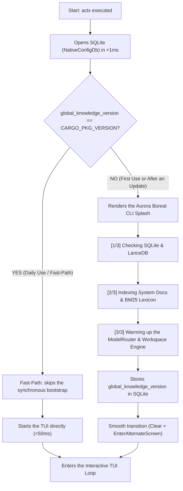
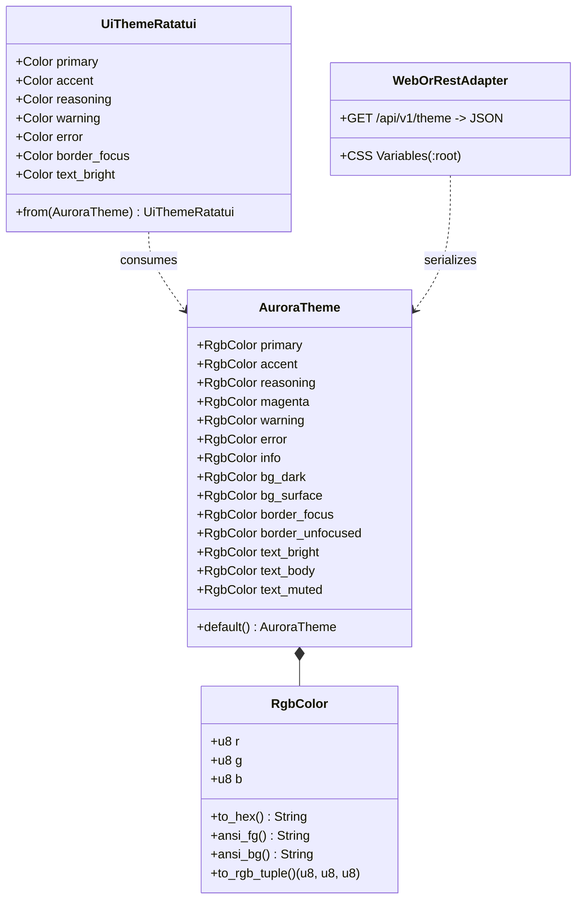

# Technical Blueprint - AnyContext v0.34.6: Aurora Boreal Design System & Fast Startup (Option C)

**Target Version**: `v0.34.6`  
**Date**: 2026-10-10  
**Author**: Levix Digital / Antigravity AI  
**Status**: Proposed (Awaiting Gate 3)  
**Plan ID**: `anycontext_blueprint_v0346_aurora_theme_and_fast_startup`  

---

## 1. Architecture and Affected Components

### 1.1 Architectural Overview
Version **v0.34.6** focuses on two central pillars of product excellence:
1. **Unified Visual Identity (Aurora Boreal Design System)**:
   - Extraction and centralization of Levix Digital's institutional Design Tokens (Boreal Emerald, Glacial Cyan, Cosmic Violet, Polar Pink, Solar Amber and Polar Night) in the `any-context-core-rs` crate.
   - A decoupled, modular architecture based on the *Hexagonal / Ports & Adapters* pattern: the Core defines pure tokens in RGB and Hex with JSON serialization support (for Web, RPC, REST and Desktop), while `actx-cli` implements the native adapters for `ratatui` (TUI) and 24-bit ANSI TrueColor (Headless CLI).
   - Any future palette change in the Core propagates automatically to every interface.
2. **Startup Optimization and Splash Telemetry (Option C - Smart Hybrid)**:
   - Removal of blocking startup bottlenecks on the critical path (`ensure_global_knowledge_bootstrap`).
   - A < 1ms check in SQLite: if the version is already provisioned (`stored_version == current_version`), it takes the *Fast-Path*, opening the TUI in < 50ms without unnecessary disk calls.
   - On the first run or after a version upgrade (`stored_version != current_version`), it shows an elegant Splash Loader with the Aurora Boreal colors on the command line, providing step-by-step telemetry of the LanceDB and BM25 index initialization before opening the TUI.

### 1.2 Modified Components and Modules
- `crates/any-context-core-rs/src/theme/mod.rs` (NEW):
  - Definition of the semantic tokens: `RgbColor`, `AuroraTheme`.
  - Conversion helpers: `to_hex()`, `ansi_fg()`, `ansi_bg()`, `to_rgb_tuple()`.
- `crates/any-context-core-rs/src/lib.rs`:
  - Public export of `pub mod theme;` and `pub use theme::{AuroraTheme, RgbColor};`.
- `crates/actx-cli/src/theme.rs` (NEW):
  - `UiTheme` adapter for `ratatui::style::Color`.
  - Palette mapped to `Color::Rgb(r, g, b)`.
- `crates/actx-cli/src/tui/ui.rs`:
  - Refactoring of the widgets (Header, Chat, ReAct Reasoning Accordion, Multiline Prompt, Command Palette, Footer and Interactive Menu) to consume the institutional Aurora Boreal palette.
- `crates/actx-cli/src/cli/oneshot.rs`:
  - CLI logs (thoughts, tool calls, sync status, ModelRouter badge) updated to use ANSI TrueColor sequences of the Aurora Boreal palette.
- `crates/actx-cli/src/engine.rs`:
  - Decoupling of the blocking synchronous bootstrap call inside `build_agent_sync`.
  - New functions `needs_global_bootstrap() -> bool` and `run_bootstrap_with_telemetry<F>(callback: F)`.
- `crates/actx-cli/src/tui/mod.rs` & `crates/actx-cli/src/main.rs`:
  - Implementation of Option C: a quick pre-TUI check, rendering of the Splash Loader when needed and immediate opening in steady state.
- `Cargo.toml` (workspace and crates): version bump to `0.34.6`.

---

## 2. Mermaid Diagrams

### 2.1 Startup Flow - Option C (Smart Hybrid)



### 2.2 Design Token Hierarchy & UI Decoupling



---

## 3. Data Structures and Signatures

### 3.1 `any_context_core_rs::theme` Module
```rust
#[derive(Debug, Clone, Copy, PartialEq, Eq, serde::Serialize, serde::Deserialize)]
pub struct RgbColor {
    pub r: u8,
    pub g: u8,
    pub b: u8,
}

impl RgbColor {
    pub const fn new(r: u8, g: u8, b: u8) -> Self;
    pub fn to_hex(&self) -> String;
    pub fn ansi_fg(&self) -> String;
    pub fn ansi_bg(&self) -> String;
    pub const fn to_rgb_tuple(&self) -> (u8, u8, u8);
}

#[derive(Debug, Clone, serde::Serialize, serde::Deserialize)]
pub struct AuroraTheme {
    pub primary: RgbColor,          // Boreal Emerald (#00E5A3)
    pub accent: RgbColor,           // Glacial Cyan (#00F0FF)
    pub reasoning: RgbColor,        // Cosmic Violet (#A855F7)
    pub magenta: RgbColor,          // Polar Pink (#EC4899)
    pub warning: RgbColor,          // Solar Amber (#F59E0B)
    pub error: RgbColor,            // Polar Crimson (#EF4444)
    pub info: RgbColor,             // Arctic Blue (#38BDF8)
    pub bg_dark: RgbColor,          // Polar Night (#0B0F19)
    pub bg_surface: RgbColor,       // Midnight Surface (#161F30)
    pub border_focus: RgbColor,     // Focus Border (#00F0FF)
    pub border_unfocused: RgbColor, // Neutral Border (#334155)
    pub text_bright: RgbColor,      // Polar Ice White (#F1F5F9)
    pub text_body: RgbColor,        // Glacial Silver (#CBD5E1)
    pub text_muted: RgbColor,       // Muted Slate (#64748B)
}
```

### 3.2 `actx_cli::theme` Module
```rust
pub struct UiTheme {
    pub primary: ratatui::style::Color,
    pub accent: ratatui::style::Color,
    pub reasoning: ratatui::style::Color,
    pub magenta: ratatui::style::Color,
    pub warning: ratatui::style::Color,
    pub error: ratatui::style::Color,
    pub info: ratatui::style::Color,
    pub bg_dark: ratatui::style::Color,
    pub bg_surface: ratatui::style::Color,
    pub border_focus: ratatui::style::Color,
    pub border_unfocused: ratatui::style::Color,
    pub text_bright: ratatui::style::Color,
    pub text_body: ratatui::style::Color,
    pub text_muted: ratatui::style::Color,
}

impl UiTheme {
    pub fn global() -> &'static UiTheme;
}
```

### 3.3 Startup Telemetry in `actx-cli/src/engine.rs`
```rust
pub fn check_upgrade_needed() -> bool;
pub fn execute_bootstrap_with_progress<F>(on_step: F) -> Result<(), String>
where
    F: FnMut(usize, usize, &str);
```

---

## 4. Documentation Changes (Dual-Doc Standard)

1. **`TECDOC.md`**:
   - Addition of **Section 107**: *Aurora Boreal Design System & Zero-Delay Modular Theme Architecture*.
   - Addition of **ADR-114**: *Modular Theme Tokens Extraction & Fast-Path Telemetry Startup (Option C)*.
2. **`README.md`**:
   - Update of the Visual Interface and Levix Digital Identity section.
   - Highlight of the ultra-fast startup (< 50ms) and the first-use telemetry.
3. **`tests/MANUAL_TESTS.md`**:
   - Addition of **Scenario 29**: validation of the Aurora Boreal color fidelity (TUI and CLI) and of the Fast-Path startup time (< 50ms in steady state and the Splash shown correctly on the first boot).
   - Strict, full preservation of all 28 pre-existing scenarios.

---

## 5. Test Suite

1. **Unit Tests in `any-context-core-rs::theme`**:
   - `test_rgb_hex_conversion`: exact conversion from RGB to uppercase Hex (`#00E5A3`, `#00F0FF`, etc.).
   - `test_theme_json_serialization`: validation that `AuroraTheme` serializes and deserializes perfectly through `serde_json` without loss, for consumption by Web/WASM.
   - `test_ansi_escape_generation`: correct generation of `\x1b[38;2;R;G;Bm` codes.
2. **Unit Tests in `actx-cli::theme`**:
   - `test_ui_theme_ratatui_mapping`: check of the mapping of every token to `ratatui::style::Color::Rgb`.
3. **Startup and Upgrade Check Tests**:
   - `test_upgrade_detection_logic`: simulation of an old SQLite version vs the package version and correct flag triggering.
4. **Manual Regression and Production Tests**:
   - Startup in normal mode: benchmark of opening in record time (< 50ms).
   - Forcing a simulated upgrade by changing the version in SQLite: check of the Splash Loader rendering with a spinner and smooth transition.
   - Headless queries (`actx -w TaxReturn -q "..."`): confirmation of the Aurora Boreal badges and perfect readability.

---

## 6. Risks, Mitigations and Rollback

| Risk | Impact | Mitigation |
|---|---|---|
| Legacy terminals without TrueColor (24-bit) support show distorted colors | Low | Ratatui and Crossterm fall back automatically to 256 colors / ANSI 16 colors. The hexadecimal tokens have balanced luminance compatible with 256-color palettes. |
| Loss of contrast between text and background in light-themed terminals | Medium | Text contrast (`text_bright` = `#F1F5F9`, `text_body` = `#CBD5E1`) was specifically calibrated to a high WCAG AAA ratio over dark backgrounds (`#0B0F19` / `#161F30`). |
| The splash hangs while loading on a LanceDB I/O failure | Medium | The bootstrap has defensive timeouts and catches errors with a graceful fallback without aborting the application. |
| **Rollback Plan** | N/A | On a regression, `git revert` to tag `v0.34.5` restores the previous behavior immediately. |

---

## 7. Step-by-Step Execution Plan

1. **Milestone 1: Theme Module in the Core (`any-context-core-rs`)**:
   - Implement `theme/mod.rs` with `RgbColor`, `AuroraTheme` and unit tests.
   - Export it in `lib.rs`.
2. **Milestone 2: Theme Adapter in `actx-cli`**:
   - Implement `actx-cli/src/theme.rs` with `UiTheme`.
   - Refactor `tui/ui.rs` (Header, Chat, Accordion, Prompt, Palette, Footer, Menu).
   - Refactor `cli/oneshot.rs` for Aurora ANSI badges and messages.
3. **Milestone 3: Fast Startup & Splash Loader (Option C)**:
   - Decouple the redundant synchronous call in `engine.rs`.
   - Implement the quick SQLite check in `main.rs` / `tui/mod.rs`.
   - Implement the `StartupLoader` component on the command line with progress and a spinner.
4. **Milestone 4: Validation, Tests and Visual Verification**:
   - Run `cargo check --workspace` and `cargo test --workspace`.
   - Test the fast startup and the splash simulation.
   - Validate the manual tests and the release executable build.
5. **Milestone 5: Dual-Doc, Version Bump & Release**:
   - Update `Cargo.toml` to `0.34.6`.
   - Update `TECDOC.md`, `README.md` and `tests/MANUAL_TESTS.md`.
   - Create the commit `feat(theme): v0.34.6 - aurora boreal design system & fast-path startup loader`, tag `v0.34.6` and push to `origin/dev`.

---

## 8. Acceptance Criteria

1. **100% green tests**: full workspace suite without errors (`cargo test --workspace`).
2. **Modularity and Reusability**: the color palette lives exclusively in the Core and can be serialized to JSON by any other interface.
3. **Aurora Boreal Visual Consistency**: Header, Chat, Reasoning Accordion, Menus and the Headless CLI consistently show the Levix Digital colors with high-contrast readability.
4. **Startup < 50ms**: normal day-to-day starts open the TUI instantly.
5. **Splash Loader Telemetry**: updates or the first boot show telemetry with progress on the command line before opening the TUI.
6. **Dual-Doc and Scenario 29**: documentation updated and Scenario 29 added without truncating previous tests.
