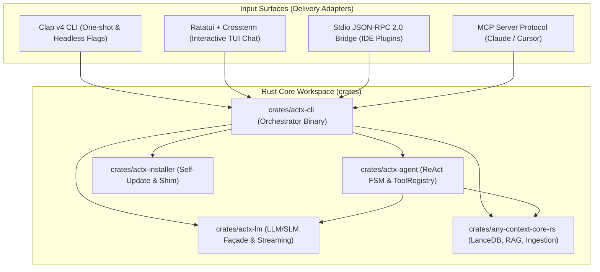

# 📐 Architectural Blueprint: Priority 4 — 100% Native CLI & TUI Interface in Rust (`actx-cli` / `actx-tui`)

> **Project**: AnyContext (`actx`)  
> **Target Version**: `v0.31.0`  
> **Status**: `APPROVED / IN_PROGRESS`  
> **Author**: Antigravity Assistant & LeviGuilherme  
> **Date**: 2026-09-25  
> **Session**: `9f488dbf-db54-4ecb-8ed2-b7a6ac1b2372`  
> **Fundamental Decision**: the native Ratatui TUI becomes the absolute default interface of the `actx` command. The pure command-line (headless) mode is restricted to operational flags (`--update`, `--version`, `--help`), daemons (`serve`, `mcp`, `rpc`) and direct queries / piped stdin.  
> **Central Goal**: consolidate the definitive transition to **100% Rust** and **zero lines of Python**, removing the Python and Bun/TypeScript runtimes from the final distribution through a single standalone executable binary (`actx.exe` / `actx`).

---

## 1. 🏛️ Overview & Architectural Motivation

With Priorities 1, 2A, 2B and 3 completed successfully:
1. `any-context-core-rs`: Document Ingestion Engine (PDF, DOCX, TXT, CSV, Code), Tree-Sitter AST Chunkers (13 languages), native LanceDB Vector Database, Okapi BM25 Lexical Search, Hybrid RAG Pipeline with RRF ($k=60$) and Concurrent Batch Retrieval (`retrieve_hybrid_batch`).
2. `actx-lm`: a universal Language Model Façade in Rust with SSE streaming for OpenAI, Anthropic, Gemini, Mock and local SLMs through LM Studio and Ollama.
3. `actx-agent`: an asynchronous ReAct Orchestrator with a Finite State Machine (FSM), a unified tool registry (`ToolRegistry`), relational SQLite sessions and reactive event emission (`AgentEvent`).

The Python layer and the TypeScript/Bun TUI currently work only as a "temporary cocoon" to receive command-line inputs and render the screen.

**Priority 4** implements the native crate [`crates/actx-cli`](file:///C:/Users/guilh/source/repos/any-context/crates/actx-cli) that brings the whole Rust ecosystem under a single executable entry point:
- **CLI Parsing with `clap v4`**: instant flags, subcommands and one-shot mode (`actx "my question"` or `cat doc.txt | actx`).
- **Terminal TUI with `ratatui` + `crossterm`**: a modern terminal interface, with an asynchronous chat viewport, real-time token streaming, rendering of collapsible ReAct / Thinking blocks, a dynamic status bar and a slash command modal with autocomplete.
- **Single Binary Distribution**: removes external dependencies (Python, pip, PyInstaller, Bun, node_modules), cutting boot time to **< 10ms** and RAM to **< 40MB**, producing standalone static binaries for Windows, Linux and macOS.

---

## 2. 🧱 Hexagonal Architecture & Module Structure



### 2.1. Folder Structure of `crates/actx-cli`

```
crates/actx-cli/
├── Cargo.toml
└── src/
    ├── main.rs                   # Main entry point, tracing and Tokio runtime initialization
    ├── cli/
    │   ├── mod.rs                # CLI module
    │   ├── args.rs               # Clap v4 argument structs (Cli, Commands, Flags)
    │   └── oneshot.rs            # Direct query execution with stdout streaming (no TUI)
    ├── tui/
    │   ├── mod.rs                # TUI module
    │   ├── app.rs                # Reactive application state (messages, input, focus, modal)
    │   ├── ui.rs                 # Rendering of the Ratatui widgets (Header, Chat, ReAct, Input)
    │   ├── events.rs             # Crossterm event loop + Tokio MPSC async channels
    │   ├── theme.rs              # Visual palette, styles and syntax rendering
    │   └── markdown.rs           # Minimalist Markdown renderer for the terminal
    ├── commands/
    │   ├── mod.rs                # Universal Command Dispatcher
    │   ├── registry.rs           # Native catalog of the 34 slash commands
    │   └── handlers.rs           # Command executors (/workspace, /sync, /model, /clear, etc.)
    └── config/
        ├── mod.rs                # Directory resolution (AppData / .config)
        └── settings.rs           # Reading and writing settings in the native SQLite
```

---

## 3. ⚙️ Technical Detail of the Components

### 3.1. Argument Parsing through `clap v4` (`src/cli/args.rs`)
Replaces Python's `argparse` and the manual `sys.argv` heuristics:
```rust
#[derive(Parser, Debug)]
#[command(name = "actx", version, about = "AnyContext - Universal Agentic Context Engine")]
pub struct Cli {
    /// Active context workspace
    #[arg(short = 'w', long = "workspace", default_value = "Default")]
    pub workspace: String,

    /// Runs a direct query without opening the TUI (One-shot)
    #[arg(short = 'p', long = "prompt")]
    pub prompt: Option<String>,

    /// Operational subcommands
    #[command(subcommand)]
    pub command: Option<Commands>,

    /// Free positional prompt (e.g. actx "how does auth work?")
    #[arg(trailing_var_arg = true)]
    pub query: Vec<String>,
}

#[derive(Subcommand, Debug)]
pub enum Commands {
    /// Starts the native REST API server
    Serve {
        #[arg(long, default_value = "127.0.0.1")]
        host: String,
        #[arg(long, default_value_t = 8000)]
        port: u16,
    },
    /// Starts the Model Context Protocol (MCP) server over stdio
    Mcp,
    /// Starts the Stdio JSON-RPC 2.0 bridge for IDE plugins
    Rpc,
    /// Syncs the active workspace's folders and documents
    Sync {
        #[arg(short, long)]
        force: bool,
    },
    /// Checks for and installs binary updates
    Update {
        #[arg(long)]
        check: bool,
    },
    /// Shows a system diagnostics report
    Diagnostics,
}
```

### 3.2. Interactive TUI with `ratatui` + `crossterm` (`src/tui/`)
- **Event-Driven Architecture**:
  - A dedicated thread reads keyboard events with `crossterm::event::EventStream` and sends `AppEvent::Key(KeyEvent)` messages to a `tokio::sync::mpsc` channel.
  - An async channel connected to the events emitted by `actx-agent` (`AgentEvent::Thinking`, `AgentEvent::Delta`, `AgentEvent::ToolStart`, `AgentEvent::ToolEnd`, `AgentEvent::Done`).
- **Presentation Widgets**:
  1. `HeaderBar`: shows the active workspace name, the selected model, the tier badge (e.g. `Local / Edge`, `Frontier`) and a token counter.
  2. `ChatViewport`: scrollable message history with visual Markdown formatting (headings, bold, lists, highlighted code blocks).
  3. `ReActAccordion`: a collapsible block showing the model's reasoning and the status of running tools (e.g. `⚙️ [NativeLanceStore] Searching top 8 chunks...`).
  4. `InputArea`: a line editor with cursor navigation, command history (Up/Down) and detection of a typed `/` to open the autocomplete popup.

---

## 4. 📋 Universal Command Parity (The 34 Slash Commands)

Every command currently in the AnyContext registry is mapped to the central dispatcher in pure Rust:
- `/help`, `/workspace`, `/sync`, `/model`, `/clear`, `/history`, `/info`, `/status`, `/exit`, `/quit`
- `/keys`, `/config`, `/logs`, `/diagnostics`, `/update`, `/rollback`, `/releases`
- `/fast`, `/deep`, `/search` (prepared for RFC-042)
- `/ingest`, `/inspect`, `/chunks`, `/privacy`, `/purge`

---

## 5. 🎯 Delivery Milestones

| Milestone | Description | Status |
|---|---|---|
| **M1: `actx-cli` Crate & Clap v4** | Crate creation, Cargo manifest, argument model and `-v`/`-h` fast path | ⚪ Pending |
| **M2: One-Shot Mode & Streaming Pipeline** | Single queries from the command line and piped stdin connected to `actx-agent` | ⚪ Pending |
| **M3: Ratatui TUI Framework & Layout** | TUI structure with responsive HeaderBar, ChatViewport and InputArea | ⚪ Pending |
| **M4: Event Loop & Reactive Streaming** | Integration of the `actx-lm` SSE stream and the `actx-agent` events on screen | ⚪ Pending |
| **M5: Command Dispatcher & Autocomplete** | Slash command parity and an interactive suggestions popup | ⚪ Pending |
| **M6: Native Test Suite & NFRs** | CLI/TUI unit and integration tests with 100% success | ⚪ Pending |
| **M7: Dual-Doc & Manual Tests** | Update of README.md, TECDOC.md and MANUAL_TESTS.md without truncation | ⚪ Pending |
