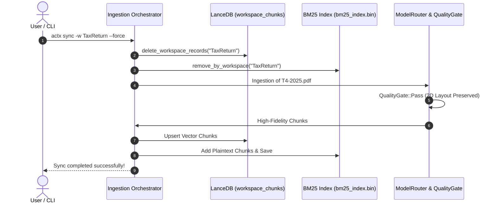

# AnyContext Technical Blueprint v0.34.5
## Restoring RAG Semantic Integrity: 2D Layout Preservation, Removal of Chunk Corruption and Transparent Decryption in BM25

**Target Version:** `v0.34.5`  
**Date:** October 10, 2026  
**Status:** `PLANNED (Awaiting Gate 3 Approval)`  
**Author:** Antigravity (Google DeepMind Team) & Levi Guilherme  
**Protocol:** `dev-cycle-protocol` (Milestone 3 - RAG Quality Stabilization)  

---

## 1. Architecture and Affected Components (Hexagonal / Ports & Adapters)

The identified bug destroys AnyContext's central purpose (high-accuracy local RAG). The fix works at the domain and adapter boundary of the hexagonal architecture:

```
┌────────────────────────────────────────────────────────────────────────┐
│                          HEXAGONAL ARCHITECTURE                        │
│                                                                        │
│   [CLI / TUI Layer] (Driving Port)                                     │
│         │                                                              │
│         ▼                                                              │
│   [Ingestion Orchestrator] (Application Core)                          │
│         │                                                              │
│         ├──► [QualityGate] (Domain Service - Pure Logic)               │
│         │          - Decides whether a chunk is Pass, Reject or NeedsDocAI│
│         │                                                              │
│         ├──► [ModelRouter] (Domain Routing Engine)                     │
│         │          - Routes between Vision SLM, Extractor or Native Layout│
│         │                                                              │
│         ├──► [SpatialFormChunker] (Domain Utility)                     │
│         │          - Conservative, non-destructive field parsing       │
│         │                                                              │
│         ▼                                                              │
│   [Native LanceStore & BM25 Index] (Driven Adapters)                   │
│         │                                                              │
│         ▼                                                              │
│   [NativeHybridPipeline] (Retrieval Application Service)               │
│         - RRF 60, BM25 Lexical, Dense Vector, Decryption On-The-Fly     │
└────────────────────────────────────────────────────────────────────────┘
```

### Affected Components:
1. **`ingestion::quality_gate`**:
   - Removes the false positive in `is_dense_complex_form` that marked legitimate 2D Markdown tables as structural garbage.
   - Tables successfully rebuilt by the native PDF parser pass as `QualityDecision::Pass` with the maximum score.
2. **`ingestion::chunkers::spatial_form`**:
   - Removes the blind `cells[0] -> cells[1]` pairing that turned numeric values or carrier names into artificial keys.
   - Key-value pairing now requires explicit delimiters (`:`, `-`) or unambiguous form headers (`Field/Value`, `Key/Value`).
3. **`ingestion::model_router`**:
   - Establishes the **Sacred Preservation** rule: without a Vision model, the original text rebuilt as Markdown is **never** discarded nor replaced by incomplete fragments.
4. **`ingestion::orchestrator`**:
   - Guarantees that a workspace cleanup (`--force`) precisely purges old records in LanceDB and removes corrupted terms in BM25.
5. **`retrieval::pipeline`**:
   - Implements defensive transparent decryption (`decrypt_text`) for any document retrieved from BM25 or LanceDB that has the `enc::` prefix.

---

## 2. Sequence and Flow Diagrams (Mermaid)

### 2.1. Quality Decision and Ingestion Flow (Before vs. After)

```mermaid
flowchart TD
    subgraph ANTES ["❌ Previous Pipeline (Destructive)"]
        A1["PDF with Tables / 2D Layout"] --> B1["pdf.rs produces 2D Markdown (| Col 1 | Col 2 |)"]
        B1 --> C1{"QualityGate: pipe_ratio >= 0.55?"}
        C1 -- Yes --> D1["NeedsDocumentAi: DenseComplexForm"]
        D1 --> E1{"Vision enabled?"}
        E1 -- No --> F1["SpatialFormChunker::chunk_dense_text"]
        F1 --> G1["Heuristic: cell[0] < 50 chars becomes a KEY!"]
        G1 --> H1["DISCARDS the original Markdown and stores inverted pairs: '58792.60: 7976.60'"]
        H1 --> I1["The LLM gets garbage and finds no answers"]
    end

    subgraph DEPOIS ["✅ New Pipeline (Sacred Semantic Fidelity)"]
        A2["PDF with Tables / 2D Layout"] --> B2["pdf.rs produces 2D Markdown (| Col 1 | Col 2 |)"]
        B2 --> C2{"QualityGate: is it a pdf_scan without text?"}
        C2 -- No (Has 2D text) --> D2["QualityDecision::Pass (Score 0.95)"]
        D2 --> E2["Keeps the Markdown Table Intact with All Relations"]
        E2 --> F2["Indexing in LanceDB and BM25 in Clean Plaintext"]
        F2 --> G2["The LLM reads the table perfectly: 'Box 14: 58792.60'"]
    end
```



### 2.2. Re-Sync and Self-Healing Flow



---

## 3. Data Structures and Type Signatures

### 3.1. Adjustment in `QualityGate` (`crates/any-context-core-rs/src/ingestion/quality_gate.rs`)

```rust
impl QualityGate {
    /// Evaluates whether the text is an unstructured dense form that needs Vision AI.
    /// Well-formed Markdown tables are NOT considered problematic dense forms,
    /// because they already have a valid 2D relational representation.
    pub fn is_dense_complex_form(&self, text: &str) -> bool {
        // If it already has structured table blocks with valid headers, it is high quality!
        let lines: Vec<&str> = text.lines().map(|l| l.trim()).filter(|l| !l.is_empty()).collect();
        if lines.is_empty() {
            return false;
        }

        let pipe_lines = lines.iter().filter(|l| l.contains('|')).count();
        let pipe_line_ratio = (pipe_lines as f32) / (lines.len() as f32);

        // Fires only on chaotic pipe fragmentation (many empty cells or OCR noise)
        // and when it is NOT a valid Markdown table with a delimiter
        let has_markdown_table_delimiter = lines.iter().any(|l| l.contains("| ---") || l.contains("|:---"));
        
        if has_markdown_table_delimiter && pipe_line_ratio >= 0.30 {
            // A valid Markdown table! No OCR/Vision needed if it already has readable text.
            return false;
        }

        // Chaotic dense form: high pipe density without a structured delimiter
        pipe_line_ratio >= self.config.max_table_pipe_ratio
    }
}
```

### 3.2. Conservative Rule in `SpatialFormChunker` (`crates/any-context-core-rs/src/ingestion/chunkers/spatial_form.rs`)

```rust
impl SpatialFormChunker {
    pub fn extract_fields_from_dense_text(&self, text: &str) -> Vec<FormField> {
        let mut fields = Vec::new();
        let mut table_headers: Option<Vec<String>> = None;

        for raw_line in text.lines() {
            let line = raw_line.trim();
            if line.is_empty() || line.starts_with("// Context:") {
                continue;
            }

            if line.starts_with('|') && line.ends_with('|') {
                if line.contains("---") {
                    continue;
                }
                let cells: Vec<&str> = line
                    .trim_matches('|')
                    .split('|')
                    .map(|c| c.trim())
                    .filter(|c| !c.is_empty())
                    .collect();

                if cells.is_empty() {
                    continue;
                }

                // Header detection
                if table_headers.is_none() {
                    table_headers = Some(cells.iter().map(|c| c.to_string()).collect());
                    continue;
                }

                // ONLY pairs as key-value if the header is explicitly Key-Value
                if let Some(ref headers) = table_headers {
                    if headers.len() == 2 && cells.len() == 2 {
                        let h0 = headers[0].to_lowercase();
                        let h1 = headers[1].to_lowercase();
                        let is_kv_header = matches!(h0.as_str(), "property" | "key" | "field" | "attribute" | "campo" | "chave" | "propriedade")
                            && matches!(h1.as_str(), "value" | "val" | "description" | "detail" | "info" | "data" | "valor" | "descrição");

                        if is_kv_header {
                            fields.push(FormField {
                                label: cells[0].trim_end_matches([':', '-']).to_string(),
                                value: cells[1].to_string(),
                                section: None,
                            });
                        }
                    }
                }
            } else {
                table_headers = None;
                // Standard line: requires the key to end with a colon or an unambiguous hyphen
                if let Some(pos) = line.find(':') {
                    let label = line[..pos].trim();
                    let value = line[pos + 1..].trim();
                    if !label.is_empty() && !value.is_empty() && label.len() < 50 && !value.contains(':') {
                        fields.push(FormField {
                            label: label.to_string(),
                            value: value.to_string(),
                            section: None,
                        });
                    }
                }
            }
        }
        fields
    }
}
```

### 3.3. Sacred Preservation in `ModelRouter` (`crates/any-context-core-rs/src/ingestion/model_router.rs`)

```rust
// In the process_document_ai_candidates fallback:
// NEVER discard the original chunk!
if !chunk.text.trim().is_empty() {
    processed.push(chunk);
}
```

### 3.4. Transparent Decryption in BM25 Retrieval (`crates/any-context-core-rs/src/retrieval/pipeline.rs`)

```rust
// When extracting a doc's text from BM25:
let sec = crate::security::SecurityEngine::default();
let clear_text = if text.starts_with("enc::") {
    sec.decrypt_text(&text)
} else {
    text
};
```

---

## 4. Documentation Changes (Dual-Doc & Manual Tests)

1. **`TECDOC.md`**:
   - **Section 106**: "High Semantic Fidelity Ingestion Architecture and 2D Layout Preservation".
   - **ADR-113**: "Removal of Heuristic Inversion in the Tabular Chunker and Unconditional Preservation of 2D Markdown Formats".
2. **`README.md`**:
   - Update the section on the processing of tax and financial forms (T4, W-2, GST/HST) and logistics forms (CMR, Invoices), detailing that the 2D geometry is kept with semantic exactness.
3. **`MANUAL_TESTS.md`**:
   - Add **Scenario 28: Cumulative Validation of Chunk and RAG Semantic Fidelity on Complex Tax and Logistics Documents (T4 and CMR)**.
   - Keep all Scenarios 1 to 27 fully intact, without truncation.

---

## 5. Test Suite (Unit, Integration and E2E)

### 5.1. Unit Tests
* **`tests/quality_gate_tests.rs`**:
  - `test_quality_gate_passes_markdown_tables`: checks that pages with Markdown tables of 2 or more columns get `QualityDecision::Pass` and not `NeedsDocumentAi`.
  - `test_quality_gate_detects_pure_scans`: guarantees that only a genuine `pdf_scan` or binary noise is routed to Document AI or rejected.
* **`tests/spatial_form_tests.rs`**:
  - `test_spatial_chunker_does_not_invert_arbitrary_columns`: checks that numeric tables such as `| 58792.60 | 7976.60 |` do not become key-value pairs.
  - `test_spatial_chunker_extracts_explicit_kv`: checks that an explicit `| Key | Value |` keeps working.
* **`tests/hybrid_retrieval_tests.rs`**:
  - `test_retrieval_decrypts_legacy_chunks_transparently`: guarantees that chunks with the `enc::` prefix return readable text in the query.

### 5.2. Integration Tests
* Ingestion of a synthetic PDF buffer simulating a T4 form with salary and tax columns.
* Check in LanceDB and BM25 that the stored chunks contain the intact Markdown table.

### 5.3. E2E Test on the Real Workspace
* Run `actx sync -w TaxReturn --force`.
* Run `actx -w TaxReturn -q "what is the employment income amount on the T4?"`.
* Check that the LLM answers with the exact value `$58,792.60` (Box 14).

---

## 6. Risks, Mitigations and Rollback

| Risk | Impact | Mitigation |
|---|---|---|
| Legacy `spatial_form_tests` tests break because they expect arbitrary pairing | Medium | Update the tests to expect table preservation and strict pairing |
| Corrupted chunks persist in the user's database | High | Instruct and validate running `actx sync --force` on the affected workspaces |
| Decryption performance in BM25 | Low | `decrypt_text` uses hardware-accelerated AES-GCM and is only triggered if the string starts with `enc::` |

**Rollback Plan:**
If a regression appears, restore the previous commit on the `dev` branch through `git revert`. The LanceDB and SQLite databases have no schema change, guaranteeing full backward compatibility.

---

## 7. Step-by-Step Execution Plan

- [ ] **Step 1:** update the version to `0.34.5` in `crates/actx-cli/Cargo.toml` and the internal dependencies.
- [ ] **Step 2:** adjust `crates/any-context-core-rs/src/ingestion/quality_gate.rs` to pass 2D Markdown tables with `QualityDecision::Pass`.
- [ ] **Step 3:** adjust `crates/any-context-core-rs/src/ingestion/chunkers/spatial_form.rs`, making field pairing conservative.
- [ ] **Step 4:** adjust `crates/any-context-core-rs/src/ingestion/model_router.rs` to unconditionally keep the original text chunks.
- [ ] **Step 5:** adjust `crates/any-context-core-rs/src/retrieval/pipeline.rs` for transparent decryption in BM25.
- [ ] **Step 6:** update the unit tests (`quality_gate_tests.rs`, `spatial_form_tests.rs`) and build through `cargo check --workspace` and `cargo test --workspace`.
- [ ] **Step 7:** update the Dual-Doc documentation (`TECDOC.md`, `README.md`, `MANUAL_TESTS.md` with Scenario 28).
- [ ] **Step 8:** run a real E2E test with `actx sync -w TaxReturn --force` and the T4 audit query.

---

## 8. Acceptance Criteria and Automatic Verification

1. `cargo check --workspace` builds with **zero errors**.
2. All unit and integration tests (`cargo test --workspace`) pass with **100% success**.
3. The T4 E2E test answers with factual precision about the employment income amount.
4. The `TECDOC.md` (Section 106 + ADR-113), `README.md` and `MANUAL_TESTS.md` (Scenario 28) files are fully documented and in sync.
