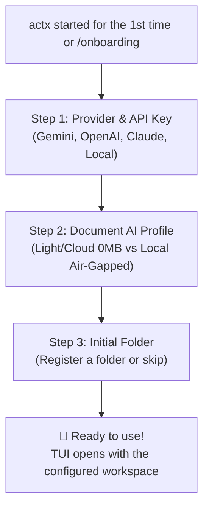
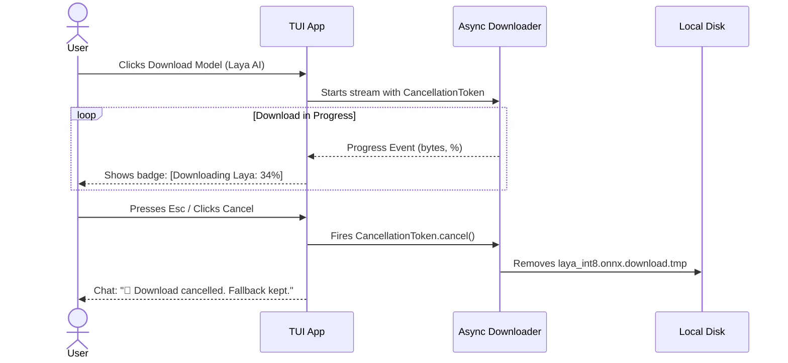

# 📐 Blueprint v0.34.9: Aurora Boreal Harmonization, ReAct Auto-Scroll, Update UX, Download Cancellation & Onboarding Wizard

**Project**: AnyContext (`actx`)  
**Target Version**: `v0.34.9`  
**Date**: 2026-10-10  
**Status**: 📋 Complete Plan for Approval  

---

## 🎯 1. Scope of Adjustments

1. **Aurora Boreal Color Harmonization in the TUI**:
   - Remove yellow (`Amber`) and red (`Crimson`) from informational and navigation components (Thinking, Menu Shortcuts, ReAct Border, Active Workspace, Fast RAG, Deep Search).
   - Replace them with the corresponding colors of the Aurora Boreal palette: **Glacial Cyan** (`#00F0FF`), **Brand Emerald** (`#00E5A3`), **Cosmic Violet** (`#A855F7`) and **Arctic Sky Blue** (`#38BDF8`).
   - Strictly restrict yellow and red to:
     - **Red (`#EF4444`)**: the destructive `[Esc/Ctrl+C] Exit` shortcut (requested as an explicit exception), critical execution errors (`[Tool Error]`, `AppStatus::Error`) and unrecoverable offline folders (`⚠️ [Sync: X folder(s) unreachable]`).
     - **Yellow (`#F59E0B`)**: real pending sync warnings (`⚡ [Sync: Changes detected (/sync)]`).

2. **"Conversation" Box without Borders or Title (Minimalist Canvas)**:
   - Run the visual test removing the outer border and the `Conversation` title.
   - Gain +2 lines of usable height and +2 columns of usable width for the chat flow.
   - Keep a minimalist paused-scroll indicator when the user scrolls up the conversation.

3. **Smooth Auto-Scroll in the ReAct & Reasoning Box**:
   - Fix the missing scroll calculation in `render_accordion`.
   - Implement wrapping, height limits and automatic auto-scroll to the end as new tokens and tool calls are injected.

4. **ONNX Model Download Telemetry and Cancellation**:
   - **On-screen progress**: download streaming with percentage, downloaded MB and speed in the TUI bottom status bar (`📥 [Downloading Laya AI: 45% (94.5/210 MB) 4.2 MB/s]`).
   - **Graceful Cancellation**: the user can cancel the download at any time through `Esc` (on the main screen) or `/menu -> Cancel Download`.
   - **Zero Disk Pollution**: cancelling aborts the HTTP request immediately, deletes temporary files (`*.download.tmp`), posts an explanatory chat message (`🛑 [Download Cancelled]`) and keeps the fallback active.
   - **Completion / Failure Notification**: on reaching 100%, it posts a confirmation in the chat. On a network failure, it warns in a friendly way.

5. **Model Navigation Guided by Specific Role in the Menu**:
   - Split the `Document AI & Local Models` menu into clear-purpose categories:
     1. 📂 **Document Classification (Ingestion)** (Instant Heuristic vs Laya AI 210MB)
     2. 👁️ **Scan & Rasterized PDF Sentinel** (2D Heuristic vs MobileNetV4 14MB)
     3. 🔍 **Question Routing (Fast vs Deep)** (Deterministic RFC-042 vs BGE-Small 35MB)
     4. 🖼️ **Document Vision (Air-Gapped Visual OCR)** (Multimodal Cloud vs SmolVLM 480MB vs Moondream2 1.1GB)
     5. 🛡️ **On-Disk Model Status & Fallbacks**
   - Guide the user clearly: explain what each role is for and that no download is required for the system to work perfectly.

6. **Guided Onboarding on First Run (First-Run Wizard / `/onboarding`)**:
   - If AnyContext starts for the first time or there are no API keys / providers configured:
     - **Step 1: 🔑 AI Provider & API Keys**: select Gemini / OpenAI / Claude / Local and save the key securely in the native SQLite.
     - **Step 2: 🤖 Document AI & Vision Profile**:
       - *Recommended Profile (Light & Cloud)*: 0 MB download, pure Rust heuristics (<1µs / 0MB RAM) + the multimodal vision of the API configured in Step 1.
       - *Air-Gapped Profile (Local Models)*: offer the option to download Laya AI / MobileNetV4 for those who need 100% offline privacy.
     - **Step 3: 📂 Initial Documents Folder (Optional)**: register the first folder for indexing or go straight to the chat.

7. **Friendly, Professional Messages in `actx --update` (404 on Releases)**:
   - Identify 404s of freshly released assets caused by the CI/CD build time (15-40 min).
   - Show a friendly, professional message inspired by GitHub CLI / Rustup, saying the packages are being prepared and offering the release link to follow along.

---

## 🗺️ 2. Onboarding Wizard Flow

---

## 🛡️ 3. Download Cancellation Mechanism

---

## 📋 4. Implementation Milestone Plan

1. **Milestone 1: Aurora Boreal Color Cleanup**:
   - Move informational `theme.warning` to `theme.accent` (Cyan), `theme.reasoning` (Violet) and `theme.primary` (Emerald).
   - Keep red only on `[Esc/Ctrl+C] Exit` and critical alerts.
2. **Milestone 2: Borderless Conversation Canvas**:
   - Remove the chat box borders and title; add a minimalist paused-scroll indicator.
3. **Milestone 3: Dynamic ReAct & Reasoning Auto-Scroll**:
   - Add scroll control in `render_accordion` to follow the reasoning in real time.
4. **Milestone 4: Friendly Message in `actx --update`**:
   - Intercept HTTP 404 and show an empathetic, professional explanation in the GitHub CLI/Rustup style.
5. **Milestone 5: ONNX Download Telemetry and Cancellation**:
   - Stream with percentage and speed in the status bar; graceful cancellation through `Esc` or the menu, deleting the temporary file.
6. **Milestone 6: Submenus Guided by Role in the Models Menu**:
   - Ingestion, Scans, Queries and Vision submenus with contextual explanations of their purpose.
7. **Milestone 7: First-Run Onboarding Wizard & `/onboarding`**:
   - Integrated step by step: Provider/API Key -> Document AI Profile -> Initial Folder.
8. **Milestone 8: Automated Tests, Dual-Doc & Release v0.34.9**:
   - ADR-117 in `TECDOC.md`, Scenario 32 in `MANUAL_TESTS.md` and release build.
