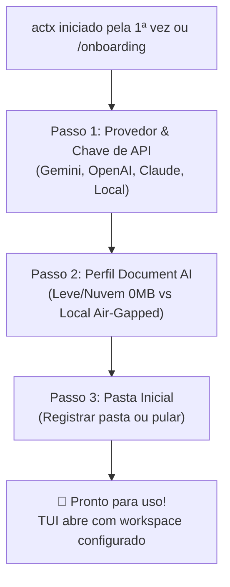
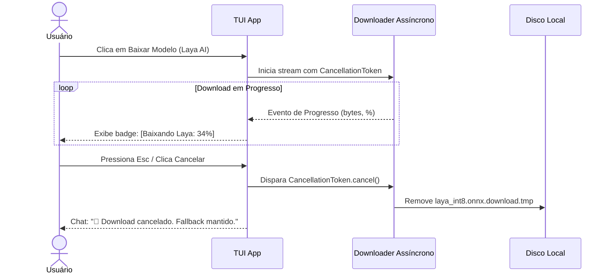

# 📐 Blueprint v0.34.9: Harmonização Aurora Boreal, Auto-Scroll ReAct, UX de Update, Cancelamento de Download & Onboarding Wizard

**Projeto**: AnyContext (`actx`)  
**Versão Alvo**: `v0.34.9`  
**Data**: 2026-10-10  
**Status**: 📋 Planejamento Completo para Aprovação  

---

## 🎯 1. Escopo de Ajustes

1. **Harmonização Cromática Aurora Boreal na TUI**:
   - Eliminar amarelo (`Amber`) e vermelho (`Crimson`) de componentes informativos e de navegação (Thinking, Atalhos de Menu, Border de ReAct, Active Workspace, Fast RAG, Deep Search).
   - Substituir pelas cores correspondentes da paleta Aurora Boreal: **Glacial Cyan** (`#00F0FF`), **Brand Emerald** (`#00E5A3`), **Cosmic Violet** (`#A855F7`) e **Arctic Sky Blue** (`#38BDF8`).
   - Restringir estritamente amarelo e vermelho para:
     - **Vermelho (`#EF4444`)**: Atalho destrutivo `[Esc/Ctrl+C] Exit` (solicitado como exceção explícita), erros críticos de execução (`[Tool Error]`, `AppStatus::Error`) e pastas offline irrecuperáveis (`⚠️ [Sync: X folder(s) unreachable]`).
     - **Amarelo (`#F59E0B`)**: Avisos reais de sincronização pendente (`⚡ [Sync: Changes detected (/sync)]`).

2. **Caixa "Conversation" sem Bordas e sem Título (Canvas Minimalista)**:
   - Realizar o teste visual removendo a borda externa e o título `Conversation`.
   - Ganhar +2 linhas de altura útil e +2 colunas de largura útil para o fluxo de chat.
   - Manter a sinalização de scroll pausado de forma minimalista caso o usuário suba a conversa.

3. **Auto-Scroll Fluido na Caixa ReAct & Reasoning**:
   - Corrigir a ausência de cálculo de scroll em `render_accordion`.
   - Implementar cálculo de wrapping, limites de altura e auto-scroll automático para o final à medida que novos tokens e tool calls são injetados.

4. **Telemetria e Cancelamento de Download de Modelos ONNX**:
   - **Progresso na tela**: Streaming do download com porcentagem, MB baixados e velocidade na barra de status inferior da TUI (`📥 [Baixando Laya AI: 45% (94.5/210 MB) 4.2 MB/s]`).
   - **Cancelamento Elegante**: O usuário pode cancelar o download a qualquer momento via `Esc` (quando na tela principal) ou via `/menu -> Cancelar Download`.
   - **Zero Poluição de Disco**: O cancelamento aborta a requisição HTTP imediatamente, exclui arquivos temporários (`*.download.tmp`), posta mensagem explicativa no chat (`🛑 [Download Cancelado]`) e mantém o fallback ativo.
   - **Notificação de Conclusão / Falha**: Ao atingir 100%, emite confirmação de acoplamento no chat. Em caso de falha de rede, avisa de forma acolhedora.

5. **Navegação Guiada de Modelos por Função Específica no Menu**:
   - Subdividir o menu `Document AI & Modelos Locais` em categorias de propósito claro:
     1. 📂 **Classificação de Documentos (Ingestão)** (Heurística Instantânea vs Laya AI 210MB)
     2. 👁️ **Sentinela de Scans & PDFs Rasterizados** (Heurística 2D vs MobileNetV4 14MB)
     3. 🔍 **Roteamento de Perguntas (Fast vs Deep)** (Determinístico RFC-042 vs BGE-Small 35MB)
     4. 🖼️ **Visão de Documentos (OCR Visual Air-Gapped)** (Nuvem Multimodal vs SmolVLM 480MB vs Moondream2 1.1GB)
     5. 🛡️ **Status de Modelos em Disco & Fallbacks**
   - Guiar o usuário com clareza: explicar para que serve cada função e que nenhum download é obrigatório para o sistema operar perfeitamente.

6. **Onboarding Guiado na Primeira Execução (First-Run Wizard / `/onboarding`)**:
   - Se o AnyContext iniciar pela primeira vez ou se não houver chaves de API / provedores configurados:
     - **Passo 1: 🔑 Provedor de IA & Chaves de API**: Selecionar Gemini / OpenAI / Claude / Local e salvar a chave de forma segura no SQLite nativo.
     - **Passo 2: 🤖 Perfil de Document AI & Visão**:
       - *Perfil Recomendado (Leve & Nuvem)*: 0 MB de download, heurísticas Rust puras (<1µs / 0MB RAM) + visão multimodal da API configurada no Passo 1.
       - *Perfil Air-Gapped (Modelos Locais)*: Oferecer a opção de baixar Laya AI / MobileNetV4 para quem precisa de privacidade 100% offline.
     - **Passo 3: 📂 Pasta Inicial de Documentos (Opcional)**: Registrar a primeira pasta para indexação ou avançar para o chat.

7. **Mensagens Amigáveis e Profissionais no `actx --update` (404 em Releases)**:
   - Identificar 404 de assets recém-lançados causados pelo tempo de compilação do CI/CD (15-40 min).
   - Apresentar mensagem acolhedora e profissional inspirada no GitHub CLI / Rustup, informando que os pacotes estão sendo preparados e oferecendo o link da release para acompanhamento.

---

## 🗺️ 2. Fluxo do Onboarding Wizard

---

## 🛡️ 3. Mecanismo de Cancelamento de Download

---

## 📋 4. Plano de Marcos de Implementação

1. **Marco 1: Limpeza Cromática Aurora Boreal**:
   - Migrar `theme.warning` informativos para `theme.accent` (Cyan), `theme.reasoning` (Violet) e `theme.primary` (Emerald).
   - Manter vermelho apenas em `[Esc/Ctrl+C] Exit` e alertas críticos.
2. **Marco 2: Canvas Conversation Borderless**:
   - Remover bordas e título da caixa de chat; adicionar indicador minimalista de scroll pausado.
3. **Marco 3: Auto-Scroll Dinâmico ReAct & Reasoning**:
   - Adicionar controle de scroll em `render_accordion` para acompanhar raciocínio em tempo real.
4. **Marco 4: Mensagem Amigável no `actx --update`**:
   - Interceptar HTTP 404 e exibir explicação empática e profissional estilo GitHub CLI/Rustup.
5. **Marco 5: Telemetria e Cancelamento de Download ONNX**:
   - Stream com porcentagem e velocidade na status bar; suporte a cancelamento gracioso via `Esc` ou menu com deleção de arquivo temporário.
6. **Marco 6: Submenus Guiados por Função no Menu de Modelos**:
   - Submenus de Ingestão, Scans, Consultas e Visão com explicações contextuais de propósito.
7. **Marco 7: Wizard de Onboarding na Primeira Execução & `/onboarding`**:
   - Passo a passo integrado: Provedor/Chave de API -> Perfil de Document AI -> Pasta Inicial.
8. **Marco 8: Testes Automatizados, Dual-Doc & Release v0.34.9**:
   - ADR-117 em `TECDOC.md`, Cenário 32 em `MANUAL_TESTS.md` e compilação do release.
