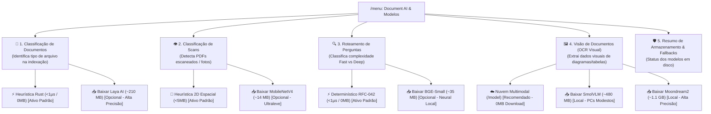

# 📐 Blueprint v0.34.9: Harmonização Aurora Boreal, Auto-Scroll ReAct, UX de Update & Download Guiado de Modelos

**Projeto**: AnyContext (`actx`)  
**Versão Alvo**: `v0.34.9`  
**Data**: 2026-10-10  
**Status**: 📋 Planejamento Expandido para Validação  

---

## 🎯 1. Escopo de Ajustes

1. **Harmonização Cromática Aurora Boreal na TUI**:
   - Eliminar amarelo (`Amber`) e vermelho (`Crimson`) de componentes informativos e de navegação (Thinking, Atalhos de Menu, Border de ReAct, Active Workspace, Fast RAG, Deep Search).
   - Substituir pelas cores correspondentes da paleta Aurora Boreal: **Glacial Cyan** (`#00F0FF`), **Brand Emerald** (`#00E5A3`), **Cosmic Violet** (`#A855F7`) e **Arctic Sky Blue** (`#38BDF8`).
   - Restringir estritamente amarelo e vermelho para:
     - **Vermelho (`#EF4444`)**: Atalho destrutivo `[Esc/Ctrl+C] Exit` (solicitado como exceção explícita), erros críticos de execução (`[Tool Error]`, `AppStatus::Error`) e pastas offline irrecuperáveis (`⚠️ [Sync: X folder(s) unreachable]`).
     - **Amarelo (`#F59E0B`)**: Avisos reais de sincronização pendente (`⚡ [Sync: Changes detected (/sync)]`).

2. **Caixa "Conversation" sem Bordas e sem Título (Canvas Minimalista)**:
   - Realizar o teste visual removendo a borda externa e o título `Conversation`.
   - Ganhar +2 linhas de altura útil e +2 colunas de largura útil para o fluxo de chat.
   - Manter a sinalização de scroll pausado de forma minimalista caso o usuário suba a conversa.

3. **Auto-Scroll Fluido na Caixa ReAct & Reasoning**:
   - Corrigir a ausência de cálculo de scroll em `render_accordion`.
   - Implementar cálculo de wrapping, limites de altura e auto-scroll automático para o final à medida que novos tokens e tool calls são injetados.

4. **Feedback Visual em Tempo Real do Download de Modelos ONNX**:
   - Resolver o download "às cegas": o usuário atualmente só recebe a mensagem inicial e não sabe o progresso.
   - Streaming do download com cálculo de porcentagem, MB baixados e velocidade.
   - Indicador dinâmico na barra de status inferior da TUI:
     `📥 [Download: 45% (94.5/210 MB) - Laya AI]`
   - Ao concluir, postar notificação no chat:
     `✔ [Download Concluído] Laya AI (mmBERT INT8 ONNX) instalado e ativo!`
   - Se houver falha (rede offline/timeout):
     `❌ [Falha no Download] <motivo>. O AnyContext continua operacional via fallback determinístico.`

5. **Navegação Guiada de Modelos por Função Específica no Menu**:
   - Eliminar a dúvida sobre "ter que baixar um ou todos".
   - Subdividir o menu `Document AI & Modelos Locais` em categorias de propósito claro:
     1. 📂 **Classificação de Documentos (Ingestão)** (Heurística Instantânea vs Laya AI 210MB)
     2. 👁️ **Classificação de Scans & Páginas Rasterizadas** (Heurística 2D vs MobileNetV4 14MB)
     3. 🔍 **Classificação de Consultas (Fast vs Deep)** (Determinístico RFC-042 vs BGE-Small 35MB)
     4. 🖼️ **Visão de Documentos & OCR Visual (Air-Gapped)** (Nuvem Multimodal vs SmolVLM 480MB vs Moondream2 1.1GB)
   - Explicar no cabeçalho de cada item:
     - **Para que serve**.
     - **Se é necessário baixar** (reforçando que o AnyContext já vem 100% pronto e funcional por padrão sem baixar nada).
     - **Se os modelos são alternativos** (ex: no submenu de Visão Local, escolher no máximo UM modelo).

6. **Mensagens Amigáveis e Profissionais no `actx --update` (Benchmark dos Grandes Players)**:
   - Tratar de forma amigável e informativa falhas de download HTTP 404 causadas pela latência natural de compilação da release no GitHub Actions (15-40 min após o push da tag).
   - Eliminar mensagens brutas de rede (`ureq HTTPS download request failed ... 404`) e URLs confusas de fallback.
   - Adotar tom profissional, empático e informativo padrão de ferramentas consagradas (GitHub CLI, Rustup, Homebrew).

---

## 🗺️ 2. Arquitetura da Navegação Guiada de Modelos (Menu Proposto)



---

## 📊 3. Experiência de Download & Telemetria em Tempo Real (Item 4)

Quando o usuário seleciona um modelo para download:
1. Uma thread assíncrona com canal `mpsc::channel` reporta `bytes_downloaded` e `total_bytes`.
2. A barra de rodapé da TUI (ao lado do status do workspace) exibe um badge animado:
   ```text
   📥 [Baixando Laya AI: 45% (94.5/210 MB) 4.2 MB/s]
   ```
3. O usuário continua conversando com a IA ou alterando configurações normalmente.
4. Ao concluir (100%):
   ```text
   │[AI - Default] (12:44:10)
   │  ✔ [Modelo Acoplado com Sucesso]
   │  **Laya AI (mmBERT INT8 ONNX)** foi instalado em disco e ativado para a classificação de documentos.
   │  A partir de agora, novas indexações utilizarão este modelo neural.
   ```

---

## 🌐 4. Mensagem de Atualização Profissional (`actx --update`) (Item 3)

```text
[*] Verificando atualizações do AnyContext...
[*] Nova versão detectada: v0.34.8
[*] Baixando pacote de distribuição 'actx-windows-x86_64.zip'...

[!] Os pacotes executáveis para a versão v0.34.8 ainda estão sendo preparados
    pelos servidores de compilação (CI/CD) ou estão temporariamente indisponíveis.

    💡 Dica: A compilação de novas releases leva alguns minutos após o lançamento.
       Por favor, tente novamente em instantes com: actx --update
       Acompanhe a publicação em: https://github.com/Levix-Digital/any-context-releases/releases/tag/v0.34.8
```

---

## 📋 5. Plano de Marcos de Implementação

1. **Marco 1: Limpeza Cromática Aurora Boreal**:
   - Migrar `theme.warning` informativos para `theme.accent` (Cyan), `theme.reasoning` (Violet) e `theme.primary` (Emerald).
   - Manter vermelho apenas em `[Esc/Ctrl+C] Exit` e alertas críticos.
2. **Marco 2: Canvas Conversation Borderless**:
   - Remover bordas e título da caixa de chat; adicionar indicador sutil de scroll pausado.
3. **Marco 3: Auto-Scroll Dinâmico ReAct & Reasoning**:
   - Adicionar controle de scroll em `render_accordion` para acompanhar raciocínio em tempo real.
4. **Marco 4: Mensagem Amigável no `actx --update`**:
   - Interceptar HTTP 404 e exibir explicação empática e profissional estilo GitHub CLI/Rustup.
5. **Marco 5: Telemetria de Download de Modelos ONNX em Tempo Real**:
   - Stream de bytes, canal de eventos e indicador de progresso percentual na barra de status da TUI.
6. **Marco 6: Reorganização do Menu em Submenus Guiados por Função**:
   - Submenus de Ingestão, Scans, Consultas e Visão com explicações contextuais de propósito.
7. **Marco 7: Testes Automatizados, Dual-Doc & Release v0.34.9**:
   - ADR-117 em `TECDOC.md`, Cenário 32 em `MANUAL_TESTS.md` e compilação do release.
