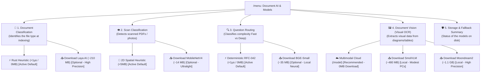

# 📐 Blueprint v0.34.9: Aurora Boreal Harmonization, ReAct Auto-Scroll, Update UX & Guided Model Download

**Project**: AnyContext (`actx`)  
**Target Version**: `v0.34.9`  
**Date**: 2026-10-10  
**Status**: 📋 Expanded Plan for Validation  

---

## 🎯 1. Scope of Adjustments

1. **Aurora Boreal Color Harmonization in the TUI**:
   - Remove yellow (`Amber`) and red (`Crimson`) from informational and navigation components (Thinking, Menu Shortcuts, ReAct Border, Active Workspace, Fast RAG, Deep Search).
   - Replace them with the corresponding colors of the Aurora Boreal palette: **Glacial Cyan** (`#00F0FF`), **Brand Emerald** (`#00E5A3`), **Cosmic Violet** (`#A855F7`) and **Arctic Sky Blue** (`#38BDF8`).
   - Strictly restrict yellow and red to:
     - **Red (`#EF4444`)**: the destructive `[Esc/Ctrl+C] Exit` shortcut (requested as an explicit exception), critical execution errors (`[Tool Error]`, `AppStatus::Error`) and unrecoverable offline folders (`⚠️ [Sync: X folder(s) unreachable]`).
     - **Yellow (`#F59E0B`)**: real pending sync warnings (`⚡ [Sync: Changes detected (/sync)]`).

2. **"Conversation" Box without Borders or Title (Minimalist Canvas)**:
   - Run the visual test removing the outer border and the `Conversation` title.
   - Gain +2 lines of usable height and +2 columns of usable width for the chat flow.
   - Keep a minimalist paused-scroll indicator when the user scrolls up the conversation.

3. **Smooth Auto-Scroll in the ReAct & Reasoning Box**:
   - Fix the missing scroll calculation in `render_accordion`.
   - Implement wrapping, height limits and automatic auto-scroll to the end as new tokens and tool calls are injected.

4. **Real-Time Visual Feedback of ONNX Model Downloads**:
   - Solve the "blind" download: today the user only gets the initial message and does not know the progress.
   - Download streaming with percentage, downloaded MB and speed.
   - A dynamic indicator in the TUI bottom status bar:
     `📥 [Download: 45% (94.5/210 MB) - Laya AI]`
   - On completion, post a notification in the chat:
     `✔ [Download Complete] Laya AI (mmBERT INT8 ONNX) installed and active!`
   - On failure (network offline/timeout):
     `❌ [Download Failed] <reason>. AnyContext keeps working through the deterministic fallback.`

5. **Model Navigation Guided by Specific Role in the Menu**:
   - Remove the doubt about "having to download one or all of them".
   - Split the `Document AI & Local Models` menu into clear-purpose categories:
     1. 📂 **Document Classification (Ingestion)** (Instant Heuristic vs Laya AI 210MB)
     2. 👁️ **Scan & Rasterized Page Classification** (2D Heuristic vs MobileNetV4 14MB)
     3. 🔍 **Query Classification (Fast vs Deep)** (Deterministic RFC-042 vs BGE-Small 35MB)
     4. 🖼️ **Document Vision & Visual OCR (Air-Gapped)** (Multimodal Cloud vs SmolVLM 480MB vs Moondream2 1.1GB)
   - Explain in the header of each item:
     - **What it is for**.
     - **Whether a download is needed** (stressing that AnyContext already comes 100% ready and working by default without downloading anything).
     - **Whether the models are alternatives** (e.g. in the Local Vision submenu, choose at most ONE model).

6. **Friendly, Professional Messages in `actx --update` (Benchmark of the Big Players)**:
   - Handle in a friendly, informative way HTTP 404 download failures caused by the natural build latency of the release on GitHub Actions (15-40 min after the tag push).
   - Remove raw network messages (`ureq HTTPS download request failed ... 404`) and confusing fallback URLs.
   - Adopt the professional, empathetic and informative tone of established tools (GitHub CLI, Rustup, Homebrew).

---

## 🗺️ 2. Architecture of the Guided Model Navigation (Proposed Menu)



---

## 📊 3. Download Experience & Real-Time Telemetry (Item 4)

When the user selects a model to download:
1. An asynchronous thread with an `mpsc::channel` reports `bytes_downloaded` and `total_bytes`.
2. The TUI footer bar (next to the workspace status) shows an animated badge:
   ```text
   📥 [Downloading Laya AI: 45% (94.5/210 MB) 4.2 MB/s]
   ```
3. The user keeps chatting with the AI or changing settings normally.
4. On completion (100%):
   ```text
   │[AI - Default] (12:44:10)
   │  ✔ [Model Attached Successfully]
   │  **Laya AI (mmBERT INT8 ONNX)** was installed on disk and enabled for document classification.
   │  From now on, new indexing runs will use this neural model.
   ```

---

## 🌐 4. Professional Update Message (`actx --update`) (Item 3)

```text
[*] Checking for AnyContext updates...
[*] New version detected: v0.34.8
[*] Downloading distribution package 'actx-windows-x86_64.zip'...

[!] The executable packages for version v0.34.8 are still being prepared
    by the build servers (CI/CD) or are temporarily unavailable.

    💡 Tip: building new releases takes a few minutes after launch.
       Please try again shortly with: actx --update
       Follow the publication at: https://github.com/Levix-Digital/any-context-releases/releases/tag/v0.34.8
```

---

## 📋 5. Implementation Milestone Plan

1. **Milestone 1: Aurora Boreal Color Cleanup**:
   - Move informational `theme.warning` to `theme.accent` (Cyan), `theme.reasoning` (Violet) and `theme.primary` (Emerald).
   - Keep red only on `[Esc/Ctrl+C] Exit` and critical alerts.
2. **Milestone 2: Borderless Conversation Canvas**:
   - Remove the chat box borders and title; add a subtle paused-scroll indicator.
3. **Milestone 3: Dynamic ReAct & Reasoning Auto-Scroll**:
   - Add scroll control in `render_accordion` to follow the reasoning in real time.
4. **Milestone 4: Friendly Message in `actx --update`**:
   - Intercept HTTP 404 and show an empathetic, professional explanation in the GitHub CLI/Rustup style.
5. **Milestone 5: Real-Time ONNX Model Download Telemetry**:
   - Byte streaming, an event channel and a percentage progress indicator in the TUI status bar.
6. **Milestone 6: Menu Reorganization into Submenus Guided by Role**:
   - Ingestion, Scans, Queries and Vision submenus with contextual explanations of their purpose.
7. **Milestone 7: Automated Tests, Dual-Doc & Release v0.34.9**:
   - ADR-117 in `TECDOC.md`, Scenario 32 in `MANUAL_TESTS.md` and release build.
