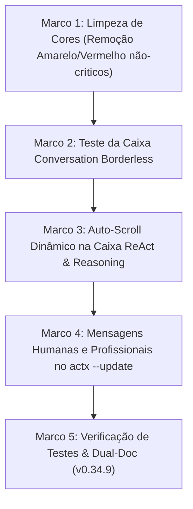

# 📐 Blueprint v0.34.9: Harmonização Aurora Boreal na TUI, Auto-Scroll ReAct e Mensagens Profissionais de Atualização

**Projeto**: AnyContext (`actx`)  
**Versão Alvo**: `v0.34.9`  
**Data**: 2026-10-10  
**Status**: 📋 Planejamento / Proposta para Aprovação  

---

## 🎯 1. Objetivos Principais

1. **Harmonização Cromática Aurora Boreal na TUI**:
   - Eliminar amarelo (`Amber`) e vermelho (`Crimson`) de componentes informativos e de navegação (Thinking, Atalhos de Menu, Border de ReAct, Active Workspace, Fast RAG, Deep Search).
   - Substituir pelas cores correspondentes da paleta Aurora Boreal: **Glacial Cyan** (`#00F0FF`), **Brand Emerald** (`#00E5A3`), **Cosmic Violet** (`#A855F7`) e **Arctic Sky Blue** (`#38BDF8`).
   - Restringir estritamente amarelo e vermelho para:
     - **Vermelho (`#EF4444`)**: Atalho destrutivo `[Esc/Ctrl+C] Exit` (solicitado como exceção explícita), erros críticos de execução (`[Tool Error]`, `AppStatus::Error`) e pastas offline irrecuperáveis (`⚠️ [Sync: X folder(s) unreachable]`).
     - **Amarelo (`#F59E0B`)**: Avisos reais de sincronização pendente (`⚡ [Sync: Changes detected (/sync)]`).
2. **Caixa "Conversation" sem Bordas e sem Título (Canvas Minimalista)**:
   - Realizar o teste visual removendo a borda externa e o título `Conversation`.
   - Ganhar +2 linhas de altura útil e +2 colunas de largura útil para o fluxo de chat.
   - Manter a sinalização de scroll pausado de forma minimalista caso o usuário suba a conversa.
3. **Auto-Scroll Fluido na Caixa ReAct & Reasoning**:
   - Resolver o problema identificado: atualmente `render_accordion` não possui qualquer cálculo de scroll, truncando raciocínios longos e ocultando os últimos eventos do loop ReAct.
   - Implementar cálculo de wrapping, limites de altura e auto-scroll automático para o final à medida que novos tokens e tool calls são injetados.
4. **Mensagens Amigáveis e Profissionais no `actx --update` (Benchmark de Mercado)**:
   - Tratar de forma amigável e informativa falhas de download HTTP 404 causadas pela latência natural de compilação da release no GitHub Actions (15-40 min após o push da tag).
   - Eliminar mensagens brutas de rede (`ureq HTTPS download request failed ... 404`) e URLs confusas de fallback.
   - Adotar tom profissional, empático e informativo padrão de ferramentas consagradas (GitHub CLI, Rustup, Homebrew).

---

## 🔍 2. Análise Técnica e Diagnóstico

### A. Cores Remanescentes na TUI (`crates/actx-cli/src/tui/ui.rs`)
| Localização | Elemento | Cor Atual | Nova Cor Proposta (Aurora Boreal) | Rationale |
| :--- | :--- | :--- | :--- | :--- |
| **Header** | `AppStatus::Thinking` | Solar Amber (Amarelo) | **Cosmic Violet** (`theme.reasoning`) ou **Cyan** | Raciocínio não é alerta; Violet é o tom do raciocínio/pensamento |
| **Header** | Active Workspace | Solar Amber (Amarelo) | **Brand Emerald** (`theme.primary`) | Workspace é o contexto ativo e saudável do usuário |
| **Header** | Indicador de Sincronização | Solar Amber (Amarelo) | **Glacial Cyan** (`theme.accent`) | Spinner ativo é atividade do sistema, não erro |
| **ReAct Box** | Borda do Accordion | Solar Amber (Amarelo) | **Cosmic Violet** (`theme.reasoning`) | Harmoniza com o ícone 🧠 e o propósito analítico |
| **ReAct Box** | `[ModelRouter: Fast RAG]` | Solar Amber (Amarelo) | **Brand Emerald** (`theme.primary`) | Fast RAG é ágil, assertivo e seguro |
| **ReAct Box** | `[Deep Search Iteration]` | Solar Amber (Amarelo) | **Glacial Cyan** (`theme.accent`) | Representa fluxo contínuo de raciocínio |
| **Input** | `Opções: {}` de comandos | Solar Amber (Amarelo) | **Glacial Cyan** (`theme.accent`) | Sugestão de sintaxe amigável |
| **Footer** | `[F1 / /menu]` | Solar Amber (Amarelo) | **Glacial Cyan** (`theme.accent`) | Atalho de navegação padrão |
| **Footer** | `[Ctrl+T]` (Toggle Reasoning) | Solar Amber (Amarelo) | **Cosmic Violet** (`theme.reasoning`) | Coerência visual com a caixa que ele alterna |
| **Footer** | `[Esc/Ctrl+C] Exit` | **Polar Crimson (Vermelho)** | **Polar Crimson (Vermelho)** | **Mantido** (exceção intencional para ação de encerramento) |
| **Menu Popup** | Borda da Janela | Solar Amber (Amarelo) | **Glacial Cyan** (`theme.border_focus`) | Consistência com caixas ativas |
| **Menu Popup** | Workspace Ativo | Solar Amber (Amarelo) | **Brand Emerald** (`theme.primary`) | Consistência com o cabeçalho principal |
| **Menu Popup** | Navegação `[▲/▼]` | Solar Amber (Amarelo) | **Glacial Cyan** (`theme.accent`) | Atalhos de menu secundários |

---

### B. Canvas "Conversation" Borderless
- **Como funciona hoje**:
  - `render_chat` desenha um `Block` com `Borders::ALL`, cantos arredondados e título `" Conversation "`.
- **Como ficará no teste**:
  - `render_chat` utiliza `Block::default().borders(Borders::NONE)`.
  - Sem linha de contorno e sem título superior, a tela ganha ar de terminal moderno (estilo ChatGPT Canvas / Claude Code CLI), onde o fluxo de mensagens respira livremente.
  - Para indicar quando o scroll foi pausado pelo usuário, uma linha sutil é apresentada no topo ou rodapé apenas quando `!app.auto_scroll`:
    `─── [Scroll Pausado: PgDn / End para descer] ───`

---

### C. Auto-Scroll na Caixa ReAct & Reasoning
- **Diagnóstico**:
  - O código atual de `render_accordion`:
    ```rust
    let accordion_para = Paragraph::new(lines)
        .block(block)
        .wrap(Wrap { trim: false });
    frame.render_widget(accordion_para, area);
    ```
    Não chama `.scroll((offset, 0))` em momento algum!
- **Solução Arquitetural**:
  1. Em `App` (`app.rs`):
     - `pub reasoning_scroll_offset: u16`
     - `pub reasoning_max_scroll: u16`
     - `pub reasoning_auto_scroll: bool` (default `true`)
  2. Em `render_accordion` (`ui.rs`):
     - `let inner_area = block.inner(area);`
     - `let total_lines = accordion_para.line_count(inner_area.width);`
     - `let visible_height = inner_area.height as usize;`
     - `app.reasoning_max_scroll = if total_lines > visible_height { (total_lines - visible_height) as u16 } else { 0 };`
     - Se `app.reasoning_auto_scroll`, `app.reasoning_scroll_offset = app.reasoning_max_scroll;`
     - Aplica `.scroll((app.reasoning_scroll_offset, 0))`.
  3. Quando o reasoning estiver focado ou o usuário rolar a tela, o scroll manual também passa a funcionar.

---

### D. Tratamento Profissional para `actx --update` (404 em Releases Recentes)
- **Diagnóstico da Causa Raiz**:
  - O workflow `.github/workflows/release.yml` constrói pacotes de Windows e Linux com cache e empacotamento 7z. Esse processo leva de 15 a 40 minutos.
  - O tagueamento no Git dispara a criação da release no GitHub. A tag fica pública imediatamente, mas os arquivos binários `.zip` só entram ao final da compilação.
  - Ao rodar `actx --update` logo após o push da tag, o GitHub responde com `404 Not Found`.
  - Além disso, `downloader.rs` tenta o fallback para `Levix-Digital/any-context` onde binários não existem, sobrescrevendo a mensagem com a URL errada.

- **Proposta de Experiência do Usuário (Inspirada no GitHub CLI e Rustup)**:
  Em vez do erro técnico cru:
  ```text
  [!] Download failed: HTTPS download request failed for https://...: status code 404
  ```

  Apresentaremos:
  ```text
  [*] Verificando atualizações do AnyContext...
  [*] Nova versão detectada: v0.34.8
  [*] Baixando pacote de distribuição 'actx-windows-x86_64.zip'...

  [!] Os pacotes executáveis para a versão v0.34.8 ainda estão sendo preparados
      pelos servidores de compilação (CI/CD) ou estão temporariamente indisponíveis.

      💡 Dica: A compilação de novas releases leva alguns minutos após o lançamento.
         Aguarde alguns instantes e tente novamente com: actx --update
         Acompanhe a publicação em: https://github.com/Levix-Digital/any-context-releases/releases/tag/v0.34.8
  ```

  E se for erro de rede/conexão offline:
  ```text
  [!] Não foi possível conectar aos servidores de atualização do AnyContext.
      Verifique sua conexão com a internet ou tente novamente mais tarde.
  ```

---

## 🗺️ 3. Plano de Implementação em Marcos



- **Marco 1**: Substituir todos os `theme.warning` informativos em `ui.rs` por `theme.accent`, `theme.reasoning` e `theme.primary`. Manter vermelho apenas em `[Esc/Ctrl+C] Exit` e erros reais.
- **Marco 2**: Remover borda e título em `render_chat`, testando o visual minimalista limpo.
- **Marco 3**: Implementar cálculo de linha, offset e auto-scroll dinâmico para a caixa ReAct & Reasoning.
- **Marco 4**: Ajustar [`downloader.rs`](file:///C:/Users/guilh/source/repos/any-context/crates/actx-installer/src/downloader.rs) e [`lib.rs`](file:///C:/Users/guilh/source/repos/any-context/crates/actx-installer/src/lib.rs) para capturar 404 de release e exibir mensagem profissional e acolhedora com link de status.
- **Marco 5**: Suíte de testes automatizados, documentação Dual-Doc (ADR-117 e Cenário 32 em `MANUAL_TESTS.md`), compilação release e tag `v0.34.9`.

---

## 💬 4. Pontos para Decisão / Feedback do Usuário

1. **Mensagem do `--update`**: O formato sugerido (com explicação de que o CI/CD ainda está empacotando os binários + sugestão de tentar novamente em instantes + link oficial) atende perfeitamente ao tom desejado?
2. **Caixa Conversation Borderless**: Quer testar sem nenhuma borda ao redor do chat (apenas o separador do header e o prompt embaixo), ou prefere uma margem sutil?
3. **Cor do ReAct Box**: A borda do Accordion em Cosmic Violet (`#A855F7`) faz o par perfeito com o ícone 🧠. Concorda com essa escolha?
