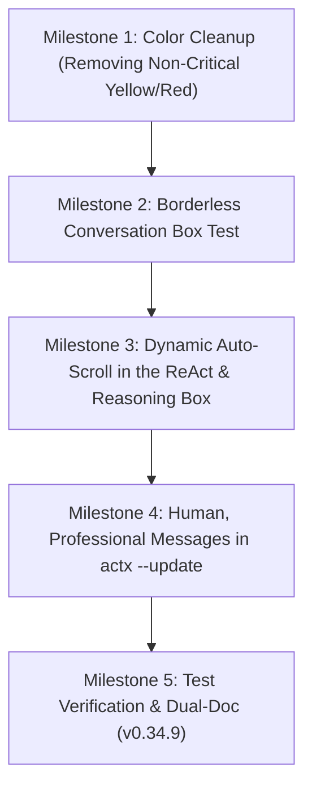

# 📐 Blueprint v0.34.9: Aurora Boreal Harmonization in the TUI, ReAct Auto-Scroll and Professional Update Messages

**Project**: AnyContext (`actx`)  
**Target Version**: `v0.34.9`  
**Date**: 2026-10-10  
**Status**: 📋 Planning / Proposal for Approval  

---

## 🎯 1. Main Goals

1. **Aurora Boreal Color Harmonization in the TUI**:
   - Remove yellow (`Amber`) and red (`Crimson`) from informational and navigation components (Thinking, Menu Shortcuts, ReAct Border, Active Workspace, Fast RAG, Deep Search).
   - Replace them with the corresponding colors of the Aurora Boreal palette: **Glacial Cyan** (`#00F0FF`), **Brand Emerald** (`#00E5A3`), **Cosmic Violet** (`#A855F7`) and **Arctic Sky Blue** (`#38BDF8`).
   - Strictly restrict yellow and red to:
     - **Red (`#EF4444`)**: the destructive `[Esc/Ctrl+C] Exit` shortcut (requested as an explicit exception), critical execution errors (`[Tool Error]`, `AppStatus::Error`) and unrecoverable offline folders (`⚠️ [Sync: X folder(s) unreachable]`).
     - **Yellow (`#F59E0B`)**: real pending sync warnings (`⚡ [Sync: Changes detected (/sync)]`).
2. **"Conversation" Box without Borders or Title (Minimalist Canvas)**:
   - Run the visual test removing the outer border and the `Conversation` title.
   - Gain +2 lines of usable height and +2 columns of usable width for the chat flow.
   - Keep a minimalist paused-scroll indicator when the user scrolls up the conversation.
3. **Smooth Auto-Scroll in the ReAct & Reasoning Box**:
   - Fix the identified problem: today `render_accordion` has no scroll calculation at all, truncating long reasoning and hiding the last events of the ReAct loop.
   - Implement wrapping, height limits and automatic auto-scroll to the end as new tokens and tool calls are injected.
4. **Friendly, Professional Messages in `actx --update` (Market Benchmark)**:
   - Handle in a friendly, informative way HTTP 404 download failures caused by the natural build latency of the release on GitHub Actions (15-40 min after the tag push).
   - Remove raw network messages (`ureq HTTPS download request failed ... 404`) and confusing fallback URLs.
   - Adopt the professional, empathetic and informative tone of established tools (GitHub CLI, Rustup, Homebrew).

---

## 🔍 2. Technical Analysis and Diagnosis

### A. Remaining Colors in the TUI (`crates/actx-cli/src/tui/ui.rs`)
| Location | Element | Current Color | Proposed New Color (Aurora Boreal) | Rationale |
| :--- | :--- | :--- | :--- | :--- |
| **Header** | `AppStatus::Thinking` | Solar Amber (Yellow) | **Cosmic Violet** (`theme.reasoning`) or **Cyan** | Reasoning is not an alert; Violet is the tone of reasoning/thinking |
| **Header** | Active Workspace | Solar Amber (Yellow) | **Brand Emerald** (`theme.primary`) | The workspace is the user's active, healthy context |
| **Header** | Sync Indicator | Solar Amber (Yellow) | **Glacial Cyan** (`theme.accent`) | An active spinner is system activity, not an error |
| **ReAct Box** | Accordion Border | Solar Amber (Yellow) | **Cosmic Violet** (`theme.reasoning`) | Harmonizes with the 🧠 icon and the analytical purpose |
| **ReAct Box** | `[ModelRouter: Fast RAG]` | Solar Amber (Yellow) | **Brand Emerald** (`theme.primary`) | Fast RAG is agile, assertive and safe |
| **ReAct Box** | `[Deep Search Iteration]` | Solar Amber (Yellow) | **Glacial Cyan** (`theme.accent`) | Represents a continuous flow of reasoning |
| **Input** | Command `Options: {}` | Solar Amber (Yellow) | **Glacial Cyan** (`theme.accent`) | A friendly syntax suggestion |
| **Footer** | `[F1 / /menu]` | Solar Amber (Yellow) | **Glacial Cyan** (`theme.accent`) | A standard navigation shortcut |
| **Footer** | `[Ctrl+T]` (Toggle Reasoning) | Solar Amber (Yellow) | **Cosmic Violet** (`theme.reasoning`) | Visual coherence with the box it toggles |
| **Footer** | `[Esc/Ctrl+C] Exit` | **Polar Crimson (Red)** | **Polar Crimson (Red)** | **Kept** (an intentional exception for the exit action) |
| **Menu Popup** | Window Border | Solar Amber (Yellow) | **Glacial Cyan** (`theme.border_focus`) | Consistency with active boxes |
| **Menu Popup** | Active Workspace | Solar Amber (Yellow) | **Brand Emerald** (`theme.primary`) | Consistency with the main header |
| **Menu Popup** | `[▲/▼]` Navigation | Solar Amber (Yellow) | **Glacial Cyan** (`theme.accent`) | Secondary menu shortcuts |

---

### B. Borderless "Conversation" Canvas
- **How it works today**:
  - `render_chat` draws a `Block` with `Borders::ALL`, rounded corners and the `" Conversation "` title.
- **How it will look in the test**:
  - `render_chat` uses `Block::default().borders(Borders::NONE)`.
  - With no outline and no top title, the screen gets the feel of a modern terminal, where the message flow breathes freely.
  - To indicate when the user has paused scrolling, a subtle line appears at the top or bottom only when `!app.auto_scroll`:
    `─── [Scroll Paused: PgDn / End to go down] ───`

---

### C. Auto-Scroll in the ReAct & Reasoning Box
- **Diagnosis**:
  - The current `render_accordion` code:
    ```rust
    let accordion_para = Paragraph::new(lines)
        .block(block)
        .wrap(Wrap { trim: false });
    frame.render_widget(accordion_para, area);
    ```
    Never calls `.scroll((offset, 0))`!
- **Architectural Solution**:
  1. In `App` (`app.rs`):
     - `pub reasoning_scroll_offset: u16`
     - `pub reasoning_max_scroll: u16`
     - `pub reasoning_auto_scroll: bool` (default `true`)
  2. In `render_accordion` (`ui.rs`):
     - `let inner_area = block.inner(area);`
     - `let total_lines = accordion_para.line_count(inner_area.width);`
     - `let visible_height = inner_area.height as usize;`
     - `app.reasoning_max_scroll = if total_lines > visible_height { (total_lines - visible_height) as u16 } else { 0 };`
     - If `app.reasoning_auto_scroll`, `app.reasoning_scroll_offset = app.reasoning_max_scroll;`
     - Apply `.scroll((app.reasoning_scroll_offset, 0))`.
  3. When the reasoning box is focused or the user scrolls the screen, manual scrolling also works.

---

### D. Professional Handling of `actx --update` (404 on Recent Releases)
- **Root Cause Diagnosis**:
  - The `.github/workflows/release.yml` workflow builds Windows and Linux packages with caching and 7z packaging. This process takes 15 to 40 minutes.
  - Tagging in Git triggers the release creation on GitHub. The tag becomes public immediately, but the `.zip` binaries only arrive at the end of the build.
  - When running `actx --update` right after the tag push, GitHub answers `404 Not Found`.
  - In addition, `downloader.rs` tries the fallback to `Levix-Digital/any-context`, where binaries do not exist, overwriting the message with the wrong URL.

- **Proposed User Experience (Inspired by GitHub CLI and Rustup)**:
  Instead of the raw technical error:
  ```text
  [!] Download failed: HTTPS download request failed for https://...: status code 404
  ```

  We will show:
  ```text
  [*] Checking for AnyContext updates...
  [*] New version detected: v0.34.8
  [*] Downloading distribution package 'actx-windows-x86_64.zip'...

  [!] The executable packages for version v0.34.8 are still being prepared
      by the build servers (CI/CD) or are temporarily unavailable.

      💡 Tip: building new releases takes a few minutes after launch.
         Wait a moment and try again with: actx --update
         Follow the publication at: https://github.com/Levix-Digital/any-context-releases/releases/tag/v0.34.8
  ```

  And for a network/offline connection error:
  ```text
  [!] Could not connect to the AnyContext update servers.
      Check your internet connection or try again later.
  ```

---

## 🗺️ 3. Implementation Plan by Milestones



- **Milestone 1**: replace every informational `theme.warning` in `ui.rs` with `theme.accent`, `theme.reasoning` and `theme.primary`. Keep red only on `[Esc/Ctrl+C] Exit` and real errors.
- **Milestone 2**: remove the border and title in `render_chat`, testing the clean minimalist look.
- **Milestone 3**: implement line counting, offset and dynamic auto-scroll for the ReAct & Reasoning box.
- **Milestone 4**: adjust [`downloader.rs`](file:///C:/Users/guilh/source/repos/any-context/crates/actx-installer/src/downloader.rs) and [`lib.rs`](file:///C:/Users/guilh/source/repos/any-context/crates/actx-installer/src/lib.rs) to catch release 404s and show a professional, friendly message with a status link.
- **Milestone 5**: automated test suite, Dual-Doc documentation (ADR-117 and Scenario 32 in `MANUAL_TESTS.md`), release build and tag `v0.34.9`.

---

## 💬 4. Points for Decision / User Feedback

1. **`--update` Message**: does the suggested format (explaining that CI/CD is still packaging the binaries + a suggestion to try again shortly + the official link) fully match the desired tone?
2. **Borderless Conversation Box**: do you want to test with no border at all around the chat (only the header separator and the prompt below), or do you prefer a subtle margin?
3. **ReAct Box Color**: the Accordion border in Cosmic Violet (`#A855F7`) pairs perfectly with the 🧠 icon. Do you agree with this choice?
