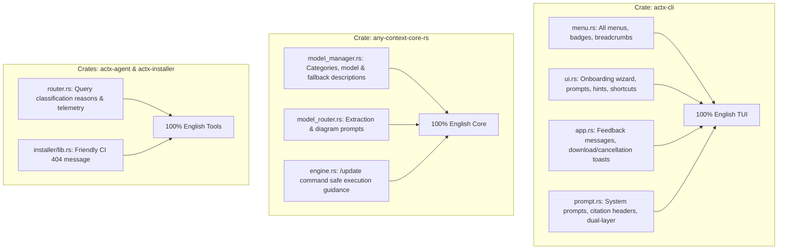

# 🏛️ AnyContext Architecture Blueprint: v0.35.0
## Global English Internationalization, Point-by-Point Braille Spinner & Standardized Release Notes

---

### 1. Executive Summary & Problem Diagnosis

| Item | Problem Reported | Root Cause Found | Architectural Solution |
| :--- | :--- | :--- | :--- |
| **1. Global English** | Strings in Portuguese throughout the project (menus, wizard, tips, status, prompts). | Rapid iterations introduced localized Portuguese texts across UI, commands, and prompts. | Comprehensive scan and 100% translation of all user-facing strings, system prompts, menu items, tips, and telemetry across the entire workspace. |
| **2. Braille Spinner** | Spinner jumps points and stutters rather than moving point-by-point smoothly. | In `ui.rs`, `((app.tick_count * 2) as usize) % len` skipped every odd frame (0, 2, 4, 6...). | Standardize to single-dot sequential traversal (`app.tick_count as usize % len`) with 10-frame clockwise perimeter dots (`["⠋", "⠙", "⠹", "⠸", "⠼", "⠴", "⠦", "⠧", "⠇", "⠏"]`) or 8-dot clockwise single-pin orbit (`["⠁", "⠈", "⠐", "⠠", "⢀", "⡀", "⠄", "⠂"]`). |
| **3. Release Notes Standard** | User requested the exact GitHub standard: `## What's Changed` with PR/commit lines and contributors. | `action-gh-release@v2` lacked `generate_release_notes: true` in `.github/workflows/release.yml`. | Enable `generate_release_notes: true` in `release.yml`, create `.github/release.yml` with semantic groupings, and adopt the standard in all release reports. |
| **4. CI E2E Fix** | `test_run_startup_splash_bootstrap_lifecycle` failed in Windows CI runner. | `global_knowledge_version` persistence was coupled to `lance_store` opening. | Unconditionally persist `global_knowledge_version` in `run_startup_splash_bootstrap()` directly via SQLite `NativeConfigDb`. |

---

### 2. Comprehensive Inventory of English Translations (Zero Left Behind)



#### Detailed String Mapping:

1. **`crates/actx-cli/src/tui/menu.rs`**:
   - `Breadcrumbs`: `"Main Menu"`, `"AI Models"`, `"Synchronization"`, `"Search Depth"`, `"Sources & Documents"`, `"API Credentials"`, `"Document AI & Local Models"`.
   - `build_main_menu`:
     - `"Workspaces & Context"`: `"Manage workspaces and isolate context per project"`
     - `"AI Models & Providers"`: `"Select active model (Gemini, Claude, GPT-4o, DeepSeek, Ollama)"`
     - `"Data Synchronization"`: `"Run incremental or forced file indexing"`
     - `"Grounding Strategy"`: `"Strict (100% local), Hybrid, or Proactive"`
     - `"Search Depth"`: `"Fast RAG (<50ms) or Deep Search (multi-turn reasoning)"`
     - `"Document AI & Local Models"`: `"Local ONNX models for ingestion, scan sentinels, routing, and vision"`
     - `"Data Sources & Documents"`: `"Local folders and web documentation portals for active workspace"`
     - `"API Credentials & Keys"`: `"Manage providers, keys, and security vault"`
     - `"Interactive Onboarding"`: `"Re-run interactive setup wizard (providers, Document AI, folders)"`
     - `"Exit AnyContext"`: `"Safely close workspace and terminal"`
   - `build_workspaces_menu`: `"Switch to workspace '{}'"`, `"To delete a workspace, run: /switch --delete <name>"`.
   - `build_sync_menu`: `"Incremental Sync (Default)"`, `"Only analyzes new and modified files via SHA-256 hash ($0.00)"`, `"[Incremental]"`, `"Full Re-Index (--force)"`, `"[Full Index]"`, `"Cancel In-Progress Sync"`, `"[Cancel]"`.
   - `build_grounding_menu`: `"Strict Mode (100% Factual Grounding)"`, `"[Default]"`, `"Hybrid Mode (Local + Synthesis)"`, `"[Balanced]"`, `"Proactive Mode (Synthesis & Recommendations)"`, `"[Research]"`.
   - `build_search_menu`: `"Auto Search Depth (Smart Default)"`, `"[Default]"`, `"Fast RAG (Single-Turn <50ms)"`, `"[Ultra Fast]"`, `"Deep Search (Reflexive ReAct)"`, `"[In-Depth]"`.
   - `build_sources_menu`: `"Workspace '{}' Sources ({})"`, `"All Sources & Workspaces (--all)"`, `"[Global]"`, `"Inspect LanceDB Vectors & Chunks (/inspect)"`.
   - `build_keys_menu`: `"API Credentials Audit Report"`, `"[Audit]"`, `"Configured (Env)"`, `"Configured (Vault)"`, `"Not configured"`, `"[Active]"`, `"[Missing]"`.
   - `build_document_ai_menu`:
     - `"🛑 Cancel Download of {}"`: `"Immediately aborts download and purges temporary files from disk"`, `"[In Progress]"`.
     - `"📂 1. Document Classification (Ingestion)"`: `"Document typology and structural categorization during indexing"`.
     - `"👁️ 2. Scan & Rasterized PDF Sentinel"`: `"Visually detects whether a page is a scan/photo before extracting text"`.
     - `"🔍 3. Query Routing (Fast vs Deep)"`: `"Classifies question complexity for direct lookup (<100ms) or multi-step reasoning"`.
     - `"🖼️ 4. Document Vision (Air-Gapped Visual OCR)"`: `"Visual inspection of charts, tables, and diagrams"`.
     - `"🛡️ 5. Storage Summary & Fallbacks"`: `"Report of models on disk, local folder, and zero-breakage guarantees (ADR-110)"`.
   - `build_doc_ai_ingestion_menu`, `scans`, `queries`, `vision`:
     - `"Rust Structural Heuristic (<1µs / 0MB RAM)"`, `"[Active / Default]"`, `"Download / Attach {}"`, `"[Download (~{:.0} MB)]"`, `"[Installed / Active]"`.
     - `"Models on Disk: {} of {} installed ({:.1} MB)"`, `"Zero Crash Guarantee (ADR-110)"`, `"[Guaranteed]"`.

2. **`crates/actx-cli/src/tui/ui.rs`**:
   - Onboarding Wizard:
     - Step 0: `" 1. Choose your LLM Provider ([↑/↓] to toggle) "`, placeholder: `"Type or paste your API key here (or press Enter to keep ENV)..."`.
     - Step 1: `" 2. Document AI & Local Models Profile ([↑/↓] to toggle) "`. Profiles:
       * `"Cloud Multimodal Vision (Zero Disk)"`: `"Uses active provider (Gemini/Claude/GPT-4o) for vision and OCR. Zero downloads or local disk overhead."`
       * `"Pure Rust 2D Spatial Heuristic"`: `"Ultra-fast native extraction (<5MB RAM, <1µs latency). Zero downloads required."`
       * `"Local ONNX Neural Pipelines"`: `"Local ONNX models for classification, semantic routing, and OCR. Downloaded on demand when requested."`
     - Step 2: `" 3. Initial Documents Folder ([Enter] to confirm, or leave empty) "`, placeholder: `"Example: C:\\Users\\YourUser\\Documents (leave empty to configure later)..."`.
     - Wizard footer tips:
       * `"Tip: Your keys are saved encrypted and restricted to your local user in '%LOCALAPPDATA%\\AnyContext\\anycontext.db'. You can change them anytime via '/keys' or '/menu'."`
       * `"Tip: No heavy downloads are required. AnyContext runs perfectly with zero extra files on disk. Local neural models can be downloaded anytime via '/menu'."`
       * `"Tip: AnyContext syncs your files in the background without sending private data to external servers. You can add folders and URLs anytime via '/sources'."`
   - Prompt bar & hints:
     - `" Prompt (Enter to send, Shift+Enter for new line, / for commands) "`
     - Context ghost text: `"Options: "`
     - Footer: `"[Esc/Ctrl+C] Exit"`, `"[F2] Menu"`, `"[Tab] Autocomplete"`, `"[Ctrl+L] Clear"`, `"[Ctrl+R] Search Depth"`, `"📥 Downloading {} {} {:.1}/{:.1} MB ({}%) [Esc to cancel]"`, `"⏸ Scroll Paused [End for real-time]"`, `"{} Syncing "`.

3. **`crates/actx-cli/src/tui/app.rs`**:
   - `"🛑 [Download Cancelled]\nDownload of **{}** was stopped at your request.\nTemporary files were removed from disk."`
   - `"📥 [ONNX Model Download Started]\nStarting async download of **{}** (~{:.0} MB)...\nFile: `{}`\nDestination: `%LOCALAPPDATA%\\AnyContext\\models\\`\nReal-time progress is displayed in the footer. Press [Esc] to cancel anytime."`
   - `"✔ [Model Successfully Attached]\n**{}** is installed on disk and active!\nFile: `%LOCALAPPDATA%\\AnyContext\\models\\{}`\nAnyContext now uses neural inference for this pipeline."`
   - `"❌ [Download Failed]\nCould not download **{}**: {}.\nAnyContext will continue operating via deterministic fallback without interruption."`
   - `"✨ [AnyContext Successfully Configured]\nProvider: `{}` | Model: `{}` | Document AI Profile: `{}`.\nYour configuration is saved and ready. Ask any question below or type `/help`."`

4. **`crates/actx-cli/src/prompt.rs`**:
   - Strict citations: `---\n📄 **Sources Consulted (Local Files):**\n- `<actual_file_name>` (Actual path or URL returned by search_db)`
   - Hybrid dual-layer headers: `### 📂 Workspace Information` (based on local documents with citations), `### 💡 General Model Knowledge` (parametric knowledge properly labeled)
   - Parametric transparency: `"According to my general knowledge..."`
   - Proactive tags: `[Document: ...]`, `[Web: ...]`, `[Recommendation]`
   - Citations: `📄 Sources Consulted:`

5. **`crates/any-context-core-rs/src/ingestion/model_manager.rs`**:
   - Categories: `"Ingestion Classifier"`, `"Scanned Classifier"`, `"Query Classifier"`, `"Document Vision"`.
   - Descriptions & fallbacks translated to English (e.g. `"Dynamic document and dense form typology classification (~95% accuracy, 60ms CPU)"`, `"Deterministic / Heuristic Classifier (<1µs / 0MB RAM)"`).
   - Active states: `"Active in runtime (~95% accuracy, 60ms CPU)"`, `"Active default (Zero download / Sub-microsecond latency)"`, `"Active scan visual sentinel (~8ms CPU)"`, `"Active Local Air-Gapped Vision Encoder"`.
   - Error messages: `"Download cancelled by user."`.

6. **`crates/any-context-core-rs/src/ingestion/model_router.rs`**:
   - System prompts for form extraction and visual diagram analysis translated to English.

7. **`crates/any-context-core-rs/src/commands/engine.rs`**:
   - `/update` safe guidance message translated to English.

8. **`crates/actx-installer/src/lib.rs`**:
   - CI build in-progress friendly 404 message translated to English.

9. **`crates/actx-agent/src/router.rs`**:
   - Reasons: `"detailed query length"`, `"multiple questions in single query"`, `"multi-aspect additive conjunctions"`, `"comparative analysis / trade-offs"`, `"targeted point query"`, `"Complex query pattern with multiple dependencies"`, `"Direct low-latency point query"`.
   - Telemetry logs: `"⚡ Fast mode forced by user (/search fast): {}"`, `"🧠 Deep Search mode forced by user (/search deep): {}"`, `"🧠 Autonomously routed to Deep Search (score: {:.2}): {}"`, `"⚡ Autonomously routed to Fast RAG (score: {:.2}): {}"`.

---

### 3. Braille Spinner: Point-by-Point Sequential Orbit

#### The Root Cause:
In `crates/actx-cli/src/tui/ui.rs`:
```rust
// Lines 108 and 470 (BUG):
let spinner_chars = ["⣷", "⣯", "⣟", "⡿", "⢿", "⣻", "⣽", "⣾"];
let spinner = spinner_chars[((app.tick_count * 2) as usize) % spinner_chars.len()];
```
Multiplying `tick_count * 2` advanced the index by 2 every frame, skipping 50% of the positions and creating an erratic stutter.

#### The Smooth Solution:
1. Standardize all spinners across `ui.rs` (syncing, downloading, processing) to single-step frame progression:
   `let spinner = spinner_chars[(app.tick_count as usize) % spinner_chars.len()];`
2. Use the canonical 10-frame clockwise perimeter dots:
   `["⠋", "⠙", "⠹", "⠸", "⠼", "⠴", "⠦", "⠧", "⠇", "⠏"]`
   Each frame transitions smoothly from dot 1 -> dot 2 -> dot 3 -> dot 6 -> dot 5 -> dot 4, orbiting fluidly point by point.

---

### 4. Release Notes Automation: GitHub Standard Format

#### Pattern Required:
```markdown
## What's Changed
* fix(compose): forward extra models and idle unload knobs to laya-serve by @NAVEENPRASAATH23 in #1053
* feat(router): warn when a registered name is one edit from a built-in by @sathariels in #1055
* docs: note on int8 dynamic quantization on CPU (#1065) by @sathariels in #1067

**Full Changelog**: https://github.com/Levix-Digital/any-context/compare/v0.34.10...v0.35.0
```

#### Implementation:
1. Update `.github/workflows/release.yml`:
   ```yaml
   - name: Publish Linux Release Assets
     uses: softprops/action-gh-release@v2
     with:
       generate_release_notes: true
       ...
   - name: Publish Windows Release Assets
     uses: softprops/action-gh-release@v2
     with:
       generate_release_notes: true
       ...
   ```
2. Create `.github/release.yml` for automated semantic categories:
   ```yaml
   changelog:
     categories:
       - title: "🚀 Features & Enhancements"
         labels: ["feat", "enhancement"]
       - title: "🐛 Bug Fixes & Resiliency"
         labels: ["fix", "bug"]
       - title: "📚 Documentation & Architecture (Dual-Doc)"
         labels: ["docs", "documentation"]
       - title: "🧰 Maintenance & CI/CD"
         labels: ["chore", "ci", "test"]
   ```

---

### 5. CI E2E Splash Test Resolution

In `crates/actx-cli/src/engine.rs`:
```rust
pub fn run_startup_splash_bootstrap() {
    ...
    // Unconditionally persist current version in settings to ensure
    // is_first_run_or_upgrade() is immediately false across all test environments:
    if let Ok(db) = any_context_core_rs::storage::NativeConfigDb::open_default() {
        let _ = db.set_setting("global_knowledge_version", env!("CARGO_PKG_VERSION"));
    }
}
```

---

### 6. Verification & Milestone Plan

- **M1**: Translation of `actx-cli` (menu, ui, app, prompt).
- **M2**: Translation of `any-context-core-rs`, `actx-agent`, `actx-installer`.
- **M3**: Braille spinner point-by-point fix (removal of `* 2` multiplier).
- **M4**: Release workflow updates (`release.yml` with `generate_release_notes: true` & `.github/release.yml`).
- **M5**: CI E2E splash test fix.
- **M6**: Automated test validation across all crates (`cargo test`).
- **M7**: Dual-Doc update (ADR-119 in `TECDOC.md` & Scenario 34 in `tests/MANUAL_TESTS.md`).
- **M8**: Bump to `v0.35.0`, commit, tag, and push.
