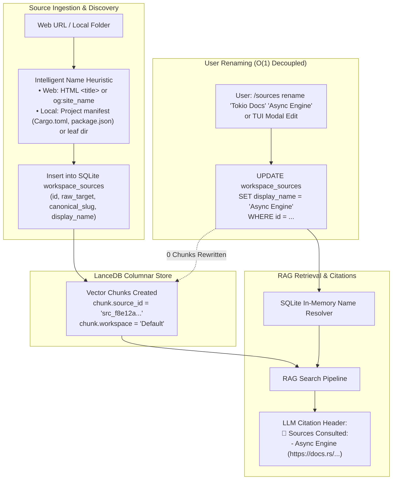

# 🏛️ AnyContext Architecture Blueprint: v0.36.0
## Intelligent Source Naming, Shared Sources Deprecation & Canonical System Knowledge Manual

---

### 1. Executive Summary & Architectural Rationale

This blueprint addresses three core requirements to elevate AnyContext to enterprise-grade maturity:

| Area | Challenge Addressed | Architectural Solution |
| :--- | :--- | :--- |
| **1. Intelligent Source Naming & Editing** | Raw filesystem paths and long URLs currently appear as source names, cluttering the UI and LLM citations. Renaming sources must not invalidate vector chunks. | **Projection Alias Pattern**: Chunks in LanceDB store immutable `source_id` keys, while SQLite maintains a decoupled `workspace_sources` table mapping physical targets to intelligent auto-generated `display_name`s. Users can edit display names at $O(1)$ via CLI (`/sources rename`) and TUI modal without rewriting vector chunks. |
| **2. Deprecation of Shared Sources** | `Shared Sources` complicates the mental model, introduces context bleed across disparate projects, and dilutes Top-K RAG precision. | **Pure Workspace Isolation**: Completely remove `Shared Sources`, the `/shared-sources` command, and cross-workspace retrieval bleed. Workspaces become strictly isolated environments. |
| **3. Canonical System Knowledge Manual** | System self-knowledge is currently fragmented across `AGENT.md`, `README.md`, and application help. | **Unified `config/SYSTEM_KNOWLEDGE.md` Manual**: A rich, narrative technical manual (not a dry bulleted list) covering architecture, grounding, commands, shortcuts, Document AI, and recovery. Embedded at compile time and automatically vector-indexed into LanceDB's `Global` workspace upon startup/upgrade. |

---

### 2. Intelligent Source Naming & Display Alias Architecture



#### 2.1 Database Schema in SQLite (`NativeConfigDb`)
```sql
CREATE TABLE IF NOT EXISTS workspace_sources (
    id TEXT PRIMARY KEY,               -- Deterministic hash/UUID: 'src_e7f12a...'
    workspace TEXT NOT NULL,           -- 'Default'
    source_type TEXT NOT NULL,         -- 'folder' | 'web_url'
    raw_target TEXT NOT NULL,          -- 'https://docs.rs/tokio/latest/tokio/index.html'
    canonical_slug TEXT NOT NULL,      -- 'tokio-docs'
    display_name TEXT NOT NULL,        -- 'Tokio Documentation' (User editable!)
    created_at TEXT NOT NULL,
    updated_at TEXT NOT NULL,
    UNIQUE(workspace, raw_target)
);
```

#### 2.2 Intelligent Auto-Naming Heuristics
1. **Web URLs**:
   - Primary: When crawled, inspect page metadata: HTML `<title>` or OpenGraph `<meta property="og:title">` (e.g. `https://docs.rs/tokio/latest/tokio/index.html` $\rightarrow$ `"Tokio Documentation"`).
   - Fallback: Hostname + key path segment (e.g. `github.com/Levix-Digital/any-context` $\rightarrow$ `"GitHub: any-context"`).
2. **Local Folders**:
   - Primary: If folder contains a project manifest (`Cargo.toml` `package.name`, `package.json` `name`, `pyproject.toml` `project.name`), extract the project name (e.g. `"actx-cli"`).
   - Fallback: Leaf directory name (e.g. `C:\Projects\financial-engine\src` $\rightarrow$ `"financial-engine/src"`).

#### 2.3 User Renaming UX
- **CLI Command**:
  ```text
  /sources rename <id_index_or_name> <new_name>
  ```
  Example: `/sources rename 1 "Tokio Async Engine"` or `/sources rename "Tokio Documentation" "Tokio Async Engine"`.
  Outputs:
  ```text
  ✔ Source 'Tokio Documentation' renamed to 'Tokio Async Engine'.
    Target: https://docs.rs/tokio/latest/tokio/io/index.html
    Chunks impacted in LanceDB: 0 (Decoupled relational alias)
  ```
- **TUI Modal Interaction**:
  - In `/sources` menu or `F1` $\rightarrow$ `Sources`, selecting any source and pressing `[Enter]` opens an actions pop-up:
    - `✏️ 1. Rename Source (Display Name)`
    - `🔄 2. Reindex This Source`
    - `🗑️ 3. Remove Source from Workspace`
  - Selecting `Rename Source` opens an in-place text input box pre-populated with the current display name.
  - Pressing `[Enter]` saves immediately to SQLite and refreshes the UI toast in $< 1\text{ms}$.

---

### 3. Complete Deprecation of `Shared Sources`

1. **CLI Registry**: Remove `/shared-sources` command from `crates/actx-cli/src/commands/registry.rs`.
2. **Core Retrieval Pipeline**: Remove `Linked shared sources search` and shared links logic from `crates/any-context-core-rs/src/retrieval/pipeline.rs`.
3. **Status & Diagnostics**: Remove `Shared Sources: No external shared links configured.` from `CommandEngine::execute_status`.
4. **Mental Model Benefit**: Zero risk of context bleed between projects. Workspaces provide complete, pure isolation.

---

### 4. Canonical `SYSTEM_KNOWLEDGE.md` Technical Manual

Instead of a sparse bullet-point list, `config/SYSTEM_KNOWLEDGE.md` will be a **comprehensive, authoritative technical manual** structured into 7 detailed narrative chapters. Dense, structured prose provides rich semantic signals for BM25 and vector search, allowing the agent to answer questions about any aspect of AnyContext with pinpoint accuracy.

#### Standard Chapter Structure:

```markdown
# 🌌 AnyContext System Knowledge & Technical Manual
> Version: v0.36.0 | Engine: 100% Native Rust | Aurora Boreal Design System

## 1. System Identity, Philosophy & Architecture
[Comprehensive narrative detailing: Actx purpose, zero-Python standalone Rust architecture,
Apache Arrow/LanceDB columnar storage, SQLite configuration vault, memory safety,
offline-first air-gapped security, zero-telemetry privacy guarantees.]

## 2. Grounding Strategies & Behavioral Directives
[In-depth specifications of Strict, Hybrid, and Proactive grounding modes. Explanations of
Mandatory Autonomous Retrieval (`search_db` / `system_status` first), parametric disclosure rules,
anti-hallucination protocols, and the Universal Temporal Recency Rule.]

## 3. Complete Command Reference (Slash Commands)
[Exhaustive manual for every slash command: /workspace, /switch, /folder, /sources,
/sources rename, /sync, /sync --force, /model, /mode, /search, /fast, /deep, /web, /keys,
/status, /inspect, /clear, /reset-memory, /history, /onboarding, /update, /exit.
Includes parameter syntax, flags, execution lifecycle, and error handling.]

## 4. Keyboard Shortcuts & TUI Navigation
[Exhaustive reference for terminal interaction: Ctrl+T for ReAct accordion toggle,
Ctrl+L for chat view clear, PageUp/PageDown for conversation scrolling, Shift+PageUp/Down
for reasoning trace scrolling, Up/Down for readline prompt history, F1/F2 menus, Esc navigation.]

## 5. Document AI, Local ONNX Models & Vision Engine
[Technical specifications of embedded Document AI: Laya AI mmBERT INT8, MobileNetV4 RVL-CDIP,
BGE-Small Query Classifier, LayoutLMv3, CLIP ViT Vision Encoder. Details the pure Rust heuristic
fallbacks (<1µs / 0MB RAM) and the ADR-110 Zero-Breakage guarantee.]

## 6. Storage Subsystems, Smart Path Healing & Data Persistence
[Details settings.db schemas, LanceDB table partitioning, models directory, and the
Smart Path Healing algorithm (ADR-117) for phonetic/structural folder drift recovery.]

## 7. Release Lifecycle, CI/CD Standards & Atomic Binary Updates
[Conventional commit release standard (## What's Changed), automated build pipeline,
launcher shim proxying, and the actx --update atomic swap process without file locks.]
```

#### Vector Indexing & Bootstrapping Lifecycle:
- Embedded at compile time in binary (`include_str!("../../../config/SYSTEM_KNOWLEDGE.md")`).
- On application boot or version upgrade (`run_startup_splash_bootstrap`):
  1. Checks `global_knowledge_version` in SQLite settings.
  2. If version differs from `CARGO_PKG_VERSION`:
     - Purges obsolete `Global` records in LanceDB and BM25 index.
     - Chunks `SYSTEM_KNOWLEDGE.md` by Markdown headers (`## ` / `### `).
     - Inserts structured sections into LanceDB under `workspace: "Global"` and updates the BM25 hybrid index.
     - Saves `global_knowledge_version = env!("CARGO_PKG_VERSION")` in SQLite.
  3. Subsequent boots bypass re-indexing instantly ($< 1\text{ms}$).

---

### 5. Step-by-Step Implementation Plan

1. **Step 1: Database Migration in `any-context-core-rs`**:
   - Add `workspace_sources` table creation and helper methods (`add_source`, `list_sources`, `rename_source`, `get_source`) to `NativeConfigDb`.
   - Implement `generate_intelligent_display_name` heuristic for folders and URLs.
2. **Step 2: Source Renaming Command & TUI Integration**:
   - Add `/sources rename <target> <new_name>` handler in `CommandEngine`.
   - Update `actx-cli` TUI: Add contextual action menu and inline renaming input modal when pressing `[Enter]` on a source in the sources menu.
3. **Step 3: Deprecate `Shared Sources`**:
   - Remove `/shared-sources` from command registry and help texts.
   - Remove shared source search logic in `pipeline.rs`.
4. **Step 4: Author `config/SYSTEM_KNOWLEDGE.md` Manual**:
   - Write the complete, comprehensive technical manual in `config/SYSTEM_KNOWLEDGE.md` adhering strictly to the 7-chapter specification.
5. **Step 5: Wire `SYSTEM_KNOWLEDGE.md` to Bootstrap**:
   - Update `engine.rs` to embed and index `SYSTEM_KNOWLEDGE.md` into the `Global` workspace.
6. **Step 6: Automated Testing & Verification**:
   - Unit tests for source auto-naming and renaming in `storage::sqlite`.
   - Unit tests for `/sources rename` command execution in `command_tests`.
   - Integration tests verifying `SYSTEM_KNOWLEDGE.md` chunking and indexing.
7. **Step 7: Version Bump & Dual-Doc**:
   - Bump version to `v0.36.0`.
   - Record ADR-120 in `TECDOC.md` and Scenario 35 in `tests/MANUAL_TESTS.md`.

---

### 6. Verification Suite

- **Test A: Auto-Naming Heuristics**:
  - Verify that a URL like `https://github.com/Levix-Digital/any-context` yields `"GitHub: any-context"`.
  - Verify that a local folder with `Cargo.toml` yields the package name.
- **Test B: Relational Renaming Decoupling**:
  - Insert 50 chunks for a source in LanceDB.
  - Rename the source via `/sources rename`.
  - Verify that SQLite updates `display_name` in $< 1\text{ms}$ while LanceDB chunks remain intact.
- **Test C: TUI Renaming Modal**:
  - Verify opening the rename modal, submitting text, and observing updated TUI list.
- **Test D: Deprecation Verification**:
  - Verify `/shared-sources` is rejected as an unknown command and does not appear in `/help` or `/status`.
- **Test E: System Knowledge Querying**:
  - Verify that asking the agent *"How does Smart Path Healing work?"* correctly retrieves and cites `config/SYSTEM_KNOWLEDGE.md` from the `Global` workspace.
