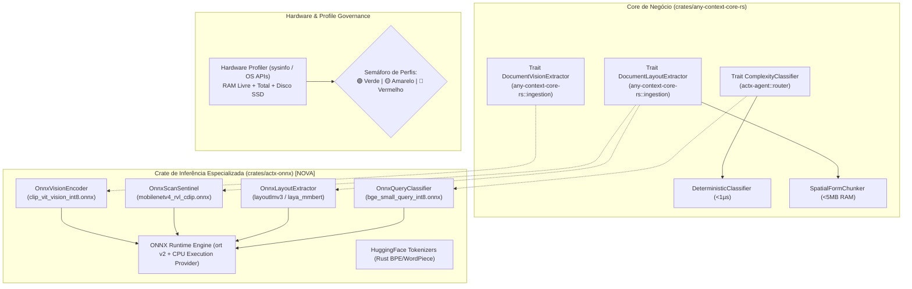

# 📐 Blueprint de Engenharia: AnyContext v0.37.0
## Motor ONNX Modular (`crates/actx-onnx`), Hardware Pre-Flight Check e Perfis de Instalação em Semáforo (Kit de Models)

---

### 📌 Metadados do Plano
- **Projeto**: AnyContext (`actx`)
- **Versão-Alvo**: `v0.37.0`
- **Autor**: Levi Silveira & Antigravity Assistant
- **Data**: 2026-10-13
- **Fase**: Fase 3 do Master Plan (Kit de Models & Especialistas)
- **Status**: Proposta Técnica para Aprovação (Gate 3 - `dev-cycle-protocol`)
- **Componentes**: 
  - `crates/actx-onnx` (Nova Crate Modular no Workspace)
  - `crates/any-context-core-rs` (Traits, Inversão de Dependência e Feature Flag `onnx`)
  - `crates/actx-installer` (Hardware Pre-Flight, Semáforo 🟢/🟡/🔴, Seleção Automática e Opções Avançadas)
  - `crates/actx-cli` (Menu TUI de Perfis, Comando `/profile`, Telemetria `/status`)
  - `crates/actx-agent` (Conexão do `ComplexityClassifier` com o `OnnxQueryClassifier`)
- **Dual-Doc**: `README.md` (UserDoc), `TECDOC.md` (TecDoc - ADR-121), `tests/MANUAL_TESTS.md` (Cenário 36)

---

## 🏛️ 1. Visão Executiva e Problema a Resolver

Atualmente (v0.36.0), o AnyContext possui o catálogo canônico de modelos ONNX e o gerenciador de downloads, mas a inferência real de tensores ainda não está ligada em tempo de execução, operando 100% sob as heurísticas determinísticas em Rust puro. Além disso, no modelo de instalação anterior, a ausência de modelos no primeiro uso transferia ao usuário comum o ônus cognitivo de descobrir e baixar 5 modelos técnicos individuais em submenus.

A versão **v0.37.0** concretiza a **Fase 3 do Master Plan ("Kit de Models")** sob três pilares definitivos:
1. **Máxima Potência Out-of-the-Box**: O software passa a vir pronto para baixar a versão mais potente que a máquina do usuário suportar confortavelmente.
2. **Inspeção de Hardware Prévia ("Trava por Máquina")**: O instalador avalia RAM total, RAM livre e espaço em SSD em $< 5\text{ms}$, marcando os perfis com semáforo (🟢 Verde / 🟡 Amarelo / 🔴 Vermelho) e selecionando automaticamente o perfil verde mais potente de forma transparente.
3. **Opções Avançadas e Desacoplamento Arquitetural**: Para desenvolvedores e usuários avançados, uma opção discreta permite selecionar individualmente quais modelos baixar e ativar. No código, o runtime ONNX é isolado em uma crate especializada (`crates/actx-onnx`), garantindo compilação condicional via Feature Flag do Cargo e preservando o Core puro e ágil.

---

## 🏗️ 2. Topologia Arquitetural: A Crate `crates/actx-onnx`



---

## 📊 3. Especificação dos Perfis e Matriz de Hardware

| Perfil | Requisitos Mínimos (Semáforo 🟢) | Modelos Incluídos | Download em Disco | Consumo de RAM | Experiência de IA |
| :--- | :--- | :--- | :--- | :--- | :--- |
| **🌌 Air-Gapped Power** *(Default em Máquinas $\ge$ 16GB)* | • RAM Livre: $\ge 6\text{ GB}$ (Total $\ge 16\text{ GB}$)<br>• Disco Livre: $\ge 5\text{ GB}$<br>• CPU: 4+ cores | • `mobilenetv4` (~3.9 MB)<br>• `clip-vit` (~84 MB)<br>• `layoutlmv3` (~121 MB)<br>• `bge-small` (~127 MB)<br>• `laya-int8` (~404 MB) | **~740 MB** | • Chat: ~150 MB<br>• Pico Sync: ~750–900 MB | **Máxima Precisão e Autonomia Total:**<br>Classificação de documentos (~95%), leitura visual de gráficos/diagramas offline e roteamento neural de complexidade. |
| **⚡ Smart Balanced** *(Default em Máquinas de 8GB)* | • RAM Livre: $\ge 3\text{ GB}$ (Total $\ge 8\text{ GB}$)<br>• Disco Livre: $\ge 2\text{ GB}$<br>• CPU: 2+ cores | • `mobilenetv4` (~3.9 MB)<br>• `layoutlmv3` (~121 MB)<br>• `bge-small` (~127 MB) | **~252 MB** | • Chat: ~130 MB<br>• Pico Sync: ~350–400 MB | **Custo-Benefício Equilibrado:**<br>Sentinela de scans, layout 2D de tabelas e roteamento neural de perguntas. Diagramas complexos usam fallback 2D ou API cloud. |
| **🟢 Lite / Fast-Path** *(Default em Máquinas $< 8\text{GB}$)* | • Qualquer hardware<br>• Ambientes de CI, Docker ou VMs | • **Nenhum download ONNX**<br>• 100% Heurísticas determinísticas nativas | **0 MB** adicionais | • Chat: $< 35\text{ MB}$<br>• Pico Sync: $< 50\text{ MB}$ | **Velocidade Pura:**<br>Inicialização em $< 10\text{ms}$, sem espera de download. RAG textual com AST e parsers nativos. |

---

## 🛠️ 4. Detalhamento dos Marcos de Implementação

### 🧱 Marco 1: Motor de Inspeção de Hardware & Semáforo (`crates/any-context-core-rs/src/hardware/`)
- Módulo `HardwareProfiler`:
  - Lê memória física total e disponível via API do sistema operacional (Windows `GlobalMemoryStatusEx`, Linux `/proc/meminfo`, macOS `sysctl`).
  - Lê espaço livre no volume onde reside `%LOCALAPPDATA%` / `~/.local/share`.
  - Avalia os 3 perfis e emite `ProfileReadiness`:
    - `Green`: Recursos ideais para operação suave sem swap.
    - `Yellow`: Operação viável, mas com uso de memória acima de 70%.
    - `Red`: Memória ou disco insuficientes.
  - Função pura `auto_select_recommended_profile(&SystemMetrics) -> ProfileTier`.

### 🧠 Marco 2: Nova Crate Modular `crates/actx-onnx`
- Criação de `crates/actx-onnx/Cargo.toml` adicionada ao `[workspace]` raiz:
  - Dependências: `ort = "2.0"` (com dynamic/bundled linking e multi-thread CPU execution provider), `tokenizers = "0.20"` (zero-copy BPE/WordPiece), `image = "0.25"`, `serde`, `tokio`.
- Implementações concretas das Traits:
  - `OnnxQueryClassifier`: Tokeniza o prompt do usuário, alimenta o modelo `bge_small_query_int8.onnx` e extrai tensores de similaridade para decidir `Fast` vs `Deep`.
  - `OnnxScanSentinel`: Processa thumbnails 224x224 com `mobilenetv4_rvl_cdip.onnx` classificando em `Scan` vs `DigitalText` em ~8ms.
  - `OnnxLayoutExtractor`: Extrai tokens com caixas delimitadoras via `layoutlmv3_base_int8.onnx`.
  - `OnnxVisionEncoder`: Extrai embeddings visuais com `clip_vit_vision_int8.onnx`.

### 🛡️ Marco 3: Feature Flag e Inversão de Dependência no Core
- Configuração do Cargo:
  ```toml
  # crates/any-context-core-rs/Cargo.toml
  [features]
  default = ["onnx"]
  onnx = ["dep:actx-onnx"]

  [dependencies]
  actx-onnx = { path = "../actx-onnx", optional = true }
  ```
- **Princípio Inviolável ADR-110**: Caso a compilação seja feita sem `--features onnx` ou caso um arquivo `.onnx` esteja corrompido, a trait despacha imediatamente para o fallback determinístico em Rust puro sem pânico.

### 📦 Marco 4: UX do Instalador & Updater (`crates/actx-installer`)
- **Tela de Instalação Padrão**:
  - Exibe a avaliação de hardware:
    ```text
    🖥️ Hardware Detected: 16.0 GB RAM (9.4 GB Available) │ 142 GB Free SSD
    ⚡ Profile Auto-Selected: 🌌 Air-Gapped Power (Optimal 🟢)
       Includes: Full Local Document AI, Scan Sentinel & Deep Search Routing
       Disk required: ~740 MB │ Estimated RAM: ~150 MB (idle) / ~850 MB (peak sync)
    
    [Enter] Install & Download Models  │  [A] Advanced Options  │  [Esc] Cancel
    ```
- **Expansor de Opções Avançadas (`[A]`)**:
  - Lista os 3 perfis e checkboxes dos 5 modelos individuais.
  - Ao alternar modelos, recalcula em tempo real: `Selected: 3 models │ Total download: 252 MB`.
  - Baixa estritamente o que foi marcado com a barra de progresso unificada.

### 🖥️ Marco 5: Multi-Surface Parity (Menu TUI & Comandos CLI)
- **Novo Comando `/profile` (alias `/preset`)**:
  - `/profile`: Abre popup interativo na TUI para alternar entre os perfis a qualquer momento.
  - `/profile airgapped | balanced | lite`: Aplica e inicia o download assíncrono dos modelos faltantes com feedback em tempo real.
  - `/status`: Exibe o perfil ativo e o semáforo de hardware da máquina atual.

---

## 🧪 5. Roteiro de Testes Manuais (Cenário 36 em `MANUAL_TESTS.md`)

- **Cenário 36.1 (Hardware Pre-Flight Check)**:
  - Executar `actx --diagnostics-hardware` e verificar a leitura exata de RAM total, livre e espaço em disco em $< 10\text{ms}$.
- **Cenário 36.2 (Auto-Seleção Inteligente no Instalador)**:
  - Comprovar que em máquina com $\ge 16\text{ GB}$ de RAM o perfil `Air-Gapped Power` é selecionado por padrão sem exigir cliques adicionais.
- **Cenário 36.3 (Opções Avançadas & Download Parcial)**:
  - Abrir Opções Avançadas, desmarcar Laya e CLIP, verificar que o download total é de ~252 MB e que apenas os 3 modelos marcados são salvos em disco.
- **Cenário 36.4 (Inferência Real ONNX no Roteador)**:
  - Fazer uma pergunta complexa no chat (`/search auto`) com o modelo `bge-small` instalado e verificar nos logs e no accordion ReAct (`Ctrl+T`) a emissão da decisão de complexidade disparada pela sessão do ONNX Runtime em $< 15\text{ms}$.
- **Cenário 36.5 (Mutabilidade no Menu TUI)**:
  - Pressionar `F1 -> Document AI & Perfis`, alterar para `Smart Balanced`, e verificar a persistência imediata no SQLite (`settings.db`).

---

## 🚀 6. Cronograma de Execução e Fechamento


