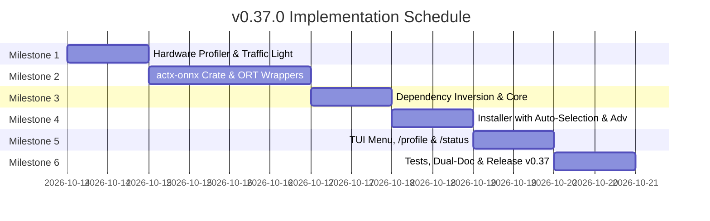

# 📐 Engineering Blueprint: AnyContext v0.37.0
## Modular ONNX Engine (`crates/actx-onnx`), Hardware Pre-Flight Check and Traffic-Light Installation Profiles (Model Kit)

---

### 📌 Plan Metadata
- **Project**: AnyContext (`actx`)
- **Target Version**: `v0.37.0`
- **Author**: Levi Silveira & Antigravity Assistant
- **Date**: 2026-10-13
- **Phase**: Master Plan Phase 3 (Model Kit & Specialists)
- **Status**: Technical Proposal for Approval (Gate 3 - `dev-cycle-protocol`)
- **Components**: 
  - `crates/actx-onnx` (New Modular Crate in the Workspace)
  - `crates/any-context-core-rs` (Traits, Dependency Inversion and the `onnx` Feature Flag)
  - `crates/actx-installer` (Hardware Pre-Flight, 🟢/🟡/🔴 Traffic Light, Automatic Selection and Advanced Options)
  - `crates/actx-cli` (TUI Profiles Menu, `/profile` Command, `/status` Telemetry)
  - `crates/actx-agent` (Connecting `ComplexityClassifier` to `OnnxQueryClassifier`)
- **Dual-Doc**: `README.md` (UserDoc), `TECDOC.md` (TecDoc - ADR-121), `tests/MANUAL_TESTS.md` (Scenario 36)

---

## 🏛️ 1. Executive Vision and Problem to Solve

Today (v0.36.0), AnyContext has the canonical catalog of ONNX models and the download manager, but real tensor inference is not yet wired at runtime, running 100% on deterministic heuristics in pure Rust. In addition, in the previous installation model, the absence of models on first use shifted onto the regular user the cognitive burden of discovering and downloading 5 individual technical models in submenus.

Version **v0.37.0** delivers **Master Plan Phase 3 ("Model Kit")** on three definitive pillars:
1. **Maximum Power Out-of-the-Box**: the software comes ready to download the most powerful version the user's machine can comfortably handle.
2. **Prior Hardware Inspection ("Per-Machine Lock")**: the installer evaluates total RAM, free RAM and SSD space in $< 5\text{ms}$, marking the profiles with a traffic light (🟢 Green / 🟡 Yellow / 🔴 Red) and transparently selecting the most powerful green profile.
3. **Advanced Options and Architectural Decoupling**: for developers and advanced users, a discreet option allows selecting individually which models to download and enable. In the code, the ONNX runtime is isolated in a specialized crate (`crates/actx-onnx`), guaranteeing conditional compilation through a Cargo Feature Flag and keeping the Core pure and agile.

---

## 🏗️ 2. Architectural Topology: The `crates/actx-onnx` Crate


---

## 📊 3. Profile Specification and Hardware Matrix

| Profile | Minimum Requirements (🟢 Traffic Light) | Included Models | Disk Download | RAM Usage | AI Experience |
| :--- | :--- | :--- | :--- | :--- | :--- |
| **🌌 Air-Gapped Power** *(Default on Machines $\ge$ 16GB)* | • Free RAM: $\ge 6\text{ GB}$ (Total $\ge 16\text{ GB}$)<br>• Free Disk: $\ge 5\text{ GB}$<br>• CPU: 4+ cores | • `mobilenetv4` (~3.9 MB)<br>• `clip-vit` (~84 MB)<br>• `layoutlmv3` (~121 MB)<br>• `bge-small` (~127 MB)<br>• `laya-int8` (~404 MB) | **~740 MB** | • Chat: ~150 MB<br>• Sync Peak: ~750–900 MB | **Maximum Precision and Full Autonomy:**<br>Document classification (~95%), offline visual reading of charts/diagrams and neural complexity routing. |
| **⚡ Smart Balanced** *(Default on 8GB Machines)* | • Free RAM: $\ge 3\text{ GB}$ (Total $\ge 8\text{ GB}$)<br>• Free Disk: $\ge 2\text{ GB}$<br>• CPU: 2+ cores | • `mobilenetv4` (~3.9 MB)<br>• `layoutlmv3` (~121 MB)<br>• `bge-small` (~127 MB) | **~252 MB** | • Chat: ~130 MB<br>• Sync Peak: ~350–400 MB | **Balanced Cost/Benefit:**<br>Scan sentinel, 2D table layout and neural question routing. Complex diagrams use the 2D fallback or a cloud API. |
| **🟢 Lite / Fast-Path** *(Default on Machines $< 8\text{GB}$)* | • Any hardware<br>• CI, Docker or VM environments | • **No ONNX download**<br>• 100% native deterministic heuristics | **0 MB** extra | • Chat: $< 35\text{ MB}$<br>• Sync Peak: $< 50\text{ MB}$ | **Pure Speed:**<br>Startup in $< 10\text{ms}$, no download wait. Text RAG with AST and native parsers. |

---

## 🛠️ 4. Implementation Milestone Detail

### 🧱 Milestone 1: Hardware Inspection Engine & Traffic Light (`crates/any-context-core-rs/src/hardware/`)
- `HardwareProfiler` module:
  - Reads total and available physical memory through the operating system API (Windows `GlobalMemoryStatusEx`, Linux `/proc/meminfo`, macOS `sysctl`).
  - Reads free space on the volume where `%LOCALAPPDATA%` / `~/.local/share` lives.
  - Evaluates the 3 profiles and emits `ProfileReadiness`:
    - `Green`: ideal resources for smooth operation without swap.
    - `Yellow`: viable operation, but with memory usage above 70%.
    - `Red`: not enough memory or disk.
  - Pure function `auto_select_recommended_profile(&SystemMetrics) -> ProfileTier`.

### 🧠 Milestone 2: New Modular Crate `crates/actx-onnx`
- Creation of `crates/actx-onnx/Cargo.toml`, added to the root `[workspace]`:
  - Dependencies: `ort = "2.0"` (with dynamic/bundled linking and a multi-thread CPU execution provider), `tokenizers = "0.20"` (zero-copy BPE/WordPiece), `image = "0.25"`, `serde`, `tokio`.
- Concrete implementations of the Traits:
  - `OnnxQueryClassifier`: tokenizes the user's prompt, feeds the `bge_small_query_int8.onnx` model and extracts similarity tensors to decide `Fast` vs `Deep`.
  - `OnnxScanSentinel`: processes 224x224 thumbnails with `mobilenetv4_rvl_cdip.onnx`, classifying `Scan` vs `DigitalText` in ~8ms.
  - `OnnxLayoutExtractor`: extracts tokens with bounding boxes through `layoutlmv3_base_int8.onnx`.
  - `OnnxVisionEncoder`: extracts visual embeddings with `clip_vit_vision_int8.onnx`.

### 🛡️ Milestone 3: Feature Flag and Dependency Inversion in the Core
- Cargo configuration:
  ```toml
  # crates/any-context-core-rs/Cargo.toml
  [features]
  default = ["onnx"]
  onnx = ["dep:actx-onnx"]

  [dependencies]
  actx-onnx = { path = "../actx-onnx", optional = true }
  ```
- **Inviolable ADR-110 Principle**: if the build is made without `--features onnx` or an `.onnx` file is corrupted, the trait dispatches immediately to the deterministic fallback in pure Rust, without a panic.

### 📦 Milestone 4: Installer & Updater UX (`crates/actx-installer`)
- **Default Installation Screen**:
  - Shows the hardware evaluation:
    ```text
    🖥️ Hardware Detected: 16.0 GB RAM (9.4 GB Available) │ 142 GB Free SSD
    ⚡ Profile Auto-Selected: 🌌 Air-Gapped Power (Optimal 🟢)
       Includes: Full Local Document AI, Scan Sentinel & Deep Search Routing
       Disk required: ~740 MB │ Estimated RAM: ~150 MB (idle) / ~850 MB (peak sync)
    
    [Enter] Install & Download Models  │  [A] Advanced Options  │  [Esc] Cancel
    ```
- **Advanced Options Expander (`[A]`)**:
  - Lists the 3 profiles and checkboxes for the 5 individual models.
  - When toggling models, it recalculates in real time: `Selected: 3 models │ Total download: 252 MB`.
  - Downloads strictly what was checked, with a unified progress bar.

### 🖥️ Milestone 5: Multi-Surface Parity (TUI Menu & CLI Commands)
- **New `/profile` Command (alias `/preset`)**:
  - `/profile`: opens an interactive TUI popup to switch between profiles at any time.
  - `/profile airgapped | balanced | lite`: applies the profile and starts the asynchronous download of the missing models with real-time feedback.
  - `/status`: shows the active profile and the hardware traffic light of the current machine.

---

## 🧪 5. Manual Test Script (Scenario 36 in `MANUAL_TESTS.md`)

- **Scenario 36.1 (Hardware Pre-Flight Check)**:
  - Run `actx --diagnostics-hardware` and check the exact reading of total RAM, free RAM and disk space in $< 10\text{ms}$.
- **Scenario 36.2 (Smart Auto-Selection in the Installer)**:
  - Confirm that on a machine with $\ge 16\text{ GB}$ of RAM the `Air-Gapped Power` profile is selected by default without extra clicks.
- **Scenario 36.3 (Advanced Options & Partial Download)**:
  - Open Advanced Options, uncheck Laya and CLIP, check that the total download is ~252 MB and that only the 3 checked models are saved to disk.
- **Scenario 36.4 (Real ONNX Inference in the Router)**:
  - Ask a complex question in the chat (`/search auto`) with the `bge-small` model installed and check in the logs and in the ReAct accordion (`Ctrl+T`) that the complexity decision is emitted by the ONNX Runtime session in $< 15\text{ms}$.
- **Scenario 36.5 (Mutability in the TUI Menu)**:
  - Press `F1 -> Document AI & Profiles`, switch to `Smart Balanced`, and check the immediate persistence in SQLite (`settings.db`).

---

## 🚀 6. Execution and Closing Schedule


