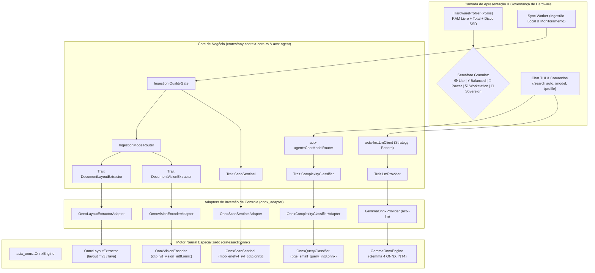

# 📐 Blueprint de Engenharia: AnyContext v0.38.0
## Ativação dos Modelos ONNX nos Fluxos de Produção & Cérebro Local Autônomo com a Família Gemma 4

---

### 📌 Metadados do Plano
- **Projeto**: AnyContext (`actx`)
- **Versão-Alvo**: `v0.38.0` (Sucessora da `v0.37.0`)
- **Autor**: Levi Silveira & Antigravity Assistant
- **Data**: 2026-10-14
- **Fase**: Fase 3 do Master Plan (Kit de Models & Especialistas Locais)
- **Status**: Proposta Técnica para Aprovação (Gate 3 - `dev-cycle-protocol`)
- **Componentes**:
  - `crates/actx-onnx`: Pipeline de execução neural para Document AI e Provedor Generativo Local Gemma 4 via ONNX Runtime.
  - `crates/actx-lm`: Novo provedor nativo `GemmaOnnxProvider` implementando a trait `LmProvider` (streaming zero-copy, tokenização BPE).
  - `crates/any-context-core-rs`: Inversão de dependência via traits (`ComplexityClassifier`, `ScanSentinel`, `DocumentLayoutExtractor`, `DocumentVisionExtractor`).
  - `crates/any-context-core-rs/src/hardware`: Expansão do `HardwareProfiler` para a matriz granular de 5 perfis de hardware.
  - `crates/actx-agent`: Integração nativa do `ChatModelRouter` e injeção do provedor local Gemma 4.
  - `crates/actx-installer`: Semáforo prévio inteligente com suporte a seleção automática e opções avançadas por perfil.
  - `crates/actx-cli`: Comandos `/model`, `/profile`, `/status` e TUI reativa com badges de inferência local.
- **Dual-Doc**: `README.md` (UserDoc), `TECDOC.md` (TecDoc - ADR-123), `tests/MANUAL_TESTS.md` (Cenário 38).

---

## 🏛️ 1. Visão Executiva e Fundamentação Estratégica

Na versão `v0.37.0`, o AnyContext estabeleceu com sucesso os alicerces estruturais da Fase 3:
1. Crate modular desacoplada [`crates/actx-onnx`](file:///C:/Users/guilh/source/repos/any-context/crates/actx-onnx) sob feature flag Cargo condicional (`onnx`).
2. Motor de inspeção de hardware nativo (`HardwareProfiler`) em $< 5\text{ms}$.
3. Estrutura preliminar de perfis semafóricos e comandos multi-superfície.

A versão **v0.38.0** consolida a Fase 3 do Master Plan dividindo o ecossistema de modelos em **duas camadas ortogonais e desacopladas**:

```
┌────────────────────────────────────────────────────────────────────────────────────────┐
│                        ARQUITETURA DUAL DE MODELOS EM PRODUÇÃO                         │
├──────────────────────────────────────────┬─────────────────────────────────────────────┤
│ 👁️ CAMADA 1: Percepção & Document AI    │ 🧠 CAMADA 2: Cérebro Generativo (Gemma 4)   │
├──────────────────────────────────────────┼─────────────────────────────────────────────┤
│ • Modelos: MobileNetV4, BGE-Small,       │ • Modelos: Gemma 4 Compact, Gemma 4 12B,    │
│   LayoutLMv3, Laya mmBERT, CLIP-ViT      │   Gemma 4 27B, Gemma 4 32B                  │
│ • Tamanho total: ~740 MB                 │ • Tamanho: 1.5 GB a 18.5 GB (quantizados)   │
│ • Papel: Sentinela de scans, extração    │ • Papel: Raciocínio conversacional, loop de │
│   geométrica de faturas, tabelas e       │   ferramentas ReAct e geração de respostas  │
│   roteamento semântico de queries.       │   em linguagem natural.                     │
│ • Latência: Sub-15ms em CPU.             │ • Latência: Streaming autoregressivo de tks │
└──────────────────────────────────────────┴─────────────────────────────────────────────┘
```

Essa separação garante que:
- O usuário possa utilizar **Document AI local** (privacidade absoluta para indexar faturas e contratos confidenciais no disco sem enviar imagens para terceiros) enquanto usa **APIs de fronteira na nuvem** (Claude 3.5 Sonnet, GPT-4o, Gemini 1.5 Pro).
- Ou possa operar em **Soberania Air-Gapped Total** (sem internet, sem chaves de API, sem Ollama ou Docker externos), rodando tanto o Document AI quanto o **Gemma 4 nativamente em ONNX**.

---

## 🏗️ 2. Topologia Arquitetural e Fluxos de Dados



---

## 📊 3. Matriz Granular de 5 Perfis de Hardware

Para acomodar com precisão cirúrgica desde laptops ultrafinos até estações de trabalho de 64GB+, a governança semafórica adota 5 perfis estritamente delimitados por limites de memória física:

| Perfil | Requisitos Mínimos (Semáforo 🟢) | Camada 1: Document AI (Percepção) | Camada 2: Cérebro Local (Gemma 4) | Download Total | Consumo Real de RAM (Pico) | Margem para SO / Apps |
| :--- | :--- | :--- | :--- | :--- | :--- | :--- |
| **🟢 Lite / Cloud** | Qualquer hardware ($< 8\text{ GB}$) | Heurísticas Rust puras (<1µs) | Provedor Cloud (Gemini / Claude / OpenAI) | **0 MB** | $< 35\text{ MB}$ | 100% da máquina livre |
| **⚡ Smart Balanced** | RAM $\ge 8\text{ GB}$ (Livre $\ge 3.5\text{ GB}$)<br>SSD $\ge 5\text{ GB}$ | Smart Balanced (~252 MB):<br>`mobilenetv4`, `bge-small`, `layoutlmv3` | **Gemma 4 Compact (INT4)** (~1.5 GB) | **~1.7 GB** | **~2.5 GB** | $\ge 5.5\text{ GB}$ livres (notebooks de 8GB) |
| **🌌 Air-Gapped Power** | RAM $\ge 16\text{ GB}$ (Livre $\ge 7\text{ GB}$)<br>SSD $\ge 15\text{ GB}$ | Full Power (~740 MB):<br>5 modelos de percepção | **Gemma 4 12B (INT4)** (~7.2 GB) | **~7.9 GB** | **~10.0 GB** | $\ge 6.0\text{ GB}$ livres (desenvolvedores em 16GB) |
| **🪐 Workstation Pro** | RAM $\ge 32\text{ GB}$ (Livre $\ge 18\text{ GB}$)<br>SSD $\ge 30\text{ GB}$ | Full Power (~740 MB):<br>5 modelos de percepção | **Gemma 4 27B (INT4)** (~15.0 GB) | **~15.7 GB** | **~18.5 GB** | $\ge 13.5\text{ GB}$ livres (estações de 32GB) |
| **👑 Sovereign Ultra** | RAM $\ge 64\text{ GB}$ (Livre $\ge 32\text{ GB}$)<br>SSD $\ge 50\text{ GB}$ | Full Power (~740 MB):<br>5 modelos de percepção | **Gemma 4 32B (INT4)** (~18.5 GB) | **~19.2 GB** | **~25.5 GB** | $\ge 38.0\text{ GB}$ livres (workstations / servidores 64GB+) |

> [!IMPORTANT]
> **Proteção Contra Colapso de Swap:** O perfil *Sovereign Ultra (Gemma 4 32B)* é **estritamente bloqueado em 🔴 Vermelho para máquinas com 32 GB de RAM**. Executar um modelo 32B (~25.5 GB em RAM) em um computador com 32GB somado ao sistema operacional (~5GB) causaria 100% de esgotamento e swap em disco, reduzindo a taxa de geração para $< 0.2\text{ tps}$. Máquinas de 32GB rodam com estabilidade impecável no perfil *Workstation Pro (Gemma 4 27B)*.

---

## 🛠️ 4. Os 4 Fluxos de Produção Ativados em Tempo Real

### 4.1 Fluxo 1: Chat ModelRouter com BGE-Small
- O `OnnxComplexityClassifierAdapter` tokeniza o prompt e avalia similaridade semântica com centróides treinados.
- Decide entre `Fast RAG` (busca pontual factual) e `Deep Search` (decomposição multi-turnos reflexiva).
- Latência: $< 15\text{ms}$ em CPU.
- Fallback ADR-110: se o modelo não estiver baixado ou se o perfil for `Lite`, despacha para o classificador heurístico determinístico em $< 1\mu\text{s}$.

### 4.2 Fluxo 2: Sentinela de Scans com MobileNetV4
- Nova trait `ScanSentinel: Send + Sync` injetada no `QualityGate`.
- Analisa páginas de PDFs com baixa densidade textual e imagens embutidas.
- Em ~8ms, classifica se a página é um scan autêntico (RVL-CDIP) antes de delegar para OCR, evitando desperdício de processamento em logotipos ou molduras visuais.

### 4.3 Fluxo 3: Layout Multimodal com LayoutLMv3 e Laya mmBERT
- Implementação da trait `DocumentLayoutExtractor` via `OnnxLayoutExtractorAdapter`.
- Ao encontrar `DocumentAiTarget::DenseComplexForm`, o `IngestionModelRouter` reconstrói a matriz espacial de faturas e tabelas, garantindo que relações de chave-valor e colunas permaneçam correlacionadas no BM25 e LanceDB.

### 4.4 Fluxo 4: Codificação de Diagramas com CLIP-ViT
- Implementação da trait `DocumentVisionExtractor` via `OnnxVisionEncoderAdapter`.
- Processa assets visuais (fluxogramas, gráficos, diagramas de rede), gerando descrição contextual estruturada para busca multimodal no LanceDB.

---

## 🧠 5. Provedor Generativo Local Gemma 4 (`GemmaOnnxProvider`)

A integração da família Gemma 4 em `actx-lm` e `actx-onnx` segue o padrão **Strategy**:
1. **Implementação de `LmProvider`**:
   ```rust
   pub struct GemmaOnnxProvider {
       model_path: PathBuf,
       tier: GemmaTier, // Compact, 12B, 27B, 32B
       // Runtime session e tokenizer BPE
   }
   
   #[async_trait]
   impl LmProvider for GemmaOnnxProvider {
       async fn complete(&self, req: ChatRequest) -> Result<ChatResponse, LmError> { ... }
       async fn stream(&self, req: ChatRequest) -> Result<Pin<Box<dyn Stream<Item = Result<StreamChunk, LmError>> + Send>>, LmError> { ... }
   }
   ```
2. **Streaming Zero-Copy**: Tokens emitidos pelo loop autoregressivo do ONNX Runtime fluem diretamente para o canal `mpsc` da TUI com latência perceptual zero.
3. **Respeito aos Atalhos de Modo**:
   - `/model gemma-4-compact`
   - `/model gemma-4-12b`
   - `/model gemma-4-27b`
   - `/model gemma-4-32b`
   - `/model cloud` (retorna para o provedor externo configurado)

---

## 🛠️ 6. Cronograma de Marcos de Implementação

### 🧱 Marco 1: Expansão do HardwareProfiler & Semáforo de 5 Níveis (`any-context-core-rs::hardware`)
- Atualizar `ProfileTier` e `HardwareProfiler`:
  - `Lite`, `SmartBalanced`, `AirGappedPower`, `WorkstationPro`, `SovereignUltra`.
- Atualizar a lógica pura de auto-seleção com os novos tetos de RAM (8GB, 16GB, 32GB, 64GB).

### 👁️ Marco 2: Adapters de Percepção (Document AI) no Core
- Criar traits `ScanSentinel` e `DocumentVisionExtractor`.
- Implementar `OnnxScanSentinelAdapter`, `OnnxLayoutExtractorAdapter` e `OnnxVisionEncoderAdapter` em `ingestion/onnx_adapter.rs`.
- Injetar no `QualityGate` e `IngestionModelRouter`.

### 🧠 Marco 3: Crate `actx-onnx` com Motor Gemma 4 & Tokenizador
- Implementar o runner de inferência generativa em `crates/actx-onnx/src/gemma/`.
- Suporte a tokenização BPE e streaming assíncrono para a TUI.
- Criação de `GemmaOnnxProvider` em `crates/actx-lm`.

### ⚙️ Marco 4: Multi-Surface Parity, Comandos e Menus TUI
- Atualizar `/profile` (alias `/preset`): exibe os 5 perfis semafóricos e permite download sob demanda.
- Atualizar `/model`: lista as variantes locais do Gemma 4 disponíveis ou instaladas ao lado dos provedores cloud.
- Atualizar o instalador `actx-installer` com o pré-flight e opções avançadas.

### 📚 Marco 5: Dual-Doc, Roteiro de Testes e Release v0.38.0
- Registrar o ADR-123 no `TECDOC.md`.
- Atualizar o `README.md` com a matriz completa dos 5 perfis.
- Adicionar o Cenário 38 em `tests/MANUAL_TESTS.md`.
- Suíte 100% verde e bump para `v0.38.0`.

---

## 🧪 7. Roteiro de Testes Manuais (Cenário 38 em `MANUAL_TESTS.md`)

- **Cenário 38.1 (Hardware Pre-Flight dos 5 Perfis)**:
  - Rodar `actx-installer --preflight-only` e conferir a classificação semafórica de cada perfil segundo a RAM da máquina.
- **Cenário 38.2 (Chat ModelRouter Neural com BGE-Small)**:
  - Digitar prompt complexo e verificar a detecção de intenção no accordion ReAct.
- **Cenário 38.3 (Sentinela de Scans na Ingestão)**:
  - Sincronizar pasta com PDF rasterizado e comprovar a classificação pelo MobileNetV4.
- **Cenário 38.4 (Inferência Local do Gemma 4)**:
  - Selecionar `/model gemma-4-12b` (ou compact), desconectar a internet e realizar consulta com streaming de tokens 100% offline.
- **Cenário 38.5 (ADR-110 Zero-Breakage Guarantee)**:
  - Deletar arquivos temporários de pesos e confirmar a transição suave para heurísticas determinísticas sem crash.
