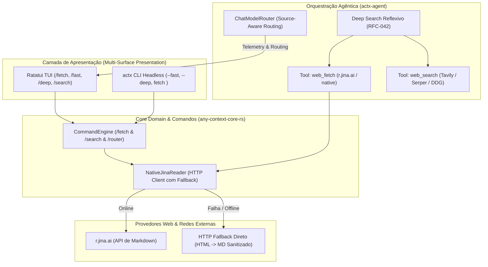

# 📐 Blueprint de Engenharia: Conector Web Jina Reader (r.jina.ai), Roteamento Source-Aware & Atalhos de Chat (/fetch, /fast, /deep) (v0.39.0)

## 📌 Metadados do Plano
- **Projeto**: AnyContext (`actx`)
- **Versão-Alvo**: `v0.39.0` (Sucessora da `v0.38.0`)
- **Componentes**: `crates/any-context-core-rs`, `crates/actx-agent`, `crates/actx-cli`
- **Data de Criação**: 2026-10-14
- **Status**: Proposto (`proposed` / Aguardando Gate 3)
- **Conversation ID**: `01fd77a2-4853-4967-b572-f0ce69495ea0`
- **Especificações de Referência**: Master Roadmap (`anycontext_master_roadmap_v0_30_38_rfc042.md`), RFC-042 (§2.3 & §4.1).

---

## 🏛️ 1. Visão Geral e Motivação Arquitetural

Com a consolidação da infraestrutura local de inteligência na versão `v0.38.0` (matriz de 5 tiers de hardware, modelos ONNX de percepção visual/documental e cérebro generativo local com a família Gemma 4), o AnyContext atinge autonomia de inferência completa.

No entanto, duas capacidades essenciais do **Marco 3 & RFC-042** permanecem pendentes para fechar o ciclo de pesquisa agêntica:
1. **Consumo Direto de Conteúdo Web em Markdown Puro (Jina Reader - `r.jina.ai`)**:
   - Atualmente, a busca na web (`NativeWebSearchEngine`) retorna títulos e snippets curtos de páginas. Quando o agente ReAct ou o Deep Search Reflexivo precisa consultar documentações técnicas completas, RFCs online, manuais de frameworks ou artigos longos, snippets de 200 caracteres são insuficientes.
   - Navegadores headless locais (ex: Chromium / Puppeteer) demandam entre 300MB e 1GB de RAM, violando o princípio de leveza e inicialização instantânea do AnyContext.
   - O conector **Jina Reader (`https://r.jina.ai/{url}`)** resolve esse gargalo ao atuar como um proxy que converte páginas web dinâmicas e SPAs em Markdown limpo, sem anúncios, menus ou scripts, com zero consumo de RAM local.
   - Para ambientes restritos, desconectados ou offline (ADR-110), deve existir um fallback nativo em Rust que realiza parsing direto sem panics.

2. **Roteamento Source-Aware & Ativação de Atalhos de Chat**:
   - O `ChatModelRouter` em `actx-agent` classifica a intenção em 4 domínios (`Code`, `Architecture`, `Document`, `General`), mas o fluxo de resposta ainda não recomenda ou seleciona o perfil ótimo de contexto com base nessa tipologia.
   - Os comandos `/fast`, `/deep`, `/search` e o novo `/fetch <url>` devem fornecer controle manual imediato para o usuário no terminal e na TUI.



---

## 🔒 2. Princípios Invioláveis de Engenharia (Dev-Cycle Compliance)

1. **Inviolabilidade da Garantia ADR-110**:
   - Falhas de rede, indisponibilidade de `r.jina.ai`, timeouts ou bloqueios de CORS/WAF nunca provocam panics ou quebram o loop do agente.
   - Em caso de erro HTTP (ex: 403, 429, 502) ou ausência de conexão, o leitor aciona imediatamente o fallback nativo com mensagem clara no canal de eventos.
2. **Paridade Multi-Superfície Absoluta**:
   - A capacidade de buscar páginas via Jina Reader e configurar profundidade de busca deve estar disponível no CLI headless (`actx fetch <url>`, `actx --fast "..."`, `actx --deep "..."`), nos comandos slash do chat (`/fetch`, `/fast`, `/deep`, `/search`) e no menu TUI.
3. **Controle Estrito de Budget de Tokens & Caracteres**:
   - O conteúdo retornado pelo Jina Reader é truncado de forma determinística pelo teto configurado (`max_chars`, padrão: 30.000 caracteres, ~7.500 tokens), evitando estouro da janela de contexto de SLMs compactos locais (ex: Gemma 4 Compact).
4. **Padrão Dual-Doc & Roteiro de Testes Sem Truncamento**:
   - Documentação síncrona no `README.md` (UserDoc) e `TECDOC.md` (TecDoc).
   - Inclusão do Cenário 39 em `tests/MANUAL_TESTS.md` com testes passo a passo.

---

## 🛠️ 3. Especificação Técnica Detalhada dos Componentes

### 3.1 Módulo `NativeJinaReader` (`crates/any-context-core-rs/src/retrieval/jina_reader.rs`)
- **Estruturas de Dados**:
  ```rust
  #[derive(Debug, Clone, Serialize, Deserialize)]
  pub struct JinaFetchResult {
      pub url: String,
      pub title: String,
      pub content: String,
      pub provider: String, // "jina" ou "native_fallback"
      pub char_count: usize,
      pub is_truncated: bool,
  }

  #[derive(Debug, Clone)]
  pub struct JinaReaderConfig {
      pub timeout_secs: u64,
      pub max_chars: usize,
      pub api_key: Option<String>,
      pub with_generated_alt: bool,
  }
  ```
- **Lógica de Execução**:
  1. Sanitiza a URL alvo (assegura schema `http://` ou `https://`).
  2. Monta a URL de destino: `https://r.jina.ai/{sanitized_url}`.
  3. Injeta headers:
     - `Accept: text/markdown`
     - `X-With-Generated-Alt: true` (se configurado)
     - `Authorization: Bearer <token>` (se `JINA_API_KEY` estiver presente na env ou no banco SQLite `NativeConfigDb`).
  4. Se a resposta HTTP for 200 OK, sanitiza o Markdown retornado, extrai o título e aplica o truncamento seguro por limite de caracteres (`max_chars`).
  5. Se houver falha de rede ou status de erro, aciona o método `fetch_direct_fallback`:
     - Realiza requisição direta via `reqwest::Client`.
     - Executa sanitização rápida de HTML (remoção de `<script>`, `<style>`, tags de navegação e extração do texto legível com formatação básica).

### 3.2 Ferramenta Nativa `web_fetch` no Agente ReAct & Deep Search (`crates/actx-cli/src/engine.rs`)
- Injetada no `Agent::builder()`:
  - **Tool Name**: `web_fetch`
  - **Description**: `"Fetches the full text of any public web page, technical documentation, or online article as clean structured Markdown using Jina Reader (r.jina.ai) with native fallback."`
  - **Schema**:
    ```json
    {
      "type": "object",
      "properties": {
        "url": {
          "type": "string",
          "description": "The target public web URL to fetch and read"
        },
        "max_chars": {
          "type": "integer",
          "description": "Optional maximum character limit to retrieve (default: 30000)"
        }
      },
      "required": ["url"]
    }
    ```
- O agente ReAct e o motor Deep Search agora podem automaticamente seguir links relevantes descobertos pelo `web_search` para extrair detalhes aprofundados.

### 3.3 Extensão do `CommandEngine` com `/fetch` (`crates/any-context-core-rs/src/commands/engine.rs`)
- Novo comando `/fetch <url>`:
  - Valida os argumentos.
  - Instancia o `NativeJinaReader`.
  - Executa a busca da página de forma assíncrona.
  - Emite o resultado com metadados: título, contagem de caracteres, status do provedor e prévia do conteúdo em Markdown formatado.

### 3.4 Enriquecimento do Roteamento Source-Aware (`crates/actx-agent/src/router.rs`)
- O `RoutingDecision` agora transporta metadados contextuais:
  - `suggested_profile`: Indica se a tipologia (`Code` vs `Architecture` vs `Document`) se beneficia de modelos com alta especialização matemática/sintática ou de janela ampla de raciocínio.
  - Telemetria de fácil leitura exibida no accordion de raciocínio da TUI.

---

## 📅 4. Cronograma de Marcos de Implementação

| Marco | Componente | Responsabilidade |
|---|---|---|
| **Marco 1** | `crates/any-context-core-rs/src/retrieval/jina_reader.rs` | Implementação do `NativeJinaReader` com suporte a `r.jina.ai`, autenticação opcional, headers e fallback HTML->Markdown nativo |
| **Marco 2** | `crates/actx-cli/src/engine.rs` | Registro da ferramenta nativa `web_fetch` no `Agent::builder()` do orquestrador ReAct e Deep Search |
| **Marco 3** | `crates/any-context-core-rs/src/commands/engine.rs` | Implementação do comando slash `/fetch <url>` e integração com `/web` e `/search` |
| **Marco 4** | `crates/actx-agent/src/router.rs` & `tui/app.rs` | Roteamento Source-Aware com telemetria enriquecida no accordion |
| **Marco 5** | Testes, Dual-Doc & Release v0.39.0 | ADR-124 no `TECDOC.md`, `README.md`, Cenário 39 em `MANUAL_TESTS.md`, 100% testes verdes e bump para `v0.39.0` |

---

## 🧪 5. Roteiro de Testes Manuais (Cenário 39)

- **Cenário 39.1 (Fetch Web com Jina Reader)**:
  - Executar `/fetch https://docs.rs/tokio/latest/tokio/` e validar o retorno de Markdown estruturado com título e contagem de caracteres.
- **Cenário 39.2 (Tool de Fetch no Loop ReAct)**:
  - Perguntar ao agente: `"Leia a página https://example.com e me diga o cabeçalho principal"` com busca web ativa. Confirmar nos logs o disparo da tool `web_fetch`.
- **Cenário 39.3 (Resiliência e Fallback ADR-110)**:
  - Executar `/fetch http://127.0.0.1:9999/invalido` ou desconectar a internet. Validar que o erro é tratado suavemente sem panics.
- **Cenário 39.4 (Atalhos /fast e /deep)**:
  - Testar `/fast Qual a função de inicialização?` e comprovar o roteamento forçado para turno único.
  - Testar `/deep Faça uma auditoria arquitetural completa` e comprovar o disparo do Deep Search com reflexão.
