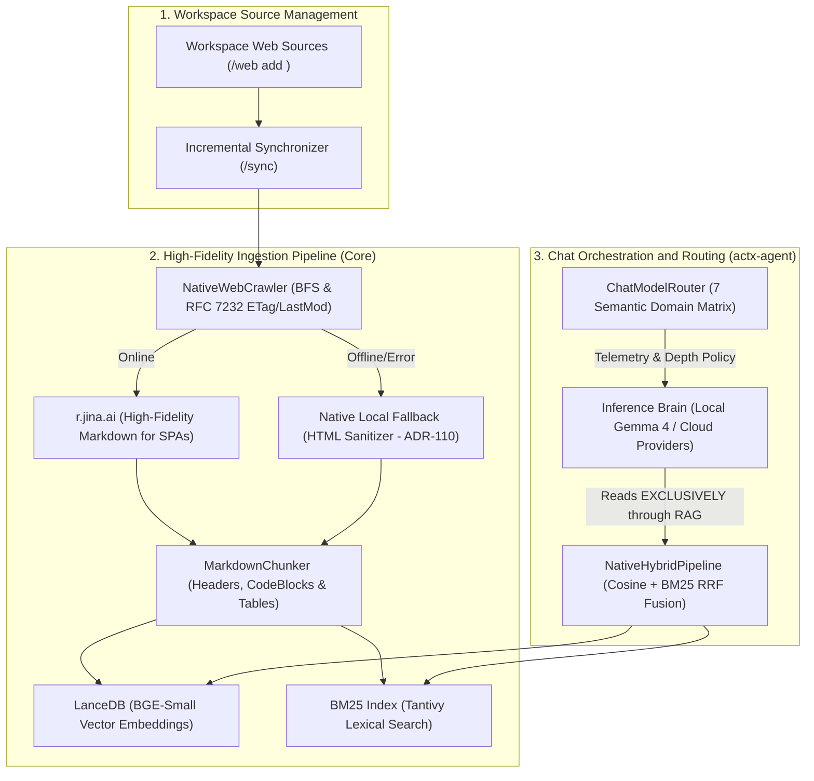

# 📐 Engineering Blueprint: Web Ingestion with Jina Reader (r.jina.ai), Pure Grounded RAG & a 7 Semantic Domain Matrix in the Chat (v0.39.0)

## 📌 Plan Metadata
- **Project**: AnyContext (`actx`)
- **Target Version**: `v0.39.0` (successor of `v0.38.0`)
- **Components**: `crates/any-context-core-rs`, `crates/actx-agent`, `crates/actx-cli`
- **Creation Date**: 2026-10-14
- **Status**: Proposed (`proposed` / awaiting Gate 3)
- **Conversation ID**: `01fd77a2-4853-4967-b572-f0ce69495ea0`
- **Reference Specifications**: Master Roadmap RFC-042 (§2.3 & §4.1), the Pure Grounded RAG principle (*Grounded RAG*).

---

## 🏛️ 1. Overview and Inviolable Philosophy: Grounded RAG

AnyContext is, by definition and architectural commitment, a **high-precision grounded RAG system**.
- **The inference model (whether the local Gemma 4 family or cloud providers) NEVER reads loose web content in real time directly in the context window**. Injecting raw web pages at inference time would violate traceability, cause hallucinations and token pollution, and remove the provenance of answers.
- **All web information AnyContext consults must go through the ingestion pipeline**:
  1. The operator registers the website or documentation as a workspace source (`/web add <url>`).
  2. The workspace's incremental `/sync` command triggers the crawler in the background.
  3. The crawler downloads and extracts **high-fidelity pure Markdown**.
  4. The content goes to the `MarkdownChunker`, is vectorized in LanceDB and indexed lexically in BM25 with SHA-256 hashing and incremental detection through HTTP headers (`ETag`, `Last-Modified`).
  5. During the chat (whether in `/fast` or `/deep` mode), the inference model searches **only and exclusively in the native RAG index** (`NativeHybridPipeline`), citing files, sections and lines with factual precision.

### The Exact Role of Jina Reader (`r.jina.ai`)
Today the crawler (`crawler.rs`) parses downloaded pages using `strip_html_tags(&html)`:
- On **modern SPAs** (React, Docusaurus, Next.js, Vue, GitBook), the initial static HTML is practically empty (`<div id="root"></div>`), failing to index the real documentation content.
- On rich documentation, naive tag removal destroys code blocks (````rust ... ````), headings (`#`, `##`) and comparison tables.

The **Jina Reader (`https://r.jina.ai/{url}`)** integration happens **exclusively in Ingestion (the Crawler)**:
- When crawling web pages registered in the workspace, the crawler queries Jina Reader, receiving the page already rendered and converted into **very high-fidelity structured Markdown with zero RAM consumption on the user's machine** (no local headless browsers such as Chromium/Puppeteer).
- For restricted environments, without an external connection or rate-limited (ADR-110), the crawler keeps a transparent fallback to native direct HTML extraction.



---

## 🧠 2. 7 Semantic Domain Matrix in the `ChatModelRouter`

The semantic classifier of `actx-agent::router` is extended from 4 to **7 semantic domains**:

| Semantic Domain (`QueryIntent`) | Focus & Lexical/Semantic Triggers | Behavior in RAG & Telemetry |
|---|---|---|
| **1. `Code`** | Algorithms, functions, structs, syntax, unit tests, panics, compiler errors (`fn `, `struct`, `impl`, `cargo`) | Focus on code blocks and signatures; recommends code-specialist models |
| **2. `Architecture`** | Life cycle, diagrams, topology, microservices, FSM, data flow, ADRs | Triggers the sub-task decomposition of the **Reflective Deep Search** (RFC-042) |
| **3. `DevOps & Infra`** | CI/CD, GitHub Actions, Docker, Shell/PowerShell, ports, envs, deploy, sccache | Focus on executable commands, terminal flags and environment validation |
| **4. `Data & Schema`** | SQL, SQLite, LanceDB, migrations, columns, tables, tabular data | Strict preservation of schema and key-value relations |
| **5. `Security & Audit`** | Vulnerabilities, credentials, secrets, authentication, JWT, sanitization, LGPD | Conservative posture, rigorous audit and compliance warnings |
| **6. `Document & Business`** | Invoices, contracts, PDFs, reports, tax terms, legal compliance | Models with an extended context window and factual rigor |
| **7. `General`** | Greetings, open conceptual questions, translations, simple syntheses | Ultra-fast execution through single-turn **Fast RAG** |

---

## 🔒 3. Inviolable Engineering Principles (Dev-Cycle Compliance)

1. **Inviolability of Pure RAG**:
   - The inference model is strictly forbidden from consuming web pages without prior indexing. Every query to web knowledge must be resolved by the `NativeHybridPipeline` over the active workspace's LanceDB and BM25.
2. **ADR-110 Guarantee (Zero-Breakage & Ingestion Resilience)**:
   - Network errors, timeouts or rate limits (HTTP 429) from `r.jina.ai` during the crawl never interrupt the sync process (`/sync`).
   - The crawler falls back gracefully to direct text extraction with local sanitization, logging the warning in the sync log.
3. **Strict Incremental Budget Control (RFC 7232)**:
   - The crawler strictly honors the `ETag` and `If-Modified-Since` headers. If a page did not change on the remote server, it is neither downloaded again nor reindexed, saving bandwidth and processing time.
4. **Absolute Multi-Surface Parity**:
   - Web ingestion and shortcuts available in the CLI terminal (`actx sync`, `actx --fast "..."`, `actx --deep "..."`), in the TUI commands (`/web add <url>`, `/sync`, `/fast`, `/deep`, `/search`) and in batch routines.
5. **Dual-Doc Pattern & Cumulative Manual Tests**:
   - ADR-124 recorded in `TECDOC.md`.
   - `README.md` updated.
   - Scenario 39 added to `tests/MANUAL_TESTS.md` without truncating the 38 previous scenarios.

---

## 🛠️ 4. Detailed Technical Specification of the Components

### 4.1 `NativeJinaExtractor` Module in the Crawler (`crates/any-context-core-rs/src/ingestion/`)
- **Location**: `crates/any-context-core-rs/src/ingestion/jina.rs` (integrated into `crawler.rs`).
- **Data Structures**:
  ```rust
  #[derive(Debug, Clone)]
  pub struct JinaExtractorConfig {
      pub timeout_secs: u64,
      pub api_key: Option<String>,
      pub with_generated_alt: bool,
  }

  pub struct NativeJinaExtractor {
      client: reqwest::Client,
      config: JinaExtractorConfig,
  }

  impl NativeJinaExtractor {
      pub fn new(config: JinaExtractorConfig) -> Self;
      
      /// Extracts the content as structured Markdown through r.jina.ai
      pub async fn extract_markdown(&self, target_url: &str) -> Result<String, String>;
  }
  ```
- **Integration into `NativeWebCrawler::crawl`**:
  - When the crawler visits a `target_url`, it first tries to extract the Markdown through `NativeJinaExtractor::extract_markdown`.
  - On success (200 OK with Markdown), it stores the page as clean Markdown with temporal metadata.
  - If `r.jina.ai` fails (offline, a 429 error or a timeout), the crawler triggers the existing direct fallback (`reqwest::get` + `strip_html_tags`), guaranteeing continuity with zero panics.

### 4.2 Evolution of `QueryIntent` in `crates/actx-agent/src/router.rs`
- Update of the intent enum:
  ```rust
  #[derive(Debug, Clone, Copy, PartialEq, Eq, Serialize, Deserialize)]
  #[serde(rename_all = "snake_case")]
  pub enum QueryIntent {
      Code,
      Architecture,
      DevOpsInfra,
      DataSchema,
      SecurityAudit,
      Document,
      General,
  }
  ```
- Extension of the multilingual lexical dictionaries (Portuguese & English) in `evaluate_lexical_score` (the literal keyword values below are quoted as they appear in the code):
  - `DevOpsInfra`: "docker", "dockerfile", "github actions", "ci/cd", "workflow", "deploy", "pipeline de release", "sccache", "variável de ambiente", "porta", "bash", "powershell".
  - `DataSchema`: "sql", "sqlite", "lancedb", "tabela", "coluna", "schema", "migração", "primary key", "foreign key", "índice vetorial", "relacional".
  - `SecurityAudit`: "vulnerabilidade", "segurança", "cve", "segredo", "api_key", "autenticação", "jwt", "sanitização", "injeção", "lgpd", "gdpr", "permissões".

### 4.3 Chat Slash Commands in the `CommandEngine` (`crates/any-context-core-rs/src/commands/engine.rs`)
- Polish of the `/fast <query>` and `/deep <query>` shortcuts:
  - They dispatch immediate queries forcing the RAG depth (single turn vs multi-turn reflection).
- The `/search [auto|fast|deep]` command:
  - Shows or persists the search depth policy in the workspace's SQLite database.

---

## 📅 5. Implementation Milestone Schedule

| Milestone | Component | Responsibility |
|---|---|---|
| **Milestone 1** | `crates/any-context-core-rs/src/ingestion/jina.rs` | `NativeJinaExtractor` for rendering and extracting Markdown from SPAs with a native local fallback |
| **Milestone 2** | `crates/any-context-core-rs/src/ingestion/crawler.rs` | Integration of the Jina extractor into the `/sync` crawl loop, keeping ETag/Last-Modified and enriched Markdown |
| **Milestone 3** | `crates/actx-agent/src/router.rs` | Extension of the matrix to the 7 semantic domains and telemetry enrichment |
| **Milestone 4** | `crates/actx-cli/src/tui/app.rs` | Display of the new semantic badges in the TUI reasoning accordion |
| **Milestone 5** | Tests, Dual-Doc & Release v0.39.0 | ADR-124 in `TECDOC.md`, `README.md`, Scenario 39 in `MANUAL_TESTS.md`, 100% green tests and bump to `v0.39.0` |

---

## 🧪 6. Cumulative Manual Test Script (Scenario 39)

### 📋 Scenario 39.1: Ingesting an SPA Website through `/sync` with Jina Reader
- **Prerequisite**: an active workspace.
- **Steps**:
  1. Register SPA documentation in the workspace:
     ```bash
     /web add https://tokio.rs
     ```
  2. Run the sync:
     ```bash
     /sync
     ```
- **Acceptance Criteria**:
  - The crawler logs the documentation extraction.
  - The pages are converted into Markdown chunks with intact headers and indexed in LanceDB and BM25.
  - Questions about the documentation (e.g. "What does tokio::select do?") return grounded answers with provenance (`[https://tokio.rs/...]`).

### 📋 Scenario 39.2: Validating the 7 Semantic Domain Matrix
- **Steps**:
  - Test prompts of each category and check the badge in the reasoning accordion:
    1. *"How do I refactor this struct in Rust?"* $\rightarrow$ `[Intent: Code]`
    2. *"What is the core's hexagonal topology?"* $\rightarrow$ `[Intent: Architecture]`
    3. *"How do I configure sccache in GitHub Actions?"* $\rightarrow$ `[Intent: DevOps & Infra]`
    4. *"What are the columns of the workspace_chunks table in SQLite?"* $\rightarrow$ `[Intent: Data & Schema]`
    5. *"Audit this code for token leaks and injection"* $\rightarrow$ `[Intent: Security & Audit]`
    6. *"What is the termination clause in the contract?"* $\rightarrow$ `[Intent: Document & Business]`
    7. *"Good morning, how can you help me today?"* $\rightarrow$ `[Intent: General]`
- **Acceptance Criteria**:
  - The telemetry precisely reflects the new 7 domains.

### 📋 Scenario 39.3: Resilience and ADR-110 Fallback in the Crawler
- **Prerequisite**: temporarily disconnect the internet or point to an offline local URL.
- **Steps**:
  ```bash
  /web add http://127.0.0.1:59999/offline
  /sync
  ```
- **Acceptance Criteria**:
  - The crawler logs a warning about the URL failure, but **does not panic nor interrupt the sync of the other local files**.

### 📋 Scenario 39.4: Search Mode Shortcuts (`/fast` and `/deep`)
- **Steps**:
  ```bash
  /fast What is the AnyContext version?
  /deep Do a complete concurrency audit of the RAG pipeline
  ```
- **Acceptance Criteria**:
  - The first query runs in a single immediate turn with the `⚡ [ModelRouter: Fast RAG]` badge.
  - The second query starts the reflective tree with sub-task decomposition and the `🧠 [ModelRouter: Deep Search]` badge.
