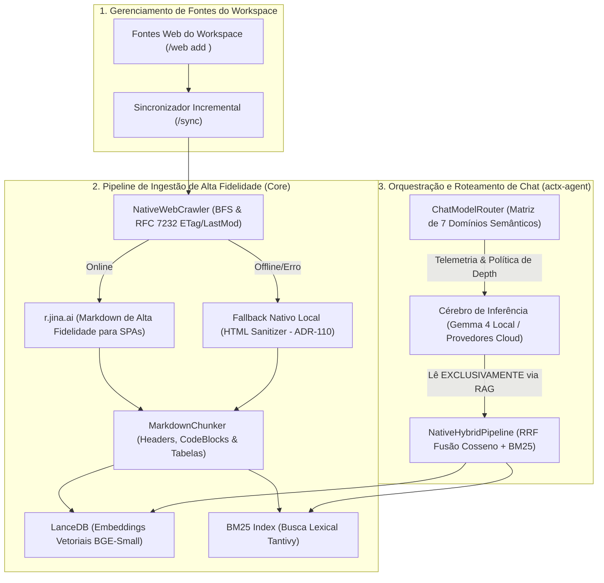

# 📐 Blueprint de Engenharia: Ingestão Web com Jina Reader (r.jina.ai), RAG Fundamentado Puro & Matriz de 7 Domínios Semânticos no Chat (v0.39.0)

## 📌 Metadados do Plano
- **Projeto**: AnyContext (`actx`)
- **Versão-Alvo**: `v0.39.0` (Sucessora da `v0.38.0`)
- **Componentes**: `crates/any-context-core-rs`, `crates/actx-agent`, `crates/actx-cli`
- **Data de Criação**: 2026-10-14
- **Status**: Proposto (`proposed` / Aguardando Gate 3)
- **Conversation ID**: `01fd77a2-4853-4967-b572-f0ce69495ea0`
- **Especificações de Referência**: Master Roadmap RFC-042 (§2.3 & §4.1), Princípio de RAG Puro Fundamentado (*Grounded RAG*).

---

## 🏛️ 1. Visão Geral e Filosofia Inviolável: RAG Fundamentado (*Grounded RAG*)

O AnyContext é, por definição e compromisso arquitetural, um **sistema de RAG fundamentado de alta precisão**.
- **O modelo de inferência (seja a família local Gemma 4 ou provedores em nuvem) NUNCA lê conteúdo web avulso em tempo real diretamente na janela de contexto**. Injetar páginas web cruas em tempo de inferência violaria a rastreabilidade, causaria alucinações, poluição de tokens e eliminaria a proveniência das respostas.
- **Toda informação web consultada pelo AnyContext passa obrigatoriamente pelo pipeline de ingestão**:
  1. O operador cadastra o website ou documentação como fonte do workspace (`/web add <url>`).
  2. O comando `/sync` incremental do workspace dispara o crawler em segundo plano.
  3. O crawler faz o download e extração em **Markdown puro de alta fidelidade**.
  4. O conteúdo é submetido ao `MarkdownChunker`, vetorizado no LanceDB e indexado lexicalmente no BM25 com hashing SHA-256 e detecção incremental via cabeçalhos HTTP (`ETag`, `Last-Modified`).
  5. Durante o chat (seja no modo `/fast` ou no `/deep`), o modelo de inferência busca **única e exclusivamente no índice RAG nativo** (`NativeHybridPipeline`), citando arquivos, seções e linhas com precisão factual.

### O Papel Exato do Jina Reader (`r.jina.ai`)
Atualmente, o crawler (`crawler.rs`) realiza o parsing de páginas baixadas utilizando `strip_html_tags(&html)`:
- Em **SPAs modernas** (React, Docusaurus, Next.js, Vue, GitBook), o HTML estático inicial é praticamente vazio (`<div id="root"></div>`), falhando em indexar o conteúdo real da documentação.
- Em documentações ricas, a remoção ingênua de tags destrói blocos de código (````rust ... ````), títulos (`#`, `##`) e tabelas comparativas.

A integração do **Jina Reader (`https://r.jina.ai/{url}`)** ocorre **exclusivamente na Ingestão (Crawler)**:
- Ao fazer o crawl de páginas web cadastradas no workspace, o crawler consulta o Jina Reader, recebendo a página já renderizada e convertida em **Markdown estruturado de altíssima fidelidade com zero consumo de RAM na máquina do usuário** (sem navegadores headless locais como Chromium/Puppeteer).
- Para ambientes restritos, sem conexão externa ou com rate-limit (ADR-110), o crawler mantém fallback transparente para extração HTML direta nativa.



---

## 🧠 2. Matriz de 7 Domínios Semânticos no `ChatModelRouter`

O classificador semântico do `actx-agent::router` é expandido de 4 para **7 domínios semânticos**:

| Domínio Semântico (`QueryIntent`) | Foco & Gatilhos Léxicos/Semânticos | Comportamento no RAG & Telemetria |
|---|---|---|
| **1. `Code`** | Algoritmos, funções, structs, syntax, unit tests, panics, compiler errors (`fn `, `struct`, `impl`, `cargo`) | Foco em blocos de código e assinaturas; recomenda modelos especialistas em código |
| **2. `Architecture`** | Ciclo de vida, diagramas, topologia, microsserviços, FSM, fluxo de dados, ADRs | Aciona a decomposição em sub-tarefas do **Deep Search Reflexivo** (RFC-042) |
| **3. `DevOps & Infra`** | CI/CD, GitHub Actions, Docker, Shell/PowerShell, portas, envs, deploy, sccache | Foco em comandos executáveis, flags de terminal e validação de ambiente |
| **4. `Data & Schema`** | SQL, SQLite, LanceDB, migrações, colunas, tabelas, dados tabulares | Preservação estrita de esquema e relacionamentos de chave-valor |
| **5. `Security & Audit`** | Vulnerabilidades, credenciais, segredos, autenticação, JWT, sanitização, LGPD | Postura conservadora, auditoria rigorosa e alertas de conformidade |
| **6. `Document & Business`** | Faturas, contratos, PDFs, relatórios, termos fiscais, conformidade jurídica | Modelos com janela de contexto estendida e rigor factual |
| **7. `General`** | Saudações, perguntas conceituais abertas, traduções, sínteses simples | Execução ultrarrápida via **Fast RAG** de turno único |

---

## 🔒 3. Princípios Invioláveis de Engenharia (Dev-Cycle Compliance)

1. **Inviolabilidade do RAG Puro**:
   - É terminantemente proibido o modelo de inferência consumir páginas web sem indexação prévia. Todas as consultas ao conhecimento web devem ser resolvidas pelo `NativeHybridPipeline` sobre o LanceDB e BM25 do workspace ativo.
2. **Garantia ADR-110 (Zero-Breakage & Resiliência de Ingestão)**:
   - Erros de rede, timeouts ou limites de taxa (HTTP 429) do `r.jina.ai` durante o crawler nunca interrompem o processo de sincronização (`/sync`).
   - O crawler faz fallback gracioso para extração direta de texto com sanitização local, registrando o aviso no log de sincronização.
3. **Controle Estrito de Budget Incremental (RFC 7232)**:
   - O crawler respeita rigorosamente cabeçalhos `ETag` e `If-Modified-Since`. Se uma página não foi alterada no servidor remoto, ela não é rebaixada nem reindexada, preservando banda e tempo de processamento.
4. **Paridade Multi-Superfície Absoluta**:
   - Ingestão web e atalhos disponíveis no terminal CLI (`actx sync`, `actx --fast "..."`, `actx --deep "..."`), nos comandos da TUI (`/web add <url>`, `/sync`, `/fast`, `/deep`, `/search`) e nas rotinas em lote.
5. **Padrão Dual-Doc & Testes Manuais Acumulativos**:
   - Registro do ADR-124 no `TECDOC.md`.
   - Atualização do `README.md`.
   - Inclusão do Cenário 39 em `tests/MANUAL_TESTS.md` sem truncamento dos 38 cenários anteriores.

---

## 🛠️ 4. Especificação Técnica Detalhada dos Componentes

### 4.1 Módulo `NativeJinaExtractor` no Crawler (`crates/any-context-core-rs/src/ingestion/`)
- **Localização**: `crates/any-context-core-rs/src/ingestion/jina.rs` (integrado ao `crawler.rs`).
- **Estruturas de Dados**:
  ```rust
  #[derive(Debug, Clone)]
  pub struct JinaExtractorConfig {
      pub timeout_secs: u64,
      pub api_key: Option<String>,
      pub with_generated_alt: bool,
  }

  pub struct NativeJinaExtractor {
      client: reqwest::Client,
      config: JinaExtractorConfig,
  }

  impl NativeJinaExtractor {
      pub fn new(config: JinaExtractorConfig) -> Self;
      
      /// Extrai o conteúdo em Markdown estruturado via r.jina.ai
      pub async fn extract_markdown(&self, target_url: &str) -> Result<String, String>;
  }
  ```
- **Integração no `NativeWebCrawler::crawl`**:
  - Quando o crawler visita uma URL `target_url`, ele primeiramente tenta extrair o Markdown via `NativeJinaExtractor::extract_markdown`.
  - Se obtiver sucesso (200 OK com Markdown), armazena a página como Markdown limpo com metadados temporais.
  - Se `r.jina.ai` falhar (offline, erro 429 ou timeout), o crawler aciona o fallback direto já existente (`reqwest::get` + `strip_html_tags`), assegurando continuidade com zero panics.

### 4.2 Evolução da `QueryIntent` em `crates/actx-agent/src/router.rs`
- Atualização do enum de intenção:
  ```rust
  #[derive(Debug, Clone, Copy, PartialEq, Eq, Serialize, Deserialize)]
  #[serde(rename_all = "snake_case")]
  pub enum QueryIntent {
      Code,
      Architecture,
      DevOpsInfra,
      DataSchema,
      SecurityAudit,
      Document,
      General,
  }
  ```
- Expansão dos dicionários léxicos multilíngues (PT & EN) em `evaluate_lexical_score`:
  - `DevOpsInfra`: "docker", "dockerfile", "github actions", "ci/cd", "workflow", "deploy", "pipeline de release", "sccache", "variável de ambiente", "porta", "bash", "powershell".
  - `DataSchema`: "sql", "sqlite", "lancedb", "tabela", "coluna", "schema", "migração", "primary key", "foreign key", "índice vetorial", "relacional".
  - `SecurityAudit`: "vulnerabilidade", "segurança", "cve", "segredo", "api_key", "autenticação", "jwt", "sanitização", "injeção", "lgpd", "gdpr", "permissões".

### 4.3 Comandos Slash de Chat no `CommandEngine` (`crates/any-context-core-rs/src/commands/engine.rs`)
- Polimento dos atalhos `/fast <query>` e `/deep <query>`:
  - Despacham consultas imediatas forçando a profundidade do RAG (turno único vs reflexão multi-turno).
- Comando `/search [auto|fast|deep]`:
  - Exibe ou persiste a política de profundidade de busca no banco SQLite do workspace.

---

## 📅 5. Cronograma de Marcos de Implementação

| Marco | Componente | Responsabilidade |
|---|---|---|
| **Marco 1** | `crates/any-context-core-rs/src/ingestion/jina.rs` | Implementação do `NativeJinaExtractor` para renderização e extração de Markdown de SPAs com fallback nativo local |
| **Marco 2** | `crates/any-context-core-rs/src/ingestion/crawler.rs` | Integração do extrator Jina no loop de crawl do `/sync`, preservando ETag/Last-Modified e Markdown enriquecido |
| **Marco 3** | `crates/actx-agent/src/router.rs` | Expansão da matriz para os 7 domínios semânticos e enriquecimento de telemetria |
| **Marco 4** | `crates/actx-cli/src/tui/app.rs` | Exibição das novas badges semânticas no accordion de raciocínio da TUI |
| **Marco 5** | Testes, Dual-Doc & Release v0.39.0 | ADR-124 no `TECDOC.md`, `README.md`, Cenário 39 em `MANUAL_TESTS.md`, 100% testes verdes e bump para `v0.39.0` |

---

## 🧪 6. Roteiro de Testes Manuais Acumulativo (Cenário 39)

### 📋 Cenário 39.1: Ingestão de Website SPA via `/sync` com Jina Reader
- **Pré-requisito**: Workspace ativo.
- **Passos**:
  1. Registrar uma documentação SPA no workspace:
     ```bash
     /web add https://tokio.rs
     ```
  2. Executar a sincronização:
     ```bash
     /sync
     ```
- **Critério de Aceitação**:
  - O crawler loga a extração da documentação.
  - As páginas são convertidas em chunks de Markdown com headers intactos e indexadas no LanceDB e BM25.
  - Perguntas sobre a documentação (ex: "Qual a função do tokio::select?") retornam respostas fundamentadas com proveniência (`[https://tokio.rs/...]`).

### 📋 Cenário 39.2: Validação da Matriz de 7 Domínios Semânticos
- **Passos**:
  - Testar prompts de cada categoria e verificar a badge no accordion de raciocínio:
    1. *"Como refatorar este struct em Rust?"* $\rightarrow$ `[Intent: Code]`
    2. *"Qual a topologia hexagonal do core?"* $\rightarrow$ `[Intent: Architecture]`
    3. *"Como configurar o sccache no GitHub Actions?"* $\rightarrow$ `[Intent: DevOps & Infra]`
    4. *"Quais as colunas da tabela workspace_chunks no SQLite?"* $\rightarrow$ `[Intent: Data & Schema]`
    5. *"Audite este código contra vazamento de tokens e injeção"* $\rightarrow$ `[Intent: Security & Audit]`
    6. *"Qual a cláusula de rescisão no contrato?"* $\rightarrow$ `[Intent: Document & Business]`
    7. *"Bom dia, como você pode me ajudar hoje?"* $\rightarrow$ `[Intent: General]`
- **Critério de Aceitação**:
  - A telemetria reflete com precisão os novos 7 domínios.

### 📋 Cenário 39.3: Resiliência e Fallback ADR-110 no Crawler
- **Pré-requisito**: Desconectar temporariamente a internet ou apontar para URL local offline.
- **Passos**:
  ```bash
  /web add http://127.0.0.1:59999/offline
  /sync
  ```
- **Critério de Aceitação**:
  - O crawler emite log de aviso sobre a falha da URL, mas **não sofre panic nem interrompe o sync dos outros arquivos locais**.

### 📋 Cenário 39.4: Atalhos de Modo de Busca (`/fast` e `/deep`)
- **Passos**:
  ```bash
  /fast Qual a versão do AnyContext?
  /deep Faça uma auditoria completa de concorrência no pipeline RAG
  ```
- **Critério de Aceitação**:
  - A primeira consulta executa em turno único imediato com badge `⚡ [ModelRouter: Fast RAG]`.
  - A segunda consulta inicia a árvore reflexiva com decomposição em sub-tarefas e badge `🧠 [ModelRouter: Deep Search]`.
