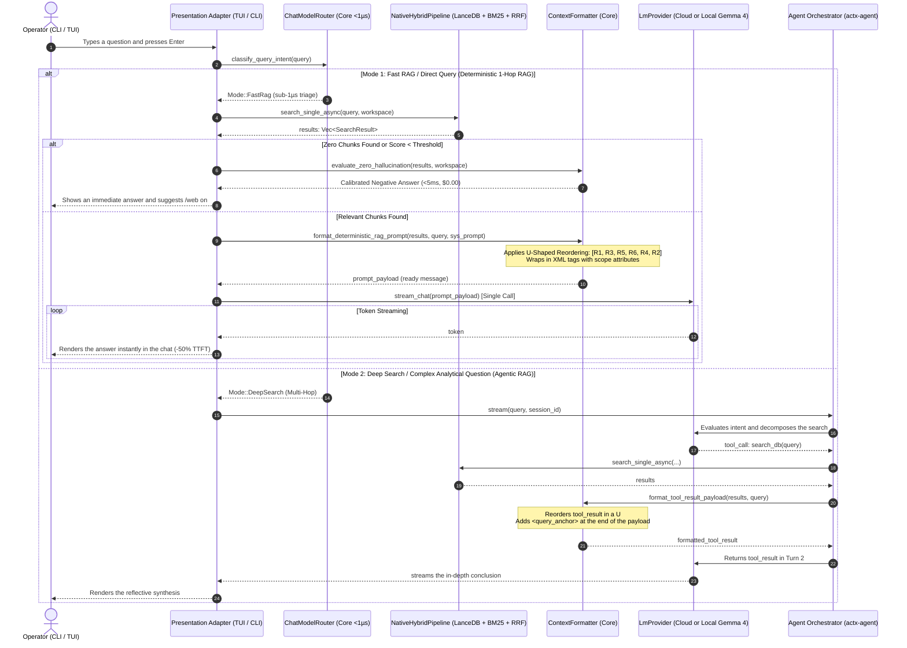

# 📐 Engineering Blueprint: AnyContext v0.43.0
## Backend-First Deterministic RAG, U-Shaped Reordering, Structural XML Isolation and Zero Hallucination Gate (Front A)

---

### 1. Metadata & Architectural Governance
- **Target Version**: `v0.43.0` (successor of `v0.42.0`)
- **Phase**: Front A of the Next-Generation RAG Roadmap
- **Author**: LeviGuilherme / Google DeepMind Pair Programming
- **Date**: 2026-10-15
- **Plan Status**: `active`
- **Superseded Previous Plan**: `anycontext_blueprint_v0420_matriz_tri_cross_platform_de_aceleracao_por_hardware_directml_metalcoreml_cudavulkan_no_actx_onnx`
- **Global Product Policy**: developed in Calgary, Alberta, Canada. 100% global, neutral and decoupled from tax or regional specifics.
- **Architectural Pattern**: strict Hexagonal Architecture (*Ports & Adapters*). Every context assembly rule, mathematical reordering and anti-hallucination gate lives in the Core (`crates/any-context-core-rs`). The surfaces (CLI, TUI, REST) are mere presentation adapters.

---

### 2. Problem Context & Technical Goals

#### 2.1 Problems Identified in the Current RAG:
1. **Double LLM Turn on Direct Questions (TTFT Mismatch)**:
   - On simple queries (*"what is the v2 timeout?"*), AnyContext instantiates the `Agent` and waits for the LLM to emit a `tool_call: search_db(...)`. The backend runs the search and returns the `tool_result`. Then the LLM makes a second turn to generate the answer.
   - This doubles generation latency (*Time-to-First-Token* - TTFT) and duplicates input token consumption in 80-90% of everyday interactions.
2. **The *Lost in the Middle* Effect (Monotonic Linear Order of Chunks)**:
   - Chunks coming from RRF are formatted in decreasing score order (`Rank 1, Rank 2, Rank 3, Rank 4, Rank 5`).
   - Rank 5 (the worst evidence) sits right next to the question (the *Recency Bias* zone), while Rank 2 is stuck in the middle of the context, suffering severe positional decay in Transformer attention.
3. **Cross-Contamination of Parameters and Versions (No Isolation)**:
   - Chunks injected as plain-text bullets have no hard syntactic barriers. When the base contains documents of several versions (e.g. v1 and v2), the model mixes incompatible values, timeouts and rules (*Cross-Attention Fusion*).
4. **Hallucination on Empty Bases or No Match**:
   - If retrieval finds no relevant documents, the LLM gets an empty context and often tries to "guess" or give generic cloud answers, instead of stating the truth precisely.

#### 2.2 Goals of Version v0.43.0:
1. **Backend-First Deterministic RAG (1-hop)**: when `ChatModelRouter` categorizes the question as `Fast RAG` (or when `search_mode` is `Fast` / `grounding_mode` is `Strict`), the Core runs retrieval (LanceDB + BM25 + RRF) **before** calling the LLM and sends the assembled prompt in **a single final call**, cutting latency in half.
2. **U-Shaped Reordering**: a mathematical algorithm in the Core that reorders the chunks (`[R1, R3, R5, ..., R4, R2]`), placing **Rank 1** at the very top (*Primacy Bias*) and **Rank 2** right next to the question (*Recency Bias*), pushing distractors into the central valley.
3. **Structural XML Isolation with Scope Attributes**: each chunk wrapped in the tag `<chunk id="..." rank="..." score="..." source="..." scope="..." version="...">` with an internal contextual header `[Context: ...]`, and anti-fusion system rules.
4. **Zero Hallucination Gate (Negative Answer Fast-Path)**: if the search returns 0 chunks or a score below a safe threshold, the Core returns an honest answer in <5ms at $0.00 in tokens, listing the monitored sources and suggesting alternatives (`/web on`).
5. **Equal Protection in Agentic RAG**: the same U formatting and XML isolation are applied to the return payload of the `search_db` tool in `Deep Search`, with a final `<query_anchor>` against attention dispersion.

---

### 3. Architectural Sequence Diagram (Dual-Mode RAG)

---

### 4. Surface Matrix & Presentation Parity

| Surface | Behavior in Fast RAG (Deterministic) | Behavior in Deep Search (Agentic) | Visual Indicator |
| :--- | :--- | :--- | :--- |
| **Interactive TUI Chat** | Retrieval in the backend first, a single LLM call. The answer appears in half the time. | ReAct loop with an expandable `<think>` accordion and explicit tools. | `⚡ [RAG: Deterministic 1-Hop]` / `🧠 [RAG: Deep Search]` |
| **Headless CLI (`actx "..."`)** | Direct execution without instantiating the agent state machine. Clean, instant stdout output. | Full reflective loop with TrueColor decomposition and tool logs. | TrueColor ANSI badge on the first line of the stream |
| **Zero Hallucination Gate** | An honest structured answer listing the monitored folders and sources without hallucinating. | The agent reports that the tool returned no documents and evaluates web search. | A neutral explanatory notice in the chat or stdout |

---

### 5. Step-by-Step Implementation Milestones (M1 to M5)

#### Milestone 1: Single Canonical Formatter in the Core (`crates/any-context-core-rs/src/retrieval/prompt.rs`)
- Implement a `ContextFormatter` struct in the Core:
  - `pub fn u_shaped_reorder<T: Clone>(items: Vec<T>) -> Vec<T>`:
    - Input ordered by relevance: `[R1, R2, R3, R4, R5, R6]`
    - U output: `[R1, R3, R5, R6, R4, R2]`
    - Supports edge cases: 0 items, 1 item, 2 items, an odd number of items.
  - `pub fn format_xml_chunks(results: &[SearchResult]) -> String`:
    - Wraps each chunk with the attributes `id="chk_{idx}"`, `rank="{idx}"`, `score="{score:.2}"`, `source="{path}"`, `file="{name}"`, `type="{content_type}"`.
    - Injects an internal contextual header `[Context: {file_name} > {header_path}]`.
  - `pub fn format_deterministic_prompt(chunks: &[SearchResult], query: &str, system_prompt: &str, workspace: &str) -> String`:
    - Full structure: `<system_instructions>` with anti-fusion rules $\rightarrow$ `<retrieved_context>` with chunks in a U $\rightarrow$ `<user_query>`.
  - `pub fn format_tool_result(chunks: &[SearchResult], query: &str) -> String`:
    - Formats the payload for `actx-agent` with chunks in a U and a `<query_anchor>` block.
  - `pub fn evaluate_zero_hallucination(chunks: &[SearchResult], workspace: &str, monitored_sources: &[String], query: &str) -> Option<String>`:
    - Returns the immediate honest answer if `chunks.is_empty()` or if the highest score is below `0.005`.

#### Milestone 2: Deterministic Dispatch in the CLI & TUI Engine (`crates/actx-cli/src/engine.rs`)
- Create the function `stream_deterministic_rag(provider, query, workspace, grounding_mode, search_mode)`:
  - Runs retrieval through `NativeHybridPipeline` in `any-context-core-rs`.
  - If `evaluate_zero_hallucination` returns a negative message, emits an immediate completion event without calling the LLM ($0.00 tokens).
  - If there are valid chunks, formats the deterministic prompt in a U and calls `provider.chat_stream(messages)`.
- In the main dispatcher (`crates/actx-cli/src/engine.rs`), check:
  - If `search_mode == SearchMode::Fast` or the `ChatModelRouter` decision is `Fast`: trigger `stream_deterministic_rag`.
  - If `search_mode == SearchMode::Deep`: trigger `build_agent_sync` and the reflective loop.

#### Milestone 3: Equal Hardening of the `search_db` Tool in `actx-agent`
- Update the closure of the `search_db` tool in `crates/actx-cli/src/engine.rs` (lines 180-200) to use `ContextFormatter::format_tool_result`.
- Remove the legacy flat bullet formatting, guaranteeing that even in `Deep Search` mode the multiple chunks returned for the LLM's reflection come in U-Shaped format with hardened XML tags.

#### Milestone 4: Automated Test Suite & NFRs
- Unit tests for `ContextFormatter`:
  - `test_u_shaped_reorder_empty`
  - `test_u_shaped_reorder_single_element`
  - `test_u_shaped_reorder_two_elements`
  - `test_u_shaped_reorder_even_length` (`[R1, R2, R3, R4, R5, R6]` $\rightarrow$ `[R1, R3, R5, R6, R4, R2]`)
  - `test_u_shaped_reorder_odd_length` (`[R1, R2, R3, R4, R5]` $\rightarrow$ `[R1, R3, R5, R4, R2]`)
  - `test_xml_formatting_and_attributes`
  - `test_zero_hallucination_empty_sources`
  - `test_zero_hallucination_monitored_sources_warning`
- Integration tests in `actx-cli`:
  - Parity test of the deterministic 1-hop RAG vs the reflective RAG.

#### Milestone 5: Dual-Doc, MANUAL_TESTS (Scenario 43) & Release v0.43.0
- Update `README.md` (UserDoc) documenting the Dual-Mode RAG architecture, the TTFT cut and the XML anti-fusion rules.
- Update `TECDOC.md` with **ADR-128: Dual RAG Architecture with Backend-First Deterministic Retrieval, U-Shaped Reordering and Structural XML Isolation**.
- Prepend **Scenario 43** to `tests/MANUAL_TESTS.md` without truncating scenarios 1 to 42.
- Version bump to `v0.43.0` in every crate, commit, push, PR/tag and release monitoring.

---

### 6. Non-Regression & Inviolable Principles
1. **Zero Database Breakage**: zero migrations in LanceDB or SQLite in this version (preparing the ground for Fronts B and C).
2. **Zero Injection in the UI**: all XML formatting and U-Shape computation belong strictly to the Core (`any-context-core-rs`).
3. **Calgary Global Policy**: 100% agnostic to the languages or tax rules of any country.
4. **Test Scenario Preservation**: `tests/MANUAL_TESTS.md` keeps all scenarios 1 to 42 intact.
