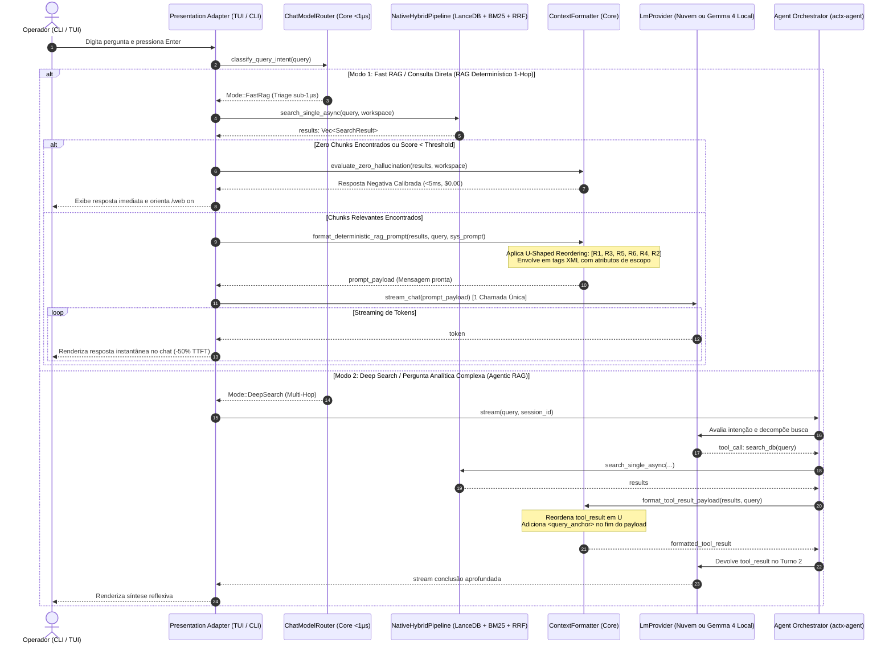

# 📐 Blueprint de Engenharia: AnyContext v0.43.0
## RAG Determinístico Backend-First, U-Shaped Reordering, Isolamento Estrutural em XML e Zero Hallucination Gate (Frente A)

---

### 1. Metadados & Governança Arquitetural
- **Versão-Alvo**: `v0.43.0` (Sucessora da `v0.42.0`)
- **Fase**: Frente A do Roadmap de RAG de Nova Geração
- **Autor**: LeviGuilherme / Google DeepMind Pair Programming
- **Data**: 2026-10-15
- **Status do Plano**: `active`
- **Plano Anterior Superado**: `anycontext_blueprint_v0420_matriz_tri_cross_platform_de_aceleracao_por_hardware_directml_metalcoreml_cudavulkan_no_actx_onnx`
- **Política Global do Produto**: Desenvolvido em Calgary, Alberta, Canadá. 100% global, neutro e desacoplado de especificidades fiscais ou regionais.
- **Padrão Arquitetural**: Arquitetura Hexagonal Estrita (*Ports & Adapters*). Toda regra de montagem de contexto, reordenação matemática e portão anti-alucinação reside no Core (`crates/any-context-core-rs`). As superfícies (CLI, TUI, REST) são meros adaptadores de apresentação.

---

### 2. Contexto do Problema & Objetivos Técnicos

#### 2.1 Problemas Identificados no RAG Atual:
1. **Duplo Turno de LLM em Perguntas Diretas (Incompatibilidade de TTFT)**:
   - Em consultas simples (*"qual é o timeout da v2?"*), o AnyContext instancia o `Agent` e aguarda o LLM emitir um `tool_call: search_db(...)`. O backend executa a busca e devolve o `tool_result`. Em seguida, o LLM faz um segundo turno para gerar a resposta.
   - Isso dobra a latência de geração (*Time-to-First-Token* - TTFT) e duplica o consumo de tokens de entrada em 80-90% das interações do dia a dia.
2. **Efeito *Lost in the Middle* (Ordem Linear Monotônica dos Chunks)**:
   - Os chunks vindos do RRF são formatados em ordem decrescente de pontuação (`Rank 1, Rank 2, Rank 3, Rank 4, Rank 5`).
   - O Rank 5 (pior evidência) fica colado na pergunta (zona de *Recency Bias*), enquanto o Rank 2 fica preso no miolo do contexto, sofrendo decaimento posicional severo na atenção dos Transformers.
3. **Contaminação Cruzada de Parâmetros e Versões (Falta de Isolamento)**:
   - Chunks injetados como bullets de texto puro não possuem barreiras sintáticas rígidas. Quando a base contém documentos de múltiplas versões (ex: v1 e v2), o modelo mistura valores, timeouts e regras incompatíveis (*Cross-Attention Fusion*).
4. **Alucinação em Bases Vazias ou Sem Match**:
   - Se o retrieval não encontra documentos relevantes, o LLM recebe contexto vazio e frequentemente tenta "adivinhar" ou emitir respostas genéricas da nuvem, em vez de declarar a verdade com precisão.

#### 2.2 Objetivos da Versão v0.43.0:
1. **RAG Determinístico Backend-First (1-hop)**: Quando o `ChatModelRouter` categoriza a pergunta como `Fast RAG` (ou quando `search_mode` for `Fast` / `grounding_mode` for `Strict`), o Core executa o retrieval (LanceDB + BM25 + RRF) **antes** de chamar o LLM e envia o prompt montado em **uma única chamada final**, cortando a latência pela metade.
2. **U-Shaped Reordering**: Algoritmo matemático no Core que reordena os chunks (`[R1, R3, R5, ..., R4, R2]`), posicionando o **Rank 1** no topo absoluto (*Primacy Bias*) e o **Rank 2** colado na pergunta (*Recency Bias*), empurrando os distratores para o vale central.
3. **Isolamento Estrutural em XML com Atributos de Escopo**: Envelopamento de cada chunk na tag `<chunk id="..." rank="..." score="..." source="..." scope="..." version="...">` com cabeçalho contextual interno `[Context: ...]`, e regras de sistema anti-fusão.
4. **Zero Hallucination Gate (Fast-Path de Resposta Negativa)**: Se a busca retornar 0 chunks ou score abaixo de limiar seguro, o Core retorna uma resposta honesta em <5ms com $0.00 em tokens, informando as fontes monitoradas e sugerindo alternativas (`/web on`).
5. **Proteção Paritária no Agentic RAG**: A mesma formatação em U e isolamento XML é aplicada no payload de retorno da ferramenta `search_db` no `Deep Search`, com `<query_anchor>` final contra dispersão de atenção.

---

### 3. Diagrama Arquitetural de Sequência (Dual-Mode RAG)

---

### 4. Matriz de Superfícies & Paridade de Apresentação

| Superfície | Comportamento no Fast RAG (Determinístico) | Comportamento no Deep Search (Agentic) | Indicador Visual |
| :--- | :--- | :--- | :--- |
| **TUI Chat Interativo** | Retrieval prévio no backend, 1 chamada única ao LLM. Resposta surge em metade do tempo. | Loop ReAct com accordion `<think>` expansível e ferramentas explícitas. | `⚡ [RAG: Deterministic 1-Hop]` / `🧠 [RAG: Deep Search]` |
| **CLI Headless (`actx "..."`)** | Execução direta sem instanciar state machine de agente. Saída limpa e instantânea no stdout. | Loop reflexivo completo com logs TrueColor de decomposição e ferramentas. | Badge ANSI TrueColor na primeira linha do stream |
| **Zero Hallucination Gate** | Resposta estruturada honesta listando pastas e fontes monitoradas sem alucinar. | Agente reporta que a ferramenta não retornou documentos e avalia web search. | Alerta neutro explicativo no chat ou stdout |

---

### 5. Marcos de Implementação Passo a Passo (M1 a M5)

#### Marco 1: Formatador Canônico Único no Core (`crates/any-context-core-rs/src/retrieval/prompt.rs`)
- Implementar struct `ContextFormatter` no Core:
  - `pub fn u_shaped_reorder<T: Clone>(items: Vec<T>) -> Vec<T>`:
    - Entrada ordenada por relevância: `[R1, R2, R3, R4, R5, R6]`
    - Saída em U: `[R1, R3, R5, R6, R4, R2]`
    - Suporta casos de borda: 0 itens, 1 item, 2 itens, número ímpar de itens.
  - `pub fn format_xml_chunks(results: &[SearchResult]) -> String`:
    - Envelopa cada chunk com atributos `id="chk_{idx}"`, `rank="{idx}"`, `score="{score:.2}"`, `source="{path}"`, `file="{name}"`, `type="{content_type}"`.
    - Injeta cabeçalho contextual interno `[Context: {file_name} > {header_path}]`.
  - `pub fn format_deterministic_prompt(chunks: &[SearchResult], query: &str, system_prompt: &str, workspace: &str) -> String`:
    - Estrutura completa: `<system_instructions>` com regras anti-fusão $\rightarrow$ `<retrieved_context>` com chunks em U $\rightarrow$ `<user_query>`.
  - `pub fn format_tool_result(chunks: &[SearchResult], query: &str) -> String`:
    - Formata o payload para o `actx-agent` com chunks em U e bloco `<query_anchor>`.
  - `pub fn evaluate_zero_hallucination(chunks: &[SearchResult], workspace: &str, monitored_sources: &[String], query: &str) -> Option<String>`:
    - Retorna a resposta honesta imediata se `chunks.is_empty()` ou se o maior score for inferior a `0.005`.

#### Marco 2: Despacho Determinístico no CLI & TUI Engine (`crates/actx-cli/src/engine.rs`)
- Criar a função `stream_deterministic_rag(provider, query, workspace, grounding_mode, search_mode)`:
  - Executa o retrieval via `NativeHybridPipeline` no `any-context-core-rs`.
  - Se `evaluate_zero_hallucination` retornar mensagem negativa, emite evento de conclusão imediata sem chamar o LLM ($0.00 tokens).
  - Se houver chunks válidos, formata o prompt determinístico em U e chama `provider.chat_stream(messages)`.
- No despachante principal (`crates/actx-cli/src/engine.rs`), verificar:
  - Se `search_mode == SearchMode::Fast` ou decisão do `ChatModelRouter == Fast`: aciona `stream_deterministic_rag`.
  - Se `search_mode == SearchMode::Deep`: aciona `build_agent_sync` e o loop reflexivo.

#### Marco 3: Blindagem Paritária da Ferramenta `search_db` no `actx-agent`
- Atualizar a closure da ferramenta `search_db` em `crates/actx-cli/src/engine.rs` (linhas 180-200) para usar `ContextFormatter::format_tool_result`.
- Eliminar a formatação plana em bullets legada, garantindo que mesmo no modo `Deep Search`, os múltiplos chunks devolvidos para a reflexão do LLM venham em formato U-Shaped e com tags XML blindadas.

#### Marco 4: Suíte de Testes Automatizados & NFRs
- Testes unitários para `ContextFormatter`:
  - `test_u_shaped_reorder_empty`
  - `test_u_shaped_reorder_single_element`
  - `test_u_shaped_reorder_two_elements`
  - `test_u_shaped_reorder_even_length` (`[R1, R2, R3, R4, R5, R6]` $\rightarrow$ `[R1, R3, R5, R6, R4, R2]`)
  - `test_u_shaped_reorder_odd_length` (`[R1, R2, R3, R4, R5]` $\rightarrow$ `[R1, R3, R5, R4, R2]`)
  - `test_xml_formatting_and_attributes`
  - `test_zero_hallucination_empty_sources`
  - `test_zero_hallucination_monitored_sources_warning`
- Testes de integração no `actx-cli`:
  - Teste de paridade do RAG determinístico 1-hop vs RAG reflexivo.

#### Marco 5: Dual-Doc, MANUAL_TESTS (Cenário 43) & Release v0.43.0
- Atualizar `README.md` (UserDoc) com a documentação da arquitetura Dual-Mode RAG, corte de TTFT e regras anti-fusão XML.
- Atualizar `TECDOC.md` com o **ADR-128: Arquitetura Dual de RAG com Recuperação Determinística Backend-First, U-Shaped Reordering e Isolamento Estrutural em XML**.
- Prepend do **Cenário 43** em `tests/MANUAL_TESTS.md` sem truncamento dos cenários 1 a 42.
- Bump de versão para `v0.43.0` em todos os crates, commit, push, PR/tag e monitoramento de release.

---

### 6. Não-Regressão & Princípios Invioláveis
1. **Zero Quebra de Bancos**: Zero migrações no LanceDB ou SQLite nesta versão (preparando o terreno para as Frentes B e C).
2. **Zero Injeção em UI**: Toda formatação XML e cálculo de U-Shape pertencem estritamente ao Core (`any-context-core-rs`).
3. **Calgary Global Policy**: 100% agnóstico a línguas ou regras fiscais de qualquer país.
4. **Preservação de Cenários de Teste**: `tests/MANUAL_TESTS.md` mantém todos os cenários de 1 a 42 intactos.
