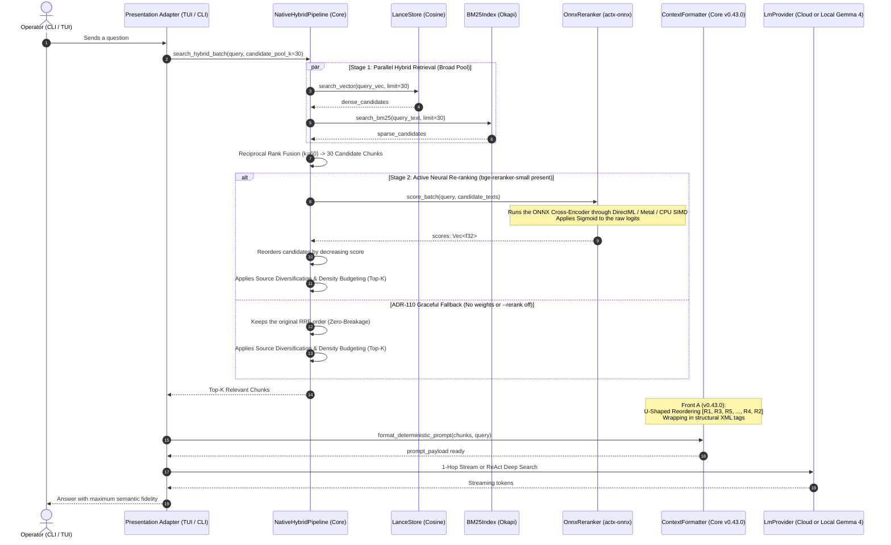

# 📐 Engineering Blueprint: AnyContext v0.44.0
## Two-Stage Neural Retrieval with Local Re-ranking (ONNX Cross-Encoder), Hardware Acceleration and ADR-110 Graceful Fallback (Front B)

---

### 1. Metadata & Architectural Governance
- **Target Version**: `v0.44.0` (successor of `v0.43.0`)
- **Phase**: Front B of the Next-Generation RAG Roadmap
- **Author**: LeviGuilherme / Google DeepMind Pair Programming
- **Date**: 2026-10-15
- **Plan Status**: `active`
- **Superseded Previous Plan**: `anycontext_blueprint_v0430_rag_determinístico_backend_first_u_shaped_reordering_e_isolamento_estrutural_em_xml`
- **Global Product Policy**: developed in Calgary, Alberta, Canada. 100% global, neutral and decoupled from the tax or regional specifics of any country.
- **Architectural Pattern**: strict Hexagonal Architecture (*Ports & Adapters*). Every neural scoring, normalization, candidate reordering and fallback rule lives in the Core (`crates/any-context-core-rs`) and in the neural engine (`crates/actx-onnx`). The surfaces (CLI, TUI, REST) are mere presentation adapters.

---

### 2. Problem Context & Technical Goals

#### 2.1 Problems Identified in the Single-Stage RAG (Bi-Encoder + RRF):
1. **No Cross-Attention in Bi-Encoders**:
   - Dense search (LanceDB Cosine) computes the vector similarity between the isolated embedding of the question and the isolated embedding of the chunk. There is no bidirectional interaction between the question's tokens and the document's tokens at scoring time.
2. **RRF False Positives**:
   - RRF (*Reciprocal Rank Fusion*, $k=60$) combines the ordinal ranks of dense search and lexical BM25. Chunks with accidental term matches get a BM25 boost, while conceptually richer chunks can be pushed beyond the Top 5.
3. **Wasted LLM Context Window**:
   - To make sure the answer is not lost, the system has to increase the number of injected chunks, which dilutes the model's attention and increases latency.

#### 2.2 Goals of Version v0.44.0 (Front B):
1. **Two-Stage Neural Retrieval**:
   - **Stage 1 (High Recall / Low Latency)**: `NativeHybridPipeline` retrieves a broad pool of candidates (e.g. Top 30 chunks) through LanceDB + BM25 + RRF.
   - **Stage 2 (High Semantic Precision / Cross-Attention)**: the `actx-onnx::OnnxReranker` neural engine evaluates the `[CLS] query [SEP] chunk_text [SEP]` pairs simultaneously, producing fine relevance scores through a Cross-Encoder with Sigmoid normalization.
2. **Light, Sovereign Default Model**:
   - `bge-reranker-small` (INT8 quantized, ~45 MB on disk), offering SOTA accuracy with sub-20ms latency.
3. **Native Hardware Acceleration (ADR-127)**:
   - The reranker connects automatically to the `actx-onnx` `ExecutionDevice`: DirectML (Windows), Metal (macOS), CUDA/Vulkan (Linux) or CPU SIMD.
4. **No-Breakage Guarantee with a Transparent Fallback (ADR-110)**:
   - If the reranker weights are not downloaded into `%LOCALAPPDATA%/actx/models/`, the pipeline keeps the original RRF order without errors, without freezing the terminal and at $0.00 cost.
5. **Smooth Integration with Front A (v0.43.0)**:
   - The re-ranked Top-K flows straight into `ContextFormatter`, which applies **U-Shaped Reordering** (`[R1, R3, R5, ..., R4, R2]`), **Structural XML Isolation** and the **Zero Hallucination Gate**.
6. **Multi-Surface Parity & Assisted Downloader**:
   - CLI flag: `actx --rerank <auto|on|off>`
   - TUI slash command: `/rerank <auto|on|off>` with the status and latency of the last scoring.
   - TUI header badge: `[Rerank: ⚡ ONNX: bge-small]` or `[Rerank: ⚡ RRF (Fallback)]`.
   - Assisted download: `actx download reranker`.

---

### 3. Architectural Sequence Diagram (Two-Stage Retrieval Pipeline)

---

### 4. Surface Matrix & Presentation Parity

| Surface | Behavior with `--rerank auto/on` | Behavior with `--rerank off` or No Weights | Visual Indicator |
| :--- | :--- | :--- | :--- |
| **Headless CLI (`actx "..."`)** | Runs neural re-ranking of 30 candidates in <15ms and shows the answer. | Runs the standard RRF without calling cross-encoder inference. | A diagnostic line with the neural scoring time |
| **Interactive TUI Chat** | Active reordering in the backend with a dynamic badge at the top. | The badge shows the transparent fallback to RRF or the disabled status. | `[Rerank: ⚡ ONNX: bge-small]` or `[Rerank: ⚡ RRF (Fallback)]` |
| **`/rerank` Command** | Shows a table with the status, active model, device (GPU/CPU) and latency of the last scoring. | Allows switching between `auto`, `on` and `off` at runtime. | A formatted ANSI/Ratatui table |
| **Download Subcommand** | `actx download reranker` downloads and validates the `bge-reranker-small` model with pre-flights. | Support for `--force` and a smooth progress bar in the terminal. | Download telemetry and SHA256 verification |

---

### 5. Step-by-Step Implementation Milestones (M1 to M6)

#### Milestone 1: Cross-Encoder Neural Engine in `crates/actx-onnx`
- Create `crates/actx-onnx/src/reranker.rs`:
  - An `OnnxReranker` struct with an ONNX session managed through `ModelSession`.
  - A simple tokenizer in Rust (WordPiece / BPE for `[CLS] q [SEP] doc [SEP]` pairs with padding and truncation at 512 tokens).
  - Method `pub fn score_batch(&self, query: &str, candidates: &[String]) -> Result<Vec<f32>, String>`.
  - Support for selecting the `ExecutionDevice` accelerator (DirectML, Metal, CUDA, CPU SIMD).
  - Safe detection `pub fn is_neural_active(&self) -> bool` pointing to `%LOCALAPPDATA%/actx/models/bge_reranker_small_int8.onnx`.
- Update `crates/actx-onnx/src/engine.rs` and `src/lib.rs`:
  - Add a `pub reranker: OnnxReranker` field to `OnnxEngine`.
  - Include `"BGE-Reranker-Small (Cross-Encoder)"` in the `summary()`.

#### Milestone 2: Two-Stage Retrieval Hook in the Core (`crates/any-context-core-rs/src/retrieval/pipeline.rs`)
- Extend `NativeHybridPipeline`:
  - Method `pub fn rerank_candidates(&self, query: &str, candidates: &mut [HybridSearchResult]) -> Result<(), String>`.
  - Calibration of `candidate_pool_k = 30` in `HybridSearchRequest`.
  - Reranking placed between RRF (step 9) and diversification/density budget (step 10).
  - Score normalization to the $[0.0, 1.0]$ scale through Sigmoid: $S = \frac{1}{1 + e^{-logit}}$.
  - Automatic graceful fallback to the original RRF score if the reranker is not active (ADR-110).

#### Milestone 3: Rerank Commands and Download Catalog in the Core
- Update `crates/any-context-core-rs/src/ingestion/model_manager.rs`:
  - Add a `ModelCatalogItem` entry for `reranker` (`bge-reranker-small-int8`, ~45 MB).
  - A pre-flight check validating that the model fits comfortably on any machine with $\ge 4$ GB of RAM.
- Create the `/rerank` command dispatcher in `crates/any-context-core-rs/src/commands/engine.rs` and `models.rs`:
  - Subcommands `/rerank on`, `/rerank off`, `/rerank auto`, and `/rerank` (status).

#### Milestone 4: CLI & TUI Surface Adaptation
- Update `crates/actx-cli/src/cli/args.rs`:
  - Add the `--rerank <auto|on|off>` flag.
- Update `crates/actx-cli/src/engine.rs`:
  - Pass the rerank setting to the pipeline and to the deterministic 1-hop execution.
- Update `crates/actx-cli/src/tui/app.rs` and `ui.rs`:
  - Add a dynamic badge in the TUI top header: `[Rerank: ⚡ ONNX: bge-small]` or `[Rerank: ⚡ RRF (Fallback)]`.
  - Register `/rerank` in the autocomplete and the command registry.

#### Milestone 5: Automated Test Suite & NFRs
- Unit tests in `actx-onnx`:
  - `test_reranker_fallback_when_file_missing`: guarantees that a missing file causes no panic.
  - `test_reranker_tokenization_pair`: validates the `[CLS] q [SEP] doc [SEP]` demarcation.
  - `test_reranker_sigmoid_normalization`: validates that scores fall strictly within $[0.0, 1.0]$.
- Unit tests in `any-context-core-rs`:
  - `test_two_stage_pipeline_reranking_fallback`: validates that without weights the pipeline returns the chunks in RRF order.
  - `test_rerank_command_dispatch`: validates switching between `auto`, `on` and `off`.
- Integration tests in `actx-cli`:
  - `test_cli_flag_rerank_off`: validates headless execution with `--rerank off`.

#### Milestone 6: Dual-Doc, MANUAL_TESTS (Scenario 44) & Release v0.44.0
- Update `README.md` (UserDoc) documenting Two-Stage Neural Re-ranking, the `--rerank` flag, the `/rerank` command and the model download.
- Update `TECDOC.md` with **ADR-129: Two-Stage Neural Retrieval Architecture with a Local Cross-Encoder (ONNX Runtime) and the ADR-110 Graceful Fallback**.
- Prepend **Scenario 44** to `tests/MANUAL_TESTS.md` without truncating scenarios 1 to 43.
- Version bump to `v0.44.0` in every crate, commit, push, PR/tag and uninterrupted CI/CD follow-up until the 14 binaries are published.

---

### 6. Non-Regression & Inviolable Principles
1. **Zero Schema Breakage**: no structural change to LanceDB or SQLite.
2. **ADR-110 Guarantee**: 100% guaranteed, uninterrupted operation even without downloading the neural model (transparent fallback to RRF).
3. **Calgary Global Policy**: 100% agnostic to regional or tax rules.
4. **Test Scenario Preservation**: `tests/MANUAL_TESTS.md` keeps all 43 previous scenarios intact.
