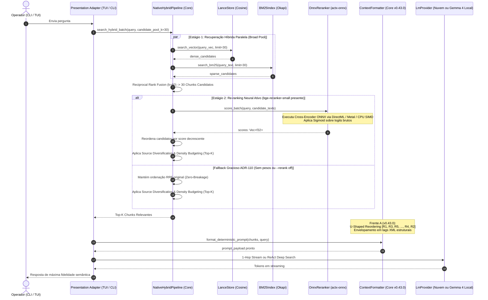

# 📐 Blueprint de Engenharia: AnyContext v0.44.0
## Two-Stage Neural Retrieval com Re-ranking Local (Cross-Encoder ONNX), Aceleração por Hardware e Fallback Gracioso ADR-110 (Frente B)

---

### 1. Metadados & Governança Arquitetural
- **Versão-Alvo**: `v0.44.0` (Sucessora da `v0.43.0`)
- **Fase**: Frente B do Roadmap de RAG de Nova Geração
- **Autor**: LeviGuilherme / Google DeepMind Pair Programming
- **Data**: 2026-10-15
- **Status do Plano**: `active`
- **Plano Anterior Superado**: `anycontext_blueprint_v0430_rag_determinístico_backend_first_u_shaped_reordering_e_isolamento_estrutural_em_xml`
- **Política Global do Produto**: Desenvolvido em Calgary, Alberta, Canadá. 100% global, neutro e desacoplado de especificidades fiscais ou regionais de qualquer país.
- **Padrão Arquitetural**: Arquitetura Hexagonal Estrita (*Ports & Adapters*). Toda regra de pontuação neural, normalização, reordenação de candidatos e fallback reside no Core (`crates/any-context-core-rs`) e no motor neural (`crates/actx-onnx`). As superfícies (CLI, TUI, REST) são meros adaptadores de apresentação.

---

### 2. Contexto do Problema & Objetivos Técnicos

#### 2.1 Problemas Identificados no RAG de 1 Estágio (Bi-Encoder + RRF):
1. **Ausência de Atenção Cruzada nos Bi-Encoders**:
   - A busca densa (LanceDB Cosine) calcula a similaridade vetorial entre o embedding isolado da pergunta e o embedding isolado do chunk. Não há interação bidirecional entre os tokens da pergunta e os tokens do documento no momento da pontuação.
2. **Falsos Positivos do RRF**:
   - O RRF (*Reciprocal Rank Fusion*, $k=60$) combina ordens ordinais de busca densa e BM25 léxico. Chunks com coincidência acidental de termos recebem boost no BM25, enquanto chunks conceituais mais ricos podem ser empurrados para além do Top 5.
3. **Desperdício de Janela de Contexto no LLM**:
   - Para garantir que a resposta não seja perdida, o sistema é obrigado a aumentar o número de chunks injetados, o que dilui a atenção do modelo e amplia a latência.

#### 2.2 Objetivos da Versão v0.44.0 (Frente B):
1. **Recuperação Neural em Dois Estágios (Two-Stage Retrieval)**:
   - **Estágio 1 (Alto Recall / Baixa Latência)**: `NativeHybridPipeline` resgata um pool amplo de candidatos (ex: Top 30 chunks) via LanceDB + BM25 + RRF.
   - **Estágio 2 (Alta Precisão Semântica / Cross-Attention)**: Motor neural `actx-onnx::OnnxReranker` avalia os pares `[CLS] query [SEP] chunk_text [SEP]` simultaneamente, gerando scores de relevância finos via Cross-Encoder com normalização Sigmoid.
2. **Modelo Padrão Leve e Soberano**:
   - `bge-reranker-small` (INT8 quantizado, ~45 MB em disco), oferecendo acurácia SOTA com latência sub-20ms.
3. **Aceleração por Hardware Nativa (ADR-127)**:
   - O reranker conecta-se automaticamente ao `ExecutionDevice` do `actx-onnx`: DirectML (Windows), Metal (macOS), CUDA/Vulkan (Linux) ou CPU SIMD.
4. **Garantia de Não-Quebra com Fallback Transparente (ADR-110)**:
   - Se os pesos do reranker não estiverem baixados em `%LOCALAPPDATA%/actx/models/`, o pipeline mantém a ordenação original do RRF sem gerar erros, sem travar o terminal e com custo $0.00.
5. **Integração Fluida com a Frente A (v0.43.0)**:
   - O Top-K re-ranqueado flui diretamente para o `ContextFormatter`, que aplica o **U-Shaped Reordering** (`[R1, R3, R5, ..., R4, R2]`), o **Isolamento Estrutural em XML** e o **Zero Hallucination Gate**.
6. **Paridade Multi-Superfície & Downloader Assistido**:
   - Flag CLI: `actx --rerank <auto|on|off>`
   - Slash Command TUI: `/rerank <auto|on|off>` com status e latência do último scoring.
   - Badge no Header da TUI: `[Rerank: ⚡ ONNX: bge-small]` ou `[Rerank: ⚡ RRF (Fallback)]`.
   - Download assistido: `actx download reranker`.

---

### 3. Diagrama Arquitetural de Sequência (Two-Stage Retrieval Pipeline)

---

### 4. Matriz de Superfícies & Paridade de Apresentação

| Superfície | Comportamento com `--rerank auto/on` | Comportamento com `--rerank off` ou Sem Pesos | Indicador Visual |
| :--- | :--- | :--- | :--- |
| **CLI Headless (`actx "..."`)** | Executa re-ranking neural de 30 candidatos em <15ms e exibe resposta. | Executa RRF padrão sem chamar inferência de cross-encoder. | Linha de diagnóstico com tempo de scoring neural |
| **TUI Chat Interativo** | Reordenação ativa no backend com badge dinâmico no topo. | Badge indica fallback transparente para RRF ou status desativado. | `[Rerank: ⚡ ONNX: bge-small]` ou `[Rerank: ⚡ RRF (Fallback)]` |
| **Comando `/rerank`** | Exibe tabela com status, modelo ativo, dispositivo (GPU/CPU) e latência do último scoring. | Permite alternar entre `auto`, `on` e `off` em tempo de execução. | Tabela formatada ANSI/Ratatui |
| **Subcomando de Download** | `actx download reranker` baixa e valida o modelo `bge-reranker-small` com pre-flights. | Suporte a `--force` e barra de progresso suave no terminal. | Telemetria de download e verificação SHA256 |

---

### 5. Marcos de Implementação Passo a Passo (M1 a M6)

#### Marco 1: Motor Neural Cross-Encoder no `crates/actx-onnx`
- Criar `crates/actx-onnx/src/reranker.rs`:
  - Struct `OnnxReranker` com sessão ONNX gerenciada via `ModelSession`.
  - Tokenizador simples em Rust (WordPiece / BPE para pares `[CLS] q [SEP] doc [SEP]` com padding e truncation em 512 tokens).
  - Método `pub fn score_batch(&self, query: &str, candidates: &[String]) -> Result<Vec<f32>, String>`.
  - Suporte à seleção de acelerador `ExecutionDevice` (DirectML, Metal, CUDA, CPU SIMD).
  - Detecção segura `pub fn is_neural_active(&self) -> bool` apontando para `%LOCALAPPDATA%/actx/models/bge_reranker_small_int8.onnx`.
- Atualizar `crates/actx-onnx/src/engine.rs` e `src/lib.rs`:
  - Adicionar campo `pub reranker: OnnxReranker` ao `OnnxEngine`.
  - Incluir `"BGE-Reranker-Small (Cross-Encoder)"` no resumo `summary()`.

#### Marco 2: Hook de Two-Stage Retrieval no Core (`crates/any-context-core-rs/src/retrieval/pipeline.rs`)
- Expandir `NativeHybridPipeline`:
  - Método `pub fn rerank_candidates(&self, query: &str, candidates: &mut [HybridSearchResult]) -> Result<(), String>`.
  - Calibração de `candidate_pool_k = 30` no `HybridSearchRequest`.
  - Intercalação do reranking entre o RRF (passo 9) e a diversificação/density budget (passo 10).
  - Normalização de scores para a escala $[0.0, 1.0]$ via Sigmoid: $S = \frac{1}{1 + e^{-logit}}$.
  - Fallback gracioso automático para pontuação RRF original caso o reranker não esteja ativo (ADR-110).

#### Marco 3: Comandos de Rerank e Catálogo de Download no Core
- Atualizar `crates/any-context-core-rs/src/ingestion/model_manager.rs`:
  - Adicionar entrada `ModelCatalogItem` para `reranker` (`bge-reranker-small-int8`, ~45 MB).
  - Pre-flight check validando que o modelo cabe confortavelmente em qualquer máquina com $\ge 4$ GB de RAM.
- Criar despachante do comando `/rerank` em `crates/any-context-core-rs/src/commands/engine.rs` e `models.rs`:
  - Subcomandos `/rerank on`, `/rerank off`, `/rerank auto`, e `/rerank` (status).

#### Marco 4: Adaptação das Superfícies CLI & TUI
- Atualizar `crates/actx-cli/src/cli/args.rs`:
  - Adicionar flag `--rerank <auto|on|off>`.
- Atualizar `crates/actx-cli/src/engine.rs`:
  - Repassar a configuração de rerank para o pipeline e para a execução determinística 1-hop.
- Atualizar `crates/actx-cli/src/tui/app.rs` e `ui.rs`:
  - Adicionar badge dinâmico no cabeçalho superior da TUI: `[Rerank: ⚡ ONNX: bge-small]` ou `[Rerank: ⚡ RRF (Fallback)]`.
  - Registrar `/rerank` no autocomplete e no registry de comandos.

#### Marco 5: Suíte de Testes Automatizados & NFRs
- Testes unitários no `actx-onnx`:
  - `test_reranker_fallback_when_file_missing`: garante que ausência do arquivo não gera panic.
  - `test_reranker_tokenization_pair`: valida demarcação `[CLS] q [SEP] doc [SEP]`.
  - `test_reranker_sigmoid_normalization`: valida que scores caem rigorosamente em $[0.0, 1.0]$.
- Testes unitários no `any-context-core-rs`:
  - `test_two_stage_pipeline_reranking_fallback`: valida que sem pesos o pipeline retorna os chunks ordenados por RRF.
  - `test_rerank_command_dispatch`: valida alternância entre `auto`, `on` e `off`.
- Testes de integração no `actx-cli`:
  - `test_cli_flag_rerank_off`: valida execução headless com `--rerank off`.

#### Marco 6: Dual-Doc, MANUAL_TESTS (Cenário 44) & Release v0.44.0
- Atualizar `README.md` (UserDoc) com a documentação do Re-ranking Neural em 2 estágios, flag `--rerank`, comando `/rerank` e download do modelo.
- Atualizar `TECDOC.md` com o **ADR-129: Arquitetura de Recuperação Neural em Dois Estágios com Cross-Encoder Local (ONNX Runtime) e Fallback Gracioso ADR-110**.
- Prepend do **Cenário 44** em `tests/MANUAL_TESTS.md` sem truncamento dos cenários 1 a 43.
- Bump de versão para `v0.44.0` em todos os crates, commit, push, PR/tag e acompanhamento ininterrupto do CI/CD até a publicação dos 14 binários.

---

### 6. Não-Regressão & Princípios Invioláveis
1. **Zero Quebra de Schemas**: Nenhuma alteração estrutural no LanceDB ou SQLite.
2. **Garantia ADR-110**: Funcionamento 100% garantido e ininterrupto mesmo sem o download do modelo neural (fallback transparente para RRF).
3. **Calgary Global Policy**: 100% agnóstico a regras regionais ou fiscais.
4. **Preservação de Cenários de Teste**: `tests/MANUAL_TESTS.md` mantém todos os 43 cenários anteriores intactos.
