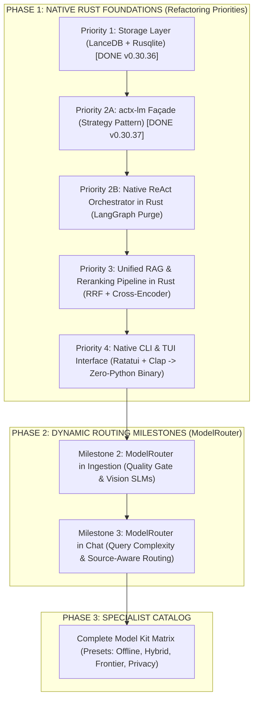

# 🗺️ Integrated Engineering Roadmap (Python -> Rust -> ModelRouter -> Model Kit)

## 📌 Plan Metadata
- **Project**: AnyContext (`actx`)
- **Base Version**: `v0.30.37`
- **Approval Date**: 2026-09-25
- **Status**: Active (`active`)
- **Conversation ID**: `9f488dbf-db54-4ecb-8ed2-b7a6ac1b2372`

---

## 🏛️ Overview and Dependency Diagram

---

## 🧱 PHASE 1: Python -> Rust Refactoring Priorities (Engineering Foundations)

> **Rule**: the engine must be 100% native Rust so that model routing runs with sub-millisecond latency, no GIL contention and no heavy orchestration library dependencies.

### 1.1. Priority 1: Storage Layer and Vector Database in Rust
* **Status**: 🟢 **DONE (`v0.30.36`)**
* **Deliveries**:
  - `NativeLanceStore` (LanceDB + Apache Arrow in an isolated Tokio runtime).
  - `NativeConfigDb` (SQLite through Rusqlite with mandatory WAL, no locks on Windows).
  - PyO3 bindings (`PyLanceStore`, `PyConfigDb`).

### 1.2. Priority 2A: Provider and Model Engine in Rust (`actx-lm`)
* **Status**: 🟢 **DONE (`v0.30.37`)**
* **Deliveries**:
  - Modular crate `crates/actx-lm` with the Strategy (`LmProvider`) and Façade (`LmClient`) patterns.
  - Native support for local SLMs (Ollama, LM Studio) and cloud (OpenAI, Anthropic with Thinking, Gemini, Groq, DeepSeek).
  - Native SSE parser and token-by-token streaming without superfluous allocations.

### 1.3. Priority 2B: ReAct Orchestrator and Agent Loop in Rust (Next Implementation)
* **Status**: 🔴 **TO DO**
* **What to do**:
  1. **LangGraph/LangChain Purge**: replace the Python ReAct graph with a native finite state machine (FSM) in Rust.
  2. **Native ReAct Reasoning Cycle**: `Thought` -> `Action (Tool Call)` -> `Observation (Tool Result)` -> `Final Answer`.
  3. **Direct Tool Invocation**: connect the orchestrator directly to the tools (`search_db`, `/sync`, file inspection) without crossing the Python bridge.
  4. **Anti-Recursion Protection**: strict, deterministic turn ceiling (permanently removing the `Recursion limit of 50 reached` error).

### 1.4. Priority 3: Native RAG and Reranking Pipeline in Rust
* **Status**: 🔴 **TO DO**
* **What to do**:
  1. **Zero-Copy In-Memory Fusion**: run the dense vector search (`NativeLanceStore`) and the sparse lexical search (`bm25.rs`) inside the same Rust process.
  2. **RRF & Cross-Encoder Reranker in Rust**: SIMD optimization for Reciprocal Rank Fusion without marshalling data to Python.
  3. **Integrated Context Density Budgeting**: smart truncation and source-fair round-robin working directly in memory before handing the tokens to `actx-lm`.

### 1.5. Priority 4: 100% Native CLI & TUI Interface (Single Binary)
* **Status**: 🔴 **TO DO**
* **What to do**:
  1. **Native Terminal CLI**: interface built with `clap` (flag parsing) and `ratatui` + `crossterm` (fast interactive TUI).
  2. **Removal of the Python Runtime from the Distribution**: AnyContext ships as a single static executable (`actx.exe` / `actx`), using under 40MB of RAM and starting in `< 10ms`.

---

## 🎯 PHASE 2: The Dynamic Routing Milestones (`ModelRouter`)

> With the Core and `actx-lm` running natively in Rust, we implement routing intelligence in Ingestion and Inference.

### 2.1. Milestone 2: `ModelRouter` in Ingestion (Specialist SLMs & Quality Gate)
* **Status**: 🟡 **TO DO (foundations ready)**
* **What to do**:
  1. **`IngestionModelRouter` Module (`crates/any-context-core-rs/src/ingestion/router.rs`)**:
     - Evaluates the confidence of the 2D extraction from `pdf.rs`.
  2. **Structure Quality Gate**:
     - *Level 1 (Text/2D Geometry)*: success -> direct indexing.
     - *Level 2 (Tesseract OCR)*: sparse but purely alphanumeric text -> fast OCR.
     - *Level 3 (Specialist Vision SLM)*: distorted form, visual diagram, borderless table or scanned receipt -> routed to a local vision model through `actx-lm` (*Qwen2-VL*, *MiniCPM-V* or *Llama-3.2-Vision* on Ollama/LM Studio).
  3. **Structured Conversion to Markdown**: the vision SLM extracts the table as standardized Markdown before vectorization in LanceDB.

### 2.2. Milestone 3: `ModelRouter` in Chat (Dynamic Query & Source-Aware Routing)
* **Status**: 🔴 **TO DO**
* **What to do**:
  1. **Query Complexity Classifier**:
     - Syntactic and semantic analysis of the user's query:
       - *Light Tier (Simple/Factual Queries)*: routed to a **Local SLM (0 tokens, zero cost, latency < 200ms)** or Groq.
       - *Heavy Tier (Cross Analysis, Multi-Document Synthesis)*: routed to a **Frontier LLM** (Claude 3.7 Sonnet with Thinking, GPT-4o, Gemini 2.5 Pro).
  2. **Source-Aware Routing**:
     - The `ModelRouter` inspects the metadata of the chunks retrieved by RAG:
       - Code chunks (`Rust`, `Python`, `Go`, `TypeScript`) -> routed to a code specialist model (e.g. *Qwen 2.5 Coder* or *Claude*).
       - Financial and accounting chunks (`CSV`, `OFX`, balance sheets) -> routed to a model with high mathematical precision.
       - General / conversational chunks -> routed to a general model.
  3. **User Policy Configuration (`/model-router`)**:
     - Modes: `Eco` (maximum local SLM), `Balanced` (SLM for simple, LLM for complex), `Quality` (always Frontier).

---

## 🗃️ PHASE 3: The Complete "Model Kit" Matrix (Curated Catalog & Presets)

> The **Complete Model Kit Matrix** defines the specialized roles for each model size and profile, letting the user choose or switch between preconfigured execution profiles.

### 3.1. The Specialist Matrix (Model Layers)

| Role / Layer | Recommended Local Models (SLM) | Recommended Cloud Models (LLM) |
| :--- | :--- | :--- |
| **1. Triage & Routing** | Qwen 2.5 1.5B / Llama 3.2 1B | Groq (Llama 3.3 70B) / Claude 3.5 Haiku |
| **2. Ingestion & Vision (OCR)** | Qwen2-VL 7B / MiniCPM-V 2.6 8B | GPT-4o-mini / Gemini 2.0 Flash |
| **3. Code Specialist** | Qwen 2.5 Coder 7B / 14B | Claude 3.7 Sonnet / DeepSeek V3 |
| **4. Vector Embeddings** | BGE-m3 / Nomic-Embed-Text | OpenAI text-embedding-3-small / Gemini |
| **5. Chat & RAG Reasoning** | Llama 3.2 3B / Qwen 2.5 7B | Claude 3.7 Sonnet (Thinking) / GPT-4o |
| **6. Deep Reasoning** | DeepSeek R1 7B / 8B (Distill) | DeepSeek R1 / OpenAI o3-mini / Gemini 2.5 |

### 3.2. The Four Official "Model Kit" Presets

The user can switch between "Kits" with a single command (e.g. `/kit <name>`):

1. 💻 **`Offline-Local-Free` Preset (100% Free & On-Device through Ollama/LM Studio)**:
   - **Triage**: Qwen 2.5 1.5B
   - **General Chat**: Llama 3.2 3B
   - **Code**: Qwen 2.5 Coder 7B
   - **Vision**: MiniCPM-V or Qwen2-VL 2B
   - **Embedding**: local Nomic-Embed-Text
   - **Benefit**: zero API cost, 100% private, runs without internet on modern laptops.

2. ⚡ **`Hybrid-Balanced` Preset (Best Cost/Benefit)**:
   - **Triage & Quick Questions**: local SLM or Groq (very fast).
   - **Complex Questions & Synthesis**: Claude 3.7 Sonnet or GPT-4o.
   - **Vision**: Gemini 2.0 Flash.
   - **Benefit**: cuts cloud token cost by up to 80% while keeping maximum quality when needed.

3. 👑 **`Maximum-Frontier` Preset (Absolute Quality)**:
   - **Chat & Synthesis**: Claude 3.7 Sonnet with Extended Thinking.
   - **Mathematical/Logical Reasoning**: DeepSeek R1 / OpenAI o3-mini.
   - **Code**: Claude 3.7 Sonnet.
   - **Benefit**: surgical precision for financial audits and critical contracts.

4. 🛡️ **`Enterprise-Privacy` Preset (Corporate Isolation)**:
   - Models hosted on secure local servers or dedicated instances (Azure OpenAI / private vLLM).
